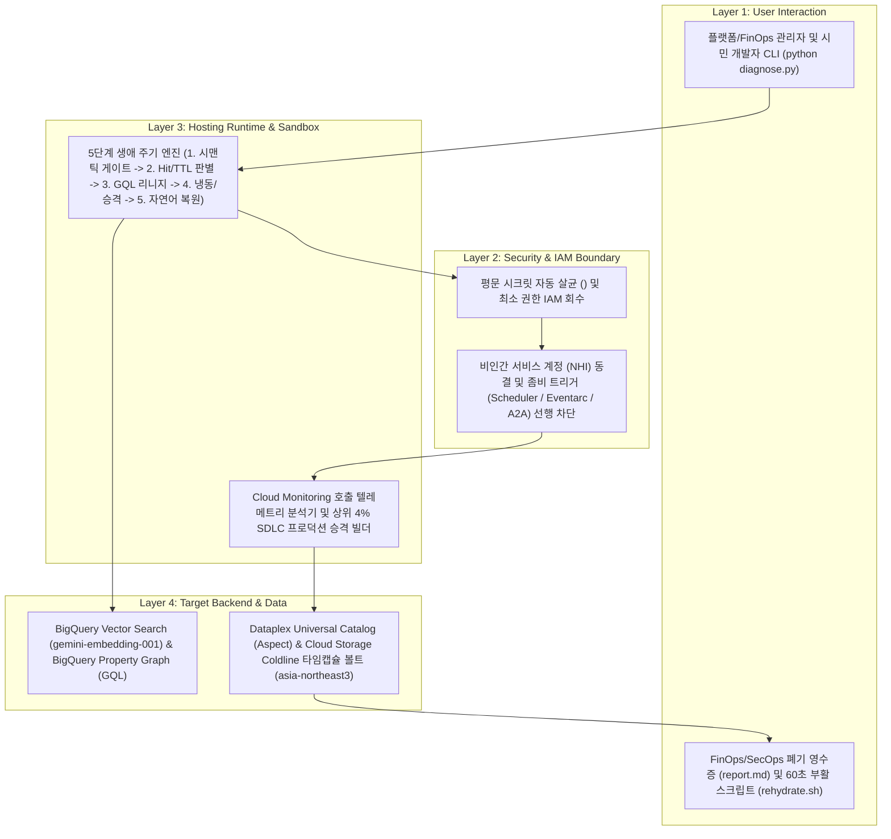

# [Skill] app-lifecycle-manager

> **목적**: 현업 바이브 코딩 및 노코드 빌더로 생성된 사내 AI 앱 인벤토리의 시맨틱 중복 생성 방지, 호출 수(`Hit-Count`) 및 보존 기한(`TTL`) 파레토 분류, `BigQuery Graph`(`GQL`) 멀티홉 블라스트 반경 검증, `Cloud Storage Coldline` 냉동 타임캡슐 동결(`rehydrate.sh`) 및 FinOps/SecOps 순 절감액 리포트(`report.md`) 생성을 자동화한다.
> **원본 샘플 경로**: `samples/app-lifecycle-manager/`

---

## 0. 아키텍처 및 처리 흐름 (Architecture & Workflow)



---

## 1. 3단계 실행 워크플로우 (예습 -> 실습 -> 복습)

### Step 1: 사전 예습 (Dry-Run 시뮬레이션)
GCP 과금이나 리소스 변경 없이 내장된 7개 사내 앱 인벤토리(96% 1회성 앱 대 4% 핵심 안착 앱)와 멀티홉 리니지 시드 데이터로 5단계 거버넌스 파이프라인을 즉시 검증한다:

```bash
python3 samples/app-lifecycle-manager/diagnose.py --dry-run
```

### Step 2: 본 실습 (중복 생성 검사, 자연어 복원 검색 및 실환경 스캔)
1. **개발 착수 전 시맨틱 중복 생성 방지 게이트(`--check-duplicate`)**:
   ```bash
   python3 samples/app-lifecycle-manager/diagnose.py --dry-run \
     --check-duplicate "재무팀 법인세 예규 및 조세심판원 판례 검색 웹앱"
   ```
2. **냉동 보관된 앱 자연어 복원 검색(`--restore-query`)**:
   ```bash
   python3 samples/app-lifecycle-manager/diagnose.py --dry-run \
     --restore-query "조세심판원 법인세 판례 검색 웹앱"
   ```
3. **사내 GCP 프로젝트 실시간 스캔**:
   ```bash
   python3 samples/app-lifecycle-manager/diagnose.py --project YOUR_PROJECT_ID --region asia-northeast3
   ```

### Step 3: 사후 복습 및 FinOps/SecOps 영수증 활용
실행 직후 생성된 `samples/app-lifecycle-manager/report.md` 파일을 열어 회수된 월간/연간 순 컴퓨트 절감액(월 `$245.42`, 연간 `$2,945.04`), 업스트림 좀비 트리거 차단 명령어, 냉동 앱별 60초 원클릭 부활 명령어(`rehydrate.sh`), 상위 4% 앱 프로덕션 승격 체크리스트를 확인한다.

> [!IMPORTANT]
> **실습 환경 보존 및 자동 정리(Teardown) 금지 원칙**:
> 에이전트는 사용자의 명시적 승인 없이 `Cloud Run` 서비스, `Cloud Storage` 버킷, `BigQuery` 데이터셋을 임의로 삭제하지 않는다.
