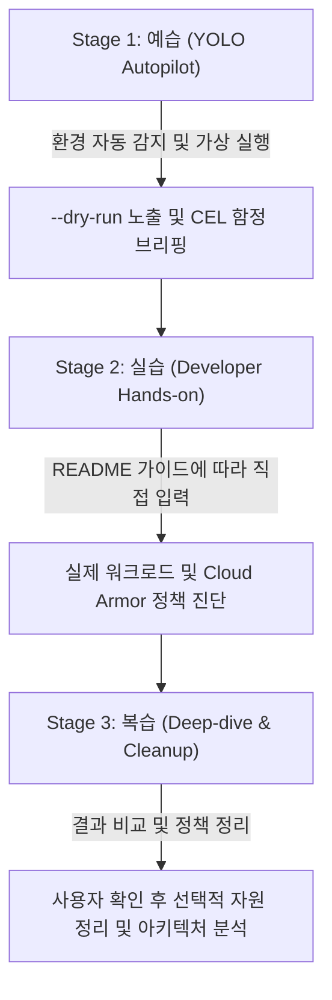

<!--
Copyright 2026 Google LLC. All Rights Reserved.
SPDX-License-Identifier: Apache-2.0

NOTICE: This code/repository is owned by Google LLC and provided under the Apache-2.0 License.
It is strictly provided as an EXAMPLE/REFERENCE ONLY and is NOT INTENDED FOR PRODUCTION USE.
All contents, designs, and code examples are subject to change, modification, or removal at any time without notice.

[고지 사항] 본 저장소 및 문서는 구글 (Google LLC) 소유이며 Apache 2.0 라이선스 하에 예시 (Sample) 용도로 제공된다.
프로덕션 환경용이 아니며, 사전 통지 없이 언제든지 수정, 변경 또는 삭제될 수 있다.
-->

> [!IMPORTANT]
> **구글 (Google LLC) 참조용 샘플 고지 사항**:
> 본 프로젝트의 모든 소스 코드와 문서는 Google LLC의 소유이며, Apache-2.0 라이선스에 따라 오직 **참조용 샘플 (Sample / Reference Only)** 목적으로만 제공된다. 프로덕션 환경에 그대로 사용할 수 없으며, 사전 통지 없이 언제든 내용이 수정, 변경 또는 삭제될 수 있다.

---
name: cloud-armor-java4shell-guard
description: >-
  Autopilot, hands-on diagnostics, and self-healing for cloud-armor-java4shell-guard: OpenJDK 17.0.6+ AVX-512 VBMI 취약점(CVE-2026-114938, Java4Shell)에 노출된 Compute Engine, GKE, Cloud Run 워크로드를 식별하고, Cloud Armor Custom CEL 기반 가상 패치 규칙과 실환경 4대 설정 함정을 1분 만에 교차 진단하는 도구다.
---

# Cloud Armor 기반 Java4Shell (CVE-2026-114938) 가상 패치 및 노출 진단기 (Autopilot & Hands-on Guide)

본 스킬은 사내 엔지니어와 실무자가 `cloud-armor-java4shell-guard` 미니 프로젝트를 **"예습(YOLO 자율 주행) -> 실습(단계별 핸즈온) -> 복습(심화 검증 및 리소스 정리)"** 3단계 학습 사이클로 완주할 수 있도록 지원하는 실행 가이드다. (As of 2026-11-18)

**Audience**: `#Architect`, `#Developer`, `#SecOps`  
**Concern**: `#Compliance`, `#Resilience`, `#Security`  
**Service**: `#CloudArmor`, `#CloudRun`, `#ComputeEngine`, `#GKE`

---

## 1. 3단계 학습 워크플로우 한눈에 보기



---

## 2. Stage 1: 예습 (YOLO Autopilot 모드)

사내 개발자가 "이 미니 프로젝트 욜로 모드로 먼저 시연해 줘"라고 요청할 때 에이전트가 수행하는 자율 실행 절차다.

### Step 1.1 환경 자동 감지 및 설정 세팅 (Pre-flight)
1. 현재 활성화된 gcloud 프로젝트 및 기본 리전을 확인한다:
   ```bash
   gcloud config get-value project
   gcloud config get-value compute/region
   ```
2. `samples/cloud-armor-java4shell-guard/.env.example`을 참조하여 `samples/cloud-armor-java4shell-guard/.env` 파일이 없을 경우 자동 생성하고, 감지된 프로젝트 ID와 리전으로 기본 세팅을 구성한다.
3. 실행에 필요한 최소 IAM 권한(`roles/compute.viewer, roles/container.viewer, roles/run.viewer, roles/logging.viewer`) 충족 여부를 안내한다.
4. 사내 FinOps 거버넌스 및 자원 추적을 위해 테스트용 Cloud Armor 리소스 생성 시 4대 필수 표준 라벨(`--labels=managed-by=google-cloud-0-to-1,scenario=cloud-armor-java4shell-guard,env=sample,created-by=customer-engineer`)을 누락 없이 주입해야 함을 설명한다.

### Step 1.2 가상 모의 실행 및 아키텍처 브리핑 (Smoke Test)
실제 클라우드 비용이나 정책 변경 없이 1초 만에 전체 실행 흐름과 예상 진단 리포트를 화면에 출력한다:
```bash
cd samples/cloud-armor-java4shell-guard
python diagnose.py --dry-run
```

---

## 3. Stage 2: 실습 (Developer Hands-on 단계)

예습을 통해 전체 흐름을 파악한 사내 개발자가 콘솔과 터미널에서 직접 명령어를 수행하는 본 실습 단계다.

### Step 2.1 저장소 이동 및 환경 설정
```bash
cd samples/cloud-armor-java4shell-guard
python diagnose.py --config
```

### Step 2.2 실환경 읽기 전용 진단 실행
```bash
python diagnose.py
```

---

## 4. Stage 3: 복습 (Deep-dive 및 자원 정리)

> [!IMPORTANT]
> **실습 환경 보존 원칙**: 본 진단 도구는 사내 인프라를 읽기 전용으로만 점검하며 Cloud Armor 정책이나 백엔드 리소스를 임의로 변경, 삭제하지 않는다. 테스트용 정책 정리는 사용자가 OpenJDK 패치 및 검증 완료를 확인한 뒤 수동으로 수행한다.

1. 생성된 `report.md`에서 AVX-512 VBMI 노출 워크로드와 `base64Decode() == ''` 우회, `.urlDecode()` 오탐, Form 미분리 검출 여부를 검토한다.
2. 테스트용 정책을 수동 정리할 때는 Backend Service 연결을 먼저 해제한 뒤 정책을 삭제한다.
