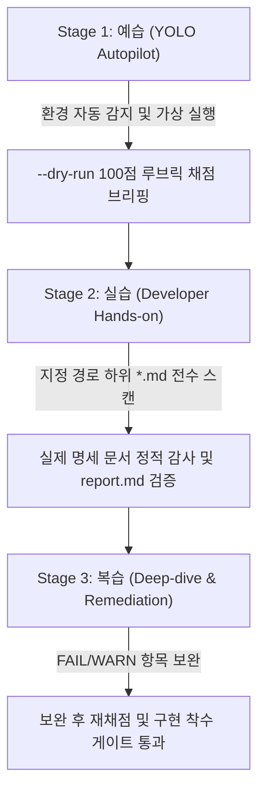

<!--
Copyright 2026 Google LLC. All Rights Reserved.
SPDX-License-Identifier: Apache-2.0

NOTICE: This code/repository is owned by Google LLC and provided under the Apache-2.0 License.
It is strictly provided as an EXAMPLE/REFERENCE ONLY and is NOT INTENDED FOR PRODUCTION USE.
All contents, designs, and code examples are subject to change, modification, or removal at any time without notice.

[고지 사항] 본 저장소 및 문서는 구글 (Google LLC) 소유이며 Apache 2.0 라이선스 하에 예시 (Sample) 용도로 제공된다.
프로덕션 환경용이 아니며, 사전 통지 없이 언제든지 수정, 변경 또는 삭제될 수 있다.
-->

> [!IMPORTANT]
> **구글 (Google LLC) 참조용 샘플 고지 사항**:
> 본 프로젝트의 모든 소스 코드와 문서는 Google LLC의 소유이며, Apache-2.0 라이선스에 따라 오직 **참조용 샘플 (Sample / Reference Only)** 목적으로만 제공된다. 프로덕션 환경에 그대로 사용할 수 없으며, 사전 통지 없이 언제든 내용이 수정, 변경 또는 삭제될 수 있다.

---
name: gcp-waf-linter
description: >-
  Autopilot, hands-on diagnostics, and self-healing for gcp-waf-linter: AI 에이전트 기반 Spec-Driven Development 환경에서 작성된 지정 경로 하위 모든 마크다운(*.md) 명세 문서를 파일명 제약 없이 대상으로 삼아 Google Cloud Well-Architected Framework(WAF) 7대 아키텍처 차원, 명세 내부 논리 모순 교차 검증 및 가독성/모호어까지 25개 항목 100점 만점 루브릭으로 자동 채점하는 정적 린터다.
---

# Google Cloud Well-Architected Framework(WAF) 명세 린터 (Autopilot & Hands-on Guide)

본 스킬은 사내 엔지니어와 실무자가 `gcp-waf-linter` 미니 프로젝트를 **"예습(YOLO 자율 주행) -> 실습(단계별 핸즈온) -> 복습(심화 검증 및 보완)"** 3단계 학습 사이클로 완주할 수 있도록 지원하는 실행 가이드다. (As of 2026-11-19)

**Audience**: `#Architect`, `#Developer`, `#FinOps`, `#SecOps`  
**Concern**: `#Architecture`, `#Governance`, `#Security`  
**Service**: `#CloudKMS`, `#CloudLogging`, `#CloudTrace`, `#ModelArmor`

---

## 1. 3단계 학습 워크플로우 한눈에 보기



---

## 2. Stage 1: 예습 (YOLO Autopilot 모드)

사내 개발자가 "이 미니 프로젝트 욜로 모드로 먼저 시연해 줘"라고 요청할 때 에이전트가 수행하는 자율 실행 절차다.

### Step 1.1 환경 자동 감지 및 설정 세팅 (Pre-flight)
1. 현재 활성화된 gcloud 프로젝트를 확인한다 (`gcloud config get-value project`).
2. `samples/gcp-waf-linter/.env.example`을 참조하여 `.env` 파일이 없을 경우 자동 생성한다.
3. 본 도구는 로컬 마크다운 명세 문서를 정적 분석하므로 별도의 GCP IAM 쓰기/읽기 권한이나 과금 없이 동작함을 안내한다.
4. 설계서 내 GCP 리소스 택소노미 검사 시 4대 필수 표준 라벨(`--labels=managed-by=google-cloud-0-to-1,scenario=gcp-waf-linter,env=sample,created-by=customer-engineer`)이 반영되어야 함을 설명한다.

### Step 1.2 가상 모의 실행 및 아키텍처 브리핑 (Smoke Test)
```bash
cd samples/gcp-waf-linter
python diagnose.py --dry-run
```

---

## 3. Stage 2: 실습 (Developer Hands-on 단계)

예습을 통해 전체 흐름을 파악한 사내 개발자가 실제 프로젝트의 지정 경로 하위 모든 마크다운(`*.md`) 명세 문서를 파일명 제약 없이 일괄 대상으로 삼아 루브릭 채점을 수행하는 단계다.

### Step 2.1 환경 설정 및 평가 실행
```bash
cd samples/gcp-waf-linter
python diagnose.py --config
python diagnose.py
```

---

## 4. Stage 3: 복습 (Deep-dive 및 보완)

> [!IMPORTANT]
> **비파괴 정적 감사 원칙**: 본 도구는 입력 문서를 읽기 전용으로만 분석하며 클라우드 리소스를 생성, 변경, 삭제하지 않는다.

1. `report.md`에서 `FAIL` 및 `WARN`으로 검출된 고아 요구 사항(`R-01`), 읽기 전용 Agent 경계(`R-02`), 미태깅 추정치(`R-04`), 양방향 PII 마스킹(`R-08`), 4대 라벨링(`R-17`), 내부 논리 모순(`R-22`), 가독성 및 모호어(`R-23`~`R-24`), 최신 Google Cloud 서비스/모델/SDK 업그레이드(`R-25`)를 보완한 뒤 재평가한다.
