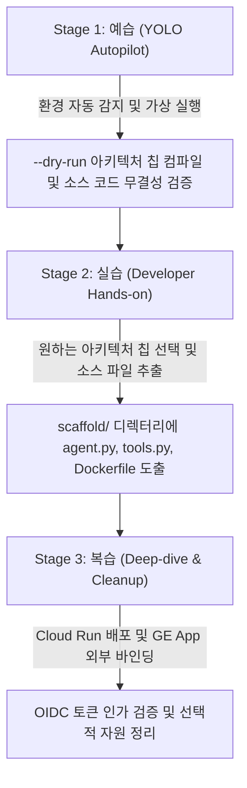

<!--
Copyright 2026 Google LLC. All Rights Reserved.
SPDX-License-Identifier: Apache-2.0

NOTICE: This code/repository is owned by Google LLC and provided under the Apache-2.0 License.
It is strictly provided as an EXAMPLE/REFERENCE ONLY and is NOT INTENDED FOR PRODUCTION USE.
All contents, designs, and code examples are subject to change, modification, or removal at any time without notice.

[고지 사항] 본 저장소 및 문서는 구글 (Google LLC) 소유이며 Apache 2.0 라이선스 하에 예시 (Sample) 용도로 제공된다.
프로덕션 환경용이 아니며, 사전 통지 없이 언제든지 수정, 변경 또는 삭제될 수 있다.
-->

> [!IMPORTANT]
> **구글 (Google LLC) 참조용 샘플 고지 사항**:
> 본 프로젝트의 모든 소스 코드와 문서는 Google LLC의 소유이며, Apache-2.0 라이선스에 따라 오직 **참조용 샘플 (Sample / Reference Only)** 목적으로만 제공된다. 프로덕션 환경에 그대로 사용할 수 없으며, 사전 통지 없이 언제든 내용이 수정, 변경 또는 삭제될 수 있다.

---
name: gemini-enterprise-agent-factory-custom
description: >-
  Autopilot, hands-on diagnostics, and self-healing for gemini-enterprise-agent-factory-custom: 사내 BigQuery, ERP, 모니터링 시스템 등 복잡한 기업 기간계 자산을 결합한 High-code 커스텀 에이전트(GEAP / Cloud Run)를 원클릭 스캐폴딩하고 GE App에 외부 에이전트로 연동하는 도구다.
---

# Gemini Enterprise 커스텀 에이전트 스캐폴더 및 GE App 연동기 (`gemini-enterprise-agent-factory-custom`) (Autopilot & Hands-on Guide)

본 스킬은 사내 클라우드 아키텍트와 백엔드 엔지니어가 `gemini-enterprise-agent-factory-custom` 미니 프로젝트를 **"예습(YOLO 자율 주행) -> 실습(단계별 핸즈온) -> 복습(심화 검증 및 리소스 정리)"** 3단계 학습 사이클로 완주할 수 있도록 지원하는 실행 가이드다.

**Audience**: `#Architect`, `#Developer`  
**Concern**: `#Architecture`, `#Performance`, `#Security`  
**Service**: `#AgentPlatform`, `#CloudRun`, `#VertexAI`  

---

## 1. 3단계 학습 워크플로우 한눈에 보기



---

## 2. Stage 1: 예습 (YOLO Autopilot 모드)

고객사 아키텍트가 "이 미니 프로젝트 욜로 모드로 먼저 시연해 줘"라고 요청할 때 에이전트가 수행하는 자율 실행 절차다.

### Step 1.1 환경 자동 감지 및 설정 세팅 (Pre-flight)
```bash
cd samples/gemini-enterprise-agent-factory-custom
python diagnose.py --dry-run
```

### Step 1.2 아키텍처 및 자가 검증 브리핑
실행 완료 후 생성된 `report.md`를 바탕으로 다음 3가지를 명확히 보고한다:
1. **아키텍처 스택**: FastAPI + Vertex AI SDK + BigQuery/MCP 연동 구성
2. **생성된 하이코드 산출물**: `agent.py`, `tools.py`, `Dockerfile`, `deploy.sh` 4대 파일
3. **GE App 외부 에이전트 연동 매니페스트**: OIDC 토큰 기반 엔드포인트 바인딩 스키마

---

## 3. Stage 2: 실습 (Developer Hands-on 모드)

참가자가 직접 원하는 아키텍처 칩을 선택하고 로컬에 소스 코드를 추출해 보는 단계다.

### Step 2.1 아키텍처 칩 지정 실습
원하는 칩 번호를 지정하여 가상 실행한다:
```bash
# 5번 Model Context Protocol(MCP) 게이트웨이 에이전트 검증
python diagnose.py --dry-run --chip 5

# 2번 Cloud Logging & Monitoring SRE 장애 분석 에이전트 검증
python diagnose.py --dry-run --chip 2
```

### Step 2.2 실제 소스 코드 디스크 추출 실습
```bash
python diagnose.py --write-files
ls -la scaffold/
```

---

## 4. Stage 3: 복습 (Deep-dive & Cleanup 모드)

### Step 3.1 Cloud Run 배포 집행 (선택 사항)
실제 사내 GCP 프로젝트에 컨테이너를 배포하고자 할 경우 수행한다:
```bash
cd scaffold
bash deploy.sh
```

### Step 3.2 자원 정리 (Teardown)
실습 후 생성된 자원을 정리할 때:
```bash
gcloud run services delete bq-analytics-agent --region=asia-northeast3 --quiet
gcloud iam service-accounts delete custom-agent-sa@${PROJECT_ID}.iam.gserviceaccount.com --quiet
```

---

## 5. 트러블슈팅 및 자가 치유 (Troubleshooting & Self-Healing)

1. **Cloud Run 인보커 권한 거부 (403 Forbidden)**:
   - 증상: GE App에서 외부 에이전트 호출 시 403 인증 실패 발생.
   - 자가 치유: GE App 호출 서비스 계정에 `roles/run.invoker` 역할을 부여한다:
     ```bash
     gcloud run services add-iam-policy-binding ${SERVICE_NAME} \
         --region=asia-northeast3 \
         --member="serviceAccount:${GE_APP_CALLER_SA}" \
         --role="roles/run.invoker"
     ```
2. **BigQuery 데이터셋 접근 권한 누락**:
   - 증상: `tools.py` 내 `query_bigquery_sql` 실행 시 Access Denied 발생.
   - 자가 치유: 커스텀 에이전트 실행 서비스 계정에 `roles/bigquery.dataViewer` 및 `roles/bigquery.jobUser` 역할을 부여한다.
