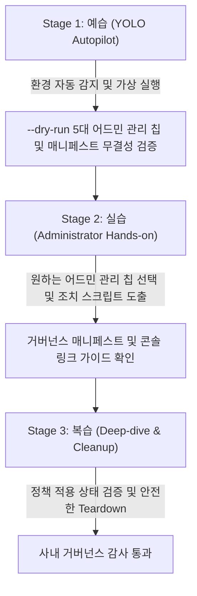

<!--
Copyright 2026 Google LLC. All Rights Reserved.
SPDX-License-Identifier: Apache-2.0

NOTICE: This code/repository is owned by Google LLC and provided under the Apache-2.0 License.
It is strictly provided as an EXAMPLE/REFERENCE ONLY and is NOT INTENDED FOR PRODUCTION USE.
All contents, designs, and code examples are subject to change, modification, or removal at any time without notice.

[고지 사항] 본 저장소 및 문서는 구글 (Google LLC) 소유이며 Apache 2.0 라이선스 하에 예시 (Sample) 용도로 제공된다.
프로덕션 환경용이 아니며, 사전 통지 없이 언제든지 수정, 변경 또는 삭제될 수 있다.
-->

> [!IMPORTANT]
> **구글 (Google LLC) 참조용 샘플 고지 사항**:
> 본 프로젝트의 모든 소스 코드와 문서는 Google LLC의 소유이며, Apache-2.0 라이선스에 따라 오직 **참조용 샘플 (Sample / Reference Only)** 목적으로만 제공된다. 프로덕션 환경에 그대로 사용할 수 없으며, 사전 통지 없이 언제든 내용이 수정, 변경 또는 삭제될 수 있다.

---
name: gemini-enterprise-copilot-admin
description: >-
  Autopilot, hands-on diagnostics, and self-healing for gemini-enterprise-copilot-admin: 사내 IT 어드민 및 인프라 팀을 위해 도메인 선점 충돌, 외부 마켓플레이스 차단 거버넌스, 유휴 라이선스 회수, Overage 과금 방어, 사내망 FQDN 허용 등 5대 관리 과제를 대화형으로 자율 진단하고 조치 가이드를 제공하는 도구다.
---

# Gemini Enterprise 어드민 코파일럿 (`gemini-enterprise-copilot-admin`) (Autopilot & Hands-on Guide)

본 스킬은 사내 클라우드 아키텍트와 IT 어드민이 `gemini-enterprise-copilot-admin` 미니 프로젝트를 **"예습(YOLO 자율 주행) -> 실습(단계별 핸즈온) -> 복습(심화 검증 및 리소스 정리)"** 3단계 학습 사이클로 완주할 수 있도록 지원하는 실행 가이드다.

**Audience**: `#Architect`, `#FinOps`, `#SecOps`  
**Concern**: `#Billing`, `#Compliance`, `#Security`  
**Service**: `#AgentPlatform`, `#BigQuery`, `#CloudMonitoring`  

---

## 1. 3단계 학습 워크플로우 한눈에 보기



---

## 2. Stage 1: 예습 (YOLO Autopilot 모드)

고객사 아키텍트가 "어드민 코파일럿 욜로 모드로 먼저 시연해 줘"라고 요청할 때 에이전트가 수행하는 자율 실행 절차다.

### Step 1.1 환경 자동 감지 및 설정 세팅 (Pre-flight)
1. 현재 활성화된 gcloud 프로젝트 및 실행 서비스 계정 환경을 확인한다.
2. 사내 거버넌스 및 자원 추적을 위한 4대 필수 표준 라벨링(`managed-by=google-cloud-0-to-1`, `scenario=gemini-enterprise-copilot-admin`, `env=sample`, `created-by=customer-engineer`) 규약을 고지한다.
```bash
cd samples/gemini-enterprise-copilot-admin
python diagnose.py --dry-run
```

### Step 1.2 아키텍처 및 자가 검증 브리핑
실행 완료 후 생성된 `report.md`를 바탕으로 다음 3가지를 명확히 보고한다:
1. **5대 어드민 관리 과제**: 도메인 온보딩, 마켓플레이스 차단, 라이선스 회수, Overage 방어, FQDN 진단
2. **거버넌스 매니페스트**: Discovery Engine 공유 및 마켓플레이스 비활성화 규격
3. **즉시 조치 스크립트**: DNS TXT, BigQuery SQL 및 gcloud 관리자 명령어

---

## 3. Stage 2: 실습 (Administrator Hands-on 모드)

IT 어드민이 특정 관리 이슈에 맞추어 칩을 선택하고 가이드를 도출하는 절차다.

### Step 2.1 5대 관리 칩 선택 실행
```bash
# 1번 도메인 선점 충돌 및 Cloud Identity 온보딩
python diagnose.py --dry-run --chip 1

# 2번 외부 마켓플레이스 차단 및 사내 승인 에이전트 통제
python diagnose.py --dry-run --chip 2

# 3번 부서별 라이선스 채택률 분석 및 30일 유휴 라이선스 회수
python diagnose.py --dry-run --chip 3

# 4번 Overage 추가 과금 방어 및 AI Studio 키 차단
python diagnose.py --dry-run --chip 4

# 5번 사내망 프록시 허용용 Exact 15대 코어 FQDN 진단
python diagnose.py --dry-run --chip 5

# 6번 수백 개 에이전트 전수 감사 및 좀비 에이전트 식별 (BigQuery 쿼리 팩)
python diagnose.py --dry-run --chip 6

# 7번 Cloud Logging to BigQuery 30초 원클릭 감사 로그 싱크 구축 & GCP 콘솔 길잡이
python diagnose.py --dry-run --chip 7
```

---

## 4. Stage 3: 복습 (Deep-dive & Teardown 모드)

실습 완료 후 임시 DNS 레코드나 서비스 계정을 정리하는 가이드다.

```bash
# 임시 서비스 계정 정리
gcloud iam service-accounts delete "ge-admin-sa@${PROJECT_ID}.iam.gserviceaccount.com" --project="${PROJECT_ID}" --quiet
```
