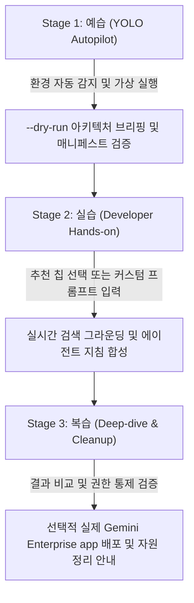

<!--
Copyright 2026 Google LLC. All Rights Reserved.
SPDX-License-Identifier: Apache-2.0

NOTICE: This code/repository is owned by Google LLC and provided under the Apache-2.0 License.
It is strictly provided as an EXAMPLE/REFERENCE ONLY and is NOT INTENDED FOR PRODUCTION USE.
All contents, designs, and code examples are subject to change, modification, or removal at any time without notice.

[고지 사항] 본 저장소 및 문서는 구글 (Google LLC) 소유이며 Apache 2.0 라이선스 하에 예시 (Sample) 용도로 제공된다.
프로덕션 환경용이 아니며, 사전 통지 없이 언제든지 수정, 변경 또는 삭제될 수 있다.
-->

> [!IMPORTANT]
> **구글 (Google LLC) 참조용 샘플 고지 사항**:
> 본 프로젝트의 모든 소스 코드와 문서는 Google LLC의 소유이며, Apache-2.0 라이선스에 따라 오직 **참조용 샘플 (Sample / Reference Only)** 목적으로만 제공된다. 프로덕션 환경에 그대로 사용할 수 없으며, 사전 통지 없이 언제든 내용이 수정, 변경 또는 삭제될 수 있다.

---
name: gemini-enterprise-copilot-agent
description: >-
  Autopilot, hands-on diagnostics, and self-healing for gemini-enterprise-copilot-agent: Gemini Enterprise app 환경에서 비개발자 임직원이 대화형 인터뷰와 추천 칩으로 노코드 에이전트를 자율 생성하고 대행 서비스 계정으로 안전하게 등록하는 자율형 사내 에이전트 팩토리 도구다.
---

# Gemini Enterprise 자율형 사내 노코드 에이전트 팩토리 (`gemini-enterprise-copilot-agent`) (Autopilot & Hands-on Guide)

본 스킬은 사내 엔지니어와 실무자가 `gemini-enterprise-copilot-agent` 미니 프로젝트를 **"예습(YOLO 자율 주행) -> 실습(단계별 핸즈온) -> 복습(심화 검증 및 리소스 정리)"** 3단계 학습 사이클로 완주할 수 있도록 지원하는 실행 가이드다.

**Audience**: `#Architect`, `#Developer`, `#FinOps`, `#SecOps`  
**Concern**: `#Compliance`, `#IAM`, `#Security`  
**Service**: `#AgentPlatform`, `#GeminiAPI`  

---

## 1. 3단계 학습 워크플로우 한눈에 보기



---

## 2. Stage 1: 예습 (YOLO Autopilot 모드)

고객 개발자나 실무자가 "이 미니 프로젝트 욜로 모드로 먼저 시연해 줘"라고 요청할 때 에이전트가 수행하는 자율 실행 절차다.

### Step 1.1 환경 자동 감지 및 설정 세팅 (Pre-flight)
```bash
cd samples/gemini-enterprise-copilot-agent
python diagnose.py --dry-run
```

### Step 1.2 아키텍처 및 자가 검증 브리핑
실행 완료 후 생성된 `report.md`를 바탕으로 다음 3가지를 명확히 보고한다:
1. **대행 서비스 계정 권한**: `roles/discoveryengine.editor` 바인딩 검증 상태
2. **메타 에이전트 매니페스트**: `@에이전트 팩토리` 시스템 지침 및 `create_ge_nocode_agent` 도구 스키마
3. **5대 골든 지침 및 가드레일**: No-Training, PII 보호, 환각 방지 수칙의 강제 주입 여부

---

## 3. Stage 2: 실습 (Developer Hands-on 모드)

참가자가 직접 추천 칩을 변경하거나 커스텀 프롬프트를 입력하여 에이전트를 합성해 보는 단계다.

### Step 2.1 추천 칩 기반 합성 실습
원하는 부서와 칩 번호를 지정하여 실행한다:
```bash
# 인사/총무 부서의 연차 및 휴가 규정 에이전트 합성
python diagnose.py --dry-run --chip 2:1

# 법무/준법 부서의 비밀유지계약서(NDA) 검토 에이전트 합성
python diagnose.py --dry-run --chip 5:1
```

### Step 2.2 사용자 직접 정의 프롬프트 실습
자사의 특수한 업무 요구사항을 직접 입력하여 실시간 검색 그라운딩 지침을 합성한다:
```bash
python diagnose.py --dry-run --prompt "사내 특허 출원 절차 및 선행 기술 검토 에이전트"
```

---

## 4. Stage 3: 복습 (Deep-dive & Cleanup 모드)

### Step 3.1 실제 Gemini Enterprise app 배포 (선택 사항)
실제 사내 Gemini Enterprise app 웹 포털에 메타 에이전트를 등록하고자 할 경우 수행한다:
```bash
python diagnose.py --publish
```

### Step 3.2 자원 정리 (Teardown)
실습 후 생성된 자원을 정리할 때:
```bash
gcloud iam service-accounts delete ge-agent-factory-sa@${PROJECT_ID}.iam.gserviceaccount.com --quiet
```

---

## 5. 트러블슈팅 및 자가 치유 (Troubleshooting & Self-Healing)

1. **대행 서비스 계정 권한 누락 (roles/discoveryengine.editor)**:
   - 증상: `diagnose.py` 진단 결과 `WARN` 또는 권한 부족 경고 발생.
   - 자가 치유: 아래 명령어로 최소 권한을 부여한다:
     ```bash
     gcloud projects add-iam-policy-binding ${PROJECT_ID} \
         --member="serviceAccount:ge-agent-factory-sa@${PROJECT_ID}.iam.gserviceaccount.com" \
         --role="roles/discoveryengine.editor"
     ```
2. **실시간 검색 그라운딩 지연 또는 실패**:
   - 증상: 인터넷 연결 불안정 또는 할당량 초과.
   - 자가 치유: `--dry-run` 모드에서는 내장된 결정론적 템플릿 엔진으로 즉시 안전 폴백되어 검증이 지속된다.
