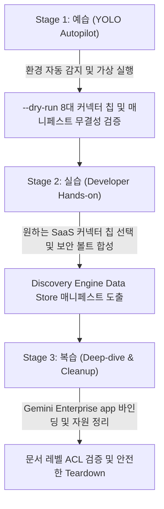

<!--
Copyright 2026 Google LLC. All Rights Reserved.
SPDX-License-Identifier: Apache-2.0

NOTICE: This code/repository is owned by Google LLC and provided under the Apache-2.0 License.
It is strictly provided as an EXAMPLE/REFERENCE ONLY and is NOT INTENDED FOR PRODUCTION USE.
All contents, designs, and code examples are subject to change, modification, or removal at any time without notice.

[고지 사항] 본 저장소 및 문서는 구글 (Google LLC) 소유이며 Apache 2.0 라이선스 하에 예시 (Sample) 용도로 제공된다.
프로덕션 환경용이 아니며, 사전 통지 없이 언제든지 수정, 변경 또는 삭제될 수 있다.
-->

> [!IMPORTANT]
> **구글 (Google LLC) 참조용 샘플 고지 사항**:
> 본 프로젝트의 모든 소스 코드와 문서는 Google LLC의 소유이며, Apache-2.0 라이선스에 따라 오직 **참조용 샘플 (Sample / Reference Only)** 목적으로만 제공된다. 프로덕션 환경에 그대로 사용할 수 없으며, 사전 통지 없이 언제든 내용이 수정, 변경 또는 삭제될 수 있다.

---
name: gemini-enterprise-copilot-connector
description: >-
  Autopilot, hands-on diagnostics, and self-healing for gemini-enterprise-copilot-connector: Jira, Confluence, Salesforce, ServiceNow, SharePoint, Google Drive 등 기업 기간계 저장소를 Gemini Enterprise app에 연결하기 위한 데이터 저장소(Data Store) 매니페스트, Secret Manager 보안 볼트 연동 및 문서 레벨 ACL 동기화 설정을 대화형으로 자율 생성하는 도구다.
---

# Gemini Enterprise 데이터 커넥터 팩토리 (`gemini-enterprise-copilot-connector`) (Autopilot & Hands-on Guide)

본 스킬은 사내 클라우드 아키텍트와 데이터 엔지니어가 `gemini-enterprise-copilot-connector` 미니 프로젝트를 **"예습(YOLO 자율 주행) -> 실습(단계별 핸즈온) -> 복습(심화 검증 및 리소스 정리)"** 3단계 학습 사이클로 완주할 수 있도록 지원하는 실행 가이드다.

**Audience**: `#Architect`, `#Developer`, `#SecOps`  
**Concern**: `#Architecture`, `#Compliance`, `#Security`  
**Service**: `#AgentPlatform`, `#BigQuery`, `#CloudStorage`  

---

## 1. 3단계 학습 워크플로우 한눈에 보기



---

## 2. Stage 1: 예습 (YOLO Autopilot 모드)

고객사 아키텍트가 "데이터 커넥터 팩토리 욜로 모드로 먼저 시연해 줘"라고 요청할 때 에이전트가 수행하는 자율 실행 절차다.

### Step 1.1 환경 자동 감지 및 설정 세팅 (Pre-flight)
```bash
cd samples/gemini-enterprise-copilot-connector
python diagnose.py --dry-run
```

### Step 1.2 아키텍처 및 자가 검증 브리핑
실행 완료 후 생성된 `report.md`를 바탕으로 다음 3가지를 명확히 보고한다:
1. **커넥터 아키텍처**: Jira/Confluence/Salesforce 등 기간계 SaaS -> Secret Manager -> Discovery Engine Data Store
2. **보안 및 ACL 모델**: Identity Mapping 및 문서 레벨 접근 제어(Document-level ACL) 정책
3. **Gemini Enterprise app 바인딩 페이로드**: `default_collection/engines` 연결 규격

---

## 3. Stage 2: 실습 (Developer Hands-on 모드)

데이터 엔지니어가 특정 사내 기간계 시스템에 맞는 커넥터를 직접 선택하여 매니페스트를 도출하는 절차다.

### Step 2.1 8대 커넥터 칩 선택 실행
```bash
# 1번 Jira Cloud 커넥터
python diagnose.py --dry-run --chip 1

# 3번 Salesforce CRM 커넥터
python diagnose.py --dry-run --chip 3

# 5번 SharePoint Online 커넥터
python diagnose.py --dry-run --chip 5

# 6번 Google Drive 전사 공유 드라이브 커넥터
python diagnose.py --dry-run --chip 6
```

---

## 4. Stage 3: 복습 (Deep-dive & Teardown 모드)

실습 완료 후 생성된 테스트 리소스를 안전하게 정리하는 가이드다.

```bash
# Data Store 바인딩 해제 및 정리
curl -X POST \
    -H "Authorization: Bearer $(gcloud auth print-access-token)" \
    -H "Content-Type: application/json" \
    "https://discoveryengine.googleapis.com/v1alpha/projects/${PROJECT_ID}/locations/${LOCATION}/collections/default_collection/engines/${GE_APP_ID}:unbindDataStore" \
    -d '{"dataStoreId": "ds-jira-connector"}'

# Secret Manager 보안 볼트 정리
gcloud secrets delete connector-secret-jira-connector --project="${PROJECT_ID}" --quiet
```
