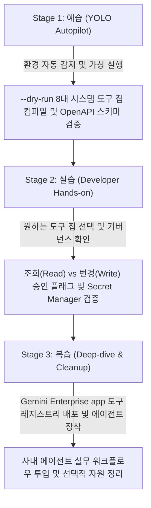

<!--
Copyright 2026 Google LLC. All Rights Reserved.
SPDX-License-Identifier: Apache-2.0

NOTICE: This code/repository is owned by Google LLC and provided under the Apache-2.0 License.
It is strictly provided as an EXAMPLE/REFERENCE ONLY and is NOT INTENDED FOR PRODUCTION USE.
All contents, designs, and code examples are subject to change, modification, or removal at any time without notice.

[고지 사항] 본 저장소 및 문서는 구글 (Google LLC) 소유이며 Apache 2.0 라이선스 하에 예시 (Sample) 용도로 제공된다.
프로덕션 환경용이 아니며, 사전 통지 없이 언제든지 수정, 변경 또는 삭제될 수 있다.
-->

> [!IMPORTANT]
> **구글 (Google LLC) 참조용 샘플 고지 사항**:
> 본 프로젝트의 모든 소스 코드와 문서는 Google LLC의 소유이며, Apache-2.0 라이선스에 따라 오직 **참조용 샘플 (Sample / Reference Only)** 목적으로만 제공된다. 프로덕션 환경에 그대로 사용할 수 없으며, 사전 통지 없이 언제든 내용이 수정, 변경 또는 삭제될 수 있다.

---
name: gemini-enterprise-copilot-skill
description: >-
  Autopilot, hands-on diagnostics, and self-healing for gemini-enterprise-copilot-skill: Gemini Enterprise app 환경에서 에이전트가 호출할 사내 시스템(Google Sheets, Slack, Jira, ERP 등) 연동 도구(Tools / Extensions)를 대화형으로 자율 생성하고 Secret Manager 보안 볼트 및 거버넌스 승인을 거쳐 등록하는 사내 스킬 팩토리 도구다.
---

# Gemini Enterprise 자율형 사내 스킬 팩토리 (`gemini-enterprise-copilot-skill`) (Autopilot & Hands-on Guide)

본 스킬은 사내 엔지니어와 실무자가 `gemini-enterprise-copilot-skill` 미니 프로젝트를 **"예습(YOLO 자율 주행) -> 실습(단계별 핸즈온) -> 복습(심화 검증 및 리소스 정리)"** 3단계 학습 사이클로 완주할 수 있도록 지원하는 실행 가이드다.

**Audience**: `#Architect`, `#Developer`, `#SecOps`  
**Concern**: `#Architecture`, `#Compliance`, `#Security`  
**Service**: `#AgentPlatform`, `#CloudFunctions`, `#GeminiAPI`  

---

## 1. 3단계 학습 워크플로우 한눈에 보기



---

## 2. Stage 1: 예습 (YOLO Autopilot 모드)

고객 개발자나 실무자가 "이 미니 프로젝트 욜로 모드로 먼저 시연해 줘"라고 요청할 때 에이전트가 수행하는 자율 실행 절차다.

### Step 1.1 환경 자동 감지 및 설정 세팅 (Pre-flight)
1. 현재 활성화된 gcloud 프로젝트 및 대상 Gemini Enterprise app 인스턴스 환경을 확인한다.
2. 사내 거버넌스 및 자원 추적을 위한 4대 필수 표준 라벨링(`managed-by=google-cloud-0-to-1`, `scenario=gemini-enterprise-copilot-skill`, `env=sample`, `created-by=customer-engineer`) 규약을 고지한다.
```bash
cd samples/gemini-enterprise-copilot-skill
python diagnose.py --dry-run
```

### Step 1.2 아키텍처 및 자가 검증 브리핑
실행 완료 후 생성된 `report.md`를 바탕으로 다음 3가지를 명확히 보고한다:
1. **OpenAPI 3.0 스키마**: Function Calling 규격의 파라미터 및 엔드포인트 정의 상태
2. **보안 볼트(Secret Manager)**: 평문 노출 없는 자격 증명 URI 연동 상태
3. **거버넌스 승인 상태**: `ACTIVE` (조회용) vs `PENDING_ADMIN_APPROVAL` (변경용) 분류 결과

---

## 3. Stage 2: 실습 (Developer Hands-on 모드)

참가자가 직접 시스템 칩을 변경하거나 커스텀 API를 입력하여 도구 매니페스트를 합성해 보는 단계다.

### Step 2.1 도구 칩 지정 실습
원하는 시스템 칩 번호를 지정하여 가상 실행한다:
```bash
# 3번 Slack 웹훅 발송 스킬 검증 (WRITE 작업, 승인 대기 플래그 확인)
python diagnose.py --dry-run --chip 3

# 5번 BigQuery 테이블 스키마 조회 스킬 검증 (READ 작업, 즉시 활성화 확인)
python diagnose.py --dry-run --chip 5
```

### Step 2.2 사용자 직접 정의 커스텀 API 도구 실습
```bash
python diagnose.py --dry-run --prompt "사내 사원증 발급 승인 시스템 REST API"
```

---

## 4. Stage 3: 복습 (Deep-dive & Cleanup 모드)

### Step 4.1 실제 Gemini Enterprise app 도구 레지스트리 등록 (선택 사항)
실제 사내 Gemini Enterprise app 도구 카탈로그에 해당 스킬을 공식 배포하고자 할 경우 수행한다:
```bash
python diagnose.py --publish --chip 1
```

### Step 4.2 자원 정리 (Teardown)
실습 후 생성된 자원을 정리할 때:
```bash
gcloud iam service-accounts delete ge-skill-invoker-sa@${PROJECT_ID}.iam.gserviceaccount.com --quiet
```

---

## 5. 트러블슈팅 및 자가 치유 (Troubleshooting & Self-Healing)

1. **Secret Manager 접근 권한 거부 (403 Permission Denied)**:
   - 증상: 스킬 실행 시 API 토큰 복호화 실패.
   - 자가 치유: 스킬 실행 서비스 계정에 `roles/secretmanager.secretAccessor` 역할을 부여한다:
     ```bash
     gcloud secrets add-iam-policy-binding ${SECRET_NAME} \
         --member="serviceAccount:ge-skill-invoker-sa@${PROJECT_ID}.iam.gserviceaccount.com" \
         --role="roles/secretmanager.secretAccessor"
     ```
2. **OpenAPI 스키마 유효성 검증 실패**:
   - 증상: Gemini Enterprise app 콘솔에서 도구 등록 시 Invalid Schema 에러 발생.
   - 자가 치유: `diagnose.py`가 생성한 스키마가 OpenAPI 3.0.3 표준(`paths`, `operationId`, `responses`)을 100% 만족하므로, 본 도구의 산출물 JSON을 그대로 사용하여 재등록한다.
