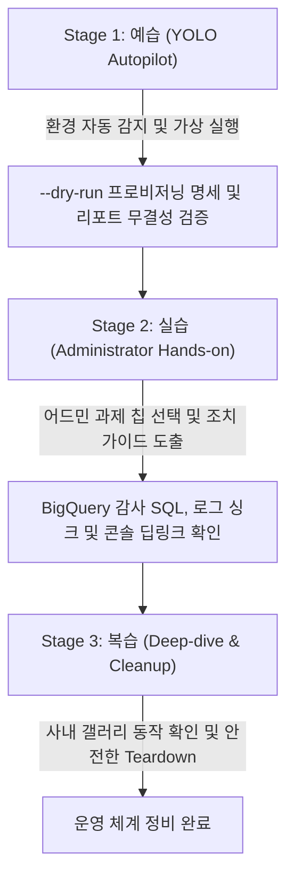

<!--
Copyright 2026 Google LLC. All Rights Reserved.
SPDX-License-Identifier: Apache-2.0

NOTICE: This code/repository is owned by Google LLC and provided under the Apache-2.0 License.
It is strictly provided as an EXAMPLE/REFERENCE ONLY and is NOT INTENDED FOR PRODUCTION USE.
All contents, designs, and code examples are subject to change, modification, or removal at any time without notice.

[고지 사항] 본 저장소 및 문서는 구글 (Google LLC) 소유이며 Apache 2.0 라이선스 하에 예시 (Sample) 용도로 제공된다.
프로덕션 환경용이 아니며, 사전 통지 없이 언제든지 수정, 변경 또는 삭제될 수 있다.
-->

> [!IMPORTANT]
> **구글 (Google LLC) 참조용 샘플 고지 사항**:
> 본 프로젝트의 모든 소스 코드와 문서는 Google LLC의 소유이며, Apache-2.0 라이선스에 따라 오직 **참조용 샘플 (Sample / Reference Only)** 목적으로만 제공된다. 프로덕션 환경에 그대로 사용할 수 없으며, 사전 통지 없이 언제든 내용이 수정, 변경 또는 삭제될 수 있다.

---
name: gemini-enterprise-factory-admin
description: >-
  Autopilot, hands-on diagnostics, and self-healing for gemini-enterprise-factory-admin: 사내 IT 어드민 및 운영 팀이 Gemini Enterprise app 채팅창에서 에이전트 및 데이터 저장소 현황 조회, 테스트 에이전트 일괄 상태/공유 제어, BigQuery 감사 SQL 및 로그 싱크 가이드를 즉시 실행하도록 전용 어드민 모듈을 배포하는 도구다.
---

# Gemini Enterprise 어드민 거버넌스 모듈 (`gemini-enterprise-factory-admin`) (Autopilot & Hands-on Guide)

본 스킬은 사내 클라우드 아키텍트와 IT 어드민이 `gemini-enterprise-factory-admin` 미니 프로젝트를 **"예습(YOLO 자율 주행) -> 실습(단계별 핸즈온) -> 복습(심화 검증 및 리소스 정리)"** 3단계 학습 사이클로 완주할 수 있도록 지원하는 실행 가이드다.

**Audience**: `#Architect`, `#Admin`  
**Concern**: `#Governance`, `#Observability`, `#Lifecycle`  
**Service**: `#GeminiEnterprise`, `#AgentPlatform`, `#BigQuery`  

---

## 1. 3단계 학습 워크플로우 한눈에 보기



---

## 2. Stage 1: 예습 (YOLO Autopilot 모드)

사용자가 "어드민 거버넌스 모듈 욜로 모드로 먼저 시연해 줘"라고 요청할 때 에이전트가 수행하는 자율 실행 절차다.

### Step 1.1 환경 자동 감지 및 설정 세팅 (Pre-flight)
1. 현재 활성화된 gcloud 프로젝트 및 실행 서비스 계정 환경을 확인한다.
2. 사내 거버넌스 및 자원 추적을 위한 4대 필수 표준 라벨링(`managed-by=google-cloud-0-to-1`, `scenario=gemini-enterprise-factory-admin`, `env=sample`, `created-by=customer-engineer`) 규약을 고지한다.
```bash
cd samples/gemini-enterprise-factory-admin
python diagnose.py --dry-run
```

### Step 1.2 아키텍처 및 자가 검증 브리핑
실행 완료 후 생성된 `report.md`를 바탕으로 다음 3가지를 명확히 보고한다:
1. **내장 어드민 도구 8종**: 에이전트/데이터 저장소 목록 조회, 배치 상태/공유/삭제, BigQuery 감사 SQL, 콘솔 딥링크
2. **GE App 사내 갤러리 바인딩**: `Agent Engine` 기반 프로비저닝 및 `/r/agents` 전사 공유(`ALL_USERS`) 명세
3. **관리 콘솔 딥링크**: Agent Platform, Gemini Enterprise, Cloud Logging, BigQuery 직접 이동 링크

---

## 3. Stage 2: 실습 (Administrator Hands-on 모드)

IT 어드민이 9대 GE 어드민 운영 과제 중 특정 항목을 선택하고 가이드를 도출하는 절차다.

### Step 2.1 GE 어드민 운영 칩 선택 실행
```bash
# 1번 60일 미사용 좀비 에이전트 전수 식별 및 보관 정리
python diagnose.py --dry-run --chip 1

# 2번 미승인 스킬 및 외부 엔드포인트 도구 감사
python diagnose.py --dry-run --chip 2

# 3번 퇴사자 및 부서 이동자 고아 에이전트 소유권 회수 및 이관
python diagnose.py --dry-run --chip 3

# 4번 부서별 계정별 토큰 소비량 톱 10 및 비용 급증 추적
python diagnose.py --dry-run --chip 4

# 5번 429 할당량 고갈 에이전트 및 호출 집중 시간대 역추적
python diagnose.py --dry-run --chip 5

# 6번 부서별 활성 사용자 추이 및 30일 미사용 유휴 계정 분석
python diagnose.py --dry-run --chip 6

# 7번 Cloud Logging 감사 로그 BigQuery 자동 적재 싱크 구축
python diagnose.py --dry-run --chip 7

# 8번 사내 갤러리 테스트 에이전트 일괄 비활성화 및 공유 범위 정리
python diagnose.py --dry-run --chip 8

# 9번 Gemini Enterprise, 데이터 커넥터 및 Agent Platform 관리 콘솔 딥링크
python diagnose.py --dry-run --chip 9
```

---

## 4. Stage 3: 복습 (Deep-dive & Teardown 모드)

실습 완료 후 테스트용 Agent Engine 및 GE App 에이전트 등록을 정리하는 가이드다.

```bash
# 임시 서비스 계정 정리
gcloud iam service-accounts delete "ge-admin-sa@${PROJECT_ID}.iam.gserviceaccount.com" --project="${PROJECT_ID}" --quiet
```
