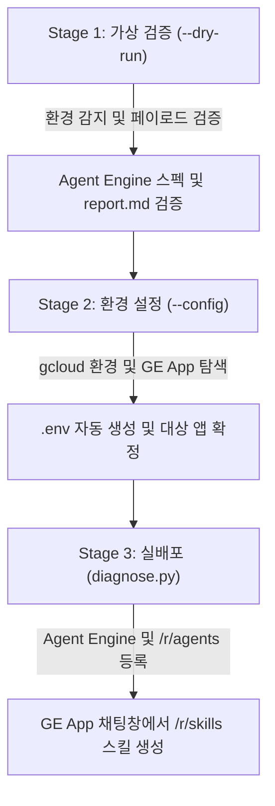

<!--
Copyright 2026 Google LLC. All Rights Reserved.
SPDX-License-Identifier: Apache-2.0

NOTICE: This code/repository is owned by Google LLC and provided under the Apache-2.0 License.
It is strictly provided as an EXAMPLE/REFERENCE ONLY and is NOT INTENDED FOR PRODUCTION USE.
All contents, designs, and code examples are subject to change, modification, or removal at any time without notice.

[고지 사항] 본 저장소 및 문서는 구글 (Google LLC) 소유이며 Apache 2.0 라이선스 하에 예시 (Sample) 용도로 제공된다.
프로덕션 환경용이 아니며, 사전 통지 없이 언제든지 수정, 변경 또는 삭제될 수 있다.
-->

> [!IMPORTANT]
> **구글 (Google LLC) 참조용 샘플 고지 사항**:
> 본 프로젝트의 모든 소스 코드와 문서는 Google LLC의 소유이며, Apache-2.0 라이선스에 따라 오직 **참조용 샘플 (Sample / Reference Only)** 목적으로만 제공된다. 프로덕션 환경에 그대로 사용할 수 없으며, 사전 통지 없이 언제든 내용이 수정, 변경 또는 삭제될 수 있다.

---
name: gemini-enterprise-factory-skill
description: >-
  Autopilot, hands-on diagnostics, and deployment guide for gemini-enterprise-factory-skill: Gemini Enterprise app 채팅창에서 반복 업무를 재사용 가능한 스킬(SKILL.md)로 대화형 생성하고, 사내 스킬 갤러리(/r/skills)에 skillAgentDefinition으로 즉시 등록하는 스킬 팩토리 도구다.
---

# Gemini Enterprise 자율형 사내 스킬 팩토리 (`gemini-enterprise-factory-skill`)

본 스킬은 사내 엔지니어와 실무자가 `gemini-enterprise-factory-skill` 미니 프로젝트를 **"예습(--dry-run) -> 환경 설정(--config) -> 실배포(diagnose.py)"** 절차로 완주할 수 있도록 지원하는 실행 가이드다.

---

## 1. 워크플로우 한눈에 보기



---

## 2. Stage 1: 가상 검증 (`--dry-run`)

1. 현재 디렉터리에서 `--dry-run`을 실행하여 실제 GCP 자원 생성 없이 프로비저닝 명세와 `report.md`를 확인한다:
```bash
cd samples/gemini-enterprise-factory-skill
python diagnose.py --dry-run
```

2. 로컬 단일 스킬 매니페스트 합성 보조 모드(`--scaffold`)가 필요할 경우 칩 번호 또는 프롬프트로 `SKILL.md` 및 `skillAgentDefinition` 페이로드를 미리 생성해 볼 수 있다:
```bash
python diagnose.py --dry-run --scaffold --chip 1
python diagnose.py --dry-run --scaffold --prompt "주간 업무 보고서 자동 요약 스킬"
```

---

## 3. Stage 2: 사내 환경 설정 및 실배포

1. **사내 환경 설정 마법사 (`--config`)**:
```bash
python diagnose.py --config
```
2. **스킬 팩토리 에이전트 실배포**:
```bash
python diagnose.py
```
배포 완료 후 Gemini Enterprise 웹 포털의 **사내 갤러리(`/r/agents`)**에서 **`GE In-Chat Skill Factory (사내 스킬 팩토리)`**를 열어 자연어로 원하는 업무 스킬을 생성하고 **`/r/skills`**에서 바로 호출할 수 있다.

---

## 4. 트러블슈팅 및 자원 정리 (Teardown)

1. **GE App 스킬 갤러리 등록 권한 오류 (403 Forbidden)**:
   - 증상: `deploy_enterprise_skill_tool` 호출 시 Discovery Engine 등록 거부.
   - 조치: 실행 주체에 `roles/discoveryengine.admin` 권한이 부여되어 있는지 확인한다.
2. **실습 후 자원 정리**:
   - 실행 완료 후 갱신된 `report.md`의 6장 `자원 정리 안내 (Teardown)`에 출력된 `curl -X DELETE` 명령으로 테스트용 Agent Engine 및 GE App 에이전트를 삭제한다.
