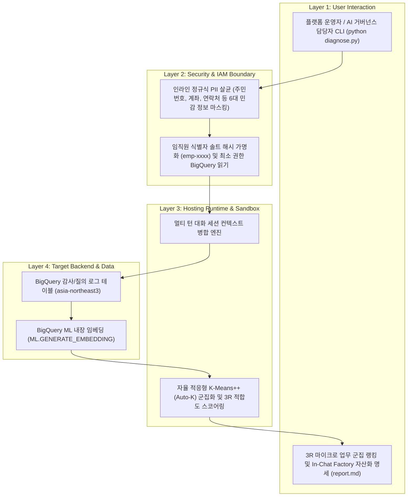

# [Skill] gemini-enterprise-prompt-miner

> **목적**: Gemini Enterprise app 사용자 질의 로그를 BigQuery에서 비식별화 수집 및 멀티 턴 세션 단위로 묶어, `ML.GENERATE_EMBEDDING`과 자율 적응형(Auto-K) 군집화로 사내 3R 마이크로 업무 및 에이전트/도구 자산화 명세를 발굴한다.
> **원본 샘플 경로**: `samples/gemini-enterprise-prompt-miner/`

---

## 0. 아키텍처 및 처리 흐름 (Architecture & Workflow)



---

## 1. 에이전트 실행 지침 (3-Stage Workflow)

사용자가 이 스킬을 호출하거나 Gemini Enterprise app 프롬프트 로그 마이닝, 반복 업무 군집화, 에이전트/스킬 후보 발굴을 요청하면 아래 3단계 절차에 따라 진행한다.

### Stage 1: 실행 모드 선택 (Mode Selection)
먼저 사용자에게 어떤 모드로 진행할지 간결하게 질문한다:
1. **Autopilot 모드 (자동 진단 및 리포트 생성)**: 에이전트가 즉시 `--dry-run` 또는 활성 GCP 프로젝트를 감지하여 `diagnose.py`를 실행하고, 발굴된 마이크로 업무 군집과 추천 에이전트/도구 명세를 브리핑한다.
2. **Hands-on 모드 (단계별 실습 가이드)**: 사용자가 직접 가상 실행부터 BigQuery 로그 테이블 연동 및 군집 분석을 수행할 수 있도록 단계별 명령어를 안내한다.

---

### Stage 2-A: Autopilot 실행 절차
1. **가상 실행 또는 실환경 마이닝 실행**:
   ```bash
   python3 samples/gemini-enterprise-prompt-miner/diagnose.py --dry-run
   ```
2. **결과 브리핑**:
   - 생성된 `samples/gemini-enterprise-prompt-miner/report.md`를 읽고, PII 마스킹 건수, 최적 군집 수(Auto-K), 상위 3R 마이크로 업무 군집 및 추천 시스템 지침(System Instructions) 초안을 요약하여 보고한다.

---

### Stage 2-B: Hands-on 실습 및 자가 치유(Self-Healing) 가이드
1. **BigQuery 내장 임베딩 원격 모델 연결 권한 미비 시**:
   - 서울 리전(`asia-northeast3`) Cloud Resource Connection 생성 및 서비스 계정에 `roles/aiplatform.user` 권한을 부여하도록 안내한다.
2. **단편적 단문 질의로 인한 군집 품질 저하 시**:
   - 멀티 턴 대화 세션 병합 옵션을 활성화하여 동일 세션 내 후속 질문을 단일 업무 컨텍스트로 묶어 분석하도록 안내한다.
