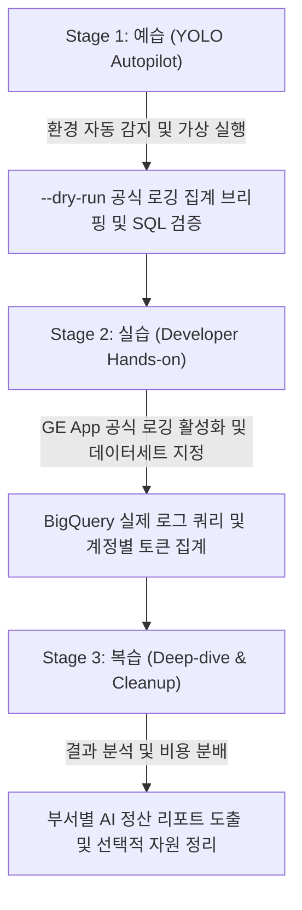

<!--
Copyright 2026 Google LLC. All Rights Reserved.
SPDX-License-Identifier: Apache-2.0

NOTICE: This code/repository is owned by Google LLC and provided under the Apache-2.0 License.
It is strictly provided as an EXAMPLE/REFERENCE ONLY and is NOT INTENDED FOR PRODUCTION USE.
All contents, designs, and code examples are subject to change, modification, or removal at any time without notice.

[고지 사항] 본 저장소 및 문서는 구글 (Google LLC) 소유이며 Apache 2.0 라이선스 하에 예시 (Sample) 용도로 제공된다.
프로덕션 환경용이 아니며, 사전 통지 없이 언제든지 수정, 변경 또는 삭제될 수 있다.
-->

> [!IMPORTANT]
> **구글 (Google LLC) 참조용 샘플 고지 사항**:
> 본 프로젝트의 모든 소스 코드와 문서는 Google LLC의 소유이며, Apache-2.0 라이선스에 따라 오직 **참조용 샘플 (Sample / Reference Only)** 목적으로만 제공된다. 프로덕션 환경에 그대로 사용할 수 없으며, 사전 통지 없이 언제든 내용이 수정, 변경 또는 삭제될 수 있다.

---
name: gemini-enterprise-usage-by-account
description: >-
  Autopilot, hands-on diagnostics, and self-healing for gemini-enterprise-usage-by-account: Gemini Enterprise(GE App) 공식 내장 프롬프트/응답 로깅 기능 안내 및 BigQuery 로그 기반 계정별 토큰 사용량/지연시간 분석 도구다.
---

# Gemini Enterprise 공식 프롬프트/응답 로깅 및 계정별 사용량 분석기 (`gemini-enterprise-usage-by-account`) (Autopilot & Hands-on Guide)

본 스킬은 사내 엔지니어와 실무자가 `gemini-enterprise-usage-by-account` 미니 프로젝트를 **"예습(YOLO 자율 주행) -> 실습(단계별 핸즈온) -> 복습(심화 검증 및 리소스 정리)"** 3단계 학습 사이클로 완주할 수 있도록 지원하는 실행 가이드다.

**Audience**: `#Architect`, `#FinOps`, `#SecOps`  
**Concern**: `#Billing`, `#Compliance`, `#Security`  
**Service**: `#BigQuery`, `#GeminiAPI`  

---

## 1. 3단계 학습 워크플로우 한눈에 보기



---

## 2. Stage 1: 예습 (YOLO Autopilot 모드)

고객 개발자나 실무자가 "이 미니 프로젝트 욜로 모드로 먼저 시연해 줘"라고 요청할 때 에이전트가 수행하는 자율 실행 절차다.

### Step 1.1 환경 자동 감지 및 설정 세팅 (Pre-flight)
```bash
cd samples/gemini-enterprise-usage-by-account
python diagnose.py --dry-run
```

### Step 1.2 아키텍처 및 자가 검증 브리핑
실행 완료 후 생성된 `report.md`를 바탕으로 다음 3가지를 명확히 보고한다:
1. **GE App 공식 로깅 아키텍처**: 관리 콘솔 1회 토글로 BigQuery 파티션 테이블에 자동 스트리밍 적재되는 원리
2. **계정별 토큰 순위**: 사용자별 호출 횟수, 입력/출력 토큰, 총 토큰 사용량, 평균 지연시간
3. **표준 집계 SQL**: BigQuery에서 직접 커스텀 대시보드(Looker Studio)를 연동할 수 있는 표준 쿼리

---

## 3. Stage 2: 실습 (Developer Hands-on 모드)

참가자가 직접 기간을 조정하거나 사내 BigQuery 데이터세트를 대상으로 쿼리를 실행해 보는 단계다.

### Step 2.1 실제 환경 쿼리 실행
```bash
python diagnose.py --project="your-project-id" --dataset="gemini_enterprise_logs" --days=14
```

---

## 4. Stage 3: 복습 (Deep-dive & Cleanup 모드)

### Step 4.1 부서별 비용 정산 활용
도출된 사용자별 토큰량을 사내 부서별 사번 매핑 테이블과 결합하여, GE App 라이선스 및 토큰 추가 과금액을 각 사업부로 정확히 분배한다.

### Step 4.2 자원 정리 (Teardown)
본 도구는 구글 관리형 로깅이므로 별도 상주 인프라가 없다. 테스트용 데이터세트만 필요시 삭제한다:
```bash
bq rm -r -f -d ${PROJECT_ID}:gemini_enterprise_logs
```

---

## 5. 트러블슈팅 및 자가 치유 (Troubleshooting & Self-Healing)

1. **BigQuery 권한 거부 (403 Access Denied)**:
   - 증상: BigQuery 쿼리 실행 시 권한 오류 발생.
   - 자가 치유: 실행 계정에 `roles/bigquery.dataViewer` 및 `roles/bigquery.jobUser` 역할을 부여한다.
2. **로그 테이블 부재 (Table not found)**:
   - 증상: GE App 로깅 활성화 직후 테이블이 생성되지 않음.
   - 자가 치유: 최초 프롬프트 호출이 발생한 후 2~3분 내에 BigQuery 파티션 테이블이 자동 생성되므로, 테스트 프롬프트를 전송한 후 재시도한다.
