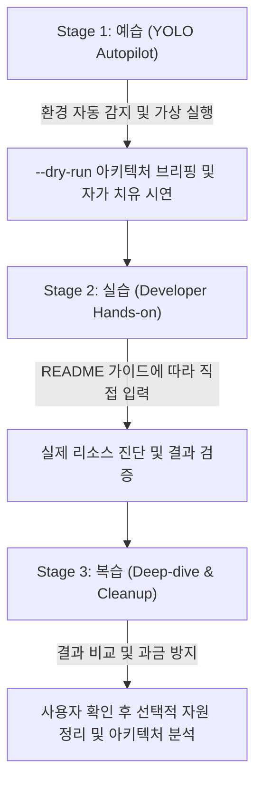

<!--
Copyright 2026 Google LLC. All Rights Reserved.
SPDX-License-Identifier: Apache-2.0

NOTICE: This code/repository is owned by Google LLC and provided under the Apache-2.0 License.
It is strictly provided as an EXAMPLE/REFERENCE ONLY and is NOT INTENDED FOR PRODUCTION USE.
All contents, designs, and code examples are subject to change, modification, or removal at any time without notice.

[고지 사항] 본 저장소 및 문서는 구글 (Google LLC) 소유이며 Apache 2.0 라이선스 하에 예시 (Sample) 용도로 제공된다.
프로덕션 환경용이 아니며, 사전 통지 없이 언제든지 수정, 변경 또는 삭제될 수 있다.
-->

---
name: gke-multi-cluster-inference-gateway
description: >-
  Autopilot, hands-on diagnostics, and self-healing for gke-multi-cluster-inference-gateway: 대규모 AI/LLM 서빙 환경에서 다중 리전 및 멀티 클라우드에 분산된 수십 개 GPU/TPU 쿠버네티스 클러스터 운영 시, 기존 계층형 Istio 풀 메시(Full-mesh) 중계로 인한 지연 시간(TTFT) 증가와 GKE Fleet 라이선스 비용 누수를 진단하고, Global External ALB 및 Hybrid/Internet NEG 기반의 1홉 플랫 직결 L7 제어 평면 상태를 1분 만에 점검 및 처방하는 아키텍처 진단 도구다.
---

# GKE Multi-Cluster Inference Gateway Skill (Autopilot & Hands-on Guide)

본 스킬은 사내 엔지니어와 실무자가 `gke-multi-cluster-inference-gateway` 미니 프로젝트를 **"예습(YOLO 자율 주행) -> 실습(단계별 핸즈온) -> 복습(심화 검증 및 리소스 정리)"** 3단계 학습 사이클로 완주할 수 있도록 지원하는 실행 가이드다.

**Audience**: `#Architect`, `#Developer`, `#FinOps`  
**Concern**: `#Billing`, `#Performance`, `#Resilience`  
**Service**: `#CloudLoadBalancing`, `#ComputeEngine`, `#GKE`

---

## 1. 3단계 학습 워크플로우 한눈에 보기



---

## 2. Stage 1: 예습 (YOLO Autopilot 모드)

사내 개발자가 "이 미니 프로젝트 욜로 모드로 먼저 시연해 줘"라고 요청할 때 에이전트가 수행하는 자율 실행 절차다.

### Step 1.1 환경 자동 감지 및 설정 세팅 (Pre-flight)
1. 현재 활성화된 gcloud 프로젝트 및 기본 리전을 확인한다:
   ```bash
   gcloud config get-value project
   gcloud config get-value compute/region
   ```
2. `samples/gke-multi-cluster-inference-gateway/.env.example`을 참조하여 `samples/gke-multi-cluster-inference-gateway/.env` 파일이 없을 경우 자동 생성하고, 감지된 프로젝트 ID와 리전으로 기본 세팅을 구성한다.
3. 사내 거버넌스 및 자원 추적을 위한 4대 필수 표준 라벨링(`managed-by=google-cloud-0-to-1`, `scenario=gke-multi-cluster-inference-gateway`, `env=sample`, `created-by=customer-engineer`) 규약을 고지한다.
4. 실행에 필요한 최소 IAM 권한(`roles/compute.viewer`) 충족 여부를 안내한다.

### Step 1.2 가상 모의 실행 및 아키텍처 브리핑 (Smoke Test)
실제 클라우드 비용이나 리소스 변경 없이 1초 만에 전체 실행 흐름과 예상 진단 리포트를 화면에 출력한다:
```bash
cd samples/gke-multi-cluster-inference-gateway
python3 diagnose.py --dry-run
```
- 화면에 출력된 진단 결과와 8대 점검 항목, 정상/주의/위험 판단 기준을 사용자에게 간결하게 브리핑한다.

---

## 3. Stage 2: 실습 (Developer Hands-on 단계)

예습을 통해 전체 흐름을 파악한 사내 개발자가 콘솔과 터미널에서 직접 명령어를 수행하는 본 실습 단계다.

### Step 2.1 저장소 이동 및 의존성 확인
```bash
cd samples/gke-multi-cluster-inference-gateway
cat requirements.txt
```

### Step 2.2 진단 도구 실행
```bash
python3 diagnose.py
```
- 특정 프로젝트를 지정하여 검사할 경우:
  ```bash
  python3 diagnose.py -p <대상_프로젝트_ID>
  ```

---

## 4. Stage 3: 복습 (Deep-dive & Cleanup)

- As-Is(다계층 메시) 대비 To-Be(Anycast 1홉 직결) 아키텍처 비교표와 즉시 실행 가능한 `gcloud` 최적화 명령어가 포함된 완제품 [report.md](report.md)를 사내 인프라 아키텍처 검토에 활용한다.
- 본 도구는 읽기 전용 진단 스크립트이므로 클라우드 상에 생성된 리소스가 없으며, 별도의 자원 정리가 필요하지 않다.
