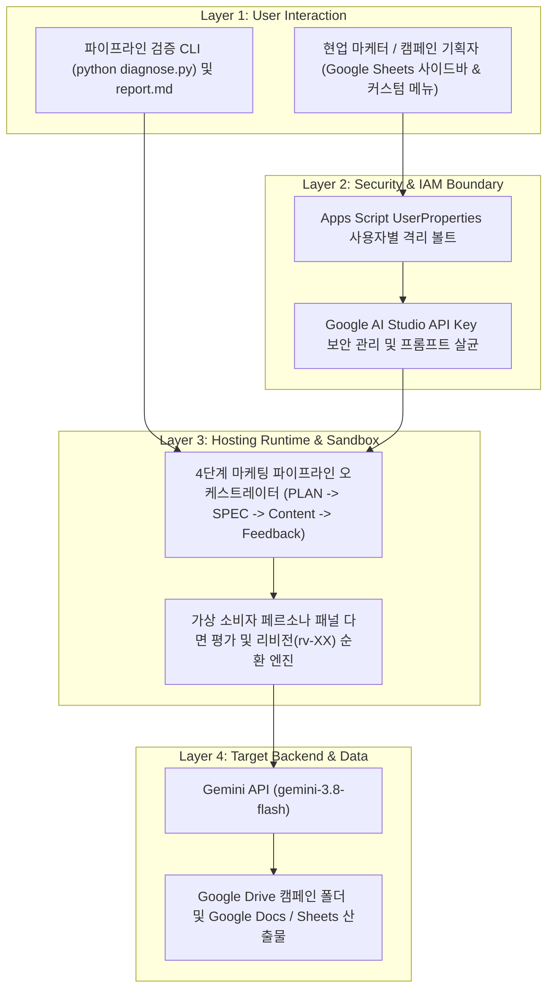

# [Skill] gws-marketing-content-pipeline

> **목적**: Google Drive와 Google Sheets 환경에서 Apps Script 및 Gemini API를 결합하여 캠페인 기획서(PLAN), 채널별 제작 명세서(SPEC), 멀티 채널 콘텐츠 초판(rv-00) 및 가상 페르소나 다면 평가 기반 개정 루프(rv-01~)를 자동화한다.
> **원본 샘플 경로**: `samples/gws-marketing-content-pipeline/`

---

## 0. 아키텍처 및 처리 흐름 (Architecture & Workflow)



---

## 1. 에이전트 실행 지침 (3-Stage Workflow)

사용자가 이 스킬을 호출하거나 Google Workspace 기반 노코드 마케팅 콘텐츠 파이프라인 구축 및 진단을 요청하면 아래 3단계 절차에 따라 진행한다.

### Stage 1: 실행 모드 선택 (Mode Selection)
먼저 사용자에게 어떤 모드로 진행할지 간결하게 질문한다:
1. **Autopilot 모드 (자동 검증 및 리포트 생성)**: 에이전트가 즉시 `diagnose.py --dry-run`을 실행하여 4단계 마케팅 파이프라인(PLAN, SPEC, Content, Feedback) 검증 결과와 Apps Script 배포 가이드를 브리핑한다.
2. **Hands-on 모드 (단계별 실습 가이드)**: 마케터가 직접 Google Sheets에 Apps Script를 붙여 넣고 Google AI Studio API 키를 등록하여 캠페인 폴더를 자동 구성하도록 단계별로 안내한다.

---

### Stage 2-A: Autopilot 실행 절차
1. **파이프라인 가상 실행 검증**:
   ```bash
   python3 samples/gws-marketing-content-pipeline/diagnose.py --dry-run
   ```
2. **결과 브리핑**:
   - 생성된 `samples/gws-marketing-content-pipeline/report.md`를 읽고, 4단계 캠페인 파이프라인 시뮬레이션 결과와 Google Sheets 사이드바 연동 절차를 요약하여 안내한다.

---

### Stage 2-B: Hands-on 실습 및 자가 치유(Self-Healing) 가이드
1. **Apps Script 실행 권한 및 API 키 미등록 오류 시**:
   - 스프레드시트 상단 메뉴에서 API Key를 `UserProperties` 볼트에 먼저 저장하고, Google Drive/Docs 스코프 승인 팝업을 허용하도록 안내한다.
2. **생성 콘텐츠 리비전(rv-01~) 보정 시**:
   - 시트 내 마케터 보정 지침 컬럼에 피드백을 기입한 뒤 재생성을 실행하여 이전 버전(`rv-00`)을 덮어쓰지 않고 순차 개정본을 누적 보존하도록 안내한다.
