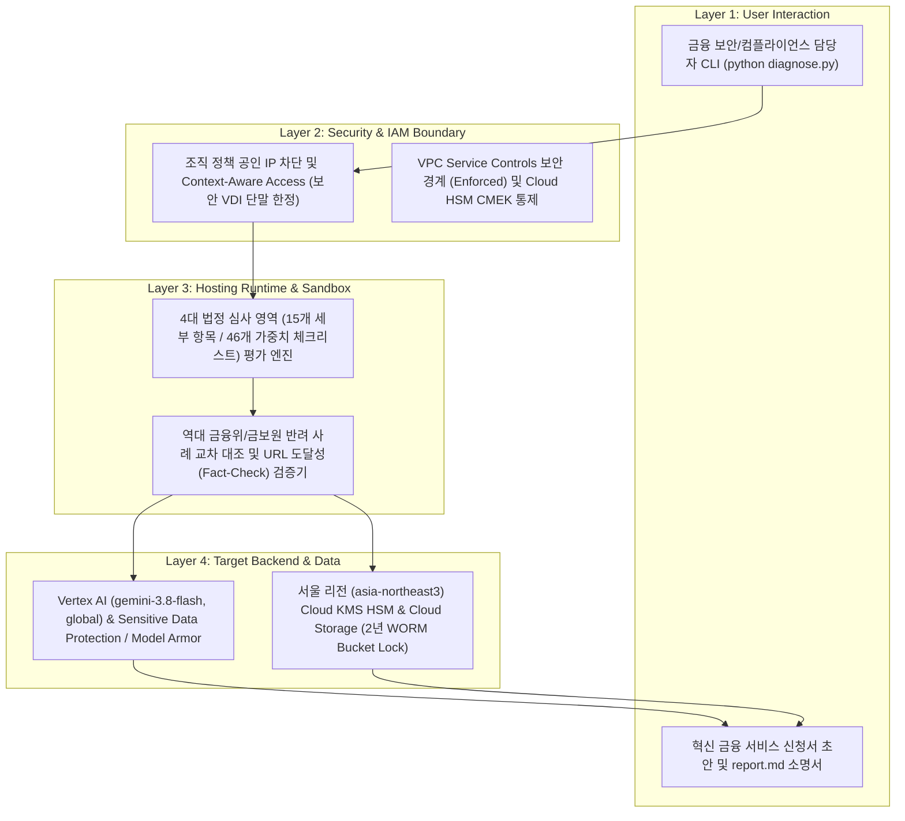

# [Skill] korea-fsc-sandbox-helper

> **목적**: 금융위원회 혁신 금융 서비스(생성형 AI 망 분리 샌드박스) 지정 신청서 및 클라우드 보안 아키텍처의 4대 심사 영역 충족도를 사전 진단하고, 역대 반려 사례 대조 및 서울 리전(`asia-northeast3`) 참조 아키텍처 블루프린트를 생성한다.
> **원본 샘플 경로**: `samples/korea-fsc-sandbox-helper/`

---

## 0. 아키텍처 및 처리 흐름 (Architecture & Workflow)



---

## 1. 에이전트 실행 지침 (3-Stage Workflow)

사용자가 이 스킬을 호출하거나 금융위원회 혁신 금융 서비스(생성형 AI 망 분리 샌드박스) 신청서 사전 심사, 금융보안원 물적 설비 요건 점검, 반려 사례 대조를 요청하면, 아래 3단계 절차에 따라 진행한다.

### Stage 1: 실행 모드 선택 (Mode Selection)
먼저 사용자에게 어떤 모드로 진행할지 간결하게 질문한다:
1. **Autopilot 모드 (자동 진단 및 리포트 생성)**: 에이전트가 즉시 `--dry-run` 또는 활성 GCP 프로젝트를 감지하여 `diagnose.py`를 실행하고, 생성된 `report.md`를 바탕으로 4대 심사 영역 점수표와 반려 위험 보완 처방을 브리핑한다.
2. **Hands-on 모드 (단계별 실습 가이드)**: 사용자가 직접 신청서 초안 점검부터 서울 리전 CMEK, 2년 WORM 감사 로그 버킷, 서킷 브레이커 구성을 실습할 수 있도록 단계별 명령어를 안내한다.

---

### Stage 2-A: Autopilot 실행 절차
1. **가상 실행 또는 실환경 사전 점검**:
   - 대상 프로젝트나 신청서 파일이 지정되지 않았으면 먼저 가상 실행으로 전체 진단 체계를 검증한다:
     ```bash
     python3 samples/korea-fsc-sandbox-helper/diagnose.py --dry-run
     ```
   - 신청서 초안(`--proposal`)이나 대상 프로젝트(`--project`)가 주어졌으면 해당 인자로 실행한다:
     ```bash
     python3 samples/korea-fsc-sandbox-helper/diagnose.py --project="<PROJECT_ID>" --proposal="<DRAFT_MD>"
     ```
2. **결과 브리핑**:
   - 생성된 `samples/korea-fsc-sandbox-helper/report.md`를 읽고, **반려 위험(`REJECT_RISK`)** 및 **보완 권고(`WARN`)** 판정을 받은 세부 항목과 매칭된 역대 반려 사례, 그리고 서울 리전(`asia-northeast3`) 참조 블루프린트 핵심 조치를 요약하여 전달한다.

---

### Stage 2-B: Hands-on 실습 및 자가 치유(Self-Healing) 가이드
사용자가 직접 실행 중 겪을 수 있는 주요 반려 위험 항목별 즉시 복구 처방이다:

1. **암호 키 금융회사 직접 통제권(CMEK + Cloud HSM) 미비 시**:
   - 전자금융감독규정 제37조 준수를 위해 서울 리전(`asia-northeast3`)에 Cloud HSM 기반 키를 생성하고 90일 자동 순환 및 4대 표준 라벨을 적용하도록 안내한다:
     ```bash
     gcloud kms keyrings create fsc-sandbox-keyring --location=asia-northeast3 --project=YOUR_PROJECT_ID
     gcloud kms keys create fsc-ai-cmek-key \
       --keyring=fsc-sandbox-keyring \
       --location=asia-northeast3 \
       --purpose=encryption \
       --protection-level=hsm \
       --rotation-period=90d \
       --next-rotation-time=$(date -u -d '+90 days' +%Y-%m-%dT%H:%M:%SZ) \
       --labels=managed-by=google-cloud-0-to-1,scenario=korea-fsc-sandbox-helper,env=sample,created-by=customer-engineer \
       --project=YOUR_PROJECT_ID
     ```
2. **감사 로그 및 프롬프트 이력 2년 불변 보존(WORM Bucket Lock) 누락 시**:
   - 전자금융감독규정 제15조 대체 통제 요건에 따라 730일 보존 정책이 적용된 서울 리전 스토리지 버킷을 생성하도록 안내한다:
     ```bash
     gcloud storage buckets create gs://YOUR_PROJECT_ID-fsc-audit-worm \
       --location=asia-northeast3 \
       --uniform-bucket-level-access \
       --public-access-prevention \
       --retention-period=730d \
       --labels=managed-by=google-cloud-0-to-1,scenario=korea-fsc-sandbox-helper,env=sample,created-by=customer-engineer \
       --project=YOUR_PROJECT_ID
     ```
3. **실증 한도(Cap) 90% 도달 경보 및 서킷 브레이커 미설계 시**:
   - 금융혁신지원 특별법 제13조 리스크 방지 요건에 따라 일일 호출량 및 거래 한도 90% 도달 시 발동할 경보 토픽과 폴백 라우팅을 구성하도록 안내한다.
