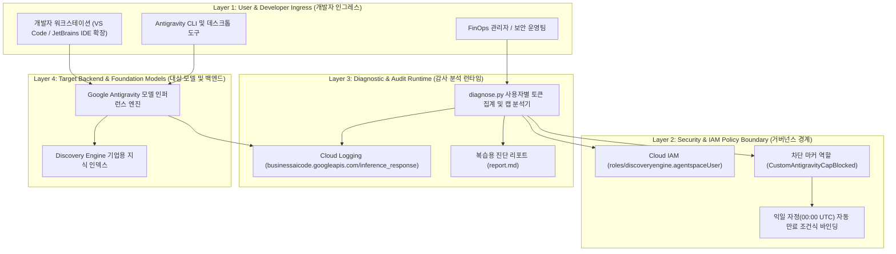

<!--
Copyright 2026 Google LLC. All Rights Reserved.
SPDX-License-Identifier: Apache-2.0

NOTICE: This code/repository is owned by Google LLC and provided under the Apache-2.0 License.
It is strictly provided as an EXAMPLE/REFERENCE ONLY and is NOT INTENDED FOR PRODUCTION USE.
All contents, designs, and code examples are subject to change, modification, or removal at any time without notice.

[고지 사항] 본 저장소 및 문서는 구글 (Google LLC) 소유이며 Apache 2.0 라이선스 하에 예시 (Sample) 용도로 제공된다.
프로덕션 환경용이 아니며, 사전 통지 없이 언제든지 수정, 변경 또는 삭제될 수 있다.
-->

# Google Antigravity 사용자별 사용량 모니터링 및 쿼터 캡 진단기

Google Antigravity(데스크톱, CLI, IDE 확장 프로그램) 환경에서 클라우드 로깅(Cloud Logging) 인퍼런스 로그를 기반으로 개발자별 토큰 소비량 및 호출 횟수를 실시간 분석하고, 일일/주간 쿼터 캡(Cap) 초과자를 식별하여 프로젝트 IAM 마커 역할 기반의 안전한 통제 처방을 제공하는 진단 도구다. (As of 2026-10-17)

---

## 1. 발생 증상 및 진단 대상 체크리스트

사내 또는 고객사 환경에서 아래 증상이 발생한다면 즉시 진단 대상이다:
- [ ] 전사 개발자에게 Google Antigravity를 배포했으나, 특정 헤비 유저가 과도하게 토큰을 소비하여 전체 풀링 쿼터가 조기 소진된다.
- [ ] Google Cloud 콘솔에서 프로젝트 총량만 보이고, 개발자 개인별 토큰(Prompt / Candidate) 소모량 현황을 파악하기 어렵다.
- [ ] 개발자별로 일일 쿼터 상한(예: 500만 토큰)을 설정하고, 초과자를 식별하여 접근을 안전하게 일시 제어하고자 한다.
- [ ] 구글 그룹(`group:`)이나 상위 조직 권한으로 부여된 사용자와 개별 바인딩(`user:`) 사용자를 구분하여 통제 가능 여부를 사전에 파악하고 싶다.


### 1.1 도구의 본질 및 비즈니스 해결 과제 (What & Why)
- **대상 사용자 (Target)**: 사내 플랫폼 엔지니어, DevOps 리드, FinOps 관리자 및 Cloud IAM 관리자
- **해결하는 핵심 문제 (Core Pain Points)**:
  1. 개발자별 Antigravity(데스크톱, CLI, IDE 확장) 토큰 소비량 및 호출 빈도를 추적하지 못해 특정 계정의 쿼터 독점과 예산 초과가 발생하는 문제
  2. 일일/주간 상한 임계치(Cap)를 초과한 사용자를 수동으로 식별하고 권한을 회수하느라 운영 공수가 과다 소모되는 문제
  3. 권한을 수동 박탈할 경우 익일 업무 재개 시 관리자가 다시 권한을 복구해 주어야 하는 관리 병목 현상
- **본 솔루션의 해결 방식 (Solution)**:
  - Cloud Logging 인퍼런스 감사 로그를 분석하여 개발자별 토큰 소비량 및 쿼터 초과 여부를 자동 판정하고, 익일 자정(00:00 UTC) 자동 만료 조건부 IAM 마커 역할(`CustomAntigravityCapBlocked`)을 처방하여 무인 자율 복구 거버넌스를 구현한다.

### 1.2 최종 산출물 3종 세트 미리보기 (Deliverables & Visual Preview)
본 도구를 실행(`python diagnose.py`)하면 다음 3가지 구체적인 엔터프라이즈 자산이 생성된다:

| 산출물 구분 | 산출물 형태 및 명칭 | 주요 포함 내용 및 실무 활용 방안 |
| :--- | :--- | :--- |
| **① 터미널 콘솔 요약** | Visual CLI Table | 개발자별 호출수, 토큰 소모량, 초과 판정 상태 및 조건부 IAM 만료 명령어 요약 표 |
| **② 정규 진단 보고서** | 마크다운 파일 (`report.md`) | 전사 사용량 지표, 쿼터 초과 계정별 상세 분석, Cloud Logging Log Analytics 표준 집계 SQL 및 자율 복구 처방전 |
| **③ 후속 조치 및 배포 자산** | Actionable Asset Specs | • **조건부 만료 IAM 차단 명령어**: 익일 자정 자동 복구되는 `CustomAntigravityCapBlocked` 정책 적용<br/>• **Log Analytics SQL**: 수천 명 규모 개발 조직 전수 조사용 BigQuery 연동 쿼리<br/>• **자동화 파이프라인**: Cloud Scheduler 및 Cloud Run 연동 무인 쿼터 가드 구성 가이드 |

---

## 2. 빠른 시작 (Quickstart)

> [!TIP]
> Cloud Shell 접속 환경 구성 및 저장소 클론(`git clone`) 방법은 루트의 [메인 README](../../README.md)를 참고한다.

### 1) 모의 데이터 가상 실행 (Dry-Run)
GCP API 호출 없이 내장된 가상 인프라 데이터로 정상 동작 여부를 즉시 검증한다:
```bash
python diagnose.py --dry-run
```

**터미널 진단 출력 미리보기:**
```text
================================================================================================
 [Google Antigravity 사용자별 사용량 모니터링 및 쿼터 캡 진단 리포트]
================================================================================================
대상 프로젝트 ID    : sample-project-id
쿼터 집계 주기      : daily (UTC 기준)
토큰 상한 임계치(Cap): 5,000,000 토큰
요청 상한 임계치(Cap): 1,000 회
진단 모드           : 모의 실행 (Dry-run)
------------------------------------------------------------------------------------------------
[1. 전사 Antigravity 사용량 및 쿼터 캡 요약 지표]
```


### 2) 사내 환경 대화형 설정 (Config Wizard, 선택 사항)
사내 활성 프로젝트 및 환경 설정을 대화형으로 탐색하여 `.env`에 자동 저장한다:
```bash
python diagnose.py --config
```


### 3) 실제 사내 인프라 실시간 진단
```bash
python diagnose.py
```
> [!NOTE]
> 앞서 `python diagnose.py --config`로 환경 설정을 저장했거나 gcloud 활성 설정을 그대로 활용할 경우 별도의 `.env` 생성 없이 즉시 실행할 수 있다. (환경 변수를 텍스트 에디터로 직접 수동 편집하고자 할 때만 `cp -n .env.example .env` 실행 후 수정)

---

## 3. 솔루션 아키텍처 및 처리 흐름



---
## 4. 조치 가이드 및 권장 설정

### 1단계: 직접 통제 가능 초과자 IAM 조건부 만료 적용 (익일 자율 복구)
기본 사용자 역할(`roles/discoveryengine.agentspaceUser`)을 일시 해제하고, 익일 자정(00:00 UTC) 자동 만료 조건식(`request.time < timestamp(...)`)이 결합된 차단 마커 역할을 부여하여 관리자 수동 개입 없는 무인 자율 복구를 구현한다:
```bash
# 1) 기본 접근 역할 해제
gcloud projects remove-iam-policy-binding [PROJECT_ID] \
    --member="user:[USER_EMAIL]" \
    --role="roles/discoveryengine.agentspaceUser"

# 2) 익일 00:00 UTC 자동 만료 차단 마커 역할 부여 (익일 자동 복원)
gcloud projects add-iam-policy-binding [PROJECT_ID] \
    --member="user:[USER_EMAIL]" \
    --role="roles/CustomAntigravityCapBlocked" \
    --condition='expression=request.time < timestamp("2026-10-18T00:00:00Z"),title=Daily_Cap_Expiry,description=Antigravity_Quota_Exceeded_Auto_Reset'
```

### 2단계: 그룹 바인딩 계정 수동 거버넌스
`NOT_ENFORCEABLE`로 분류된 사용자는 프로젝트 레벨의 개별 바인딩을 변경해도 그룹 권한으로 인해 접근이 유지된다. 사내 구글 워크스페이스(Google Workspace) / Cloud Identity 관리 콘솔 ( https://admin.google.com )에서 해당 개발자를 개발팀 그룹에서 일시 제외 조치한다.

### 3단계: Cloud Logging Log Analytics (BigQuery Linked Dataset) 초고속 대용량 분석
수천 명 규모의 대규모 개발 조직 전수 조사는 Cloud Logging Log Analytics SQL 쿼리를 통해 초 단위로 집계할 수 있다:
```sql
SELECT
  JSON_VALUE(json_payload.principalEmail) AS developer_email,
  JSON_VALUE(json_payload.clientInfo.clientType) AS client_type,
  COUNT(1) AS request_count,
  SUM(CAST(JSON_VALUE(json_payload.promptTokenCount) AS INT64)) AS total_prompt_tokens,
  SUM(CAST(JSON_VALUE(json_payload.candidatesTokenCount) AS INT64)) AS total_candidate_tokens,
  SUM(CAST(JSON_VALUE(json_payload.promptTokenCount) AS INT64) + CAST(JSON_VALUE(json_payload.candidatesTokenCount) AS INT64)) AS total_tokens
FROM
  `[PROJECT_ID].global._Default._AllLogs`
WHERE
  log_name LIKE '%businessaicode.googleapis.com%2Finference_response%'
  AND timestamp >= TIMESTAMP_SUB(CURRENT_TIMESTAMP(), INTERVAL 1 DAY)
GROUP BY
  developer_email, client_type
ORDER BY
  total_tokens DESC;
```

### 4단계: 엔터프라이즈 운영 자동화(Batch Job) 및 4대 필수 라벨링 규약
본 진단기는 읽기 전용 분석 도구다. 15분 주기 자동 캡 차단 및 매일 자정 복구를 영구 스케줄링하려면 클라우드 스케줄러(Cloud Scheduler)와 클라우드 런(Cloud Run) 잡 또는 클라우드 펑션(Cloud Functions)을 연동하여 정기 배치 파이프라인으로 구성 및 배포할 수 있다.
사내 거버넌스 준수를 위해 배치 리소스 생성 시 4대 표준 라벨(`--labels=managed-by=google-cloud-0-to-1,scenario=antigravity-user-quota-cap,env=sample,created-by=customer-engineer`)을 필수로 주입한다.

---
## 5. 사전 준비 사항 (필요 IAM 권한)

본 도구를 실행하려면 최소 아래의 IAM 권한이 필요하다:

### (1) 필수 API 활성화 및 관리 콘솔 설정
본 도구가 Cloud Logging을 통해 Antigravity 인퍼런스 지표를 실측하려면 아래 API와 관리 콘솔 로깅 설정이 선행되어야 한다 (스크립트 실행 시 미흡 항목 자동 탐지 및 조치 명령어 안내):

1. **필수 API 활성화**:
   ```bash
   gcloud services enable logging.googleapis.com businessaicode.googleapis.com
   ```
2. **관리 콘솔 개발자 도구 활동 로깅(Metadata Logging)**:
   - 구글 워크스페이스(Google Workspace) 및 Gemini Enterprise 관리 콘솔 ( https://admin.google.com ) > 생성형 AI, 개발자 도구 설정에서 **'인퍼런스 메타데이터 로깅'**이 켜져 있어야 클라우드 로깅으로 토큰 및 사용자 정보가 적재된다.

### (2) 진단 실행 계정 최소 IAM 권한
본 도구는 순수 읽기 전용 진단 스크립트이므로 최소한의 조회 권한만 요구한다:

| 역할 (Role) | 설명 |
| :--- | :--- |
| `roles/logging.viewer` | Cloud Logging 인퍼런스 로그(`businessaicode.googleapis.com`) 조회 권한 |
| `roles/serviceusage.serviceUsageViewer` | 필수 API 활성화 상태 사전 점검 권한 |
| `roles/resourcemanager.viewer` | 프로젝트 IAM 정책 및 사용자 바인딩 상태 확인 권한 |

---

## 6. 기술적 배경 및 아키텍처 원리 (Deep Dive)

### 관련 상세 설계 및 요구 사항 명세
- [비즈니스 요구 사항 명세서 (BRD)](docs/BRD.md): 비즈니스 배경, 성공 지표 및 요구 사항(BR-01~) 명세
- [기술 상세 설계서 (TDD)](docs/TDD.md): 시스템 아키텍처, 기능(FR-01~) 및 비기능(NFR-01~) 설계 명세

---

## 7. 리소스 정리 (Teardown) 안내

본 도구는 순수 읽기 전용 진단 도구이므로 별도의 클라우드 인프라 자원을 생성하지 않으며, 추가 삭제 절차가 필요하지 않다.
