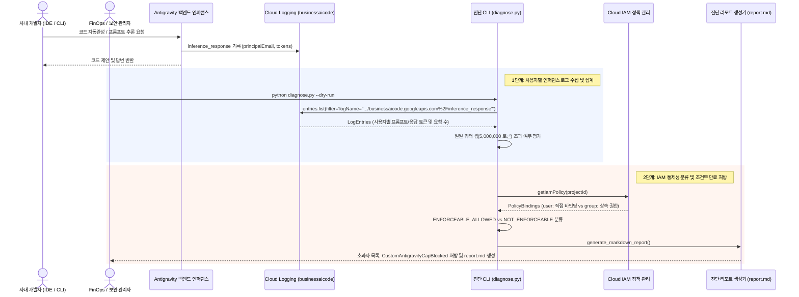

<!--
Copyright 2026 Google LLC. All Rights Reserved.
SPDX-License-Identifier: Apache-2.0

NOTICE: This code/repository is owned by Google LLC and provided under the Apache-2.0 License.
It is strictly provided as an EXAMPLE/REFERENCE ONLY and is NOT INTENDED FOR PRODUCTION USE.
All contents, designs, and code examples are subject to change, modification, or removal at any time without notice.

[고지 사항] 본 저장소 및 문서는 구글 (Google LLC) 소유이며 Apache 2.0 라이선스 하에 예시 (Sample) 용도로 제공된다.
프로덕션 환경용이 아니며, 사전 통지 없이 언제든지 수정, 변경 또는 삭제될 수 있다.
-->

# 기술 상세 설계서 (TDD): Antigravity 사용자별 사용량 모니터링 및 쿼터 캡 진단기

## 1. 시스템 아키텍처 및 런타임 상호작용 시퀀스

본 도구의 런타임 제어 및 데이터 상호작용 흐름은 아래 시퀀스 다이어그램과 같다. Cloud Logging에 적재되는 Antigravity 인퍼런스 로그를 분석하여 개발자별 토큰 소비량 및 쿼터 캡 초과자를 식별하고, IAM 조건부 만료 마커 역할 기반의 무인 자율 복구 처방을 제시한다.

---

## 2. 요구 사항 추적성 매핑 (Traceability Matrix)

| 비즈니스 요구 사항 (BRD) | 기능 요구 사항 (FR) | 비기능 요구 사항 (NFR) | 구현 파일 및 모듈 |
| :--- | :--- | :--- | :--- |
| **BR-01** (사용자별 토큰 사용량 투명성 확보) | **FR-01** (사용자별 사용량 집계 및 메트릭 파싱) | **NFR-01** (최소 IAM 권한 준수) | `diagnose.py` (`fetch_inference_logs`, `parse_usage_data`) |
| **BR-02** (쿼터 캡 초과자 식별 및 위험도 판정) | **FR-02** (쿼터 캡 임계치 평가 및 통제성 분류) | **NFR-02** (순수 파이썬 직접 실행) | `diagnose.py` (`evaluate_quota_caps`, `classify_iam_enforceability`) |
| **BR-03** (마커 역할 기반 안전 처방 제시) | **FR-03** (안전 처방전 및 조건부 만료 IAM 차단 명령어 출력) | **NFR-03** (가상 실행 모드 지원) | `diagnose.py` (`prescribe_iam_actions`), `report.md` |
| **BR-04** (엔터프라이즈 자동화 배치 연계 가이드) | **FR-04** (마크다운 진단 리포트 자동 생성 및 덮어쓰기) | **NFR-03** (민감 정보 비식별화) | `diagnose.py` (`generate_markdown_report`), `report.md` |

---

## 3. 기능 요구 사항 (Functional Requirements)

### FR-01: 사용자별 사용량 집계 및 메트릭 파싱
- Cloud Logging의 `logName="projects/{PROJECT_ID}/logs/businessaicode.googleapis.com%2Finference_response"` 필터로 최근 로그를 조회한다.
- 로그 페이로드(`jsonPayload`)에서 호출자 ID(`principalEmail`), 입력 토큰(`promptTokenCount`), 출력 토큰(`candidatesTokenCount`), 클라이언트 타입(`clientInfo`)을 추출하여 사용자별로 합산한다.

### FR-02: 쿼터 캡(Cap) 임계치 평가 및 통제성 분류
- 지정된 캡 기준(기본값: 일일 5,000,000 토큰)을 초과한 사용자를 식별한다.
- 사용자별 IAM 바인딩 상태를 분석하여 통제 가능 여부를 분류한다:
  - `ENFORCEABLE_ALLOWED`: 직접 `user:` 바인딩으로 기본 역할(`roles/discoveryengine.agentspaceUser`)을 보유하여 마커 역할로 차단 가능한 대상
  - `NOT_ENFORCEABLE`: 구글 그룹(`group:`), 도메인(`domain:`), 상속 권한, 상위 관리자 역할 보유자로 직접 차단이 불가하여 수동 검토가 필요한 대상

### FR-03: 안전 처방전 및 조건부 만료 IAM 차단 명령어 출력
- 캡 초과 사용자에 대해 프로젝트 레벨에서 안전하게 권한을 임시 제한하는 gcloud 명령어(`CustomAntigravityCapBlocked` 부여) 및 익일 자정(00:00 UTC) 자동 만료 조건식(`request.time < timestamp(...)`)을 적용한 무인 자율 복구 명령어를 처방한다.
- 대규모 개발 조직 전수 조사를 위한 Cloud Logging Log Analytics (BigQuery Linked Dataset) 표준 집계 SQL 쿼리를 제공한다.

### FR-04: 마크다운 진단 리포트 (report.md) 자동 생성 및 덮어쓰기
- 진단 실행 시 터미널 출력을 반영한 마크다운 리포트를 자동 생성하여 FinOps 및 인프라 부서 보고서로 활용하도록 지원한다.

---

## 3. 비기능 요구 사항 (Non-Functional Requirements)

### NFR-01: 최소 IAM 권한 준수
- 본 도구는 읽기 전용 진단 스크립트로서 `roles/logging.viewer` 및 `roles/resourcemanager.viewer` 권한만 요구하며 프로젝트 자원을 변경하지 않는다.

### NFR-02: 순수 파이썬 직접 실행 및 무버퍼링 스트리밍
- 쉘 래퍼 없이 `python diagnose.py` 단일 명령어로 크로스 플랫폼에서 실행되며 실시간 표준 출력을 지원한다.

### NFR-03: 가상 실행 모드 (--dry-run) 및 비식별화
- 실제 GCP 호출 없이도 사전 시뮬레이션 데이터를 통해 1초 내에 검증 가능하며, 모의 실행 시 사내 실환경 프로젝트 ID 노출을 방지하기 위해 가명(`sample-project-id`)을 적용한다.
