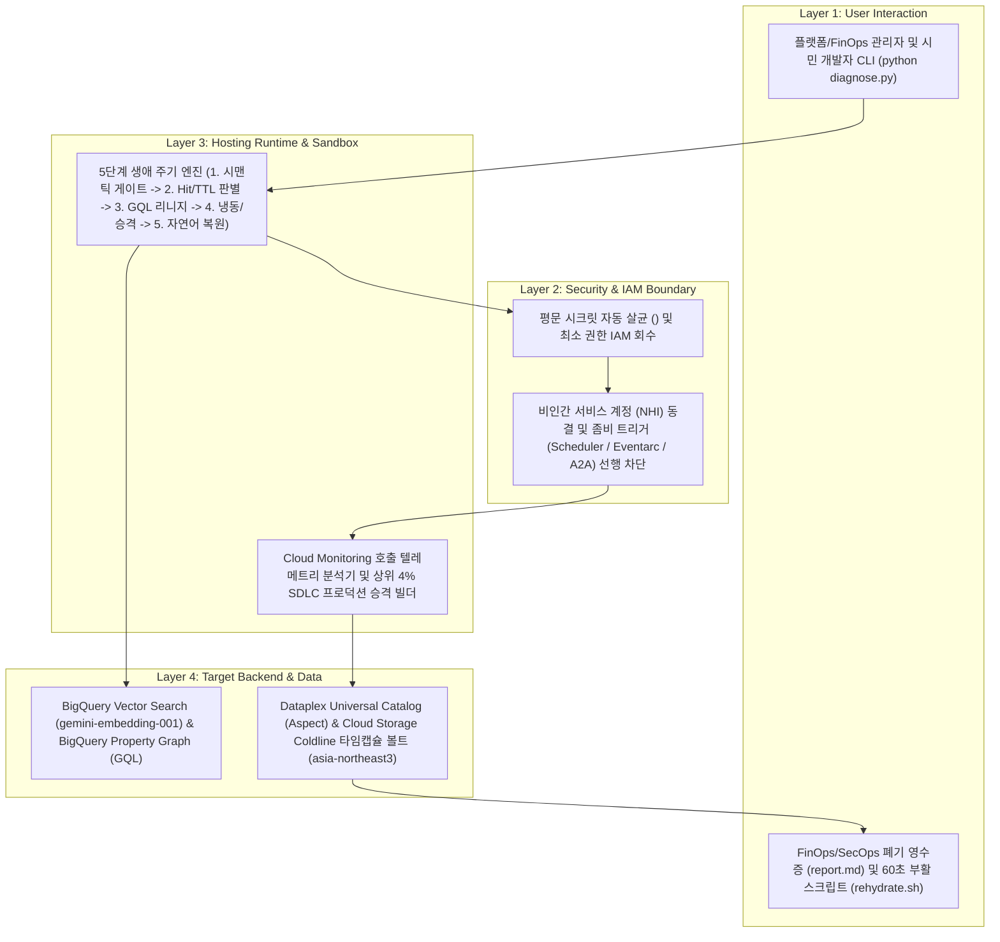

<!--
Copyright 2026 Google LLC. All Rights Reserved.
SPDX-License-Identifier: Apache-2.0

NOTICE: This code/repository is owned by Google LLC and provided under the Apache-2.0 License.
It is strictly provided as an EXAMPLE/REFERENCE ONLY and is NOT INTENDED FOR PRODUCTION USE.
All contents, designs, and code examples are subject to change, modification, or removal at any time without notice.

[고지 사항] 본 저장소 및 문서는 구글 (Google LLC) 소유이며 Apache 2.0 라이선스 하에 예시 (Sample) 용도로 제공된다.
프로덕션 환경용이 아니며, 사전 통지 없이 언제든지 수정, 변경 또는 삭제될 수 있다.
-->

> [!IMPORTANT]
> **구글 (Google LLC) 참조용 샘플 고지 사항**:
> 본 프로젝트의 모든 소스 코드와 문서는 Google LLC의 소유이며, Apache-2.0 라이선스에 따라 오직 **참조용 샘플 (Sample / Reference Only)** 목적으로만 제공된다. 프로덕션 환경에 그대로 사용할 수 없으며, 사전 통지 없이 언제든 내용이 수정, 변경 또는 삭제될 수 있다.

# 엔터프라이즈 AI 앱 생애 주기 및 콜드라인 냉동 거버넌스 진단기 (app-lifecycle-manager)

현업 바이브 코딩과 노코드 빌더로 대량 생성된 사내 AI 앱(웹앱 SPA, `Agent Engine`, `Cloud Run` API)의 중복 개발을 `BigQuery Vector Search`(`gemini-embedding-001`)와 `Dataplex Universal Catalog`로 사전 차단하고, 호출 텔레메트리(`Hit-Count & TTL`)와 `BigQuery Graph`(`GQL`) 멀티홉 호출 리니지 역추적을 통해 유휴 1회성 앱(96% 코호트)은 활성 호출자 안전 차단 후 월 `$0.02` `Cloud Storage Coldline` 냉동 타임캡슐(`rehydrate.sh` 1분 부활 스크립트 포함)로 동결하며, 고빈도 핵심 앱(4% 코호트)은 정식 프로덕션 파이프라인으로 승격시키는 5단계 생애 주기 관리 도구다. (As of 2026-11-14)

---

## 1. 발생 증상 및 진단 대상 체크리스트

사내 운영 환경에서 아래 증상이 발생한다면 즉시 진단 대상이다:
- [ ] 현업 부서에서 바이브 코딩이나 노코드 빌더로 수백~수천 개의 발표용 웹앱(SPA), 에이전트, 단건 API를 만들었으나, 이미 유사한 앱이 존재하는지 자연어로 검색할 수 없어 동일한 도구가 반복 중복 개발된다.
- [ ] 1회성 보고나 해커톤이 끝난 뒤 호출 수가 0~1회(`Hit Count <= 1`)인 유휴 앱이 방치되어 최소 인스턴스(`min-instances`) 컴퓨트 비용과 비인간 서비스 계정(NHI) 보안 표면이 계속 누적된다.
- [ ] 유휴 서비스를 정리하려 해도 업스트림에서 어떤 `Cloud Scheduler`, `Eventarc`, `Workflows`, `Pub/Sub` 또는 타 에이전트(A2A)가 호출 중인지 블라스트 반경을 알 수 없어 장애 우려로 삭제하지 못한다.
- [ ] 지금 앱을 삭제하면 다음 분기나 감사 시점에 다시 필요할 때 복구할 수 없을까 봐 내리지 못하고, 자연어 검색 한 번으로 60초 안에 원상 복구(`rehydrate.sh`)되는 안전한 콜드라인 절전 아키텍처가 필요하다.

---

## 2. 빠른 시작 (Quickstart)

### 1단계: 가상 실행 (Dry-Run)
GCP 과금이나 권한 변경 없이 내장된 7개 사내 AI 앱 인벤토리(96% 1회성 앱 대 4% 핵심 안착 앱)와 멀티홉 리니지 시드 데이터로 5단계 거버넌스 파이프라인을 5초 만에 시뮬레이션하고 `report.md` 영수증을 생성한다:

```bash
python diagnose.py --dry-run
```

**터미널 진단 출력 미리보기:**
```text
========================================================================================================
 엔터프라이즈 AI 앱 생애 주기 및 콜드라인 냉동 거버넌스 진단기 (app-lifecycle-manager)
 대상 프로젝트: sample-project-id | 기준 리전: asia-northeast3 | 모드: Dry-Run (가상 시뮬레이션)
========================================================================================================
[1/5] 개발 착수 전 시맨틱 중복 생성 방지 게이트 (BigQuery Vector Search & Knowledge Catalog) 점검 중...
  -> 신규 요청: "재무팀 법인세 예규 및 조세심판원 판례 검색 웹앱"
  -> 매칭 발견: tax-precedent-spa-001 (유사도: 0.9800, 상태: CRYO_ARCHIVED) => 권고: REHYDRATE_CRYO
[2/5] 전사 AI 앱 호출 수(Hit-Count) 및 보존 기한(TTL 14일) 파레토 분류 중...
  -> 전체 7개 앱: 냉동 보관 대상 4건 | 프로덕션 승격 대상 1건 | 기 냉동 1건 | 활성 유지 1건
[3/5] BigQuery Graph (GQL) 멀티홉 인바운드 호출 리니지 및 블라스트 반경 역추적 중...
  -> 냉동 대상 4개 앱 업스트림 자동 호출 트리거 5건 안전 차단 명령어 및 NHI IAM 5건 회수 검증 완료
[4/5] Cloud Storage Coldline 냉동 타임캡슐 패키징 및 60초 부활 스크립트(rehydrate.sh) 합성 중...
  -> 평문 시크릿 4건 마스킹(<REDACTED_SECRET_MANAGER_REF>) 및 상위 4% 앱(enterprise-it-helpdesk-triage-agent) 승격 명세 생성 완료
[5/5] 자연어 시맨틱 복원 검색(Search-to-Restore) 검증 및 FinOps/SecOps 영수증 산출 중...
  -> 월간 순 절감액: $245.42/월 (연간 $2,945.04 절감) | 회수 인스턴스: 4개 | 동결 서비스 계정(NHI): 4개
========================================================================================================
[완료] 생애 주기 관리 및 FinOps/SecOps 영수증이 생성되었다: samples/app-lifecycle-manager/report.md
```

### 2단계: 대화형 환경 설정 (선택 사항)
사내 활성 프로젝트 ID, 리전, BigQuery 거버넌스 데이터셋 및 Coldline 아카이브 버킷을 감지하여 `.env` 파일로 저장한다:

```bash
python diagnose.py --config
```

### 3단계: 사내 환경 실시간 진단
설정된 환경 변수 또는 활성 `gcloud config` 환경을 기반으로 실시간 진단을 실행한다:

```bash
python diagnose.py
```

---

## 3. 솔루션 아키텍처 및 처리 흐름



---

## 4. 조치 가이드 및 권장 설정

진단 리포트(`report.md`)에서 식별된 유휴 1회성 앱 냉동 보관 및 프로덕션 승격을 수행할 때에는 사내 거버넌스 및 FinOps 비용 귀속을 위해 **4대 필수 표준 라벨(`managed-by=google-cloud-0-to-1,scenario=app-lifecycle-manager,env=sample,created-by=customer-engineer`)**을 반드시 적용한다.

### 1) 콜드라인 냉동 타임캡슐 버킷 생성 (서울 리전)
```bash
gcloud storage buckets create gs://YOUR_PROJECT_ID-onetime-archive \
  --location=asia-northeast3 \
  --default-storage-class=COLDLINE \
  --uniform-bucket-level-access \
  --labels=managed-by=google-cloud-0-to-1,scenario=app-lifecycle-manager,env=sample,created-by=customer-engineer
```

### 2) 업스트림 좀비 트리거 안전 차단 및 트래픽 드레이닝 예시
```bash
# Cloud Scheduler 캐시 워머 일시 중지
gcloud scheduler jobs pause q3-board-cache-warmer --location=asia-northeast3 --project=YOUR_PROJECT_ID

# Cloud Run 트래픽 0% 드레이닝
gcloud run services update-traffic marketing-campaign-utm-tagger-api --to-zero --region=asia-northeast3 --project=YOUR_PROJECT_ID
```

### 3) 냉동 보관된 타임캡슐 60초 원클릭 부활 (`rehydrate.sh`)
```bash
gcloud storage cat gs://YOUR_PROJECT_ID-onetime-archive/q3-board-deck-kpi-visualizer/rehydrate.sh | bash
```

- BigQuery 콘솔 ( https://console.cloud.google.com/bigquery )
- Dataplex Universal Catalog 콘솔 ( https://console.cloud.google.com/dataplex/search )
- Cloud Storage 콘솔 ( https://console.cloud.google.com/storage/browser )

---

## 5. 사전 준비 사항 (필요 IAM 권한)

| 대상 서비스 | 최소 요구 IAM 역할 (Role) | 주요 용도 |
| :--- | :--- | :--- |
| **Cloud Run / Monitoring** | `roles/run.viewer`, `roles/monitoring.viewer` | 사내 AI 앱 인벤토리 및 14일/30일 호출 수(`request_count`) 조회 |
| **BigQuery (Vector & Graph)** | `roles/bigquery.dataViewer`, `roles/bigquery.jobUser` | `VECTOR_SEARCH` 중복 검사 및 `app_lineage_graph` GQL 멀티홉 호출 리니지 조회 |
| **Dataplex Universal Catalog** | `roles/dataplex.catalogViewer` | 전사 AI 앱 거버넌스 Aspect(`lifecycle_stage`, `ttl_days`) 조회 |
| **Cloud Storage** | `roles/storage.objectAdmin` (냉동 아카이빙 실행 시) | Coldline 타임캡슐 매니페스트 및 `rehydrate.sh` 아카이빙/복원 |

---

## 6. 기술적 배경 및 아키텍처 원리 (Deep Dive)

- **왜 단순 삭제가 아니라 '임베딩 색인 + 콜드라인 타임캡슐'인가?**:
  바이브 코딩으로 생성된 96%의 1회성 앱을 단순 삭제하면 지식 자산(시스템 프롬프트, 스키마, 컨테이너 다이제스트)이 영구 소멸되어 타 부서가 동일한 앱을 다시 개발하게 된다. 반면 컴퓨트(`min-instances`)와 서비스 계정 권한만 회수하고 아티팩트를 월 `$0.02`의 `Cloud Storage Coldline` 타임캡슐로 동결한 뒤 `BigQuery Vector Search`(`gemini-embedding-001`)와 `Dataplex Universal Catalog`에 색인해 두면, 유휴 컴퓨트 비용과 보안 공격 표면을 0으로 수렴시키면서도 자연어 검색 한 번으로 60초 만에 즉시 복원할 수 있다.
- **BigQuery Graph (`GQL`) 기반 블라스트 반경 검증**:
  `(UpstreamCaller)-[INVOKES]->(OneTimeApp)-[DEPENDS_ON]->(GCPResource)` 프로퍼티 그래프를 통해 `Cloud Scheduler`, `Eventarc`, `Workflows`, `Pub/Sub`, 타 에이전트(`A2A`) 등 모든 인바운드 호출 경로를 역추적하고 결정론적 차단 명령어를 먼저 생성함으로써 폐기 시 운영 장애를 원천 차단한다.
- **상세 설계 문서**:
  - 비즈니스 요구 사항 명세서: [docs/BRD.md](docs/BRD.md)
  - 기술 상세 설계서 및 시퀀스 다이어그램: [docs/TDD.md](docs/TDD.md)

---

## 7. 리소스 정리 (Teardown) 안내

실습 또는 검증 목적으로 생성한 콜드라인 아카이브 버킷과 BigQuery 거버넌스 데이터셋을 정리할 때에는 아래 명령어를 수동으로 실행한다:

```bash
# 1. 테스트용 콜드라인 아카이브 버킷 삭제
gcloud storage rm --recursive gs://YOUR_PROJECT_ID-onetime-archive

# 2. 테스트용 BigQuery 거버넌스 데이터셋 삭제
bq rm -r -f -d YOUR_PROJECT_ID:app_governance
```
