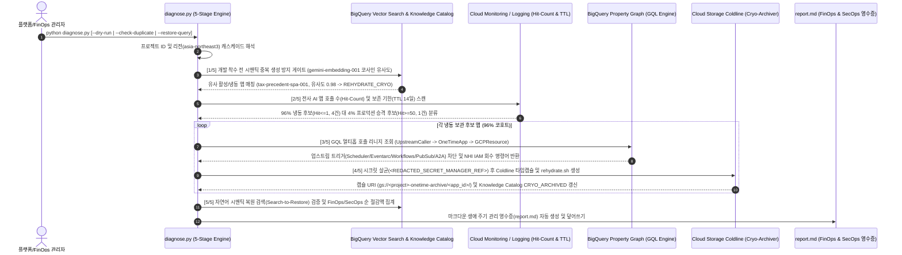

<!--
Copyright 2026 Google LLC. All Rights Reserved.
SPDX-License-Identifier: Apache-2.0

NOTICE: This code/repository is owned by Google LLC and provided under the Apache-2.0 License.
It is strictly provided as an EXAMPLE/REFERENCE ONLY and is NOT INTENDED FOR PRODUCTION USE.
All contents, designs, and code examples are subject to change, modification, or removal at any time without notice.

[고지 사항] 본 저장소 및 문서는 구글 (Google LLC) 소유이며 Apache 2.0 라이선스 하에 예시 (Sample) 용도로 제공된다.
프로덕션 환경용이 아니며, 사전 통지 없이 언제든지 수정, 변경 또는 삭제될 수 있다.
-->

> [!IMPORTANT]
> **구글 (Google LLC) 참조용 샘플 고지 사항**:
> 본 프로젝트의 모든 소스 코드와 문서는 Google LLC의 소유이며, Apache-2.0 라이선스에 따라 오직 **참조용 샘플 (Sample / Reference Only)** 목적으로만 제공된다. 프로덕션 환경에 그대로 사용할 수 없으며, 사전 통지 없이 언제든 내용이 수정, 변경 또는 삭제될 수 있다.

# 기술 상세 설계서 (TDD): 엔터프라이즈 AI 앱 생애 주기 및 콜드라인 냉동 거버넌스 (app-lifecycle-manager)

---

## 1. 종단간 런타임 상호작용 시퀀스 (`sequenceDiagram`)

---

## 2. 기능적 기술 요구 사항 (Functional Requirements)

| 요구 사항 ID | 모듈/컴포넌트 | 기술 구현 상세 |
| :---: | :--- | :--- |
| **FR-01** | `CatalogVectorEngine.pre_build_semantic_gate` | 국문/영문 형태소 및 동의어 정규화 토큰과 BigQuery `VECTOR_SEARCH`(`gemini-embedding-001`) SQL 생성기를 결합하여 신규 앱 아이디어와 기존 인벤토리 간 코사인 유사도를 산출하고 `REHYDRATE_CRYO` 또는 `REUSE_ACTIVE`를 판정한다. |
| **FR-02** | `CatalogVectorEngine.register_or_update_aspect` | Dataplex Universal Catalog 커스텀 엔트리(`one-time-ai-app`) 및 `app-lifecycle-governance` Aspect 페이로드를 합성하고 4대 필수 라벨을 주입한다. |
| **FR-03** | `HitCountTTLDetector.evaluate_fleet` | Cloud Monitoring MQL 쿼리(`run.googleapis.com/request_count`) 또는 인벤토리 메트릭을 기반으로 `ALREADY_ARCHIVED`, `CRYO_DISPOSAL`(`hit_count <= 1` 및 `age_days >= ttl_days`), `PRODUCTION_GRADUATION`(`hit_count >= 50`), `KEEP_ACTIVE` 4개 코호트로 분류한다. |
| **FR-04** | `LineageGraphEngine.build_property_graph_ddl` | `CREATE OR REPLACE PROPERTY GRAPH` DDL과 `GRAPH ... MATCH (caller:UpstreamCaller)-[inv:INVOKES]->(app:OneTimeApp)-[dep:DEPENDS_ON]->(res:GCPResource)` GQL 쿼리를 생성한다. |
| **FR-05** | `LineageGraphEngine.analyze_and_sever` | 업스트림 호출자별 결정론적 차단 명령어(`gcloud scheduler jobs pause`, `gcloud eventarc triggers delete`, `gcloud run services update-traffic --to-zero`, `gcloud pubsub subscriptions modify-push-config`)와 다운스트림 서비스 계정 IAM 회수 명령어를 합성한다. |
| **FR-06** | `CryoArchiver.create_cryo_capsule` | 환경 변수 키 중 `KEY|SECRET|TOKEN|PASSWORD|BEARER` 패턴을 `<REDACTED_SECRET_MANAGER_REF>`로 살균한 뒤 Coldline 캡슐 매니페스트와 60초 부활 스크립트(`rehydrate.sh`)를 생성한다. |
| **FR-07** | `CryoArchiver.build_graduation_package` | 상위 4% 안착 앱을 위한 Cloud Build 프로덕션 배포 명세와 5대 보안 하드닝 체크리스트(Secret Manager 90일 순환, Cloud/Model Armor, VPC-SC, SLO 알림)를 생성한다. |
| **FR-08** | `CatalogVectorEngine.search_to_restore` | `CRYO_ARCHIVED` 상태 앱을 대상으로 자연어 검색을 수행하여 코사인 유사도 순위와 원클릭 부활 명령어(`gcloud storage cat .../rehydrate.sh \| bash`)를 반환한다. |
| **FR-09** | `GovernanceReceiptGenerator.render_markdown_report` | 회수된 월간 총 컴퓨트 비용에서 Coldline 보관료(캡슐당 월 `$0.02`)를 차감한 순 절감액(월 `$245.42`, 연 `$2,945.04`)과 회수된 인스턴스/NHI/IAM/트리거 지표를 `report.md`로 출력한다. |

---

## 3. 비기능적 기술 요구 사항 (Non-Functional Requirements)

| 요구 사항 ID | 구분 | 상세 기준 |
| :---: | :--- | :--- |
| **NFR-01** | 무과금 결정론적 가상 실행 (`--dry-run`) | GCP API 호출이나 비용 발생 없이 내장된 7개 엔터프라이즈 앱 인벤토리와 멀티홉 리니지 시드 데이터로 5초 이내에 전체 5단계 파이프라인을 완주하고 `report.md`를 생성한다. |
| **NFR-02** | 시크릿 제로 유출 (Zero Secret Leakage) | 콜드라인 버킷이나 마크다운 리포트에 평문 API 키, 비밀번호, 베어러 토큰이 절대 기록되지 않도록 정규식 기반 자동 마스킹을 강제한다. |
| **NFR-03** | 블라스트 반경 안전 게이트 (Blast-Radius Gate) | 활성 자동화 호출자(`is_active=True` 및 비브라우저 호출)에 대해 결정론적 차단 명령어가 확보되지 않으면(`safe_to_dispose=False`) 냉동 아카이빙을 즉시 거부(`ValueError`)한다. |
| **NFR-04** | 리전 및 모델 표준 준수 | 일반 GCP 인프라(Cloud Run, BigQuery, Cloud Storage, Dataplex)는 서울 리전(`asia-northeast3`)을 기본값으로 적용하고, Gemini 호출은 `global` 리전 및 `gemini-3.8-flash` / `gemini-embedding-001` 표준을 준수한다. |

---

## 4. CLI 세부 파라미터 명세

- `--dry-run`: 실제 GCP 리소스를 변경하지 않고 모의 인벤토리로 5단계 생애 주기 거버넌스를 시뮬레이션한다.
- `--config`: 대화형 설정 마법사를 실행하여 활성 프로젝트 및 아카이브 버킷 설정을 `.env`에 저장한다.
- `-p`, `--project`: 진단 대상 Google Cloud 프로젝트 ID를 지정한다.
- `--region`: 대상 인프라 리전을 지정한다 (기본값: `asia-northeast3`).
- `--check-duplicate`: 1단계 개발 착수 전 시맨틱 중복 생성 방지 게이트에 테스트할 자연어 신규 앱 아이디어를 지정한다.
- `--restore-query`: 5단계 자연어 시맨틱 복원 검색(Search-to-Restore)에 사용할 자연어 질의를 지정한다.
