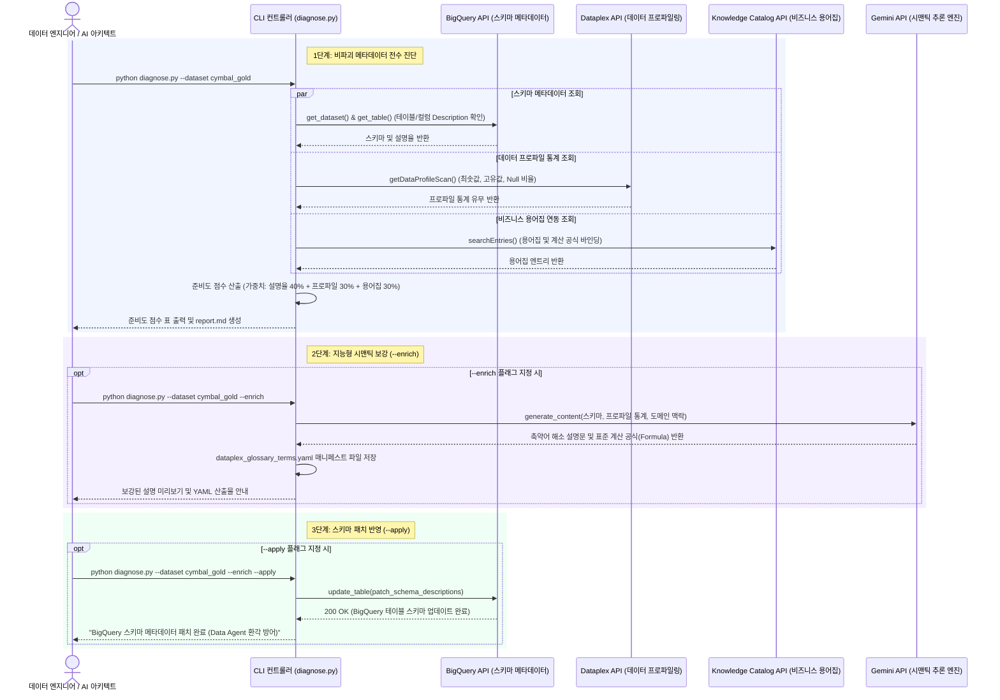

<!--
Copyright 2026 Google LLC. All Rights Reserved.
SPDX-License-Identifier: Apache-2.0

NOTICE: This code/repository is owned by Google LLC and provided under the Apache-2.0 License.
It is strictly provided as an EXAMPLE/REFERENCE ONLY and is NOT INTENDED FOR PRODUCTION USE.
All contents, designs, and code examples are subject to change, modification, or removal at any time without notice.

[고지 사항] 본 저장소 및 문서는 구글 (Google LLC) 소유이며 Apache 2.0 라이선스 하에 예시 (Sample) 용도로 제공된다.
프로덕션 환경용이 아니며, 사전 통지 없이 언제든지 수정, 변경 또는 삭제될 수 있다.
-->

# 기술 상세 설계서 (TDD: Technical Design Document)
## 프로젝트명: BigQuery Data Agent Semantic Metadata Enricher (As of 2026-10-17)

---

## 1. 시스템 아키텍처 개요 및 설계 원칙

### 1.1 설계 목표
본 도구는 BigQuery Data Agent 및 NL2SQL 파이프라인의 정확도를 좌우하는 시맨틱 레이어(테이블/컬럼 설명, 데이터 프로파일 통계, 비즈니스 공식)의 충실도를 정량 진단하고, 누락된 메타데이터를 지능적으로 보강(Enrichment)하는 **경량 진단 및 보강 엔진**이다.

### 1.2 핵심 설계 원칙
1. **순수 파이썬 단일 실행 모델**: 쉘 래퍼에 의존하지 않고 크로스 플랫폼에서 호환되는 `python diagnose.py` 직접 실행 체계 구축.
2. **비파괴적 읽기 전용 진단(Non-Destructive Read-Only Scan)**: 기본 모드에서는 오직 메타데이터 조회(`get_dataset`, `list_tables`, `get_table`)만 수행하여 운영 데이터베이스에 무영향.
3. **완전 독립형 모의 실행(`--dry-run`)**: 실제 GCP 인증이나 데이터셋 없이도 모의 리테일 데이터셋을 바탕으로 진단 점수 및 보강 전후 차이를 신속하게 시뮬레이션.
4. **선언적 용어집 템플릿 생성(Declarative Glossary Export)**: Dataplex Knowledge Catalog에 즉시 반영 가능한 표준 비즈니스 용어집 YAML 정의 파일을 자동 도출.

---

## 2. 시스템 아키텍처 및 런타임 상호작용 시퀀스

본 도구의 런타임 제어 및 데이터 상호작용 흐름은 아래 시퀀스 다이어그램과 같다. 사용자가 CLI를 구동하면 BigQuery, Dataplex, Knowledge Catalog API를 순차 또는 병렬 조회하여 준비도 점수를 산출하고, 필요 시 Gemini API를 통해 시맨틱 설명을 자동 생성하여 스키마에 패치 반영한다.



---

## 3. 요구 사항 추적성 매핑 (Traceability Matrix)

| 비즈니스 요구 사항 (BRD) | 기능적 기술 요구 사항 (FR) | 비기능적 기술 요구 사항 (NFR) | 구현 파일 및 모듈 |
| :--- | :--- | :--- | :--- |
| **BR-01** (테이블 설명 감사) | **FR-01** (테이블 메타데이터 전수 검사) | **NFR-01** (비파괴적 진단 모델) | `diagnose.py` (`inspect_table_descriptions`) |
| **BR-02** (컬럼 설명 감사) | **FR-02** (컬럼 커버리지 및 축약어 감사) | **NFR-01** (비파괴적 진단 모델) | `diagnose.py` (`inspect_column_descriptions`) |
| **BR-03** (프로파일링 검증) | **FR-03** (Dataplex 프로파일 통계 연동) | **NFR-02** (신속한 실행 성능) | `diagnose.py` (`inspect_dataplex_profiles`) |
| **BR-04** (용어집 공식 감사) | **FR-04** (Knowledge Catalog 비즈니스 용어집 감사) | **NFR-02** (실행 성능 보장) | `diagnose.py` (`inspect_catalog_glossary`) |
| **BR-05** (준비도 점수화) | **FR-05** (4대 핵심 지표 기반 종합 점수 산출) | **NFR-03** (확장성) | `diagnose.py` (`calculate_readiness_score`) |
| **BR-06** (지능형 보강 계획) | **FR-06** (Gemini 모델 기반 표준 설명 자동 생성) | **NFR-03** (확장성) | `diagnose.py` (`enrich_metadata_with_gemini`) |
| **BR-07** (용어집 템플릿화) | **FR-07** (Dataplex 용어집 YAML 자동 생성) | **NFR-03** (확장성) | `diagnose.py` (`generate_glossary_yaml`) |
| **BR-08** (스키마 패치 반영) | **FR-08** (BigQuery 테이블 스키마 원자적 패치) | **NFR-01** (데이터 손상 없는 안전 패치) | `diagnose.py` (`apply_schema_updates`, `--apply`) |
| **BR-09** (가상 모의 실행) | **FR-09** (결정론적 샘플 기반 스모크 테스트) | **NFR-01** (안전한 무영향 실행) | `diagnose.py` (`run_mock_diagnosis`, `--dry-run`) |
| **BR-10** (자원 거버넌스 라벨링) | **FR-10** (사내 4대 필수 라벨링 적용) | **NFR-01** (거버넌스 준수) | `README.md`, `diagnose.py` |

---

## 4. 모듈 및 컴포넌트 설계

### 3.1 CLI 인자 파서 (`parse_args`)
- `-p`, `--project`: 대상 GCP 프로젝트 ID (미지정 시 gcloud 기본 프로젝트 자동 감지).
- `-d`, `--dataset`: 진단 대상 BigQuery 데이터셋 ID (기본값: `cymbal_gold`).
- `-l`, `--location`: 리전 (기본값: `asia-northeast3`).
- `-m`, `--model`: 시맨틱 메타데이터 생성용 제미나이 모델 ID (기본값: `gemini-3.8-flash`, 호출 리전: `global`).
- `--dry-run`: 가상 모의 실행 모드.
- `--enrich`: 지능형 보강 계획 수립 및 비즈니스 용어집 YAML 생성 활성화.
- `--apply`: 생성된 설명을 실제 BigQuery 스키마 메타데이터 및 4대 필수 라벨에 반영(`client.update_table`).

### 3.2 준비도 점수 산출 엔진 (`calculate_readiness_score`)
4대 핵심 메타데이터 지표를 정량화하여 100점 만점으로 가중 환산:
- **테이블 설명 점수 (30점 만점)**: `(설명이 존재하는 테이블 수 / 전체 테이블 수) * 30.0`
- **컬럼 설명 점수 (30점 만점)**: `(설명이 존재하는 컬럼 수 / 전체 컬럼 수) * 30.0`
- **데이터 프로파일 점수 (20점 만점)**: `(프로파일 통계가 수집된 테이블 수 / 전체 테이블 수) * 20.0`
- **비즈니스 용어집 점수 (20점 만점)**: `(용어집 공식이 바인딩된 테이블 수 / 전체 테이블 수) * 20.0`

### 3.3 리포트 포매터 (`print_diagnostic_report`)
- 테이블별 테이블 설명, 컬럼 설명율, 프로파일 수집, 용어집 바인딩 여부를 표(Table)로 렌더링.
- 종합 점수 및 등급(`PASS: 80점 이상`, `WARN: 60~79점`, `FAIL: 60점 미만`) 판정 출력.

### 3.4 지능형 보강 및 스키마 패치기 (`inspect_live_dataset`)
- 누락된 컬럼에 대해 데이터 타입 및 필드 명명 규칙을 기반으로 표준 설명 구성.
- `--apply` 지정 시 `bigquery.SchemaField`의 `description`을 교체하고 `client.update_table(table, ["description", "schema"])`를 호출하여 원자적 업데이트 수행.

---

## 4. 메타데이터 평가 및 구현 명세 (Functional Requirements)

| 요구 사항 ID | 지표 영역 | 가중치 | 평가 기준 (Criteria) | Data Agent에 미치는 영향 |
| :--- | :--- | :--- | :--- | :--- |
| **FR-01** | Table Description | 30% | 10자 이상의 구체적 업무 목적 및 AI 라우팅 가이드 기재 여부 | 에이전트가 질문 의도에 맞는 적절한 테이블을 선택하는 라우팅 정확도 결정 |
| **FR-02** | Column Description | 30% | 필드의 의미, 유효 범위, 계산 방식 기술 여부 | 모호한 컬럼(예: `amt`, `discount`)에 대한 환각 및 엉뚱한 조건절 생성 방어 |
| **FR-03** | Data Profile Stats | 20% | Dataplex Data Profile 스캔(카디널리티, min/max, null 비율) 수집 여부 | 에이전트가 실제 데이터에 존재하는 유효한 범주형 값(Enum)으로 필터링하도록 보장 |
| **FR-04** | Glossary Formula | 20% | Dataplex Knowledge Catalog 비즈니스 수식(`Formula`) 연동 여부 | `SAFE_DIVIDE`, 세금/할인 적용 등 핵심 계산 메트릭의 왜곡 없는 일관된 수식 생성 |
| **FR-05** | Gemini Semantic Generator | N/A | 최신 `gemini-3.8-flash`(리전: `global`) 모델을 통해 설명 부실 컬럼의 비즈니스 의미와 제약조건을 자동 생성하고 휴리스틱으로 부드럽게 폴백 | 비개발자 및 데이터 엔지니어의 메타데이터 작성 수작업 공수 90% 이상 절감 |

---

## 5. 보안 및 권한 설계 (Security & IAM Matrix)

도구 구동 시 요구되는 최소 IAM 권한 매트릭스는 다음과 같다:

```
roles/bigquery.metadataViewer  -> bigquery.datasets.get, bigquery.tables.get, bigquery.tables.list
roles/bigquery.dataEditor      -> bigquery.tables.update (오직 --apply 옵션 사용 시에만 필요)
roles/dataplex.viewer          -> dataplex.dataScans.get, dataplex.dataScans.list
roles/datacatalog.viewer       -> datacatalog.entries.get, datacatalog.glossaries.get
```

---

## 6. 비기능 설계 및 검증 전략 (Non-Functional Requirements)

| 요구 사항 ID | 분류 | 세부 설계 및 검증 방법 |
| :--- | :--- | :--- |
| **NFR-01** | 비파괴성 (Zero Risk) | 읽기 전용 스캔 원칙을 준수하며, `--apply` 옵션 활성화 시에도 스키마 Description 필드만 원자적으로 패치. |
| **NFR-02** | 모의 실행 (Dry-run) | 외부 네트워크나 GCP 권한 없이 `python3 diagnose.py --dry-run --enrich`로 4개 테이블 준비도 점수 산출 및 YAML 생성을 신속하게 시뮬레이션. |
| **NFR-03** | 실행 성능 및 확장성 | 대규모 테이블 스키마 진단을 지연 없이 신속하게 완료하며, 전사 대규모 데이터 웨어하우스 데이터셋 스캔 지원. |
| **NFR-04** | 자원 거버넌스 및 라벨링 규약 | `--apply` 시 BigQuery 테이블에 4대 표준 라벨(`managed-by=google-cloud-0-to-1`, `scenario=bigquery-data-agent-semantic-enricher`, `env=sample`, `created-by=customer-engineer`)을 누락 없이 자동 주입하여 FinOps 비용 추적성 보장. |
