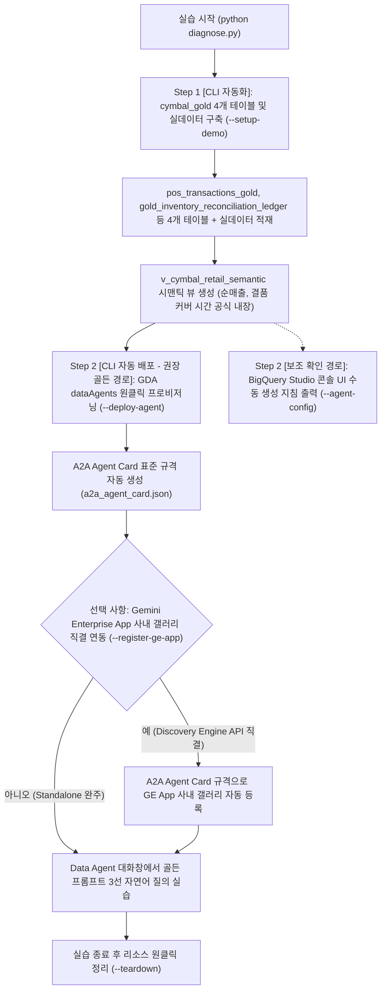

<!--
Copyright 2026 Google LLC. All Rights Reserved.
SPDX-License-Identifier: Apache-2.0

NOTICE: This code/repository is owned by Google LLC and provided under the Apache-2.0 License.
It is strictly provided as an EXAMPLE/REFERENCE ONLY and is NOT INTENDED FOR PRODUCTION USE.
All contents, designs, and code examples are subject to change, modification, or removal at any time without notice.

[고지 사항] 본 저장소 및 문서는 구글 (Google LLC) 소유이며 Apache 2.0 라이선스 하에 예시 (Sample) 용도로 제공된다.
프로덕션 환경용이 아니며, 사전 통지 없이 언제든지 수정, 변경 또는 삭제될 수 있다.
-->

> [!IMPORTANT]
> **구글 (Google LLC) 참조용 샘플 고지 사항**:
> 본 프로젝트의 모든 소스 코드와 문서는 Google LLC의 소유이며, Apache-2.0 라이선스에 따라 오직 **참조용 샘플 (Sample / Reference Only)** 목적으로만 제공된다. 프로덕션 환경에 그대로 사용할 수 없으며, 사전 통지 없이 언제든 내용이 수정, 변경 또는 삭제될 수 있다.

# BigQuery Conversational Analytics Data Agent 45분 완성 스타터 가이드 (Standalone & Optional Gemini Enterprise app)

45분 핸즈온 워크숍 내에 참석자가 명령어 한 줄(`--setup-demo`)로 빅쿼리(BigQuery) 스몰셋 데이터셋(`cymbal_gold`)과 실데이터를 10초 만에 자동 구축하고, 구글 1P 완전 관리형 런타임(GDA `dataAgents` REST API)을 통해 CLI 원클릭(`--deploy-agent`)으로 데이터 에이전트를 프로비저닝하며, A2A 표준 규격 기반으로 제미나이 엔터프라이즈 앱(Gemini Enterprise app)에 직결 연동하거나 BigQuery Studio 콘솔 UI에서 단독(Standalone)으로 멀티턴 대화 질의를 완주할 수 있도록 설계된 실무 워크숍 스타터 키트다. (As of 2026-10-19)

---

## 1. 발생 증상 및 진단 대상 체크리스트

사내 또는 고객사 환경에서 아래 증상이 발생한다면 즉시 진단 대상이다:
다음과 같은 요구 사항이 워크숍이나 사내 PoC에서 발생하고 있다면 즉시 본 스타터 키트를 활용해야 한다:
- [ ] 45분 내외의 짧은 핸즈온 세션 동안 참석자들이 BigQuery 데이터 준비부터 BigQuery Data Agent 생성 및 자연어 질의응답까지 막힘 없이 완주해야 하는 경우
- [ ] 별도의 컨테이너 빌드나 유휴 VM 비용 없이, 구글 관리형 테넌트 GDA(Gemini Data Analytics) `dataAgents` REST API를 통해 CLI 한 줄로 에이전트를 자동 프로비저닝하고자 하는 경우
- [ ] 제미나이 엔터프라이즈 앱에 올리지 않고 BigQuery Studio 내에서 단독(Standalone)으로 Data Agent를 쓰는 부서와, 제미나이 엔터프라이즈 앱에 직결 게시하려는 전사 배포 조직 모두를 하나의 워크숍 키트로 지원해야 하는 경우
- [ ] 별도의 GCP 과금이나 권한 부여 전, 가상 실행(`--dry-run`)으로 전체 SQL DDL/DML과 에이전트 시스템 지침, A2A Agent Card 명세를 사전 검토하고자 하는 경우

---

## 2. 빠른 시작 (Quickstart)

### 1) 모의 데이터 가상 실행 (Dry-Run)
GCP API 호출 없이 내장된 가상 인프라 데이터로 정상 동작 여부를 즉시 검증한다:
```bash
python diagnose.py --dry-run
```

**터미널 진단 출력 미리보기:**
```text
========================================================================================
 [BigQuery Data Agent 45분 완성 스몰셋 핸즈온 스타터 키트 (Standalone & Optional Gemini Enterprise app)]
========================================================================================
 - 대상 프로젝트 : sample-project-id (프로젝트 번호: 123456789012)
 - 빅쿼리 리전   : asia-northeast3 (데이터셋: cymbal_gold)
 - GDA 런타임   : global (에이전트 이름: cymbal-retail-data-agent)
 - GE App 엔진  : omni-retail-ge-app
 - 실행 모드     : 가상 모의 실행 (--dry-run)
----------------------------------------------------------------------------------------
 [45분 핸즈온 워크숍 역할 분담 타임라인 (GDA 완전 관리형 골든 아키텍처)]
```

### 2) 실제 사내 인프라 실시간 진단
```bash
cp .env.example .env
python diagnose.py
```
> [!NOTE]
> `.env` 설정값을 비워두면 gcloud 활성 설정 및 사내 리소스를 자동으로 감지하여 진단한다.

---

## 3. 45분 핸즈온 실습 및 프로비저닝 흐름



---
## 4. 조치 가이드 및 권장 설정

진단 결과 리포트(`report.md`)의 권장 조치 사항을 참조하여 설정을 반영한다.

---

## 5. 사전 준비 사항 (필요 IAM 권한)

본 도구를 실행하려면 최소 아래의 IAM 권한이 필요하다:

45분 핸즈온 실습을 위해 참석자 계정 또는 서비스 계정에 요구되는 최소 IAM 권한은 다음과 같다:

| 역할 (Role) | 권한 (Permission) | 용도 |
| : | : | : |
| `roles/bigquery.dataEditor` | `bigquery.datasets.create`, `bigquery.tables.create` | `--setup-demo` 실행 시 `cymbal_gold` 4개 테이블, 실데이터, 시맨틱 뷰 생성 |
| `roles/bigquery.jobUser` | `bigquery.jobs.create` | BigQuery 쿼리 실행 및 Data Agent 시맨틱 뷰 조회 |
| `roles/geminidataanalytics.dataAgentCreator` | `geminidataanalytics.dataAgents.create` | 구글 1P 완전 관리형 GDA `dataAgents` REST API 호출 및 에이전트 자동 생성 |
| `roles/discoveryengine.admin` | `discoveryengine.engines.update`, `discoveryengine.agents.create` | `[선택 사항]` A2A Agent Card를 Gemini Enterprise App 사내 갤러리에 직결 등록 |

---

## 6. 기술적 배경 및 아키텍처 원리 (Deep Dive)

- **골든 프롬프트 1 (지점 및 결제 수단별 순매출 비교)**:
  ```text
  지점(store_branch) 및 결제 수단(tender_type)별 총상품 금액(subtotal_amount), 할인 금액(discount), 세금(tax_amount)을 반영한 순매출(Net Revenue)을 비교해 줘.
  ```
- **골든 프롬프트 2 (결품 예상 커버 시간 6시간 이하 긴급 보충 품목 탐지)**:
  ```text
  현재 진열 재고(shelf_qty)와 창고 재고(backroom_qty) 합계를 시간당 판매 속도로 나눴을 때, 결품 예상 커버 시간(est_cover_hours)이 6시간 이하인 긴급 보충 대상 지점과 품목(item_sku)을 알려 줘.
  ```
- **골든 프롬프트 3 (캐셔 프로모션 임의 할인 남용 이상 거래 진단)**:
  ```text
  이상 거래 경보 테이블(pos_anomaly_alerts)에서 프로모션 남용(cashier_promo_abuse) 경보가 발생한 지점과 담당 캐셔 ID, 심각도(severity)를 보여 줘.
  ```

---
## 7. 리소스 정리 (Teardown) 안내

45분 핸즈온 실습이 끝난 후 불필요한 클라우드 리소스 과금을 예방하기 위해 아래 명령어로 스몰셋 데이터셋을 즉시 정리한다:

```bash
# 생성된 실습 데이터셋(cymbal_gold) 및 하위 테이블/뷰 일괄 삭제
python diagnose.py --teardown
```
