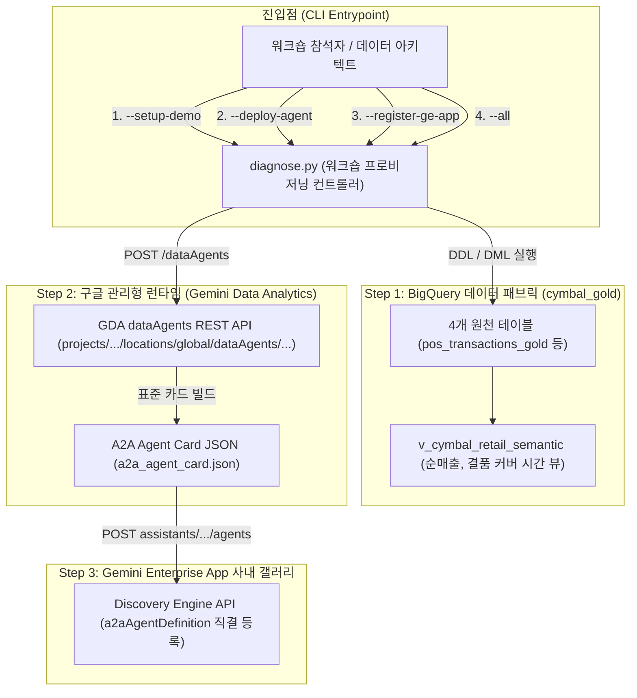

<!--
Copyright 2026 Google LLC. All Rights Reserved.
SPDX-License-Identifier: Apache-2.0

NOTICE: This code/repository is owned by Google LLC and provided under the Apache-2.0 License.
It is strictly provided as an EXAMPLE/REFERENCE ONLY and is NOT INTENDED FOR PRODUCTION USE.
All contents, designs, and code examples are subject to change, modification, or removal at any time without notice.

[고지 사항] 본 저장소 및 문서는 구글 (Google LLC) 소유이며 Apache 2.0 라이선스 하에 예시 (Sample) 용도로 제공된다.
프로덕션 환경용이 아니며, 사전 통지 없이 언제든지 수정, 변경 또는 삭제될 수 있다.
-->

# 기술 상세 설계서 (TDD: Technical Design Document)
## 프로젝트명: BigQuery Data Agent 45-Minute Hands-on Starter Kit (Standalone & Optional Gemini Enterprise app) (As of 2026-10-19)

---

## 1. 시스템 아키텍처 개요 및 설계 원칙

### 1.1 설계 목표
본 도구는 45분 핸즈온 워크숍 참석자가 BigQuery 스몰셋 데이터셋(`cymbal_gold`) 구축부터 구글 1P 완전 관리형 런타임(GDA `dataAgents` REST API)을 통한 에이전트 자동 프로비저닝, A2A Agent Card 규격 생성, Discovery Engine REST API 기반 Gemini Enterprise App 사내 갤러리 직결 연동까지 수행할 수 있도록 지원하는 **경량 워크숍 프로비저닝 및 연동 가이드 엔진**이다.

### 1.2 핵심 설계 원칙
1. **순수 파이썬 단일 실행 모델**: 쉘 래퍼 스크립트에 의존하지 않고 크로스 플랫폼에서 일관되게 동작하는 `python diagnose.py` 직접 실행 체계 구축.
2. **구글 1P 관리형 런타임 표준**: 커스텀 컨테이너 빌드나 유휴 VM 호스팅 없이, GDA REST API를 호출하여 구글 관리형 테넌트에서 1초 만에 데이터 에이전트를 프로비저닝.
3. **A2A 표준 프로토콜 바인딩**: A2UI, stateless, starter_prompts 확장을 내장한 A2A Agent Card 표준 규격(`a2a_agent_card.json`)을 생성하고 사내 갤러리에 직결 등록.
4. **계층형 캐스케이드 설정 탐색(Cascade Fallback)**: CLI 인자 > `.env` > `gcloud config` > 대화형 번호 선택기(`interactive_select`) > 사내 권장 기본값(`asia-northeast3`, `global`) 순으로 무중단 설정 확정.
5. **독립 완결성(Zero Dependency)**: 외부 모듈이나 다른 샘플에 대한 코드 의존성 없이 100% 자체 완결적으로 동작.

---

## 2. 시스템 아키텍처 및 데이터 흐름도

---

## 3. 기능적 기술 요구 사항 명세 (Functional Requirements)

| 요구 사항 ID | 구현 모듈 | 상세 기술 설계 명세 |
| :--- | :--- | :--- |
| **FR-01** | `resolve_config` | CLI 인자, `.env`, `gcloud config get-value project`, `gcloud projects describe`를 순차 탐색하고 설정을 확정하여야 한다. |
| **FR-02** | `setup_smallset_demo` | `cymbal_gold` 데이터셋 내에 4개 테이블 DDL과 샘플 데이터 `INSERT INTO`, `v_cymbal_retail_semantic` 뷰 SQL을 BigQuery API로 실행하여야 한다. |
| **FR-03** | `create_gda_data_agent` | GDA REST API(`geminidataanalytics.googleapis.com/v1beta`)를 호출하여 `stagingContext` 및 `publishedContext`에 시스템 지침, 테이블 참조, 검증된 쿼리 3쌍을 주입하고 LRO를 대기하여야 한다. |
| **FR-04** | `build_a2a_agent_card` | A2UI, starter_prompts, full_history_when_stateless 확장을 포함하는 A2A Agent Card 표준 규격을 빌드하고 로컬 JSON 파일로 저장하여야 한다. |
| **FR-05** | `register_agent_to_ge_app_api` | Discovery Engine REST API(`discoveryengine.googleapis.com/v1alpha`)를 호출하여 GE App 엔진에 A2A 에이전트를 직결 등록하고, 실패 시 콘솔 UI 수동 등록 가이드를 제공하여야 한다. |
| **FR-06** | `export_data_agent_config` | 콘솔 UI 수동 생성을 위한 System Instructions와 Verified Queries를 출력하여 보조 확인 경로를 제공하여야 한다. |
| **FR-07** | `print_workshop_guide_and_prompts` | 45분 워크숍 타임라인과 골든 프롬프트 3선의 자연어 질문, 기대 SQL, 샘플 응답 행을 출력하여야 한다. |
| **FR-08** | `teardown_demo_environment` | `--teardown` 실행 시 BigQuery 데이터셋과 GDA Data Agent 리소스를 안전하게 삭제하여 비용 누수를 방지하여야 한다. |
| **FR-09** | `inject_mandatory_labels` | 데이터셋, 테이블, 뷰, GDA 리소스 생성 시 4대 표준 라벨(`managed-by=google-cloud-0-to-1`, `scenario=bigquery-data-agent-starter`, `env=sample`, `created-by=customer-engineer`)을 누락 없이 주입하여야 한다. |

---

## 4. 비기능 설계 및 검증 전략 (Non-Functional Requirements)

| 요구 사항 ID | 분류 | 세부 설계 및 검증 방법 |
| :--- | :--- | :--- |
| **NFR-01** | 모의 실행 (Dry-run) | 외부 네트워크나 GCP 권한 없이 `python diagnose.py --dry-run` 명령만으로 45분 타임라인, SQL DDL/DML, GDA 페이로드, A2A 카드를 1초 내에 출력한다. |
| **NFR-02** | 보안 및 PII 배제 | 모든 소스 코드와 DDL, 샘플 데이터에는 특정 기업 고유 명칭이나 개인 식별 정보를 일절 포함하지 않으며 표준 엔터프라이즈 가명(`cymbal_gold`)만을 사용한다. |
| **NFR-03** | 코드 독립성 | 타 샘플이나 모듈을 참조하지 않고 100% 자체 완결적으로 실행된다. |
| **NFR-04** | FinOps 자원 추적성 | 워크숍 실습 인프라가 사내 거버넌스 및 FinOps 시스템에서 자동 식별될 수 있도록 표준 메타데이터 태깅을 강제한다. |
