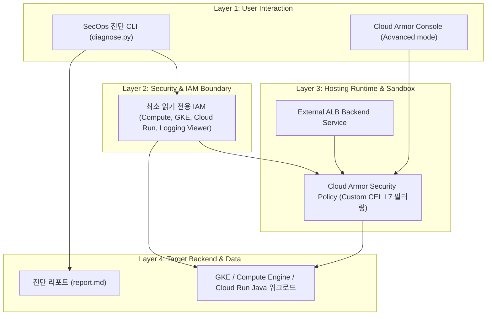

<!--
Copyright 2026 Google LLC. All Rights Reserved.
SPDX-License-Identifier: Apache-2.0

NOTICE: This code/repository is owned by Google LLC and provided under the Apache-2.0 License.
It is strictly provided as an EXAMPLE/REFERENCE ONLY and is NOT INTENDED FOR PRODUCTION USE.
All contents, designs, and code examples are subject to change, modification, or removal at any time without notice.

[고지 사항] 본 저장소 및 문서는 구글 (Google LLC) 소유이며 Apache 2.0 라이선스 하에 예시 (Sample) 용도로 제공된다.
프로덕션 환경용이 아니며, 사전 통지 없이 언제든지 수정, 변경 또는 삭제될 수 있다.
-->

> [!IMPORTANT]
> **구글 (Google LLC) 참조용 샘플 고지 사항**:
> 본 프로젝트의 모든 소스 코드와 문서는 Google LLC의 소유이며, Apache-2.0 라이선스에 따라 오직 **참조용 샘플 (Sample / Reference Only)** 목적으로만 제공된다. 프로덕션 환경에 그대로 사용할 수 없으며, 사전 통지 없이 언제든 내용이 수정, 변경 또는 삭제될 수 있다.

# Cloud Armor 기반 Java4Shell (CVE-2026-114938) 가상 패치 및 노출 진단기

OpenJDK `17.0.6+` AVX-512 VBMI 취약점(`CVE-2026-114938`, 보안 공지 `GCP-2026-082`)에 노출된 Compute Engine, GKE, Cloud Run 워크로드를 식별하고, Cloud Armor Custom CEL 기반 가상 패치(Virtual Patching) 규칙과 실환경 4대 설정 함정을 1분 만에 교차 진단하는 도구다. (As of 2026-11-18)

---

## 1. 발생 증상 및 진단 대상 체크리스트

사내 운영 환경에서 아래 항목에 해당한다면 즉시 진단 대상이다:
- [ ] GKE, Compute Engine(`N2`, `C3`, `C4`, `N4`, `M3`, `M4` 등 AVX-512 VBMI 지원 시리즈) 또는 Cloud Run 1세대/커스텀 컨테이너에서 OpenJDK `17.0.6+`, `21.x`, `25.x`, `27.x`를 운영 중이다.
- [ ] Cloud Armor 기본 제공 WAF 규칙(`java-v422-stable` 등)만으로는 `CVE-2026-114938` 비정상 Base64 패딩(`L % 4 != 0` + `=`) 공격을 차단할 수 없어 L7 가상 패치가 필요하다.
- [ ] `base64Decode() == ''` 부분 디코딩 우회, `request.body`/`request.params` 정책 선연결 순서 오류(`undeclared reference to 'request'`), `.urlDecode()`의 `+` 공백 치환 오탐 여부를 자동 점검하고자 한다.

---

## 2. 빠른 시작 (Quickstart)

1단계: 모의 실행으로 동작 및 리포트 확인
```bash
python diagnose.py --dry-run
```

2단계: 대화형 환경 설정 마법사로 `.env` 생성 (선택)
```bash
python diagnose.py --config
```

3단계: 실환경 읽기 전용 진단 실행
```bash
python diagnose.py
```

터미널 출력 미리보기:
```text
========================================================================
Cloud Armor Java4Shell (CVE-2026-114938) 노출 및 WAF 진단 결과
========================================================================
- 대상 프로젝트: sample-project-id
- 점검 워크로드 수: 3개
- AVX-512 VBMI 미완화 추정 워크로드: 2개
- 점검 Cloud Armor 정책 수: 1개
  * 정책 [prod-java-waf-policy] -> FAIL 2건, WARN 2건 (본문 검사: 8KB)
------------------------------------------------------------------------
[완료] 상세 진단 및 처방 리포트가 저장되었다: report.md
```

---

## 3. 솔루션 아키텍처 및 처리 흐름



---

## 4. 조치 가이드 및 권장 설정

진단 완료 후 생성된 [report.md](report.md)의 처방에 따라 아래 순서로 가상 패치 및 근본 조치를 적용한다:

1. **테스트 정책 생성 및 64KB 본문 검사 상한 설정** (4대 표준 라벨 적용):
```bash
gcloud compute security-policies create java4shell-waf-policy \
  --labels=managed-by=google-cloud-0-to-1,scenario=cloud-armor-java4shell-guard,env=sample,created-by=customer-engineer

gcloud beta compute security-policies update java4shell-waf-policy \
  --request-body-inspection-size=64KB
```

2. **Backend Service 선연결 (`request.body`/`request.params` 규칙 추가 전 필수)**:
```bash
gcloud compute backend-services update <BACKEND_SERVICE_NAME> \
  --security-policy=java4shell-waf-policy --global
```

3. **Custom CEL 규칙 `--preview` 선배포 후 Cloud Logging 검증 및 Enforce 전환**:
```bash
# Cloud Logging Preview 매칭 확인
gcloud logging read 'resource.type="http_load_balancer" AND jsonPayload.previewSecurityPolicy.configuredAction="DENY"' --limit=20

# 검증 완료 후 차단(Enforce) 전환
gcloud compute security-policies rules update 1000 --security-policy=java4shell-waf-policy --no-preview
```

4. **워크로드 근본 조치 (GCP-2026-082)**:
```bash
JDK_JAVA_OPTIONS="-XX:+IgnoreUnrecognizedVMOptions -XX:UseAVX=2"
```

- Cloud Armor Security Policies 콘솔 ( https://console.cloud.google.com/net-security/securitypolicies/list )

---

## 5. 사전 준비 사항 (필요 IAM 권한)

| 서비스 | 필요 역할 (Role) | 최소 IAM 권한 | 용도 |
| :--- | :--- | :--- | :--- |
| `Compute Engine` | `Compute 뷰어(roles/compute.viewer)` | `compute.instances.list`, `compute.backendServices.list`, `compute.securityPolicies.list` | VM, Backend Service, Cloud Armor 정책 조회 |
| `GKE` | `Kubernetes Engine 뷰어(roles/container.viewer)` | `container.clusters.list` | 노드풀 머신 시리즈 조회 |
| `Cloud Run` | `Cloud Run 뷰어(roles/run.viewer)` | `run.services.list` | 서비스 및 환경 변수 조회 |
| `Cloud Logging` | `Logs 뷰어(roles/logging.viewer)` | `logging.entries.list` | Preview 매칭 로그 확인 |

---

## 6. 기술적 배경 및 아키텍처 원리 (Deep Dive)

- 세부 요구 사항 및 추적성은 [docs/BRD.md](docs/BRD.md) 및 [docs/TDD.md](docs/TDD.md)를 참고한다.
- **부분 디코딩 우회 차단**: Cloud Armor의 `base64Decode()`는 앞 64바이트만 정상 디코딩해도 비어 있지 않은 문자열을 반환하므로 `base64Decode() == ''` 대신 `contains('=') && matches(...)` 단락 평가와 정규식을 조합한다.
- **`.urlDecode()` 및 Form 분리**: 표준 Base64의 `+`가 공백으로 치환되는 오탐을 막기 위해 `Cookie`와 JSON/XML 원문 본문에는 `.urlDecode()`를 적용하지 않고, `application/x-www-form-urlencoded` 본문만 별도 규칙으로 분리한다.
- Google Cloud Security Bulletins GCP-2026-082 ( https://docs.cloud.google.com/support/bulletins#gcp-2026-082 )
- Google Cloud Armor Custom Rules Language Reference ( https://cloud.google.com/armor/docs/create-security-policy-rules )

---

## 7. 리소스 정리 (Teardown) 안내

OpenJDK 보안 패치 및 검증을 완료한 뒤 테스트용 Cloud Armor 정책을 수동으로 정리하려면 아래 명령어를 실행한다 (진단 도구는 리소스를 자동 삭제하지 않는다):
```bash
gcloud compute backend-services update <BACKEND_SERVICE_NAME> --no-security-policy --global
gcloud compute security-policies delete java4shell-waf-policy
```
