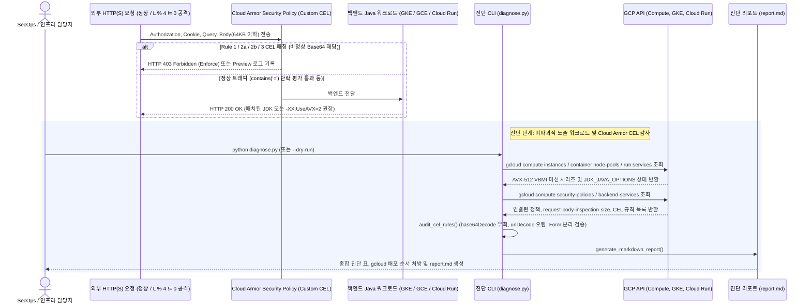

<!--
Copyright 2026 Google LLC. All Rights Reserved.
SPDX-License-Identifier: Apache-2.0

NOTICE: This code/repository is owned by Google LLC and provided under the Apache-2.0 License.
It is strictly provided as an EXAMPLE/REFERENCE ONLY and is NOT INTENDED FOR PRODUCTION USE.
All contents, designs, and code examples are subject to change, modification, or removal at any time without notice.

[고지 사항] 본 저장소 및 문서는 구글 (Google LLC) 소유이며 Apache 2.0 라이선스 하에 예시 (Sample) 용도로 제공된다.
프로덕션 환경용이 아니며, 사전 통지 없이 언제든지 수정, 변경 또는 삭제될 수 있다.
-->

> [!IMPORTANT]
> **구글 (Google LLC) 참조용 샘플 고지 사항**:
> 본 프로젝트의 모든 소스 코드와 문서는 Google LLC의 소유이며, Apache-2.0 라이선스에 따라 오직 **참조용 샘플 (Sample / Reference Only)** 목적으로만 제공된다. 프로덕션 환경에 그대로 사용할 수 없으며, 사전 통지 없이 언제든 내용이 수정, 변경 또는 삭제될 수 있다.

# 기술 상세 설계서 (TDD): Cloud Armor 기반 Java4Shell (CVE-2026-114938) 가상 패치 및 노출 진단기 (As of 2026-11-18)

## 1. 시스템 아키텍처 및 런타임 상호작용 시퀀스

본 도구의 런타임 제어 및 데이터 상호작용 흐름은 아래 시퀀스 다이어그램과 같다. 외부 요청이 External ALB 앞단의 Cloud Armor Custom CEL 규칙을 통과하거나 차단되는 L7 방어 경로와, `diagnose.py`가 사내 프로젝트의 AVX-512 VBMI 워크로드 노출 현황 및 Cloud Armor 정책의 CEL 실환경 함정을 비파괴적으로 교차 진단해 `report.md`를 생성하는 흐름을 정의한다.

---

## 2. 요구 사항 추적성 매핑 (Traceability Matrix)

| 비즈니스 요구 사항 (BRD) | 기능적 기술 요구 사항 (FR) | 비기능적 기술 요구 사항 (NFR) | 구현 파일 및 모듈 |
| :--- | :--- | :--- | :--- |
| **BR-01** (노출 워크로드 및 WAF 방어 공백 사전 탐지) | **FR-02** (AVX-512 VBMI 워크로드 및 Cloud Armor 정책 교차 진단) | **NFR-01** (최소 IAM 읽기 전용 권한 준수) | `diagnose.py` (`scan_exposed_workloads`, `audit_security_policies`) |
| **BR-02** (Cloud Armor CEL 실환경 함정 정적 감사) | **FR-03** (CEL 4대 실환경 함정 및 하위 표현식 한도 검출) | **NFR-02** (비대화형 환경 호환성) | `diagnose.py` (`inspect_cel_pitfalls`) |
| **BR-03** (가상 실행 기반 무중단 사전 검증) | **FR-04** (가상 실행 스모크 테스트 모드) | **NFR-03** (민감 정보 비식별화) | `diagnose.py` (`get_mock_diagnostics`, `--dry-run`) |
| **BR-04** (단계별 배포 순서 및 근본 조치 가이드 제공) | **FR-05** (표준 조치 CLI, Preview 검증 및 Teardown 가이드 생성) | **NFR-04** (자원 거버넌스 및 라벨링 규약) | `diagnose.py` (`generate_markdown_report`), `report.md` |
| **BR-05** (자원 거버넌스 라벨링 표준 준수) | **FR-05** (4대 표준 라벨 포함 CLI 처방 생성) | **NFR-04** (자원 거버넌스 준수) | `README.md`, `diagnose.py`, `report.md` |

---

## 3. 기능적 기술 요구 사항 (Functional Requirements)

| 요구 사항 ID | 연관 BR | 기술 요구 사항 명칭 | 구현 상세 및 검증 기준 |
| :--- | :--- | :--- | :--- |
| **FR-01** | **BR-01** | **계층형 환경 설정 및 대상 정책 자동 탐지** | CLI 인자(`--config`, `--dry-run`, `-p/--project`, `--policy`, `--backend-service`) > `.env` 및 환경 변수 > `gcloud config` 활성 프로젝트 > 대화형 번호 선택기(`sys.stdin.isatty()`) 순으로 프로젝트 및 점검 대상 Cloud Armor 정책을 확정한다. |
| **FR-02** | **BR-01** | **AVX-512 VBMI 워크로드 및 Cloud Armor 정책 교차 진단** | Compute Engine VM 및 GKE 노드풀 머신 타입을 `N2`, `C3`, `C3D`, `C4`, `C4D`, `N4`, `N4D`, `M3`, `M4`, `A3`, `A4`, `G4`, `H3`, `X4`, `Z3` 계열과 대조해 잠재 노출 대상을 분류하고, Cloud Run 1세대/커스텀 컨테이너의 `JDK_JAVA_OPTIONS` 설정 여부 및 External ALB Backend Service의 Security Policy 연결 상태를 조회한다. |
| **FR-03** | **BR-02** | **CEL 4대 실환경 함정 정적 감사** | 등록된 Custom CEL 표현식에서 (1) `base64Decode() == ''` 부분 디코딩 우회 패턴, (2) 표준 Base64 헤더/본문 내 `.urlDecode()` 호출 오탐 패턴, (3) `request.body` 규칙의 `application/x-www-form-urlencoded` 미분리 패턴, (4) `request-body-inspection-size` 64KB 미설정 및 일반 캡처 그룹 `(...)` 사용 여부를 검출하여 `PASS`/`WARN`/`FAIL` 등급을 부여한다. |
| **FR-04** | **BR-03** | **가상 실행(`--dry-run`) 스모크 테스트 모드** | `--dry-run` 플래그 입력 시 외부 GCP API 호출 없이 `sample-project-id` 가명 기반 모의 진단 데이터를 사용하여 터미널 출력 및 `report.md` 생성을 1초 이내에 완료한다. |
| **FR-05** | **BR-04, BR-05** | **순서 보장 배포 CLI 및 근본 조치 리포트 생성** | `request.body`/`request.params` 규칙 추가 전 Backend Service 선연결, `gcloud beta` 64KB 검사 상한 설정, Rule `1000/1010/1015/1020` `--preview` 선배포, Cloud Logging 조회 필터, `--no-preview` 전환 명령(4대 표준 라벨 포함) 및 `JDK_JAVA_OPTIONS="-XX:+IgnoreUnrecognizedVMOptions -XX:UseAVX=2"` 처방을 `report.md`에 기록한다. |

---

## 4. 비기능적 기술 요구 사항 (Non-Functional Requirements)

| 요구 사항 ID | 요구 사항 명칭 | 상세 기준 |
| :--- | :--- | :--- |
| **NFR-01** | **최소 IAM 권한 준수** | 진단에 필요한 읽기 전용 권한(`roles/compute.viewer`, `roles/container.viewer`, `roles/run.viewer`, `roles/logging.viewer`)만 요구하며 인프라 및 보안 정책을 임의로 변경하지 않는다. |
| **NFR-02** | **비대화형 환경 호환성** | 파이프, CI/CD, 백그라운드 실행 등 `not sys.stdin.isatty()` 환경에서는 대화형 선택 입력을 우회해 첫 번째 후보를 자동 채택하고 프로세스 멈춤을 방지한다. |
| **NFR-03** | **민감 정보 비식별화** | `--dry-run` 및 기본 산출물(`report.md`)에 실제 프로젝트 ID, 도메인, IP, 토큰 등 식별 정보를 노출하지 않고 `sample-project-id` 등 가명을 사용한다. |
| **NFR-04** | **자원 거버넌스 및 라벨링 규약** | 테스트용 로드 밸런서 및 백엔드 리소스 생성 가이드에서 4대 표준 라벨(`managed-by=google-cloud-0-to-1`, `scenario=cloud-armor-java4shell-guard`, `env=sample`, `created-by=customer-engineer`)을 일관되게 안내한다. |
