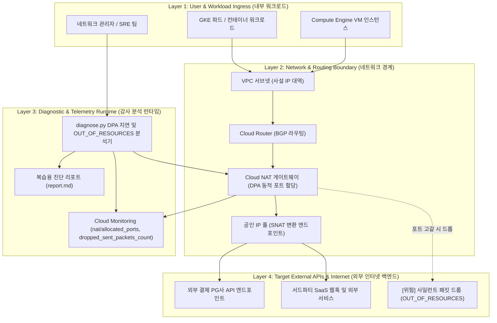

<!--
Copyright 2026 Google LLC. All Rights Reserved.
SPDX-License-Identifier: Apache-2.0

NOTICE: This code/repository is owned by Google LLC and provided under the Apache-2.0 License.
It is strictly provided as an EXAMPLE/REFERENCE ONLY and is NOT INTENDED FOR PRODUCTION USE.
All contents, designs, and code examples are subject to change, modification, or removal at any time without notice.

[고지 사항] 본 저장소 및 문서는 구글 (Google LLC) 소유이며 Apache 2.0 라이선스 하에 예시 (Sample) 용도로 제공된다.
프로덕션 환경용이 아니며, 사전 통지 없이 언제든지 수정, 변경 또는 삭제될 수 있다.
-->

> [!IMPORTANT]
> **구글 (Google LLC) 참조용 샘플 고지 사항**:
> 본 프로젝트의 모든 소스 코드와 문서는 Google LLC의 소유이며, Apache-2.0 라이선스에 따라 오직 **참조용 샘플 (Sample / Reference Only)** 목적으로만 제공된다. 프로덕션 환경에 그대로 사용할 수 없으며, 사전 통지 없이 언제든 내용이 수정, 변경 또는 삭제될 수 있다.

# Cloud NAT 포트 고갈 및 사일런트 패킷 드롭 진단기

구글 쿠버네티스 엔진(GKE, Google Kubernetes Engine) 클러스터 및 컴퓨트 엔진(Compute Engine) 환경에서 외부 API 호출 시 발생하는 간헐적 타임아웃 장애의 근본 원인을 규명하기 위해, 클라우드 NAT(Cloud NAT)의 동적 포트 할당(DPA) 확장 지연과 자원 고갈 패킷 드롭(OUT_OF_RESOURCES)을 1분 만에 교차 진단하고 최적의 최소 할당 포트와 커널 재시도 파라미터를 도출하는 도구다. (As of 2026-10-17)

---

## 1. 발생 증상 및 진단 대상 체크리스트

사내 또는 고객사 인프라에서 아래 증상이 발생한다면 즉시 진단 대상이다:
- [ ] GKE 파드 또는 VM에서 외부 결제 PG사, 서드파티 API 호출 시 간헐적으로 `Connection timed out` 또는 `Connection reset by peer`가 발생할 때
- [ ] GCP 콘솔에서 Cloud NAT 상태는 정상(Green/Running)으로 표시되나 실트래픽에서 연결 실패가 보고될 때
- [ ] 트래픽 버스트 시 4분(240초) 동안 신규 TCP SYN 패킷이 유실되는 DPA 확장 지연(NET-AV-2)이 의심될 때
- [ ] `minPortsPerVm=64` 기본 설정 상태에서 동시 아웃바운드 연결 수가 병목에 도달했는지 확인하고 싶을 때


### 1.1 도구의 본질 및 비즈니스 해결 과제 (What & Why)
- **대상 사용자 (Target)**: 클라우드 네트워크 엔지니어, SRE/DevOps 팀, GKE 인프라 운영자 및 시스템 아키텍트
- **해결하는 핵심 문제 (Core Pain Points)**:
  1. GKE 파드나 VM에서 외부 결제/인증 API 호출 시 간헐적으로 원인 불명의 타임아웃과 연결 실패가 발생하는 문제
  2. 동적 포트 할당(Dynamic Port Allocation) 확장 지연과 포트 고갈 드롭(OUT_OF_RESOURCES)이 대시보드에 명확히 표출되지 않는 사일런트 장애
  3. 최소 할당 포트와 커널 소켓 재시도 파라미터를 경험에 의존하여 임의 설정하다가 재고갈 또는 IP 낭비를 초래하는 현상
- **본 솔루션의 해결 방식 (Solution)**:
  - Cloud Monitoring의 Cloud NAT 7일간 실측 지표를 분석하여 동적 포트 할당 지연율과 자원 고갈 패킷 드롭을 교차 검증하고, 파드 동시성 트래픽에 최적화된 최소 할당 포트 및 Linux 커널 FIN 타임아웃 최적화 파라미터를 자동 도출한다.

### 1.2 최종 산출물 3종 세트 미리보기 (Deliverables & Visual Preview)
본 도구를 실행(`python diagnose.py`)하면 다음 3가지 구체적인 엔터프라이즈 자산이 생성된다:

| 산출물 구분 | 산출물 형태 및 명칭 | 주요 포함 내용 및 실무 활용 방안 |
| :--- | :--- | :--- |
| **① 터미널 콘솔 요약** | Visual CLI Table | Cloud NAT 게이트웨이별 포트 할당률, 패킷 드롭 건수, 고갈 위험 등급 및 권장 최소 포트 수치 |
| **② 정규 진단 보고서** | 마크다운 파일 (`report.md`) | 7일간 시계열 지표 분석 결과, 트래픽 피크 대비 권장 포트 계산 근거, gcloud 설정 명령어 및 커널 튜닝 가이드 |
| **③ 후속 조치 및 배포 자산** | Actionable Asset Specs | • **Cloud NAT 최적화 gcloud 명령어**: `--min-ports-per-vm` 및 정적 IP 확충 설정<br/>• **Linux 커널 소켓 튜닝 스크립트**: `tcp_fin_timeout` 및 `tcp_tw_reuse` 파라미터 적용 가이드<br/>• **GKE 노드 풀 네트워크 정책 매니페스트**: 대량 아웃바운드 트래픽 분산 매니페스트 |

---

## 2. 빠른 시작 (Quickstart)

> [!TIP]
> Cloud Shell 접속 환경 구성 및 저장소 클론(`git clone`) 방법은 루트의 [메인 README](../../README.md)를 참고한다.

### 1) 모의 데이터 가상 실행 (Dry-Run)
GCP API 호출 없이 내장된 가상 인프라 데이터로 정상 동작 여부를 즉시 검증한다:
```bash
python diagnose.py --dry-run
```

**터미널 진단 출력 미리보기:**
```text
[3] 종합 진단 결과: [CRITICAL]
  * 원인 분석: Cloud NAT 게이트웨이에서 1,420건의 아웃바운드 패킷 드롭(OUT_OF_RESOURCES)이 실제 발생함

[4] 포트 임계치 초과 인스턴스 상세:
  gke-prod-core-pool-a1b2 | 피크 포트: 1012/1024 (98.8%) | 드롭 수: 860건

[5] 긴급 조치 가이드 및 아키텍처 처방:
  gcloud compute routers nats update nat-gw-prod-main \
    --router=cr-prod-asia-northeast3 --region=asia-northeast3 \
    --enable-dynamic-port-allocation --min-ports-per-vm=256 --max-ports-per-vm=2048
```


### 2) 사내 환경 대화형 설정 (Config Wizard, 선택 사항)
사내 활성 프로젝트 및 환경 설정을 대화형으로 탐색하여 `.env`에 자동 저장한다:
```bash
python diagnose.py --config
```


### 3) 실제 사내 인프라 실시간 진단
```bash
python diagnose.py
```
> [!NOTE]
> 앞서 `python diagnose.py --config`로 환경 설정을 저장했거나 gcloud 활성 설정을 그대로 활용할 경우 별도의 `.env` 생성 없이 즉시 실행할 수 있다. 특정 리전이나 라우터를 명시하려면 환경 변수 또는 .env 파일에 기재한다. (환경 변수를 텍스트 에디터로 직접 수동 편집하고자 할 때만  실행 후 수정)

---

## 3. 솔루션 아키텍처 및 처리 흐름



---

## 4. 조치 가이드 및 권장 설정

진단 도구가 `CRITICAL` 또는 `WARNING` 상태를 출력한 경우 아래의 순서로 조치한다:

1. **최소 할당 포트(min-ports-per-vm) 상향**:
   ```bash
   gcloud compute routers nats update [NAT_NAME] \
     --router=[ROUTER_NAME] \
     --region=[REGION] \
     --enable-dynamic-port-allocation \
     --min-ports-per-vm=256 \
     --max-ports-per-vm=2048
   ```

2. **GKE 노드 및 VM 커널 파라미터 튜닝**:
   호스트 노드에서 임시 적용:
   ```bash
   sudo sysctl -w net.ipv4.tcp_syn_retries=6
   ```
   영구 반영 (`/etc/sysctl.d/99-gcp-nat.conf`):
   ```bash
   echo "net.ipv4.tcp_syn_retries = 6" | sudo tee -a /etc/sysctl.d/99-gcp-nat.conf
   sudo sysctl -p /etc/sysctl.d/99-gcp-nat.conf
   ```

3. **GCP 리소스 생성 시 4대 필수 표준 라벨링 준수**:
   - 사내 거버넌스 및 FinOps 비용 추적을 위해 Cloud Router, Cloud NAT 게이트웨이 등 신규 네트워크 리소스 생성 시 4대 표준 라벨을 필수로 주입한다:
     - `managed-by`: `google-cloud-0-to-1`
     - `scenario`: `cloud-nat-port-exhaustion-guard`
     - `env`: `sample`
     - `created-by`: `customer-engineer`
   - gcloud CLI 예시: `--labels=managed-by=google-cloud-0-to-1,scenario=cloud-nat-port-exhaustion-guard,env=sample`

---

## 5. 사전 준비 사항 (필요 IAM 권한)

본 도구를 실행하려면 최소 아래의 IAM 권한이 필요하다:

| 서비스 | 필요 역할 (Role) | 최소 IAM 권한 |
| :--- | :--- | :--- |
| `Cloud Monitoring` | `roles/monitoring.viewer` | `monitoring.timeSeries.list` |
| `Compute Engine` | `roles/compute.networkViewer` | `compute.routers.get`, `compute.routers.list` |

---

## 6. 기술적 배경 및 아키텍처 원리 (Deep Dive)

### 관련 상세 설계 및 요구 사항 명세
- [비즈니스 요구 사항 명세서 (BRD)](docs/BRD.md): 비즈니스 배경, 성공 지표 및 요구 사항(BR-01~) 명세
- [기술 상세 설계서 (TDD)](docs/TDD.md): 시스템 아키텍처, 기능(FR-01~) 및 비기능(NFR-01~) 설계 명세

Cloud NAT는 외부 공인 IP가 없는 사설 서브넷의 가상 머신이나 GKE 노드가 인터넷으로 안전하게 나갈 수 있도록 지원한다. 이때 출발지 IP와 포트를 변환하여 전송하는데, 포트 할당 방식에 따라 다음과 같은 구조적 병목이 발생할 수 있다:

1. **동적 포트 할당(DPA) 확장 지연 (NET-AV-2)**:
   - DPA가 켜져 있더라도 각 인스턴스는 초기에 `minPortsPerVm`(기본 64개)으로 시작한다.
   - 트래픽이 순간적으로 급증하여 기존 포트를 소진하면, Cloud NAT는 2배씩 포트 블록(예: 64 -> 128 -> 256 -> 512)을 확장한다.
   - 하지만 사용량 감지 및 포트 블록 재할당에는 최대 240초(4분)의 전파 지연이 발생할 수 있다.
   - 이 지연 시간 동안 새로 생성되는 TCP SYN 패킷은 `OUT_OF_RESOURCES` 사유로 무음 폐기(Silent Drop)된다.

2. **클라이언트 OS 커널의 SYN 재시도 한계**:
   - 리눅스 기본 커널 설정에서 TCP SYN 재시도 횟수(`net.ipv4.tcp_syn_retries`)가 낮게 설정되어 있으면, Cloud NAT가 포트를 확장하기 전에 클라이언트가 연결을 포기하고 타임아웃 오류를 애플리케이션으로 반환한다.
   - 따라서 `minPortsPerVm`을 사전에 여유 있게 확보하고(예: 256개 이상), 커널 SYN 재시도 횟수를 상향 조정(예: 6회 이상)하는 조치가 병행되어야 한다.

3. **관련 공식 기술 문서 및 콘솔 경로**:
   - Cloud NAT 포트 할당 개요 ( https://cloud.google.com/nat/docs/ports-and-addresses )
   - Cloud NAT 구성 최적화 가이드 ( https://cloud.google.com/nat/docs/tune-nat-configuration )
   - Cloud NAT 모니터링 지표 참조 ( https://cloud.google.com/nat/docs/monitoring )
   - Cloud NAT 콘솔 게이트웨이 목록 ( https://console.cloud.google.com/net-services/nat/list )

---

## 7. 리소스 정리 (Teardown) 안내

본 진단 도구는 읽기 전용(Read-Only) 명령어로 작동하므로 별도의 클라우드 인프라 자원을 생성하지 않는다. 로컬에서 생성된 가상 환경이나 임시 설정 파일만 정리하면 된다:
```bash
rm -f .env
```
