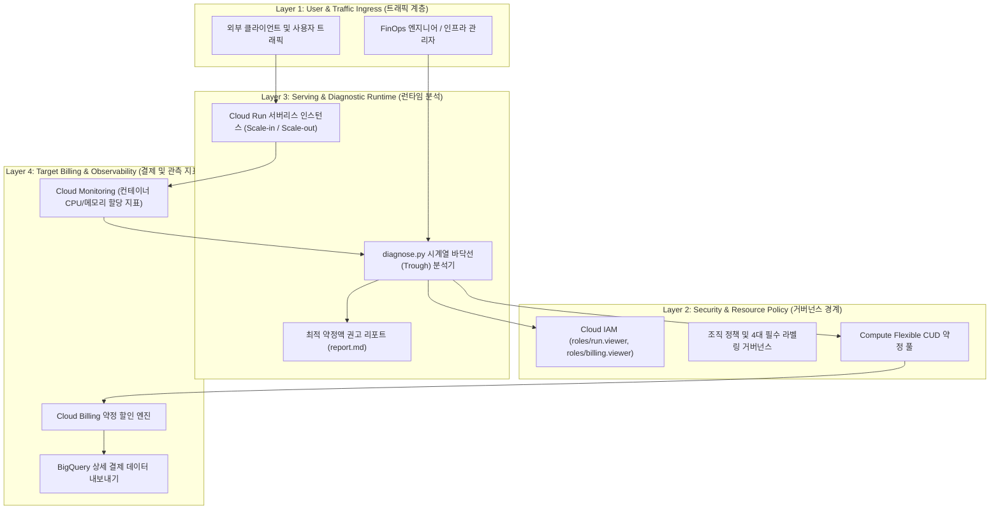

<!--
Copyright 2026 Google LLC. All Rights Reserved.
SPDX-License-Identifier: Apache-2.0

NOTICE: This code/repository is owned by Google LLC and provided under the Apache-2.0 License.
It is strictly provided as an EXAMPLE/REFERENCE ONLY and is NOT INTENDED FOR PRODUCTION USE.
All contents, designs, and code examples are subject to change, modification, or removal at any time without notice.

[고지 사항] 본 저장소 및 문서는 구글 (Google LLC) 소유이며 Apache 2.0 라이선스 하에 예시 (Sample) 용도로 제공된다.
프로덕션 환경용이 아니며, 사전 통지 없이 언제든지 수정, 변경 또는 삭제될 수 있다.
-->

> [!IMPORTANT]
> **구글 (Google LLC) 참조용 샘플 고지 사항**:
> 본 프로젝트의 모든 소스 코드와 문서는 Google LLC의 소유이며, Apache-2.0 라이선스에 따라 오직 **참조용 샘플 (Sample / Reference Only)** 목적으로만 제공된다. 프로덕션 환경에 그대로 사용할 수 없으며, 사전 통지 없이 언제든 내용이 수정, 변경 또는 삭제될 수 있다.

# Cloud Run Compute CUD 약정 할인 최적화 및 권장 엔진 과소 약정 분석

서버리스 클라우드 런(Cloud Run) 환경에서 자동 스케일링 특성으로 인해 GCP 콘솔 추천 엔진이 초래하는 과소 약정(Under-commitment) 트랩을 분석하고, 3개월 시계열 최저 바닥선(Trough) 기반의 최적 Compute Flexible CUD 약정액과 사전 리소스 최적화 가이드를 처방한다. (As of 2026-10-17)

---

## 1. 발생 증상 및 진단 대상 체크리스트

사내 또는 고객사 환경에서 아래 증상이 발생한다면 즉시 진단 대상이다:
사내 또는 고객사 환경에서 아래 증상이 발생한다면 즉시 진단 대상이다: Cloud Run을 대규모 배치 처리, 마이크로서비스 또는 이벤트 기반 워크로드로 운영할 때, 비용 최적화를 위해 약정 사용 할인(CUD, Committed Use Discounts)을 검토하게 된다.
- [ ] **추천 엔진의 과소 약정(Under-commitment) 유도**: Cloud Run의 동적 오토스케일링(Scale-in/Scale-out) 변동성 때문에 GCP 콘솔의 기본 CUD 추천 엔진(주황색 지표)이 극도로 보수적인 수치(안전 바닥선의 30~50% 수준)를 제안하여 실질적인 절감 기회를 크게 상실한다.
- [ ] **과다 약정(Over-commitment) 공포**: 추천 수치보다 크게 약정하고 싶으나, 비수기나 트래픽 감소 시 스케일 인되어 약정 금액 밑으로 떨어져 유휴 비용(돈 낭비)을 지불할까 우려하여 의사 결정이 지연된다.
- [ ] **사전 최적화 부재**: CPU 상시 할당(Always allocated), 유휴 min-instances, 낮은 Concurrency 등 서비스 구성 최적화가 선행되지 않은 상태에서 CUD를 약정하여 불필요한 인프라 비용까지 1~3년간 고정 약정하는 오류가 발생한다.


### 1.1 도구의 본질 및 비즈니스 해결 과제 (What & Why)
- **대상 사용자 (Target)**: 서버리스 인프라 담당자, 클라우드 FinOps 리드, 재무 관리자 및 Cloud Run 운영자
- **해결하는 핵심 문제 (Core Pain Points)**:
  1. Cloud Run의 급격한 자동 스케일링 특성으로 인해 GCP 콘솔 추천 엔진이 피크 트래픽을 오판하여 과소 약정(Under-commitment)을 권고하는 문제
  2. 3개월 사용량 변동폭을 고려하지 않고 약정을 체결했다가 유휴 시간대 낭비가 발생하거나 온디맨드 초과 요금이 청구되는 현상
  3. 약정 체결 전 CPU 유휴 할당, 동시성 튜닝, 최소 인스턴스 등 사전 최적화 기회를 놓쳐 비효율적인 비용 구조가 고착화되는 문제
- **본 솔루션의 해결 방식 (Solution)**:
  - Cloud Monitoring의 90일 시계열 사용량 데이터를 추출하여 주간/월간 최저 바닥선(Trough)을 수학적으로 산출하고, 과소 약정 트랩을 우회하는 안전한 Compute Flexible CUD 약정액과 사전 인프라 최적화 가이드를 처방한다.

### 1.2 최종 산출물 3종 세트 미리보기 (Deliverables & Visual Preview)
본 도구를 실행(`python diagnose.py`)하면 다음 3가지 구체적인 엔터프라이즈 자산이 생성된다:

| 산출물 구분 | 산출물 형태 및 명칭 | 주요 포함 내용 및 실무 활용 방안 |
| :--- | :--- | :--- |
| **① 터미널 콘솔 요약** | Visual CLI Table | 90일 최저/평균/피크 사용량, 추천 약정액($/hour), 예상 월간 절감액 및 ROI 지표 요약 표 |
| **② 정규 진단 보고서** | 마크다운 파일 (`report.md`) | 시간대별 사용량 분포 차트, Flexible CUD 추천 산출 근거, Cloud Run 사전 최적화 체크리스트 및 구매 실행 가이드 |
| **③ 후속 조치 및 배포 자산** | Actionable Asset Specs | • **약정 구매 실행 파라미터**: GCP 결제 콘솔 입력용 시간당 약정 금액($/hr) 및 기간(1년/3년)<br/>• **Cloud Run 최적화 배포 옵션**: `--cpu-throttling`, `--concurrency`, `--min-instances` 최적 파라미터<br/>• **FinOps 거버넌스 라벨링 규약**: CUD 비용 추적을 위한 4대 필수 라벨 가이드 |

---

## 2. 빠른 시작 (Quickstart)

> [!TIP]
> Cloud Shell 접속 환경 구성 및 저장소 클론(`git clone`) 방법은 루트의 [메인 README](../../README.md)를 참고한다.

### 1) 모의 데이터 가상 실행 (Dry-Run)
GCP API 호출 없이 내장된 가상 인프라 데이터로 정상 동작 여부를 즉시 검증한다:
```bash
python diagnose.py --dry-run
```

**터미널 진단 출력 미리보기:**
```text
[시간당 사용량 지표 분석 (USD)]
- 평균 시간당 지출     : $52.40 / hour
- 피크 시간당 지출     : $88.60 / hour
- 최저 바닥선(Trough)  : $36.00 / hour  (야간/주말 Scale-in 시 최저점)
[CUD 약정 추천 수치 비교]
1. GCP 콘솔 기본 추천액 : $15.00 / hour (변동성 보수 계산으로 과소 약정 유도)
2. 실질 최적 권장 약정액: $30.60 / hour (바닥선 x 85%)
   => 약정 갭(추가 약정): $15.60 / hour
[월간 예상 순 절감액 비교 (USD, 월 730시간 기준)]
- 콘솔 추천 수용 시    : 1년 약정 $1,861.50 | 3년 약정 $3,066.00
```


### 2) 사내 환경 대화형 설정 (Config Wizard, 선택 사항)
사내 활성 프로젝트 및 환경 설정을 대화형으로 탐색하여 `.env`에 자동 저장한다:
```bash
python diagnose.py --config
```


### 3) 실제 사내 인프라 실시간 진단
```bash
python diagnose.py
```
> [!NOTE]
> 앞서 `python diagnose.py --config`로 환경 설정을 저장했거나 gcloud 활성 설정을 그대로 활용할 경우 별도의 `.env` 생성 없이 즉시 실행할 수 있다. (환경 변수를 텍스트 에디터로 직접 수동 편집하고자 할 때만 `cp -n .env.example .env` 실행 후 수정)

---

## 3. 솔루션 아키텍처 및 처리 흐름



---
## 4. 조치 가이드 및 권장 설정

### 1단계: Cloud Run 사전 최적화 선행
약정을 체결하기 전에 불필요한 고정 지출을 줄여 정밀한 베이스라인을 확보한다:
1. **CPU 할당 최적화**: 지속적인 백그라운드 처리가 필요한 서비스가 아니라면 **요청 처리 중에만 CPU 할당(Request-only)**을 적용한다.
2. **동시성(Concurrency) 튜닝**: 기본 80을 기준으로 애플리케이션의 메모리 및 I/O 특성에 맞춰 동시성을 상향 조정하여 불필요한 컨테이너 인스턴스 확장을 방지한다.
3. **min-instances 점검**: 상시 웜업이 필수적인 핵심 경로 외에 개발/테스트 환경의 `min-instances`를 0으로 설정한다.

### 2단계: 최적 베이스라인 기반 CUD 구매
1. GCP 콘솔에서 **결제(Billing) > 약정 사용 할인(CUD)** 메뉴로 이동한다.
2. **약정 구매(Purchase commitment)**를 선택하고 다음 옵션을 지정한다:
   - **약정 유형**: **Compute Flexible CUD** (Cloud Run, GKE, Compute Engine에 공통 적용되며 서비스별 종속 제약이 없음)
   - **약정 기간**: 1년 또는 3년 (약정 할인율은 구글 클라우드 공식 요금 페이지 참조)
   - **시간당 커밋 금액**: 콘솔의 보수적 추천액이 아닌, 진단 리포트에서 도출된 최적 권장 약정액을 입력한다.

### 공식 가이드 및 콘솔 링크
- 약정 사용 할인(CUD) 개요 및 플렉시블 약정 ( https://cloud.google.com/docs/cuds )
- Cloud Run 비용 최적화 권장사항 ( https://docs.cloud.google.com/run/docs/tips/services-cost-optimization )
- Google Cloud 콘솔 약정 구매 ( https://console.cloud.google.com/billing/commitments )
- Google Cloud 콘솔 Cloud Run 서비스 목록 ( https://console.cloud.google.com/run )

### 3단계: GCP 리소스 생성 시 4대 필수 표준 라벨링 준수
- Cloud Run 서비스 및 관련 클라우드 인프라 생성/배포 시 FinOps 비용 분석 및 추적을 위해 4대 표준 라벨을 필수로 주입한다:
  - `managed-by`: `google-cloud-0-to-1`
  - `scenario`: `cloud-run-cud-optimizer`
  - `env`: `sample`
  - `created-by`: `customer-engineer`
- gcloud CLI 예시: `--labels=managed-by=google-cloud-0-to-1,scenario=cloud-run-cud-optimizer,env=sample,created-by=customer-engineer`

---
## 5. 사전 준비 사항 (필요 IAM 권한)

본 도구를 실행하려면 최소 아래의 IAM 권한이 필요하다:

본 도구를 실행하려면 최소 아래의 IAM 권한이 필요하다:

본 도구를 실행하고 결제 지표 및 서비스를 진단하기 위해 다음 권한이 필요하다:

- `roles/billing.viewer`: Cloud Billing 계정 지출 내역 및 CUD 현황 조회
- `roles/run.viewer`: Cloud Run 서비스 구성(min-instances, CPU 할당 방식, 동시성) 조회
- `roles/monitoring.viewer`: Cloud Monitoring 사용량 시계열 지표 조회

---

## 6. 기술적 배경 및 아키텍처 원리 (Deep Dive)

### 관련 상세 설계 및 요구 사항 명세
- [비즈니스 요구 사항 명세서 (BRD)](docs/BRD.md): 비즈니스 배경, 성공 지표 및 요구 사항(BR-01~) 명세
- [기술 상세 설계서 (TDD)](docs/TDD.md): 시스템 아키텍처, 기능(FR-01~) 및 비기능(NFR-01~) 설계 명세

---

## 7. 리소스 정리 (Teardown) 안내

본 도구는 순수 진단 및 계산 도구이므로 클라우드 상에 추가 리소스를 프로비저닝하지 않는다.
단, 실제 구매한 CUD 약정은 구매 후 취소가 불가능하므로 반드시 90일 이상의 트래픽 시계열과 안전 마진을 거친 후 신중히 구매를 확정해야 한다.
