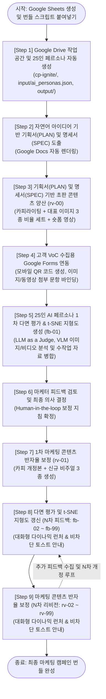

<!--
Copyright 2026 Google LLC. All Rights Reserved.
SPDX-License-Identifier: Apache-2.0

NOTICE: This code/repository is owned by Google LLC and provided under the Apache-2.0 License.
It is strictly provided as an EXAMPLE/REFERENCE ONLY and is NOT INTENDED FOR PRODUCTION USE.
All contents, designs, and code examples are subject to change, modification, or removal at any time without notice.

[고지 사항] 본 저장소 및 문서는 구글 (Google LLC) 소유이며 Apache 2.0 라이선스 하에 예시 (Sample) 용도로 제공된다.
프로덕션 환경용이 아니며, 사전 통지 없이 언제든지 수정, 변경 또는 삭제될 수 있다.
-->

> [!IMPORTANT]
> **구글 (Google LLC) 참조용 샘플 고지 사항**:
> 본 프로젝트의 모든 소스 코드와 문서는 Google LLC의 소유이며, Apache-2.0 라이선스에 따라 오직 **참조용 샘플 (Sample / Reference Only)** 목적으로만 제공된다. 프로덕션 환경에 그대로 사용할 수 없으며, 사전 통지 없이 언제든 내용이 수정, 변경 또는 삭제될 수 있다.

# Google Drive 마케팅 콘텐츠 생성 파이프라인 (`drive-marketing-content-pipeline`)

Google Cloud 프로젝트 생성 및 복잡한 로컬 파이썬 개발 환경 설정, 별도 API Key 발급 없이, 현재 로그인된 Google 계정 OAuth 2.0 자동 인증(Keyless Zero-Setup)만으로 Google Drive, Google Sheets, Apps Script 기반의 종단간 마케팅 콘텐츠 양산 및 25인 AI 페르소나 다면 평가 파이프라인을 구축하는 경량 자동화 솔루션이다. (As of 2026-10-13)

**Audience**: `#Architect`, `#Developer`  
**Concern**: `#Performance`, `#Resilience`  
**Service**: `#GeminiAPI`, `#Workspace`

---

## 이 가이드가 필요한 상황 (증상 체크리스트)

- **인프라 장벽**: 기업 및 마케팅 실무 부서에서 Google Cloud 콘솔 권한이나 결제 프로젝트 생성 승인을 받기까지 수 주 이상의 지연이 발생할 때
- **개발 환경 부재**: 파이썬 가상 환경, Docker, 터미널 CLI 도구, API Key 발급 절차에 익숙하지 않은 비개발자 기획자나 마케터가 브라우저 환경에서 직접 인공 지능 마케팅 자동화를 검증하고자 할 때
- **정성 평가의 한계**: 신제품 출시 전 다면적인 소비자 반응을 사전에 검증하기 어렵고, 정량 평점과 정성 의견, 이미지/동영상 VoC를 통합 분석하는 체계가 부족할 때
- **명세 기반 통제 필요**: 단순 프롬프트 엔지니어링을 넘어, 캠페인 기획서(PLAN)와 콘텐츠 제작 명세서(SPEC)에 기반한 엄격한 규격 통제와 인간 참여(Human-in-the-loop) 콘텐츠 보정 루프를 구축하고자 할 때

---

## 처리 흐름도 (Activity Diagram)



---

## 2단계 퀵스타트 가이드 (Quickstart)

### 1단계: Google Sheets 생성 및 번들 스크립트 붙여넣기
1. Google Drive ( https://drive.google.com )에서 빈 Google Sheets 문서를 새로 생성한다.
2. 상단 메뉴에서 `확장 프로그램` > `Apps Script`를 클릭한다.
3. 기본 편집창의 기존 코드를 모두 지우고, 본 저장소의 `bundle_apps_script.js` 파일 내용을 전체 복사하여 붙여넣는다.
4. 좌측 `프로젝트 설정 (톱니바퀴 아이콘)`에서 `편집기에서 "appsscript.json" 매니페스트 파일 표시`를 체크한 뒤, 본 저장소의 `appsscript.json` 내용을 붙여넣고 상단 디스크 아이콘(`프로젝트 저장`)을 누른다.
5. Google Sheets 브라우저 탭을 새로고침(F5)하면 상단 메뉴 바에 `[마케팅 콘텐츠 파이프라인]` 커스텀 메뉴가 활성화된다.

### 2단계: 상단 메뉴를 통한 9단계 자동화 순차 실행

1. `[Step 1] Google Drive 작업 공간 및 25인 페르소나 자동 생성`:
   - Google Sheets 상단 메뉴에서 `[마케팅 콘텐츠 파이프라인]` > `[Step 1] Google Drive 작업 공간 및 25인 페르소나 자동 생성`을 클릭한다.
   - 클릭 1번으로 Google Drive에 캠페인 루트 폴더(`cp-ignite`), 25인 페르소나 데이터셋(`input/ai_personas.json`), 비디오 샘플을 자동 세팅한다.
   - 최초 1회 실행 시 Google 계정 권한 승인 팝업이 나타나면 `고급` > `이동`을 클릭한 후 `허용`을 선택한다. (Google 계정 자동 로그인으로 완결 구동)
2. `[Step 2] 아이디어 기반 기획서(PLAN) 및 콘텐츠 제작 명세서(SPEC) 자동 도출`:
   - Google Sheets 상단 메뉴에서 `[마케팅 콘텐츠 파이프라인]` > `[Step 2] 아이디어 기반 기획서(PLAN) 및 콘텐츠 명세서(SPEC) 자동 도출`을 클릭한다.
   - 캠페인 아이디어(예: '프리미엄 노이즈 캔슬링 헤드폰 가을 론칭 프로모션')를 자유롭게 입력하면 전문 마케팅 캠페인 기획서(`PLAN`)와 멀티 채널 콘텐츠 제작 명세서(`SPEC`) Google Docs 문서가 자동 생성된다. 마케터는 브라우저에서 직접 `SPEC` 수치(이미지 비율, 숏폼 길이, 카피 채널)를 수정할 수 있다.
3. `[Step 3] 기획서(PLAN) 및 명세서(SPEC) 기반 초판 마케팅 콘텐츠 양산 (rv-00)`:
   - Google Sheets 상단 메뉴에서 `[마케팅 콘텐츠 파이프라인]` > `[Step 3] 기획서 및 명세서 기반 초판 마케팅 콘텐츠 양산 (rv-00)`을 클릭한다.
   - 마케터가 확정한 `SPEC` 규격에 맞추어 마케팅 카피 Google Docs(`campaign_content`), 대표 비주얼 이미지 3종 비율 세트(16:9, 9:16, 1:1), 세로 9:16 모바일 숏폼 영상(`00_shorts.mp4`)을 콘텐츠 폴더에 자동 일괄 양산한다.
4. `[Step 4] 고객 VoC 수집용 Google Forms 자동 생성 (이미지/비디오 업로드)`:
   - Google Sheets 상단 메뉴에서 `[마케팅 콘텐츠 파이프라인]` > `[Step 4] 고객 VoC 수집용 Google Forms 자동 생성 (이미지/비디오 업로드)`를 클릭한다.
   - 평점, 서술형 의견, 고객 동영상 및 이미지 첨부 문항이 포함된 Google Forms 문서를 생성하고 Google Sheets 응답 탭 및 모바일 접속용 QR 코드를 자동 연동한다. (동영상 업로드 권장 규격: 15초~30초 이내 숏폼 영상, 파일 크기 30MB 이하)
5. `[Step 5] 25인 AI 페르소나 1차 다면 평가 및 t-SNE 지형도 자동 렌더링 (fb-01)`:
   - Google Sheets 상단 메뉴에서 `[마케팅 콘텐츠 파이프라인]` > `[Step 5] 25인 AI 페르소나 1차 다면 평가 및 t-SNE 지형도 자동 렌더링 (fb-01)`을 클릭한다.
   - 25인의 가상 소비자 반응, 설문 제출 이미지 및 비디오 VoC VLM 분석 결과, 그리고 마케터가 `input/fb-01/` 폴더에 직접 드롭한 수작업 투입 자료(이미지, 추가 영상, 메모 문서)를 종합 병합하여 t-SNE 여론 지형도가 임베드된 다면 평가 보고서(`feedback_summary`) Google Docs 문서를 완성한다.
6. `[Step 6] 마케터 피드백 검토 및 최종 의사 결정 (Human-in-the-loop)`:
   - Google Sheets 상단 메뉴에서 `[마케팅 콘텐츠 파이프라인]` > `[Step 6] 마케터 피드백 검토 및 최종 의사 결정 (Human-in-the-loop)`을 클릭한다.
   - 마케터 전용 팝업이 표시되며, 평가 보고서를 검토한 마케터가 핵심 개선 방향을 선택하거나 직접 입력하여 최종 보정 지침을 확정한다.
7. `[Step 7] 다면 평가 피드백 기반 1차 마케팅 콘텐츠 반자율 보정 (rv-01)`:
   - Google Sheets 상단 메뉴에서 `[마케팅 콘텐츠 파이프라인]` > `[Step 7] 다면 평가 피드백 기반 1차 마케팅 콘텐츠 반자율 보정 (rv-01)`을 클릭한다.
   - 마케터의 의사 결정과 시각적 피드백을 반영하여 개정된 광고 카피, 새로운 이미지 3종, 보정된 모바일 숏폼 영상이 담긴 `rv-01/` 마케팅 콘텐츠를 자동 제작한다.
8. `[Step 8] 다면 평가 및 t-SNE 지형도 갱신 (N차 피드백: fb-02 ~ fb-99)`:
   - Google Sheets 상단 메뉴에서 `[마케팅 콘텐츠 파이프라인]` > `[Step 8] 다면 평가 및 t-SNE 지형도 갱신 (N차 피드백: fb-02 ~ fb-99)`를 클릭한다.
   - 대화형 다이나믹 런처가 구동되어 최신 폴더를 자동 스캔한 뒤 다음 피드백 회차(기본값: `fb-02`)를 제안하며, 빈칸으로 확인 시 자동 증분되고 원하는 번호(`3`, `07`, `99` 등)를 수기 지정할 수도 있다. 실행 즉시 화면 우측 하단에 예상 소요 시간(약 45초~1분 30초) 토스트 안내가 표시된다.
9. `[Step 9] 마케팅 콘텐츠 반자율 보정 (N차 리비전: rv-02 ~ rv-99)`:
   - Google Sheets 상단 메뉴에서 `[마케팅 콘텐츠 파이프라인]` > `[Step 9] 마케팅 콘텐츠 반자율 보정 (N차 리비전: rv-02 ~ rv-99)`를 클릭한다.
   - 대화형 다이나믹 런처를 통해 최신 리비전을 자동 감지하여 다음 개정본(기본값: `rv-02`)을 자동 양산하거나 마케터가 원하는 번호로 점프할 수 있다. 완결 카피, 신규 비주얼 3종 및 숏폼 영상을 일괄 패키징하며, 실행 즉시 비차단 소요 시간 토스트 안내가 제공된다.

> [!TIP]
> **타깃 AI 페르소나 맞춤 변경 (선택 사항)**:
> 상단 메뉴의 `[마케팅 콘텐츠 파이프라인]` > `[0. 타깃 AI 페르소나 패널 맞춤 재설정 (선택 사항)]`을 클릭하여 원하는 타깃 시장(예: '일본 20대 여성', '미국 B2B SaaS 바이어' 또는 'hf:데이터셋명')을 입력하면 해당 캠페인 전용 25인 맞춤 평가단으로 즉시 교체된다.

---

## 생성 산출물 디렉터리 구조

파이프라인 실행 시 Google Drive(My Drive) 루트에 다음과 같은 자체 완결적 폴더 구조가 가나다순 및 알파벳순으로 자동 구축된다:

```text
My Drive/
├── 마케팅 콘텐츠 파이프라인 (Google Sheets: 9단계 자동화 컨트롤 타워)
├── cp-autumn-breeze/ (다중 캠페인 독립 격리 폴더 예시 - 아래 상세 접기 참조)
└── cp-ignite/ (기본 실습 캠페인 폴더)
    ├── 고객 피드백 설문 (Google Forms: 실시간 고객 VoC 수집 폼)
    ├── input/ (원천 입력 데이터셋)
    │   ├── 아이디어 메모 (Google Docs: 마케터 캠페인 아이디어 초안 메모)
    │   ├── ai_personas.json (해당 캠페인 전용 25인 슬림 페르소나 패널)
    │   ├── fb-01/ (1차 피드백 데이터셋)
    │   │   ├── ai_persona_feedbacks.json (25인 페르소나 실시간 평가 데이터)
    │   │   ├── feedback_clusters_map.png (text-multilingual-embedding-002 기반 128d t-SNE 지형도)
    │   │   ├── feedback_points_128d.json (128d 임베딩 투영 세부 의견 포인트 목록)
    │   │   ├── feedback_sample.mp4 (고객 직접 촬영 모바일 세로 비디오 VoC)
    │   │   ├── feedback_summary (Google Docs: VLM 분석과 지형도가 포함된 종합 다면 평가 보고서)
    │   │   └── video_voc_analysis.json (Gemini VLM 멀티모달 표정, 음성 톤, 발화 분석 결과)
    │   └── fb-02/ (2차 피드백 데이터셋 - 아래 상세 접기 참조)
    ├── output/ (리비전별 마케팅 콘텐츠)
    │   ├── rv-00/ (초판 마케팅 콘텐츠)
    │   │   ├── 00_banner_16x9.png (가로형 디스플레이 배너 16:9)
    │   │   ├── 00_poster_9x16.png (세로형 모바일 포스터 9:16)
    │   │   ├── 00_shorts.mp4 (세로 9:16 모바일 숏폼 영상)
    │   │   ├── 00_sns_1x1.png (정방형 SNS 피드 이미지 1:1)
    │   │   └── campaign_content (Google Docs: 멀티 채널 카피 및 영상 콘티)
    │   ├── rv-01/ (1차 개정본 - 아래 상세 접기 참조)
    │   └── rv-02/ (2차 완결본 - 아래 상세 접기 참조)
    ├── PLAN (Google Docs: 마케팅 캠페인 기획서 전문)
    └── SPEC (Google Docs: 멀티 채널 콘텐츠 제작 명세서 - 이미지, 숏폼, 카피 규격)
```

<details>
<summary><strong>1. 기본 캠페인(cp-ignite): 2차 피드백(fb-02) 및 후속 개정본 콘텐츠(rv-01, rv-02) 세부 트리 펼치기</strong></summary>

```text
My Drive/
└── cp-ignite/
    ├── input/
    │   └── fb-02/ (2차 피드백 데이터셋)
    │       ├── ai_persona_feedbacks.json (2차 개정본 평가 데이터)
    │       ├── feedback_clusters_map.png (갱신된 128d t-SNE 지형도)
    │       ├── feedback_points_128d.json (2차 128d 임베딩 세부 의견 포인트)
    │       ├── feedback_summary (Google Docs: 2차 종합 평가 보고서)
    │       └── video_voc_analysis.json (2차 비디오 VoC 분석 데이터)
    └── output/
        ├── rv-01/ (1차 개정본)
        │   ├── 01_banner_16x9.png (보정된 가로형 배너)
        │   ├── 01_poster_9x16.png (보정된 세로형 포스터)
        │   ├── 01_shorts.mp4 (보정된 세로 9:16 모바일 숏폼 영상)
        │   ├── 01_sns_1x1.png (보정된 SNS 피드 이미지)
        │   └── campaign_content (Google Docs: 1차 피드백 반영 개정 카피)
        └── rv-02/ (2차 완결본)
            ├── 02_banner_16x9.png (최종 완결형 배너)
            ├── 02_poster_9x16.png (최종 완결형 포스터)
            ├── 02_shorts.mp4 (최종 완결형 모바일 숏폼 영상)
            ├── 02_sns_1x1.png (최종 완결형 SNS 피드 이미지)
            └── campaign_content (Google Docs: 최종 완결 배포 카피)
```

</details>

<details>
<summary><strong>2. 다중 캠페인 독립 격리 예시 (cp-autumn-breeze) 세부 트리 펼치기</strong></summary>

```text
My Drive/
└── cp-autumn-breeze/ (다중 캠페인 독립 격리 폴더 예시)
    ├── 고객 피드백 설문 (Google Forms: 2026 가을 오텀 브리즈 고객 설문 폼)
    ├── input/
    │   ├── 아이디어 메모 (Google Docs: 아웃도어 라이프스타일 컬렉션 기획 메모)
    │   ├── ai_personas.json (가을 아웃도어 타깃 25인 맞춤 페르소나 패널)
    │   └── fb-01/ (1차 피드백 데이터셋)
    │       ├── ai_persona_feedbacks.json
    │       ├── feedback_clusters_map.png
    │       ├── feedback_sample.mp4
    │       ├── feedback_summary (Google Docs: 1차 종합 평가 보고서)
    │       └── video_voc_analysis.json
    ├── output/
    │   └── rv-00/ (초판 마케팅 콘텐츠)
    │       ├── 00_banner_16x9.png
    │       ├── 00_poster_9x16.png
    │       ├── 00_shorts.mp4
    │       ├── 00_sns_1x1.png
    │       └── campaign_content (Google Docs: 멀티 채널 카피 및 영상 콘티)
    ├── PLAN (Google Docs: 오텀 브리즈 캠페인 기획서 전문)
    └── SPEC (Google Docs: 멀티 채널 콘텐츠 제작 명세서)
```

</details>

---

## AI 페르소나 평가단 구성

본 파이프라인의 가상 평가단 데이터셋은 대한민국 시장 환경을 반영한 25인의 다면적 인구통계학적 프로필(전문 마케터 12인 및 일반 소비자 13인)을 갖추고 있다. 세부 프로필 속성(연령, 성별, 직업, 세부 관심사 및 평가 관점)은 `input/ai_personas.json` 파일에 JSON 규격으로 체계화되어 있다.

Google Sheets 상단 메뉴의 `[마케팅 콘텐츠 파이프라인]` > `[0. 타깃 AI 페르소나 패널 맞춤 재설정 (선택 사항)]`을 통해 원하는 타깃 시장이나 Hugging Face 공개 데이터셋(예: `hf:nvidia/Nemotron-Personas-Korea`)을 지정하면 실시간으로 동기화되어 교체되므로, 특정 고정 표에 의존하지 않고 캠페인 목적에 맞게 자유롭게 운용할 수 있다.

---

## 핵심 아키텍처 및 차별화 요소

### 1. Keyless Zero-Setup & Web-Native
Google Cloud 프로젝트, 서비스 계정 키, 결제 계정 등록, 별도 API Key 발급이 전혀 필요하지 않다. 현재 Google Sheets에 로그인된 Google 계정의 OAuth 2.0 Access Token 기반 자동 인증으로 Apps Script 상에서 브라우저 단독으로 즉시 안전하게 구동된다.

### 2. 기획서(PLAN) 및 제작 명세서(SPEC) 기반 엄격한 품질 통제
아이디어 발상 단계에서 전문 마케팅 기획서(`PLAN`)와 채널별 제작 명세서(`SPEC`)를 Google Docs 문서로 분리 생성한다. 마케터가 브라우저에서 직접 `SPEC` 문서의 이미지 종횡비, 해상도, 모바일 숏폼 영상 길이(15초~30초), 카피 채널을 수정한 뒤 후속 단계를 실행하면, 인공 지능이 해당 명세를 엄격히 준수하여 콘텐츠를 양산한다.

### 3. 25인 한국인 마스터 AI 페르소나 다면 평가 및 열린 피드백 원칙
20대부터 50대까지 IT/금융/유통 전문 마케터 12인과 대학생/직장인/자영업자 등 일반 소비자 13인으로 구성된 25인 패널 데이터를 내장하고 있다. 특히 콘텐츠 제작 명세서(`SPEC`)에 특정 설문 문항이 고정되어 있지 않은 한 **'열린 피드백(Open-ended Feedback)' 원칙**을 적용하여 각 페르소나가 제약 없는 관점에서 자유로운 소감을 발화한다. 또한 25명의 페르소나가 1인당 단편적인 1개의 의견만 남기는 것이 아니라, 호평 포인트, 비판/개선 요구 포인트, 가격/구매 혜택 의견 등 **1인당 2~4개의 세부 의견 포인트(Key Feedback Points)**를 도출하여 전체 50~80개 이상의 풍부한 의견 군집을 형성한다.

### 4. 한국어 특화 128d 임베딩 및 다중 포인트 t-SNE 여론 지형도
도출된 50~80개 이상의 세부 의견 포인트를 한국어 성능이 뛰어난 `text-multilingual-embedding-002` 모델을 통해 128차원 MRL(Matryoshka Representation Learning) 벡터로 일괄 변환한다. Apps Script 환경에서 경량 PCA 2축 투영을 거쳐 2차원 평면 좌표로 변환한 뒤, QuickChart REST API를 호출하여 호평, 비판, 가격, 사용성 등 4개 군집으로 입체적 다면 여론 지형도(`feedback_clusters_map.png`)를 실시간 생성하고 Google Docs 피드백 보고서 상단에 자동 임베드한다.

### 5. Gemini VLM 기반 고객 동영상 피드백(비디오 VoC) 심층 분석
고객이 스마트폰으로 직접 촬영한 동영상 피드백(MP4)을 Gemini VLM 멀티모달 엔진이 분석하여, 고객의 얼굴 표정 변화, 음성 톤, 실제 발화 내용(Transcript), 감정 및 개선 제안을 구조화된 `video_voc_analysis.json` 파일로 자동 추출 및 저장한다. 다면 평가(Judge) 실행 시 이 VLM 분석 데이터가 25인 AI 페르소나 데이터와 함께 종합 분석된다.

> [!WARNING]
> **비디오 분석 런타임 제약 및 Google Cloud 환경 이관 안내**:
> - **Apps Script 런타임 제약 (타임아웃 및 페이로드 한계)**: 본 솔루션은 브라우저 서버리스 환경에서 구동되므로 Apps Script의 단일 실행 시간 제한(최대 6분)과 `UrlFetchApp`의 단일 요청 페이로드 제한(최대 50MB)을 적용받는다. 동영상(MP4)을 Base64 문자열로 인코딩할 때 데이터 크기가 약 33% 팽창하므로, 과도한 연산 지연과 브라우저 타임아웃을 방어하기 위해 **15초~30초 이내의 숏폼 동영상(원본 파일 크기 30MB 이하)**을 권장한다.
> - **Google Cloud 환경 이관 권장**: 1분 이상의 장문 고객 인터뷰 영상이나 고화질 대용량 동영상을 다루고자 할 때는 Google Cloud 환경으로의 이관이 필요하며, 성공적인 이관을 위해 Google Cloud에 연락하여 전문 컨설팅을 받는 것을 권장한다.

### 6. Gemini VLM 기반 고객 제출 이미지 분석 및 수작업 투입 자료 전수 스캔
Google Forms를 통해 인입된 고객 제출 이미지(실착 샷, 디자인 비교 등)를 Gemini VLM으로 자동 분석하여 시각적 VoC를 추출한다. 또한 Google Forms를 거치지 않고 마케터나 테스터가 `input/fb-xx/` 폴더에 직접 수작업으로 드롭한 파일(이미지, 추가 영상, Google Docs, 텍스트 메모)도 전수 자동 감지하여 다면 평가와 리비전 보정에 실시간으로 병합한다.

### 7. 99차 무제한 피드백 루프 (fb-01 ~ fb-99, rv-00 ~ rv-99) 및 다이나믹 회차 탐지기
피드백과 리비전이 고정된 2회차에 머무르지 않고, Google Drive 폴더 트리를 실시간 스캔하여 최신 회차 번호를 자동 계산하고 다음 회차(`fb-03`, `rv-03` 등)를 추천한다. 빈칸으로 [확인]을 누르면 자동 증가하며, 원하는 특정 번호(`7`, `07`, `99` 등)를 수기 지정하여 최대 99회차까지 유연하게 순환할 수 있다.

### 8. Google Sheets 비차단 UI 토스트(Toast) 기반의 실시간 예상 소요 시간 안내 UX
VLM 분석, t-SNE 지형도 렌더링, 이미지 3종 및 숏폼 영상 양산 등 장시간(약 45초~1분 30초) 연산이 소요되는 단계 실행 시, 브라우저 화면 우측 하단에 비차단 토스트(`SpreadsheetApp.toast`)로 예상 소요 시간과 현재 작업 상태를 즉시 노출하여 마케터의 대기 불안감을 해소한다.

### 9. 모바일 숏폼 영상(MP4) 및 멀티 채널 비주얼 소재 양산
가로형 디스플레이 배너(16:9), 세로형 모바일 포스터(9:16), 정방형 SNS 피드 이미지(1:1)뿐만 아니라, 인스타그램 릴스와 유튜브 쇼츠에 즉시 활용 가능한 세로 9:16 모바일 숏폼 영상(`*_shorts.mp4`)을 매 리비전마다 완결형으로 양산한다.

> [!NOTE]
> **상세 기술 아키텍처 및 내부 스크립트 모듈 구조**: 11대 스크립트 모듈 구성(`Code_*.js`) 및 REST 엔드포인트 연동 기술 명세는 [TDD](docs/TDD.md), 전체 비즈니스 및 사용자 요구 사항은 [BRD](docs/BRD.md)를 참조한다.

---

## 자원 정리 안내 (Teardown)

본 솔루션은 가상 머신(VM), 데이터베이스, VPC 등의 유료 클라우드 리소스를 일절 생성하지 않는다. 실습 및 검증을 완료한 후 정리하고자 할 경우 다음 절차를 수행한다:

1. **Google Drive 산출물 삭제**:
   - Google Drive ( https://drive.google.com )에서 생성된 캠페인 루트 폴더(`cp-ignite`)와 Google Sheets 문서를 휴지통으로 이동 후 비운다.
