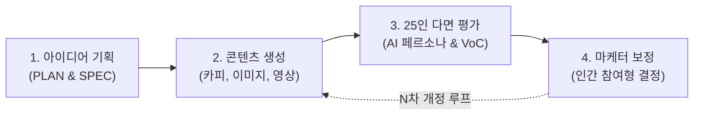

<!--
Copyright 2026 Google LLC. All Rights Reserved.
SPDX-License-Identifier: Apache-2.0

NOTICE: This code/repository is owned by Google LLC and provided under the Apache-2.0 License.
It is strictly provided as an EXAMPLE/REFERENCE ONLY and is NOT INTENDED FOR PRODUCTION USE.
All contents, designs, and code examples are subject to change, modification, or removal at any time without notice.

[고지 사항] 본 저장소 및 문서는 구글 (Google LLC) 소유이며 Apache 2.0 라이선스 하에 예시 (Sample) 용도로 제공된다.
프로덕션 환경용이 아니며, 사전 통지 없이 언제든지 수정, 변경 또는 삭제될 수 있다.
-->

> [!IMPORTANT]
> **구글 (Google LLC) 참조용 샘플 고지 사항**:
> 본 프로젝트의 모든 소스 코드와 문서는 Google LLC의 소유이며, Apache-2.0 라이선스에 따라 오직 **참조용 샘플 (Sample / Reference Only)** 목적으로만 제공된다. 프로덕션 환경에 그대로 사용할 수 없으며, 사전 통지 없이 언제든 내용이 수정, 변경 또는 삭제될 수 있다.

# 구글 드라이브(Google Drive) 마케팅 콘텐츠 생성 파이프라인 (`drive-marketing-content-pipeline`)

구글 클라우드(Google Cloud) 프로젝트 생성, 신용카드 등록, 복잡한 로컬 파이썬 개발 환경 설정 없이, 개인 구글 계정으로 100% 무료 발급받는 Google AI Studio API Key 1회 등록만으로 구글 드라이브(Google Drive), 구글 시트(Google Sheets), Apps Script 기반의 종단간 마케팅 콘텐츠 생성 및 25인 AI 페르소나 다면 평가 파이프라인을 구축하는 경량 자동화 솔루션이다. (As of 2026-10-14)

**Audience**: `#Architect`, `#Developer`  
**Concern**: `#Performance`, `#Resilience`  
**Service**: `#GeminiAPI`, `#Workspace`

---

## 문제 증상 체크리스트

- 구글 클라우드 프로젝트 승인이나 파이썬 개발 환경 없이 브라우저에서 AI 마케팅 자동화를 즉시 검증하고 싶을 때
- 신제품 출시 전 25인 다면 소비자 반응 및 정량 평점, 정성 의견, 이미지/비디오 VoC를 사전 통합 분석하고 싶을 때
- 단순 1회성 생성을 넘어, 기획서(PLAN)와 제작 명세서(SPEC)에 맞춘 엄격한 콘텐츠 생성 및 마케터 피드백 보정 루프가 필요할 때

---

## 처리 흐름도 (Activity Diagram)



---

## 구축, 사용 가이드

### 1단계: 구글 드라이브 캠페인 폴더 생성 및 구글 시트 등록

구글 시트(Google Sheets)에 스크립트를 등록하고 캠페인을 시작하는 절차는 다음과 같다:

#### 1. 캠페인 폴더 생성 및 구글 시트 생성 (Folder-First UX)
1. 구글 드라이브 ( https://drive.google.com )에서 이번에 진행할 마케팅 캠페인 이름으로 새 폴더를 먼저 생성한다. (예: `2026 가을 오텀 브리즈 캠페인`, `autumn-campaign-2026` 등 자유롭게 명명 가능).
   - **영문 폴더명**: 마케터가 정한 영문 이름 그대로 시스템 슬러그로 채택된다.
   - **한글 폴더명**: 마케팅 및 시즌 키워드를 분석하여 안전한 영문 슬러그(예: `cp-2026-autumn-breeze`)로 자동 변환된다.
   - **폴더명 변경 대비 ID 영구 바인딩**: 폴더의 구글 드라이브 고유 ID로 영구 바인딩되므로, 향후 마케터가 폴더 이름을 변경하더라도 100% 동일한 캠페인 폴더로 끊김 없이 추적된다.
2. 생성한 캠페인 폴더 안으로 이동하여 빈 구글 시트(Google Sheets) 문서를 새로 생성한다.
3. 구글 시트 상단 메뉴에서 `확장 프로그램` > `Apps Script`를 클릭한다.

#### 2. 스크립트 코드 등록 (방법 A 권장)
- **방법 A (권장): 경량 자동 갱신 부트스트랩 ([bootstrap.js](bootstrap.js), 약 100줄)**:
  - 단 100줄짜리 부트스트랩 코드만 최초 1회 붙여넣으면, 이후 GitHub 저장소의 기능 추가나 버그 패치가 사용자의 구글 시트에 **사람의 개입 없이 100% 실시간 자동 반영**된다.
  - Apps Script 기본 편집창의 기존 코드를 모두 지우고, 본 저장소의 [bootstrap.js](bootstrap.js) 파일 내용을 복사하여 붙여넣는다.
  - 좌측 `프로젝트 설정 (톱니바퀴 아이콘)`에서 `편집기에서 "appsscript.json" 매니페스트 파일 표시`를 체크한 뒤, 본 저장소의 [appsscript.json](appsscript.json) 파일 내용을 붙여넣고 상단 디스크 아이콘(`프로젝트 저장`)을 누른다.
- **방법 B: 완전 독립형 오프라인 단일 번들 ([bundle_apps_script.js](bundle_apps_script.js), 약 3,400줄)**:
  - 외부 네트워크(GitHub Raw) 호출 없이 Apps Script 환경 내에서 단독으로 모든 코드가 구동되기를 원할 때 `bootstrap.js` 대신 [bundle_apps_script.js](bundle_apps_script.js) 파일 내용을 전체 복사하여 붙여넣는다.

#### 3. 활성화 및 API Key 1회 등록 (우측 패널 인라인 완결 UX)
4. 구글 시트 브라우저 탭을 새로고침(F5)하면 상단에 `[마케팅 콘텐츠 파이프라인]` 메뉴가 생성되며 우측 패널(사이드바) 제어 패널이 자동으로 활성화된다. (사이드바가 닫힌 경우 상단 `[마케팅 콘텐츠 파이프라인]` > `제어 패널 열기 (Open Panel)`를 클릭한다).
5. **Gemini API Key 1회 등록**: Google AI Studio ( https://aistudio.google.com/app/apikey ) 에서 개인 구글 계정으로 무료 API Key를 발급받는다. 사이드바 상단 온보딩 배너의 `[API Key 등록]` 버튼을 누르면 화면 중앙 팝업 없이 **사이드바 상단 인라인 입력창**이 열리며, 키를 입력하고 `[저장]`을 누르면 즉시 안전하게 보관된다.

### 2단계: 우측 패널(사이드바) 컨트롤 타워를 통한 원클릭 실행

본 솔루션은 상단 드롭다운 메뉴를 헤매지 않고, 구글 시트 우측 패널(사이드바) 전용 모던 웹 UI 컨트롤 타워를 통해 5단계 파이프라인 실행, 산출물 바로가기, 실시간 지표 조회를 원스톱으로 통제할 수 있다. 중앙 팝업 모달을 전면 배제하고 사이드바 내 완결형 인터랙션을 제공한다:

- **첫 방문 마케터 온보딩 가이드 배너**: API Key 미등록 시 1단계(API Key 등록) 배너가, 등록 완료 후에는 2단계(작업 공간 초기화) 배너가 순차 표시되며 원클릭 버튼을 제공한다. 작업 공간 구축 완료 시 배너는 자동으로 정리된다.
- **실시간 경과 시간 카운트업 타이머 및 회전 스피너**: 장시간 소요 작업 실행 시 멈춤 불안감을 해소하기 위해 부드러운 CSS 회전 스피너와 함께 1초 단위 실시간 경과 시간(`실행 경과: 12초`)을 화면에 표시한다.
- **사이드바 상단 직행 알림 카드**: 작업 완료 시 중앙 알림창 대신 사이드바 상단에 성공 안내 카드와 함께 생성된 구글 독스 즉시 열기 버튼(예: `[기획서 (PLAN) 열기]`)이 직관적으로 팝업된다.
- **산출물 바로가기 카드 7종 확장**: 최상단 원천 `[아이디어 메모]` 구글 독스부터 `기획서 (PLAN)`, 최신 리비전 동적 바인딩 `최신 콘텐츠 열기 (rv-00)`까지 한눈에 탐색할 수 있다.
- **'도구에 도구를 묻다' AI 코파일럿 대화창 및 동적 액션 칩 (Copilot UX)**:
  - 도구 사용법이나 다음 진행 순서가 헷갈릴 때 하단 자유 대화창에 "지금 뭐 해야 돼?", "기획서 만들어 줘", "25인 평가가 뭐야?" 등을 자연어로 입력하면, AI가 구글 드라이브 실제 파이프라인 상태를 실시간 진단하여 친절한 안내 답변과 함께 **대화창 내 동적 실행 버튼 칩(예: `[기획서 (PLAN) 도출하기]`)**을 즉시 제시한다.
  - 마케터는 제시된 칩을 1클릭하는 것만으로 해당 작업을 바로 실행할 수 있으며, `[지금 뭐 해야 돼?]`, `[기획서 도출해 줘]`, `[초판 제작해 줘]`, `[t-SNE 지형도가 뭐야?]` 등 5대 빠른 추천 칩을 통해 타이핑 없이도 질의할 수 있다.

1. `[초기화] 캠페인 작업 공간 구축 (스마트 보존 및 누락 복구)`:
   - 사이드바 상단 온보딩 배너 또는 하단 `환경 설정 및 초기화` 접이식 메뉴에서 `[초기화] 캠페인 작업 공간 구축` 버튼을 클릭한다.
   - 마케터가 생성한 캠페인 부모 폴더를 자동으로 감지하고 고유 ID로 영구 바인딩한다.
   - **스마트 무손실 복구**: 폴더 내에 이미 존재하는 기존 자산(기획서, 제작 명세서, 페르소나, 초판/개정본 콘텐츠, 설문 폼)은 **절대 덮어쓰거나 삭제하지 않고 100% 온전히 보존**하며, 오직 누락된 필수 폴더 트리(`prompts/`, `input/`, `output/`) 및 프롬프트 독스만 핀포인트로 복구한다.
   - 구글 시트 문서 제목도 `[마케팅 콘텐츠 컨트롤 타워] ` + 캠페인 폴더 명칭으로 자동 동기화된다.
   - 최초 1회 실행 시 구글 시트 및 드라이브 접근 권한 승인 팝업이 나타나면 `고급` > `이동`을 클릭한 후 `허용`을 선택한다.

2. `[설정] 캠페인 환경 설정 및 재설정 (Configure)`:
   - 캠페인 코드, 제품명, 타깃 오디언스, 핵심 소구점(USP), 프로모션 오퍼 등 핵심 마케팅 속성을 확인하거나 실시간으로 대화형 다이얼로그를 통해 재설정한다.

3. `[기획] 기획서 및 콘텐츠 명세서 생성 (PLAN & SPEC)`:
   - 캠페인 아이디어를 입력하면 `prompts/01_idea_to_plan` 및 `prompts/02_plan_to_spec` 지침에 따라 전문 마케팅 기획서(`PLAN`)와 멀티 채널 콘텐츠 제작 명세서(`SPEC`) 구글 독스가 자동 도출된다.
   - 제작 명세서(SPEC) 확정 직후 `prompts/03_persona_synthesis` 지침에 따라 명세서의 타깃 오디언스에 최적화된 25인 맞춤 AI 페르소나 패널(`ai_personas.json`)이 캠페인 루트에 자동 합성된다.
   - 마케터는 브라우저에서 직접 `SPEC` 수치(배너 규격, 숏폼 길이, 카피 채널 등)를 자유롭게 수정할 수 있다.

4. `[생성] 초판 마케팅 콘텐츠 생성 (rv-00)`:
   - `SPEC` 규격과 `prompts/04_content_generation` 지침에 맞추어 다음 산출물을 `output/rv-00/`에 생성한다:
     - 광고 카피라이팅 및 모바일 숏폼 영상 콘티가 통합된 단일 구글 독스(`campaign_content`)
     - Gemini Nano Banana 2.1 기반 3대 대표 비주얼 이미지 세트(16:9 가로 배너, 9:16 세로 포스터, 1:1 SNS 피드)
     - Gemini Veo 3.1 Fast 모델을 호출하여 렌더링한 9:16 모바일 숏폼 실제 영상 바이너리(`00_shorts.mp4`)
   - **지능형 파일 상태 감지 및 보충**: 폴더 내 일부 파일(예: 비디오만 미생성)이 누락된 경우, 마케터가 수정한 구글 독스와 기존 이미지를 보존한 채 누락된 파일만 고속 보충할 수 있는 스마트 선택 다이얼로그를 지원한다.

5. `[평가] 25인 AI 페르소나 다면 평가 실행 (fb-xx)`:
   - 캠페인 루트의 `ai_personas.json`과 `prompts/05_persona_evaluation` 지침에 따라 25인 다면 평가를 수행한다.
   - 평가단으로부터 50~80개의 구체적인 세부 의견 포인트를 도출하고, 128차원 다국어 텍스트 임베딩을 PCA/t-SNE 2차원 평면으로 투영한 여론 지형도 차트(`feedback_clusters_map.png`)를 렌더링한다.
   - 다이나믹 회차 선택기를 통해 `fb-01`부터 `fb-99`까지 원하는 회차를 지정하거나 자동 증분 실행할 수 있다.

6. `[보고서] 피드백 종합 분석 보고서 생성 (feedback_summary)`:
   - 고객 VoC 설문 폼 응답 실데이터, 실제 제출된 미디어(비디오/이미지)에 대한 Gemini VLM 멀티모달 분석 결과, 25인 다면 평가 지형도를 단일 구글 독스 보고서(`feedback_summary`)로 종합 도출한다.
   - 여론 지형도 차트가 문서 본문 가로폭에 맞추어 자동 임베드된다.
   - **마케터 자산 영구 보존 원칙**: 인간 마케터의 최종 의사 결정 문서인 `마케터 보정 지침` 구글 독스를 독립 파일로 분리 생성한다. 마케터가 작성한 보정 지침은 향후 보고서(`feedback_summary`)를 몇 번 재생성하더라도 절대 덮어써지지 않고 100% 안전하게 보존된다.

7. `[보정] 피드백 반영 콘텐츠 보정 (rv-xx)`:
   - 마케터가 `마케터 보정 지침` 독스에 작성한 최종 의사 결정 지침(최우선 구속력)과 다면 피드백을 반영하여 개정된 완결 카피 및 숏폼 콘티(`campaign_content`), 새로운 비주얼 이미지 3종 세트, 그리고 Gemini Veo 신규 숏폼 영상(`xx_shorts.mp4`)이 패키징된 차기 리비전(`output/rv-01/` 등)을 생성한다.
   - **리비전 안전 가드레일**: 기존 회차 폴더에 모든 파일이 완비되어 있으면 기존 성과물을 파괴하지 않고 차기 리비전(rv-xx+1)으로 자동 승격 생성할 수 있도록 안내한다.

8. 부가 유틸리티 메뉴:
   - `[API Key] Gemini API Key 설정`: Google AI Studio 무료 API Key 등록 및 변경
   - `[설문 폼] 고객 VoC 설문 폼 열기`: 초기화 시 생성된 고객 설문지 즉시 열기 및 URL 확인
   - `[페르소나] 25인 AI 페르소나 맞춤 재설정`: 자연어 기준 입력 또는 Hugging Face 데이터셋 연동을 통해 캠페인 루트의 `ai_personas.json`을 즉시 재생성

> [!TIP]
> - **구글 시트 컨트롤 타워 실행 로그 (Plain Sheet Style)**:
>   구글 시트 '실행 로그' 탭은 알록달록한 배경색이나 배너 같은 거추장스러운 템플릿 장식 없이, 1행 기본 헤더와 2행부터 순수 텍스트 행으로 한 줄씩 담백하게 누적되는 미니멀한 구글 시트 본연의 스타일로 파이프라인의 모든 작업을 실시간 기록한다:
>   - `실행 단계 (150px, 가운데 정렬)`: 작업 공간 준비, 기획서, 초판 생성, 다면 평가, 개정본 보정 등 식별자
>   - `진행 상태 (100px, 가운데 정렬)`: 완료, 진행 중, 실패, 활성 순수 텍스트
>   - `산출물 링크 (250px, 왼쪽 정렬)`: 클릭 시 해당 드라이브 폴더 또는 구글 독스로 1초 직행 하이퍼링크 (RichText 기반)
>   - `완료 시각 (150px, 가운데 정렬)`: 작업 완료 타임스탬프 (한국 표준시 기준)
>   - `소요 시간 (초) (100px, 우측 정렬)`: 엔진 실제 처리 시간 (단위 텍스트 없는 초 단위 숫자, 세자리 콤마 구분)
>   - `소모 토큰 (100px, 우측 정렬)`: Gemini API 실제 소모 토큰 수 (단위 텍스트 없는 세자리 콤마 구분 숫자)
>   - `상세 내용 (400px, 왼쪽 정렬)`: 생성된 미디어 규격, 누락 복구 내역, 모델 평가 요약
> - **사이드바 [실행 로그 열기]**:
>   우측 패널 하단의 `[실행 로그 열기]` 버튼을 누르면 언제든지 실행 로그 시트 탭으로 즉시 전환된다.
> - **GitHub 퍼블릭 저장소 기반 SSOT 자동 동기화**:
>   초기화(`[초기화]`) 실행 시 본 GitHub 저장소의 `prompts/*.md` 파일들이 Google Apps Script의 `UrlFetchApp`을 통해 실시간으로 인출되어 구글 드라이브 구글 독스 및 캠페인 루트에 자동 시딩된다. 저장소의 마크다운 프롬프트를 갱신하면, Apps Script 코드를 다시 배포할 필요 없이 구글 시트에서 `[초기화]` 메뉴만 누르면 최신 9대 프롬프트가 즉시 동기화된다.
> - **프롬프트 외부화 및 마케터 직접 수정 체계**:
>   초기화 완료 후 캠페인 루트 아래 `prompts/` 폴더에 생성된 9대 구글 독스 문서(`01_idea_to_plan` ~ `09_visual_prompt`)를 열어 톤앤매너, 금지어, 평가 가이드라인을 자유롭게 편집할 수 있다. 파이프라인은 문서 최종 수정 시각 기반의 스마트 캐시(`CacheService`)를 적용하여 수정 사항을 실시간 반영한다.
> - **새로운 캠페인을 시작할 때**:
>   구글 시트 상단 메뉴의 `[파일]` > `[사본 만들기]`를 클릭하거나, 새 캠페인 폴더를 만들고 시트를 복사해 넣기만 하면 새 캠페인용 컨트롤 타워가 즉시 독립 운영된다.

---

## 디렉터리 구조

파이프라인 초기화 시 구글 드라이브(My Drive) 마케터가 생성한 캠페인 폴더 내에 다음과 같은 실사용 솔루션 구조가 10초 만에 자동 구축된다:

```text
My Drive/
└── [마케터가 생성한 캠페인 폴더]/ (예: 2026 가을 오텀 브리즈 캠페인 또는 autumn-campaign-2026)
    ├── [마케팅 콘텐츠 컨트롤 타워] 2026 가을 오텀 브리즈 캠페인 (구글 시트: 실시간 실행 로그 및 VoC 집계)
    ├── [아이디어 메모] (구글 독스: 마케터 원천 아이디어 작성 - 캠페인 루트 직속)
    ├── 고객 피드백 설문 (구글 폼: 초기화 시 자동 생성 및 시트 바인딩)
    ├── ai_personas.json (캠페인 루트 직속 25인 타깃 AI 페르소나 패널 - SPEC 도출 시 자동 합성)
    ├── prompts/ (마케터 직접 편집 가능한 9대 프롬프트 구글 독스)
    │   ├── 01_idea_to_plan (기획서 PLAN 전문 도출 지침)
    │   ├── 02_plan_to_spec (기획서 기반 멀티 채널 콘텐츠 제작 명세서 SPEC 도출 지침)
    │   ├── 03_persona_synthesis (타깃 맞춤 AI 페르소나 25인 패널 합성 및 Hugging Face 정규화 지침)
    │   ├── 04_content_generation (초판 카피 및 모바일 숏폼 콘티 생성 지침)
    │   ├── 05_persona_evaluation (25인 페르소나 다면 평가 및 의견 포인트 도출 지침)
    │   ├── 06_vlm_media_analysis (고객 피드백 영상 및 이미지 VLM 멀티모달 분석 지침)
    │   ├── 07_feedback_summary (VoC 및 VLM 멀티모달 분석 기반 종합 보고서 지침)
    │   ├── 08_content_revision (피드백 요약서 반영 차기 리비전 보정 지침)
    │   └── 09_visual_prompt (이미지 3종 및 Veo 숏폼 영상 생성 프롬프트 엔지니어링 지침)
    ├── input/ (외부 인바운드 피드백 전용 데이터셋)
    │   ├── fb-01/ (1차 피드백 데이터셋)
    │   │   ├── ai_persona_feedbacks.json (25인 페르소나 실시간 다면 평가 데이터)
    │   │   ├── feedback_clusters_map.png (128d 임베딩 기반 t-SNE 다면 여론 지형도)
    │   │   ├── feedback_points_128d.json (128d 벡터 투영 세부 의견 포인트 목록)
    │   │   ├── feedback_{timestamp}.mp4 (고객 직접 제출 모바일 동영상 실데이터)
    │   │   ├── feedback_{timestamp}_vlm.json (Gemini VLM 멀티모달 1:1 분석 결과)
    │   │   ├── feedback_summary (구글 독스: t-SNE 지형도가 임베드된 종합 분석 보고서)
    │   │   └── 마케터 보정 지침 (구글 독스: 인간 마케터 최종 의사 결정 문서 - 덮어쓰기 금지)
    │   └── fb-02/ (2차 피드백 데이터셋: N차 루프 시 자동 증분)
    ├── output/ (리비전별 마케팅 콘텐츠)
    │   ├── rv-00/ (초판 마케팅 콘텐츠)
    │   │   ├── 00_banner_16x9.png (가로형 디스플레이 배너 16:9)
    │   │   ├── 00_poster_9x16.png (세로형 모바일 포스터 9:16)
    │   │   ├── 00_shorts.mp4 (Gemini Veo 3.1 Fast 모델 생성 세로 9:16 숏폼 영상 실데이터)
    │   │   ├── 00_sns_1x1.png (정방형 SNS 피드 이미지 1:1)
    │   │   └── campaign_content (구글 독스: 카피라이팅 및 숏폼 영상 콘티 통합 전문)
    │   ├── rv-01/ (1차 개정본: 피드백 반영 카피, 신규 비주얼 3종, 숏폼 콘티 및 Veo 신규 영상)
    │   └── rv-02/ (2차 개정본: N차 루프 시 자동 증분)
    ├── PLAN (구글 독스: 마케팅 캠페인 기획서 전문)
    └── SPEC (구글 독스: 멀티 채널 콘텐츠 제작 명세서 - 규격 및 설문 가이드)
```

---

## 로컬 모듈러 테스트 수이트 (Modular Test Suite)

본 솔루션은 실제 Google Apps Script 배포 전, 로컬 터미널 환경에서 마케터의 전체 업무 흐름과 에셋 보존 로직, LLM 비정형 사족 방어 및 실제 REST API 호출 무결성을 0.02초 만에 자체 검증할 수 있는 모듈러 테스트 수이트를 제공한다:

- `tests/test_scenario.py`: 마케터 모킹 기반 5단계 E2E 시나리오 및 에셋 영구 보존 단위 테스트
- `tests/test_edge_cases.py`: LLM 백틱 감싸임 및 앞뒤 대화형 사족 슬라이싱 방어 단위 테스트
- `tests/test_live_api.py`: 실제 Google AI Studio 엔드포인트 직접 호출 및 사용 토큰 계측 테스트
- `test_pipeline.py`: 전수 모듈 통합 실행기 (통합 요약 리포트 자동 출력)

```bash
# 1. 전체 모듈 종합 검증 (기본 권장, 가상 모킹 모드로 0.02초 만에 완결)
python3 test_pipeline.py --all

# 2. 마케터 5단계 E2E 시나리오 모듈만 단독 실행
python3 -m unittest tests/test_scenario.py

# 3. LLM 비정형 사족 방어 파서 모듈만 단독 실행
python3 -m unittest tests/test_edge_cases.py

# 4. 실제 Google AI Studio API 키를 사용한 라이브 엔드포인트 호출 검증
python3 test_pipeline.py --live --api-key YOUR_GEMINI_API_KEY
```

---

## 유의 사항

> [!WARNING]
> - **숏폼 동영상 권장 규격**: 브라우저 서버리스 환경(Apps Script 런타임 제약 및 페이로드 한계)의 안정적인 구동을 위해 **15초~30초 이내의 숏폼 동영상(파일 크기 30MB 이하)** 업로드를 권장한다.
> - **구글 클라우드 환경 이관**: 1분 이상의 장문 고객 인터뷰 영상이나 고화질 대용량 동영상을 다루고자 할 때는 구글 클라우드 환경으로의 이관이 필요하며, 성공적인 이관을 위해 구글 클라우드에 연락하여 전문 컨설팅을 받는 것을 권장한다.

---

## 자원 정리 안내 (Teardown)

본 솔루션은 유료 클라우드 리소스를 일절 생성하지 않는다. 실습 및 검증을 완료한 후 정리하고자 할 경우 다음 절차를 수행한다:

1. **구글 드라이브 산출물 삭제**:
   - 구글 드라이브 ( https://drive.google.com )에서 생성된 캠페인 루트 폴더(`cp-ignite`)와 구글 시트 문서를 휴지통으로 이동 후 비운다.
