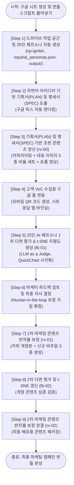

<!--
Copyright 2026 Google LLC. All Rights Reserved.
SPDX-License-Identifier: Apache-2.0

NOTICE: This code/repository is owned by Google LLC and provided under the Apache-2.0 License.
It is strictly provided as an EXAMPLE/REFERENCE ONLY and is NOT INTENDED FOR PRODUCTION USE.
All contents, designs, and code examples are subject to change, modification, or removal at any time without notice.

[고지 사항] 본 저장소 및 문서는 구글 (Google LLC) 소유이며 Apache 2.0 라이선스 하에 예시 (Sample) 용도로 제공된다.
프로덕션 환경용이 아니며, 사전 통지 없이 언제든지 수정, 변경 또는 삭제될 수 있다.
-->

> [!IMPORTANT]
> **구글 (Google LLC) 참조용 샘플 고지 사항**:
> 본 프로젝트의 모든 소스 코드와 문서는 Google LLC의 소유이며, Apache-2.0 라이선스에 따라 오직 **참조용 샘플 (Sample / Reference Only)** 목적으로만 제공된다. 프로덕션 환경에 그대로 사용할 수 없으며, 사전 통지 없이 언제든 내용이 수정, 변경 또는 삭제될 수 있다.

# 구글 드라이브 마케팅 콘텐츠 생성 파이프라인 (`drive-marketing-content-pipeline`)

Google Cloud 프로젝트 생성 및 복잡한 로컬 파이썬 개발 환경 설정, 별도 API Key 발급 없이, 현재 로그인된 구글 계정 OAuth 2.0 자동 인증(Keyless Zero-Setup)만으로 구글 드라이브, 구글 시트, Apps Script 기반의 종단간 마케팅 콘텐츠 양산 및 25인 AI 페르소나 다면 평가 파이프라인을 구축하는 경량 자동화 솔루션이다. (As of 2026-10-13)

**Audience**: `#Architect`, `#Developer`  
**Concern**: `#Performance`, `#Resilience`  
**Service**: `#GeminiAPI`, `#Workspace`

---

## 이 가이드가 필요한 상황 (증상 체크리스트)

- **인프라 장벽**: 기업 및 마케팅 실무 부서에서 Google Cloud 콘솔 권한이나 결제 프로젝트 생성 승인을 받기까지 수 주 이상의 지연이 발생할 때
- **개발 환경 부재**: 파이썬 가상 환경, Docker, 터미널 CLI 도구, API Key 발급 절차에 익숙하지 않은 비개발자 기획자나 마케터가 브라우저 환경에서 직접 인공 지능 마케팅 자동화를 검증하고자 할 때
- **정성 평가의 한계**: 신제품 출시 전 다면적인 소비자 반응을 사전에 검증하기 어렵고, 정량 평점과 정성 의견, 이미지/동영상 VoC를 통합 분석하는 체계가 부족할 때
- **명세 기반 통제 필요**: 단순 프롬프트 엔지니어링을 넘어, 캠페인 기획서(PLAN)와 콘텐츠 제작 명세서(SPEC)에 기반한 엄격한 규격 통제와 인간 참여(Human-in-the-loop) 콘텐츠 보정 루프를 구축하고자 할 때

---

## 처리 흐름도 (Activity Diagram)



---

## 2단계 퀵스타트 가이드 (Quickstart)

### 1단계: 구글 시트 생성 및 번들 스크립트 붙여넣기
1. 구글 드라이브 ( https://drive.google.com )에서 빈 구글 스프레드시트를 새로 생성한다.
2. 상단 메뉴에서 `확장 프로그램` > `Apps Script`를 클릭한다.
3. 기본 편집창의 기존 코드를 모두 지우고, 본 저장소의 `bundle_apps_script.js` 파일 내용을 전체 복사하여 붙여넣는다.
4. 좌측 `프로젝트 설정 (톱니바퀴 아이콘)`에서 `편집기에서 "appsscript.json" 매니페스트 파일 표시`를 체크한 뒤, 본 저장소의 `appsscript.json` 내용을 붙여넣고 상단 디스크 아이콘(`프로젝트 저장`)을 누른다.
5. 구글 시트 브라우저 탭을 새로고침(F5)하면 상단 메뉴 바에 `>> 마케팅 콘텐츠 파이프라인 <<` 커스텀 메뉴가 활성화된다.

### 2단계: 상단 메뉴를 통한 9단계 자동화 순차 실행

1. **[Step 1] 구글 드라이브 작업 공간 및 25인 페르소나 자동 생성**:
   - 구글 시트 상단 메뉴에서 `>> 마케팅 콘텐츠 파이프라인 <<` > `[Step 1] 구글 드라이브 작업 공간 및 25인 페르소나 자동 생성`을 클릭한다.
   - 클릭 1번으로 구글 드라이브에 캠페인 루트 폴더(`cp-ignite`), 25인 페르소나 데이터셋(`input/ai_personas.json`), 비디오 샘플을 자동 세팅한다.
   - 최초 1회 실행 시 구글 계정 권한 승인 팝업이 나타나면 `고급` > `이동`을 클릭한 후 `허용`을 선택한다. (구글 계정 자동 로그인으로 완결 구동)
2. **[Step 2] 아이디어 기반 기획서(PLAN) 및 콘텐츠 제작 명세서(SPEC) 자동 도출**:
   - 캠페인 아이디어(예: '프리미엄 노이즈 캔슬링 헤드폰 가을 론칭 프로모션')를 자유롭게 입력하면 전문 마케팅 캠페인 기획서(`PLAN`)와 멀티 채널 콘텐츠 제작 명세서(`SPEC`) 구글 독스가 자동 생성된다. 마케터는 브라우저에서 직접 `SPEC` 수치(이미지 비율, 숏폼 길이, 카피 채널)를 수정할 수 있다.
3. **[Step 3] 기획서(PLAN) 및 명세서(SPEC) 기반 초판 마케팅 콘텐츠 양산 (rv-00)**:
   - 마케터가 확정한 `SPEC` 규격에 맞추어 마케팅 카피 구글 독스(`campaign_content`), 대표 비주얼 이미지 3종 비율 세트(16:9, 9:16, 1:1), 세로 9:16 모바일 숏폼 영상(`00_shorts.mp4`)을 콘텐츠 폴더에 자동 일괄 양산한다.
4. **[Step 4] 고객 VoC 수집용 구글 폼 자동 생성 (이미지/비디오 업로드)**:
   - 평점, 서술형 의견, 고객 동영상 첨부 문항이 포함된 구글 폼을 생성하고 시트 응답 탭 및 모바일 접속용 QR 코드를 자동 연동한다.
5. **[Step 5] 25인 AI 페르소나 1차 다면 평가 및 t-SNE 지형도 자동 렌더링 (fb-01)**:
   - 25인의 가상 소비자 반응과 고객 비디오 VoC VLM 분석 결과를 결합하여 t-SNE 여론 지형도가 임베드된 다면 평가 보고서(`feedback_summary`) 구글 독스를 완성한다.
6. **[Step 6] 마케터 피드백 검토 및 최종 의사 결정 (Human-in-the-loop)**:
   - 마케터 전용 팝업이 표시되며, 평가 보고서를 검토한 마케터가 핵심 개선 방향을 선택하거나 직접 입력하여 최종 보정 지침을 확정한다.
7. **[Step 7] 다면 평가 피드백 기반 1차 마케팅 콘텐츠 반자율 보정 (rv-01)**:
   - 마케터의 의사 결정을 반영하여 개정된 광고 카피, 새로운 이미지 3종, 보정된 모바일 숏폼 영상이 담긴 `rv-01/` 마케팅 콘텐츠를 자동 제작한다.
8. **[Step 8] 2차 다면 평가 및 t-SNE 지형도 갱신 (fb-02)**:
   - 1차 개정본 콘텐츠를 25인 페르소나에게 재평가받고 갱신된 t-SNE 여론 지형도 및 2차 평가 보고서를 생성한다.
9. **[Step 9] 2차 마케팅 콘텐츠 반자율 보정 완결 (rv-02)**:
   - 최종 배포용 마케팅 카피, 완성형 비주얼 3종, 최종 모바일 숏폼 영상 패키지를 `rv-02/` 폴더에 완결 생성한다.

> [!TIP]
> **타깃 AI 페르소나 맞춤 변경 (선택 사항)**:
> 상단 메뉴의 `[0. 타깃 AI 페르소나 패널 맞춤 재설정 (선택 사항)]`을 클릭하여 원하는 타깃 시장(예: '일본 20대 여성', '미국 B2B SaaS 바이어' 또는 'hf:데이터셋명')을 입력하면 해당 캠페인 전용 25인 맞춤 평가단으로 즉시 교체된다.

---

## 생성 산출물 디렉터리 구조

파이프라인 실행 시 구글 드라이브(My Drive) 루트에 다음과 같은 자체 완결적 폴더 구조가 가나다순 및 알파벳순으로 자동 구축된다:

```text
My Drive/
├── 마케팅 콘텐츠 파이프라인 (구글 스프레드시트: 9단계 자동화 컨트롤 타워)
├── cp-autumn-breeze/ (다중 캠페인 독립 격리 폴더 예시 - 아래 상세 접기 참조)
└── cp-ignite/ (기본 실습 캠페인 폴더)
    ├── 고객 피드백 설문 (구글 폼: 실시간 고객 VoC 수집 폼)
    ├── input/ (원천 입력 데이터셋)
    │   ├── 아이디어 메모 (구글 독스: 마케터 캠페인 아이디어 초안 메모)
    │   ├── ai_personas.json (해당 캠페인 전용 25인 슬림 페르소나 패널)
    │   ├── fb-01/ (1차 피드백 데이터셋)
    │   │   ├── ai_persona_feedbacks.json (25인 페르소나 실시간 평가 데이터)
    │   │   ├── feedback_clusters_map.png (QuickChart 기반 t-SNE 여론 지형도 차트)
    │   │   ├── feedback_sample.mp4 (고객 직접 촬영 모바일 세로 비디오 VoC)
    │   │   ├── feedback_summary (구글 독스: VLM 분석과 지형도가 포함된 종합 다면 평가 보고서)
    │   │   └── video_voc_analysis.json (Gemini VLM 멀티모달 표정, 음성 톤, 발화 분석 결과)
    │   └── fb-02/ (2차 피드백 데이터셋 - 아래 상세 접기 참조)
    ├── output/ (리비전별 마케팅 콘텐츠 - 아래 상세 접기 참조)
    ├── PLAN (구글 독스: 마케팅 캠페인 기획서 전문)
    └── SPEC (구글 독스: 멀티 채널 콘텐츠 제작 명세서 - 이미지, 숏폼, 카피 규격)
```

<details>
<summary><strong>1. 기본 캠페인(cp-ignite): 2차 피드백(fb-02) 및 전체 리비전 콘텐츠(rv-00, rv-01, rv-02) 세부 트리 펼치기</strong></summary>

```text
My Drive/
└── cp-ignite/
    ├── input/
    │   └── fb-02/ (2차 피드백 데이터셋)
    │       ├── ai_persona_feedbacks.json (2차 개정본 평가 데이터)
    │       ├── feedback_clusters_map.png (갱신된 t-SNE 여론 지형도)
    │       ├── feedback_summary (구글 독스: 2차 종합 평가 보고서)
    │       └── video_voc_analysis.json (2차 비디오 VoC 분석 데이터)
    └── output/
        ├── rv-00/ (초판 마케팅 콘텐츠)
        │   ├── 00_banner_16x9.png (가로형 디스플레이 배너)
        │   ├── 00_poster_9x16.png (세로형 모바일 포스터)
        │   ├── 00_shorts.mp4 (세로 9:16 모바일 숏폼 영상)
        │   ├── 00_sns_1x1.png (정방형 SNS 피드 이미지)
        │   └── campaign_content (구글 독스: 멀티 채널 카피 및 영상 콘티)
        ├── rv-01/ (1차 개정본)
        │   ├── 01_banner_16x9.png (보정된 가로형 배너)
        │   ├── 01_poster_9x16.png (보정된 세로형 포스터)
        │   ├── 01_shorts.mp4 (보정된 세로 9:16 모바일 숏폼 영상)
        │   ├── 01_sns_1x1.png (보정된 SNS 피드 이미지)
        │   └── campaign_content (구글 독스: 1차 피드백 반영 개정 카피)
        └── rv-02/ (2차 완결본)
            ├── 02_banner_16x9.png (최종 완결형 배너)
            ├── 02_poster_9x16.png (최종 완결형 포스터)
            ├── 02_shorts.mp4 (최종 완결형 모바일 숏폼 영상)
            ├── 02_sns_1x1.png (최종 완결형 SNS 피드 이미지)
            └── campaign_content (구글 독스: 최종 배포용 마케팅 카피)
```

</details>

<details>
<summary><strong>2. 다중 캠페인 독립 격리 예시 (cp-autumn-breeze) 세부 트리 펼치기</strong></summary>

```text
My Drive/
└── cp-autumn-breeze/ (다중 캠페인 독립 격리 폴더 예시)
    ├── 고객 피드백 설문 (구글 폼: 2026 가을 오텀 브리즈 고객 설문 폼)
    ├── input/
    │   ├── 아이디어 메모 (구글 독스: 아웃도어 라이프스타일 컬렉션 기획 메모)
    │   ├── ai_personas.json (가을 아웃도어 타깃 25인 맞춤 페르소나 패널)
    │   └── fb-01/ (1차 피드백 데이터셋)
    │       ├── ai_persona_feedbacks.json
    │       ├── feedback_clusters_map.png
    │       ├── feedback_sample.mp4
    │       ├── feedback_summary (구글 독스)
    │       └── video_voc_analysis.json
    ├── output/
    │   └── rv-00/ (초판 마케팅 콘텐츠)
    │       ├── 00_banner_16x9.png
    │       ├── 00_poster_9x16.png
    │       ├── 00_shorts.mp4
    │       ├── 00_sns_1x1.png
    │       └── campaign_content (구글 독스)
    ├── PLAN (구글 독스: 오텀 브리즈 캠페인 기획서 전문)
    └── SPEC (구글 독스: 멀티 채널 콘텐츠 제작 명세서)
```

</details>

---

## 25인 마스터 AI 페르소나 패널 구성

본 파이프라인에 탑재된 가상 평가단은 대한민국 시장 환경을 반영한 25인의 다면적 인구통계학적 프로필을 갖추고 있다:

| ID | 이름 | 연령 | 성별 | 직업 | 분류 | 주요 관심사 및 평가 관점 |
| :--- | :--- | :--- | :--- | :--- | :--- | :--- |
| kr_persona_00001 | 김도현 | 34 | 남 | 브랜드 마케터 | 전문 마케터 | 브랜드 일관성, 헤드카피 설득력, USP 전달력 |
| kr_persona_00002 | 이지은 | 29 | 여 | 퍼포먼스 마케터 | 전문 마케터 | CTR 전환 효율, CTA 명확성, 모바일 가독성 |
| kr_persona_00003 | 박서준 | 41 | 남 | 광고 대행사 CD | 전문 마케터 | 크리에이티브 독창성, 비주얼 임팩트, 톤앤매너 |
| kr_persona_00004 | 최유진 | 27 | 여 | 소셜 콘텐츠 에디터 | 전문 마케터 | 릴스/쇼츠 바이럴 잠재력, 인스타 감성 공감대 |
| kr_persona_00005 | 정민우 | 38 | 남 | 그로스 해커 | 전문 마케터 | A/B 테스트 적합성, 전환 퍼널 설계 최적화 |
| kr_persona_00006 | 강수진 | 32 | 여 | CRM 마케터 | 전문 마케터 | 구매 전환 유도, 재구매 락인, 멤버십 혜택 |
| kr_persona_00007 | 윤재현 | 45 | 남 | 마케팅 총괄 본부장 | 전문 마케터 | ROI 효율, 전사 비즈니스 목표 정합성 |
| kr_persona_00008 | 한소희 | 24 | 여 | 인플루언서 마케터 | 전문 마케터 | Z세대 트렌드 반영도, 숏폼 챌린지 적합성 |
| kr_persona_00009 | 오승호 | 36 | 남 | 프로덕트 마케터 | 전문 마케터 | 기술 사양(ANC, 배터리)의 대중적 언어 전환 |
| kr_persona_00010 | 배지원 | 31 | 여 | 카피라이터 | 전문 마케터 | 문장의 리듬감, 감성적 후킹, 기억 용이성 |
| kr_persona_00011 | 송태현 | 43 | 남 | 이커머스 MD | 전문 마케터 | 패키징 구성, 얼리버드 가격 정책, 상세 페이지 |
| kr_persona_00012 | 권미래 | 28 | 여 | 글로벌 마케터 | 전문 마케터 | 글로벌 확장성, 문화적 수용도, 비주얼 완성도 |
| kr_persona_00013 | 조현우 | 26 | 남 | 취업 준비생 | 일반 소비자 | 가성비, 일상 소음 차단, 온라인 강의 몰입도 |
| kr_persona_00014 | 장서연 | 22 | 여 | 대학생 | 일반 소비자 | 디자인, 파스텔 컬러, 카페 공부 감성 사진 |
| kr_persona_00015 | 임동혁 | 33 | 남 | IT 기업 개발자 | 일반 소비자 | 장시간 착용 편안함, 기기 멀티포인트 페어링 |
| kr_persona_00016 | 유하나 | 35 | 여 | 금융권 과장 | 일반 소비자 | 지하철 통근 스트레스 완화, 가벼운 무게 |
| kr_persona_00017 | 노준영 | 48 | 남 | 공인회계사 | 일반 소비자 | 통화 품질, 잦은 출장 시 휴대성, 내구성 |
| kr_persona_00018 | 신예원 | 25 | 여 | 스타트업 디자이너 | 일반 소비자 | 미니멀한 외관 디자인, 힌지 마감 퀄리티 |
| kr_persona_00019 | 문성진 | 39 | 남 | 자영업 카페 대표 | 일반 소비자 | 매장 음악 모니터링, 신속한 충전 속도 |
| kr_persona_00020 | 백수아 | 30 | 여 | 프리랜서 번역가 | 일반 소비자 | 집안 생활 소음 차단, 장시간 귀 압박감 여부 |
| kr_persona_00021 | 곽태훈 | 52 | 남 | 중소기업 임원 | 일반 소비자 | 복잡하지 않은 직관적 조작 버튼, 명료한 음질 |
| kr_persona_00022 | 서가영 | 28 | 여 | 항공사 승무원 | 일반 소비자 | 기내 소음 차단력, 전용 파우치 휴대 편의성 |
| kr_persona_00023 | 홍성우 | 37 | 남 | 피트니스 트레이너 | 일반 소비자 | 운동 시 땀 배출 및 방수, 안정적인 고정력 |
| kr_persona_00024 | 안지민 | 23 | 여 | 패션 쇼핑몰 모델 | 일반 소비자 | 착용 샷의 패션 아이템 조화, 세련된 컬러감 |
| kr_persona_00025 | 전진우 | 40 | 남 | 건축 설계사 | 일반 소비자 | 현장 소음 차단, 클래식 및 재즈 음향 해상력 |

---

## 핵심 아키텍처 및 차별화 요소

### 1. Zero-GCP & Keyless Zero-Setup
Google Cloud 프로젝트, 서비스 계정 키, 결제 계정 등록, 별도 API Key 발급이 전혀 필요하지 않다. 현재 스프레드시트에 로그인된 구글 계정의 OAuth 2.0 Access Token 기반 자동 인증으로 구글 앱스 스크립트(Apps Script) 상에서 즉시 안전하게 구동된다.

### 2. No-Python & Web-Native
로컬 터미널, 파이썬 가상 환경(`.venv`), 외부 패키지 설치(`pip install`)가 일절 존재하지 않는다. 웹 브라우저 안에서 구글 시트 상단 커스텀 메뉴 클릭만으로 전체 9단계 파이프라인(Step 1~Step 9)이 즉시 수행된다.

### 3. 기획서(PLAN) 및 제작 명세서(SPEC) 기반 엄격한 품질 통제
아이디어 발상 단계에서 전문 마케팅 기획서(`PLAN`)와 채널별 제작 명세서(`SPEC`)를 구글 독스로 분리 생성한다. 마케터가 브라우저에서 직접 `SPEC` 문서의 이미지 종횡비, 해상도, 모바일 숏폼 영상 길이(15초~30초), 카피 채널을 수정한 뒤 후속 단계를 실행하면, 인공 지능이 해당 명세를 엄격히 준수하여 콘텐츠를 양산한다.

### 4. 25인 한국인 마스터 AI 페르소나 다면 평가 및 열린 피드백 원칙
20대부터 50대까지 IT/금융/유통 전문 마케터 12인과 대학생/직장인/자영업자 등 일반 소비자 13인으로 구성된 25인 패널 데이터를 내장하고 있다. 특히 콘텐츠 제작 명세서(`SPEC`)에 특정 설문 문항이 고정되어 있지 않은 한 **'열린 피드백(Open-ended Feedback)' 원칙**을 적용하여 각 페르소나가 제약 없는 관점에서 자유로운 소감을 발화한다. 또한 25명의 페르소나가 1인당 단편적인 1개의 의견만 남기는 것이 아니라, 호평 포인트, 비판/개선 요구 포인트, 가격/구매 혜택 의견 등 **1인당 2~4개의 세부 의견 포인트(Key Feedback Points)**를 도출하여 전체 50~80개 이상의 풍부한 의견 군집을 형성한다.

### 5. Gemini VLM 기반 고객 동영상 피드백(비디오 VoC) 심층 분석
고객이 스마트폰으로 직접 촬영한 동영상 피드백(MP4)을 Gemini VLM 멀티모달 엔진이 분석하여, 고객의 얼굴 표정 변화, 음성 톤, 실제 발화 내용(Transcript), 감정 및 개선 제안을 구조화된 `video_voc_analysis.json` 파일로 자동 추출 및 저장한다. 다면 평가(Judge) 실행 시 이 VLM 분석 데이터가 25인 AI 페르소나 데이터와 함께 종합 분석된다.

### 6. 모바일 숏폼 영상(MP4) 및 멀티 채널 비주얼 소재 양산
가로형 디스플레이 배너(16:9), 세로형 모바일 포스터(9:16), 정방형 SNS 피드 이미지(1:1)뿐만 아니라, 인스타그램 릴스와 유튜브 쇼츠에 즉시 활용 가능한 세로 9:16 모바일 숏폼 영상(`*_shorts.mp4`)을 매 리비전마다 완결형으로 양산한다.

### 7. 한국어 특화 128d 임베딩 및 다중 포인트 t-SNE 여론 지형도
도출된 50~80개 이상의 세부 의견 포인트를 한국어 성능이 뛰어난 `text-multilingual-embedding-002` 모델을 통해 128차원 MRL(Matryoshka Representation Learning) 벡터로 일괄 변환한다. Apps Script 환경에서 경량 PCA 2축 투영을 거쳐 2차원 평면 좌표로 변환한 뒤, QuickChart REST API를 호출하여 호평, 비판, 가격, 사용성 등 4개 군집으로 입체적 다면 여론 지형도(`feedback_clusters_map.png`)를 실시간 생성하고 구글 독스 피드백 보고서 상단에 자동 임베드한다.

### 8. 구글 시트 실시간 실행 대시보드
구글 드라이브 폴더 탭을 번거롭게 오갈 필요 없이, 작업 중인 구글 시트의 `실행 대시보드` 탭에서 각 단계별 처리 상태와 생성된 산출물(PLAN, SPEC, 초판 콘텐츠 폴더, 구글 폼, 피드백 요약서, 개정본 폴더)의 하이퍼링크를 즉시 클릭하여 열람할 수 있다.

### 9. 태스크별 최적 Gemini 모델 사양 연동 (As of 2026-10-13)
단일 모델에 고정하지 않고, 각 작업의 특성과 처리 속도, 비용 효율성을 고려하여 최적의 모델을 취사선택하여 연동한다:
- **텍스트 생성 및 다면 평가**: `gemini-3.8-flash` (기획서 작성, 25인 다면 평가, VLM 비디오 VoC 분석에 적합한 빠른 응답 속도 및 긴 컨텍스트 윈도우)
- **한국어 특화 텍스트 임베딩**: `text-multilingual-embedding-002` (한국어 정밀 분석 및 128차원 MRL 축소 임베딩을 통한 50~80+개 의견 포인트 벡터화)
- **비주얼 소재 생성**: `gemini-2.5-flash-image` (채널별 종횡비 이미지 생성에 적합)
- **모바일 숏폼 영상 콘티 및 제작**: `veo-3.1-generate-001` (15초~30초 세로 숏폼 영상 제작에 적합)

### 10. 모듈화된 11대 핵심 스크립트 및 구글 시트 커스텀 메뉴 매핑
유지보수성과 가독성을 위해 단발성 래퍼 파일 중복(`Round1`, `Round2`)을 제거하고 기능 단위로 단일화한 11개 스크립트 모듈로 구성되어 있다:

| 파일명 (`apps-scripts/`) | 담당 기능 및 주요 함수 | 구글 시트 커스텀 메뉴 매핑 |
| :--- | :--- | :--- |
| `Code_Config.js` | 전역 설정, 태스크별 최적 모델 선정, 규격 명세 | 시스템 전역 설정 |
| `Code_Gemini.js` | 구글 계정 OAuth 2.0 자동 로그인 REST 클라이언트 | API 통신 엔진 |
| `Code_Utils.js` | 드라이브/독스/폼 헬퍼, QuickChart, Base64 시딩 | 공통 유틸리티 |
| `Code_Step1_Workspace.js` | 작업 폴더(`cp-ignite/`), `input/ai_personas.json`, 시트 대시보드 | `[Step 1] 구글 드라이브 작업 공간 및 25인 페르소나 자동 생성` |
| `Code_Step2_IdeaToPlan.js` | 자연어 아이디어 기반 `PLAN` & `SPEC` 구글 독스 생성 | `[Step 2] 아이디어 기반 기획서 및 명세서 자동 도출` |
| `Code_Step3_ContentGen.js` | 초판 마케팅 콘텐츠(rv-00) 양산 (카피, 이미지 3종, 숏폼 MP4) | `[Step 3] 초판 마케팅 콘텐츠 양산 (rv-00)` |
| `Code_Step4_Form.js` | 고객 VoC 수집용 구글 폼 생성 및 모바일 QR 코드 연동 | `[Step 4] 고객 VoC 수집용 구글 폼 자동 생성` |
| `Code_Step5_8_Judge.js` | 25인 다면 평가 및 t-SNE 지형도 생성/갱신 통합 엔진 | `[Step 5] 1차 다면 평가 (fb-01)` / `[Step 8] 2차 다면 평가 (fb-02)` |
| `Code_Step6_Decision.js` | 마케터 피드백 검토 및 최종 의사 결정 (Human-in-the-loop) | `[Step 6] 마케터 피드백 검토 및 최종 의사 결정` |
| `Code_Step7_9_Refine.js` | 피드백 반영 마케팅 콘텐츠 반자율 보정 통합 엔진 | `[Step 7] 1차 보정 (rv-01)` / `[Step 9] 2차 보정 완결 (rv-02)` |
| `Code_Menu.js` | 시트 상단 메뉴(`onOpen`), 맞춤 페르소나 설정 | 커스텀 메뉴 바 UI 컨트롤러 |

---

## 자원 정리 안내 (Teardown)

본 솔루션은 클라우드 가상 머신(VM), 데이터베이스, VPC 등의 유료 클라우드 리소스를 일절 생성하지 않는다. 실습 및 검증을 완료한 후 정리하고자 할 경우 다음 절차를 수행한다:

1. **구글 드라이브 산출물 삭제**:
   - 구글 드라이브 ( https://drive.google.com )에서 생성된 캠페인 루트 폴더(`cp-ignite`)와 구글 시트 파일을 휴지통으로 이동 후 비운다.
