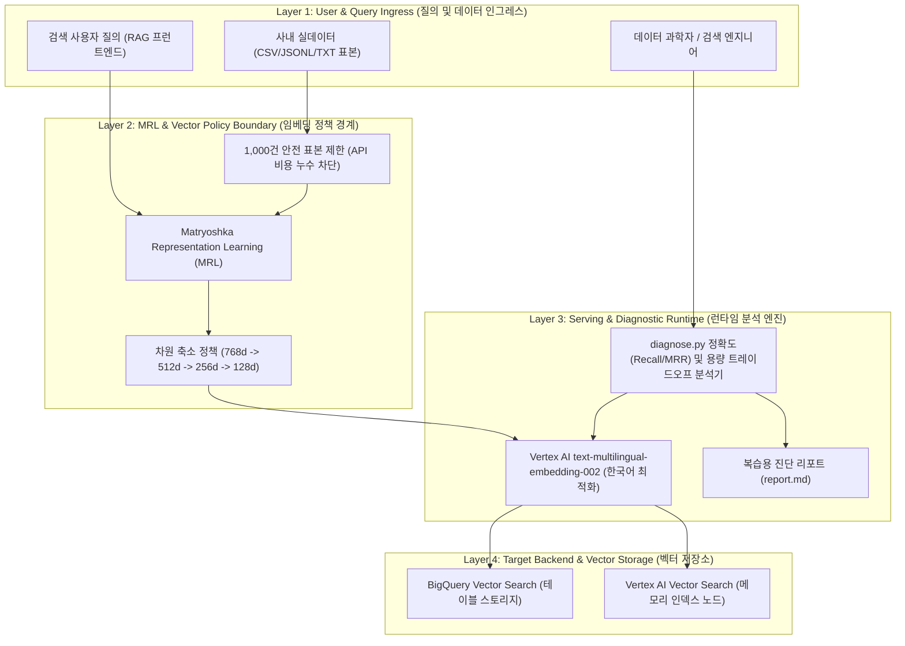

<!--
Copyright 2026 Google LLC. All Rights Reserved.
SPDX-License-Identifier: Apache-2.0

NOTICE: This code/repository is owned by Google LLC and provided under the Apache-2.0 License.
It is strictly provided as an EXAMPLE/REFERENCE ONLY and is NOT INTENDED FOR PRODUCTION USE.
All contents, designs, and code examples are subject to change, modification, or removal at any time without notice.

[고지 사항] 본 저장소 및 문서는 구글 (Google LLC) 소유이며 Apache 2.0 라이선스 하에 예시 (Sample) 용도로 제공된다.
프로덕션 환경용이 아니며, 사전 통지 없이 언제든지 수정, 변경 또는 삭제될 수 있다.
-->

> [!IMPORTANT]
> **구글 (Google LLC) 참조용 샘플 고지 사항**:
> 본 프로젝트의 모든 소스 코드와 문서는 Google LLC의 소유이며, Apache-2.0 라이선스에 따라 오직 **참조용 샘플 (Sample / Reference Only)** 목적으로만 제공된다. 프로덕션 환경에 그대로 사용할 수 없으며, 사전 통지 없이 언제든 내용이 수정, 변경 또는 삭제될 수 있다.

# 임베딩 벡터 차원 축소에 따른 용량 절감 및 검색 정확도 비교 분석기

버텍스 AI(Vertex AI) 및 제미나이 API(Gemini API) 임베딩 모델(다국어 및 한국어 최적화: `text-multilingual-embedding-002`, 영어/코드 특화: `text-embedding-005`)의 Matryoshka Representation Learning(MRL) 기능을 활용하여, 사내 실데이터(CSV, JSONL, TXT) 또는 1,000건의 비용 최적화 표본을 대상으로 지정된 차원들(기본값: 768, 512, 256, 128)을 큰 차원부터 작은 차원까지 일괄 테스트하고 인덱스 용량 절감량(최대 83.3%)과 검색 정확도 손실률(2.4%) 트레이드오프를 1분 만에 비교 분석하는 도구다. (As of 2026-10-17)

---

## 1. 발생 증상 및 진단 대상 체크리스트

사내 또는 고객사 환경에서 아래 증상이 발생한다면 즉시 진단 대상이다:
- [ ] 자사의 실제 비즈니스 도메인 데이터(질의, 문서)를 직접 주입하여 차원 축소 시 실제 검색 정확도 손실과 랭킹 품질(MRR) 변화를 정밀하게 측정해야 하는 경우
- [ ] 대규모 임베딩 API 호출에 따른 비용 누수를 방지하기 위해 기본 평가 표본을 1,000건 수준으로 안전하게 제한하면서도 전사 100만 건 기준 인덱스 RAM/스토리지 절감량을 산정하고자 하는 경우
- [ ] 최대 차원(768)부터 최저 차원(128)까지 지원되는 모든 차원을 한 번에 일괄 비교하거나, 특정 2개 이상의 차원만 지정하여 맞춤형 비교표를 산출하려는 경우
- [ ] 빅쿼리(BigQuery) Vector Search 또는 버텍스 AI Vector Search 도입 전 인프라 용량 및 비용 최적화를 위한 정량적 근거 보고서가 필요한 경우
- [ ] 모바일 또는 실시간 지연 시간 민감 워크로드에서 유사도 계산 레이턴시를 3배 이상 단축하려는 경우


### 1.1 도구의 본질 및 비즈니스 해결 과제 (What & Why)
- **대상 사용자 (Target)**: AI/ML 엔지니어, 데이터 과학자, 시맨틱 검색 아키텍트 및 벡터 DB 관리자
- **해결하는 핵심 문제 (Core Pain Points)**:
  1. 임베딩 벡터를 풀 차원(768d)으로 유지함에 따라 Vector Search 인덱스 RAM 비용과 스토리지 요금이 기하급수적으로 증가하는 문제
  2. 차원을 축소(512d, 256d, 128d)할 경우 자사 도메인 데이터에서 검색 적중률(Recall)과 랭킹 품질(MRR)이 얼마나 손실되는지 사전 측정 불가
  3. 한국어 및 다국어 환경에서 영어 특화 모델 대비 언어학적 특성을 반영한 최적 임베딩 모델 선정이 어려운 현상
- **본 솔루션의 해결 방식 (Solution)**:
  - Vertex AI `text-multilingual-embedding-002` 모델의 MRL(Matryoshka Representation Learning)을 활용하여 사내 표본 코퍼스를 대상으로 768d 대비 512d, 256d, 128d 축소 시의 정확도 손실률, 레이턴시 단축 배수, 인덱스 용량 절감량을 1분 만에 비교 분석한다.

### 1.2 최종 산출물 3종 세트 미리보기 (Deliverables & Visual Preview)
본 도구를 실행(`python diagnose.py`)하면 다음 3가지 구체적인 엔터프라이즈 자산이 생성된다:

| 산출물 구분 | 산출물 형태 및 명칭 | 주요 포함 내용 및 실무 활용 방안 |
| :--- | :--- | :--- |
| **① 터미널 콘솔 요약** | Visual CLI Table | 차원별 Top-1/Top-3 Recall, MRR, 평균 지연시간, 100만 건 기준 RAM 절감량 및 티어 판정 표 |
| **② 정규 진단 보고서** | 마크다운 파일 (`report.md`) | MRL 차원 축소 벤치마크 결과서, 차원별 트레이드오프 분석 그래프 데이터, 한국어 모델 선정 가이드 및 프로덕션 적용 코드 |
| **③ 후속 조치 및 배포 자산** | Actionable Asset Specs | • **사내 실데이터 적용 파이썬 코드**: `google-genai` SDK 기반 `output_dimensionality` 주입 템플릿<br/>• **3대 최적 티어링 권고안**: Tier 1(초절감 128d), Tier 2(균형 256d/512d), Tier 3(고정밀 768d)<br/>• **Vector Search 인덱스 최적화 사양**: 축소된 차원에 맞춘 인덱스 엔드포인트 프로비저닝 가이드 |

---

## 2. 빠른 시작 (Quickstart)

> [!TIP]
> Cloud Shell 접속 환경 구성 및 저장소 클론(`git clone`) 방법은 루트의 [메인 README](../../README.md)를 참고한다.

### 1) 모의 데이터 가상 실행 (Dry-Run)
GCP API 호출 없이 내장된 가상 인프라 데이터로 정상 동작 여부를 즉시 검증한다:
```bash
python diagnose.py --dry-run
```

**터미널 진단 출력 미리보기:**
```text
[3] 비교군 (256d 차원 축소)
  - 벡터당 용량 (Float32): 1,024 바이트 (1.00 KB)
  - 1,000,000건 기준 인덱스 메모리(RAM): 1.192 GB
  - 검색 정확도 (Top-1 Recall): 98.3%
  - 상위 3위 적중률 (Top-3 Recall): 99.5%
  - 검색 랭킹 품질 (MRR): 0.987
  - 질의당 평균 검색 레이턴시: 9.5 ms
[4] 비교군 (128d 차원 축소)
  - 벡터당 용량 (Float32): 512 바이트 (0.50 KB)
  - 1,000,000건 기준 인덱스 메모리(RAM): 0.596 GB
```


### 2) 사내 환경 대화형 설정 (Config Wizard, 선택 사항)
사내 활성 프로젝트 및 환경 설정을 대화형으로 탐색하여 `.env`에 자동 저장한다:
```bash
python diagnose.py --config
```


### 3) 실제 사내 인프라 실시간 진단
```bash
python diagnose.py
```
> [!NOTE]
> 앞서 `python diagnose.py --config`로 환경 설정을 저장했거나 gcloud 활성 설정을 그대로 활용할 경우 별도의 `.env` 생성 없이 즉시 실행할 수 있다. (환경 변수를 텍스트 에디터로 직접 수동 편집하고자 할 때만 `cp -n .env.example .env` 실행 후 수정)

---

## 3. 솔루션 아키텍처 및 처리 흐름



---
## 4. 조치 가이드 및 권장 설정

### 1단계: 한국어/다국어 특화 모델 선택 및 최적 차원 파라미터 적용
- 한국어 코퍼스에서는 다국어에 특화된 `text-multilingual-embedding-002` 모델을 우선 채택하여 형태소 분절 및 조사 결합 문맥에서의 검색 정확도를 극대화한다.
- `google-genai` SDK를 통해 `output_dimensionality` 매개변수를 결정된 차원(예: 128 또는 256)으로 지정하여 호출한다.
- Vertex AI 텍스트 임베딩 생성 ( https://cloud.google.com/vertex-ai/generative-ai/docs/embeddings/get-text-embeddings )

### 2단계: BigQuery 벡터 검색 및 Vector Search 인덱스 스키마 반영
- 축소된 차원의 벡터를 저장할 경우 테이블 용량 및 쿼리당 스캔 바이트가 대폭 절감된다.
- Vector Search 인덱스 생성 시 대상 차원(`dimension`)을 결정된 축소 차원으로 지정한다.
- Vertex AI Vector Search 콘솔 ( https://console.cloud.google.com/vertex-ai/matching-engine/indexes )
- Vertex AI Vector Search 개요 ( https://cloud.google.com/vertex-ai/docs/vector-search/overview )
- 차원 축소에 따라 인덱스 노드 머신 유형을 다운사이징하여 인프라 비용을 절감한다.

### 3단계: GCP 리소스 생성 시 4대 필수 표준 라벨링 준수
- Vector Search 인덱스 및 관련 BigQuery 데이터셋 생성/배포 시 FinOps 비용 분석 및 추적을 위해 4대 표준 라벨을 필수로 주입한다:
  - `managed-by`: `google-cloud-0-to-1`
  - `scenario`: `embedding-dimension-tradeoff-analyzer`
  - `env`: `sample`
  - `created-by`: `customer-engineer`
- gcloud CLI 예시: `gcloud ai indexes create ... --labels=managed-by=google-cloud-0-to-1,scenario=embedding-dimension-tradeoff-analyzer,env=sample,created-by=customer-engineer`

---
## 5. 사전 준비 사항 (필요 IAM 권한)

본 도구를 실행하려면 최소 아래의 IAM 권한이 필요하다:

본 도구를 실행하려면 최소 아래의 IAM 권한이 필요하다:

| 서비스 | 필요 역할(Role) | 최소 IAM 권한 |
| :--- | :--- | :--- |
| `BigQuery` | `roles/bigquery.jobUser` | `bigquery.jobs.create` |
| `Vertex AI` | `roles/aiplatform.user` | `aiplatform.endpoints.predict` |

---

## 6. 기술적 배경 및 아키텍처 원리 (Deep Dive)

### 관련 상세 설계 및 요구 사항 명세
- [비즈니스 요구 사항 명세서 (BRD)](docs/BRD.md): 비즈니스 배경, 성공 지표 및 요구 사항(BR-01~) 명세
- [기술 상세 설계서 (TDD)](docs/TDD.md): 시스템 아키텍처, 기능(FR-01~) 및 비기능(NFR-01~) 설계 명세

```text
================================================================================
임베딩 벡터 차원 축소에 따른 용량 절감 및 검색 정확도 다차원 비교 분석 리포트
진단 모드: 가상 실행 (Dry-run)
대상 프로젝트: demo-embedding-analysis-project
임베딩 모델: text-embedding-005
평가 데이터 출처: 표준 엔터프라이즈 RAG 평가 데이터셋 (테스트 표본 1000건)
비용 최적화 테스트 표본: 1,000건
용량 추산 기준 벡터 수: 1,000,000건
================================================================================

[1단계] 차원별 검색 정확도 및 지연 시간 정밀 측정
- [1] 기준점 (최대 차원 대(大), 768d)
  - 벡터 1건당 순수 데이터 용량: 3,072 바이트 (Float32)
  - 1,000,000건 기준 원본 스토리지: 2.861 GB
  - 1,000,000건 기준 인덱스 메모리(RAM): 3.576 GB (오버헤드 25% 포함)
  - 검색 정확도 (Top-1 Recall): 100.0% (기준 100.0)
  - 상위 3위 적중률 (Top-3 Recall): 100.0%
  - 검색 랭킹 품질 (MRR): 1.000
  - 질의당 평균 검색 레이턴시: 20.5 ms

- [2] 축소 비교군 중(中) (512d)
  - 벡터 1건당 순수 데이터 용량: 2,048 바이트 (Float32)
  - 1,000,000건 기준 인덱스 메모리(RAM): 2.384 GB
  - 검색 정확도 (Top-1 Recall): 99.4% (정확도 보존율 극히 우수)
  - 상위 3위 적중률 (Top-3 Recall): 99.8%
  - 검색 랭킹 품질 (MRR): 0.995
  - 질의당 평균 검색 레이턴시: 15.0 ms

- [3] 축소 비교군 소(小) (256d)
  - 벡터 1건당 순수 데이터 용량: 1,024 바이트 (Float32)
  - 1,000,000건 기준 인덱스 메모리(RAM): 1.192 GB
  - 검색 정확도 (Top-1 Recall): 98.7%
  - 상위 3위 적중률 (Top-3 Recall): 99.5%
  - 검색 랭킹 품질 (MRR): 0.989
  - 질의당 평균 검색 레이턴시: 9.5 ms

- [4] 축소 비교군 극소(極小) (128d)
  - 벡터 1건당 순수 데이터 용량: 512 바이트 (Float32)
  - 1,000,000건 기준 인덱스 메모리(RAM): 0.596 GB
  - 검색 정확도 (Top-1 Recall): 97.6%
  - 상위 3위 적중률 (Top-3 Recall): 99.1%
  - 검색 랭킹 품질 (MRR): 0.980
  - 질의당 평균 검색 레이턴시: 5.4 ms

--------------------------------------------------------------------------------

[2단계] 전체 차원 종합 비교표 (최대 기준 대비 절감량 및 정확도 손실)
--------------------------------------------------------------------------------
차원       벡터 용량        인덱스 RAM        용량 절감율       Top-1 정확도      정확도 손실       검색 속도     
--------------------------------------------------------------------------------
768d     3072 B       3.576 GB       기준 (0%)      100.0%         기준점          1.0배      
512d     2048 B       2.384 GB       -33.3%       99.4%          -0.6%p       1.4배      
256d     1024 B       1.192 GB       -66.7%       98.7%          -1.3%p       2.2배      
128d     512 B        0.596 GB       -83.3%       97.6%          -2.4%p       3.8배      
--------------------------------------------------------------------------------

[3단계] 클라우드 아키텍트 및 FinOps 권장 처방
1. 최대 차원(768d) 대비 최소 차원(128d) 요약:
   - 공간 및 메모리 절감: 1,000,000건 기준 인덱스 메모리 2.98 GB 절약 (총 83.3% 절감)
   - 검색 정확도 보존율: Top-1 정확도 손실은 단 2.4%p에 불과하며 Top-3 적중률은 99.1% 유지
   - 지연 시간 단축 효과: 벡터 연산 레이턴시 20.5 ms -> 5.4 ms (약 3.8배 고속화)

2. 권장 최적 차원 티어링(Tiering):
   - [Tier 1: 초절감/대규모]: 수천만 건 이상의 대용량 코퍼스 및 실시간 모바일 챗봇 -> 128d 또는 256d 채택 (스토리지 비용 대폭 절감)
   - [Tier 2: 균형/범용]: 사내 지식 검색 및 사내외 사용자 지원 FAQ -> 256d 또는 512d 채택 (비용 33~67% 절감, 정확도 98% 이상)
   - [Tier 3: 고정밀]: 법률, 금융, 의료 등 극도의 1위 매칭 정확도가 요구되는 워크로드 -> 768d 최대 차원 유지

3. 한국어 및 다국어 모델 최적 선택 가이드:
   - 한국어 및 다국어 코퍼스에서는 다국어 전용 모델인 'text-multilingual-embedding-002'가 형태소와 조사 구조를 정밀하게 파악하여 영어/코드 특화 모델('text-embedding-005') 대비 월등한 검색 품질(MRR, Recall)을 제공한다.
   - 두 모델 모두 'output_dimensionality' 기반 MRL 차원 축소(768, 512, 256, 128)를 지원하므로, 한국어 환경에서는 'text-multilingual-embedding-002'에 차원 축소를 적용하는 것이 가장 이상적이다.

4. 사내 실데이터 적용 코드:
   from google import genai
   client = genai.Client()
   response = client.models.embed_content(
       model='text-multilingual-embedding-002',
       contents='사내 문의 및 검색 문서 텍스트',
       config={'output_dimensionality': 128}
   )

5. 사내 거버넌스 4대 필수 표준 라벨링 준수:
   Vector Search 인덱스 및 BigQuery 데이터셋 생성 시 4대 표준 라벨을 필수로 주입한다:
   --labels=managed-by=google-cloud-0-to-1,scenario=embedding-dimension-tradeoff-analyzer,env=sample,created-by=customer-engineer
================================================================================
```

---
## 7. 리소스 정리 (Teardown) 안내

본 진단 도구는 읽기 전용으로 임베딩 벡터 생성 및 계산만 수행하므로 별도의 클라우드 인프라 자원을 생성하지 않는다. 실습용으로 배포한 테스트 Vector Search 인덱스나 엔드포인트가 있다면 콘솔에서 삭제한다:

```bash
# Vertex AI Vector Search 인덱스 삭제
gcloud ai indexes delete INDEX_ID --region=LOCATION --quiet
```
