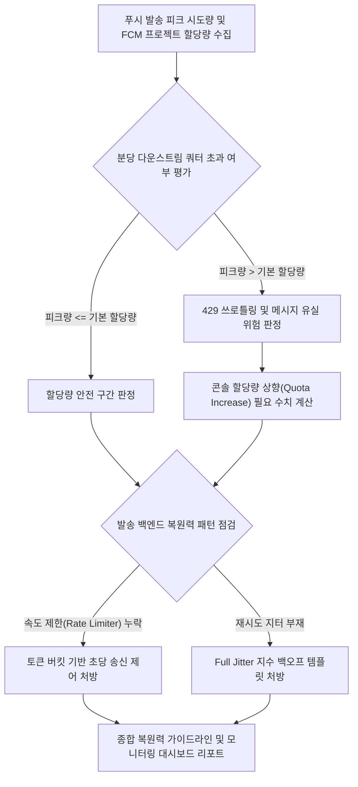

<!--
Copyright 2026 Google LLC. All Rights Reserved.
SPDX-License-Identifier: Apache-2.0

NOTICE: This code/repository is owned by Google LLC and provided under the Apache-2.0 License.
It is strictly provided as an EXAMPLE/REFERENCE ONLY and is NOT INTENDED FOR PRODUCTION USE.
All contents, designs, and code examples are subject to change, modification, or removal at any time without notice.

[고지 사항] 본 저장소 및 문서는 구글 (Google LLC) 소유이며 Apache 2.0 라이선스 하에 예시 (Sample) 용도로 제공된다.
프로덕션 환경용이 아니며, 사전 통지 없이 언제든지 수정, 변경 또는 삭제될 수 있다.
-->

> [!IMPORTANT]
> **구글 (Google LLC) 참조용 샘플 고지 사항**:
> 본 프로젝트의 모든 소스 코드와 문서는 Google LLC의 소유이며, Apache-2.0 라이선스에 따라 오직 **참조용 샘플 (Sample / Reference Only)** 목적으로만 제공된다. 프로덕션 환경에 그대로 사용할 수 없으며, 사전 통지 없이 언제든 내용이 수정, 변경 또는 삭제될 수 있다.

# FCM 대량 푸시 쿼터 고갈 방어 및 429 쓰로틀링 복원력 진단

모바일 앱 대규모 마케팅이나 긴급 공지 발송 시 FCM(Firebase Cloud Messaging) HTTP v1 API의 다운스트림 메시지 할당량 초과로 발생하는 429 Quota Exceeded 쓰로틀링과 메시지 유실을 진단하고, 사전 쿼터 증설 및 토큰 버킷 속도 제한, Full Jitter 지수 백오프 복원력 패턴을 처방한다. (As of 2026-10-17)

---

## 1. 3단계 핵심 요약 (Input -> Detect -> Fix)

| 단계 | 실행 및 동작 | 기대 산출물 및 해결 과제 |
| :--- | :--- | :--- |
| **1. 실행 (Input)** | `python diagnose.py (또는 --dry-run)` | 활성 프로젝트 및 사내 리소스 자동 감지 |
| **2. 판정 (Detect)** | 텔레메트리 실시간 분석 | FCM HTTP v1 분당 다운스트림 쿼터 초과(429 Quota Exceeded) 및 메시지 유실 위험 진단 |
| **3. 처방 (Fix)** | 복붙용 조치 가이드 제공 | 초당 토큰 버킷 속도 제한, Full Jitter 지수 백오프 및 사전 쿼터 증설 가이드 도출 |

---

## 2. 발생 증상 및 진단 대상 체크리스트

사내 또는 고객사 환경에서 아래 증상이 발생한다면 즉시 진단 대상이다:
대규모 사용자 기반 모바일 서비스에서 프로모션, 라이브 커머스, 재난 알림 등으로 수십만~수백만 건의 푸시 메시지를 일시에 발송할 때 다음과 같은 장애가 발생한다:
- [ ] **FCM API 429 할당량 초과**: FCM HTTP v1 API의 프로젝트당 분당 다운스트림 메시지 기본 전송 한도(600,000+건/분)를 초과하여 대량의 `429 RESOURCE_EXHAUSTED` 에러 발생 및 푸시 전송 실패.
- [ ] **재시도 폭풍(Retry Storm)과 지연 누적**: 실패한 요청에 대해 고정 지연 또는 즉시 무제한 재시도를 수행하여 FCM 인프라 쓰로틀링이 가중되고 알림이 제때 전달되지 않는 사고.
- [ ] **기기 토큰 팬아웃 병목**: 단일 기기 토큰에 대한 개별 API 루프 호출로 인해 백엔드 연결 고갈 및 불필요한 네트워크 지연 초래.

---

## 3. 빠른 시작 (Quickstart)

### 1) 모의 데이터 가상 실행 (Dry-Run)
GCP API 호출 없이 내장된 가상 인프라 데이터로 정상 동작 여부를 즉시 검증한다:
```bash
python diagnose.py --dry-run
```

**터미널 진단 출력 미리보기:**
```text
종합 진단 상태          : ACTION_REQUIRED
----------------------------------------------------------------------------
[항목별 세부 진단 결과]
1. [CRITICAL] DOWNSTREAM_QUOTA_EXCEEDED
   내용: 피크 시 분당 발송량(750,000건)이 기본 할당량(600,000건)을 125.0% 초과하여 약 20.0%의 요청이 429 쓰로틀링 에러로 실패한다.
2. [WARNING] TOKEN_BUCKET_RATE_LIMITING
   내용: 발송 백엔드에 토큰 버킷 속도 제한기(Rate Limiter)가 누락되어 있어 이벤트 발생 시 일시에 요청이 몰려 FCM 인프라 쓰로틀링을 유발한다.
3. [WARNING] EXPONENTIAL_BACKOFF_AND_JITTER
   내용: 429 에러 발생 시 고정 대기 재시도 또는 즉시 재시도로 인해 '재시도 폭풍(Retry Storm)'이 발생하고 있다. Full Jitter 기반 지수 백오프 도입이 시급하다.
4. [INFO] TOPIC_FANOUT_OPTIMIZATION
```

### 2) 실제 사내 인프라 실시간 진단
```bash
cp .env.example .env
python diagnose.py
```
> [!NOTE]
> `.env` 설정값을 비워두면 gcloud 활성 설정 및 사내 리소스를 자동으로 감지하여 진단한다.

---

## 4. 진단 및 해결 흐름



---
## 5. 조치 가이드 및 권장 설정

### 1단계: Google Cloud 콘솔 할당량 상향(Quota Increase) 신청
1. 구글 클라우드 콘솔(Google Cloud Console)의 **IAM 및 관리자 > 할당량 및 시스템 한도** 메뉴로 이동한다.
2. 서비스 필터에서 `Firebase Cloud Messaging API`를 선택한다.
3. 지표 `Downstream messages per minute`를 선택하고 **할당량 수정**을 클릭한다.
4. 비즈니스 정당성(대규모 프로모션 일정, 예상 동시 발송량)과 함께 최소 피크 대비 1.5배의 수치를 입력하여 상향을 요청한다.

### 2단계: 발송 큐 토큰 버킷 속도 제한(Rate Limiting) 구현
발송 백엔드(Celery, Kafka Consumer 등)에서 초당 최대 송신 속도를 현재 분당 할당량의 1/60 수준으로 억제한다:
```python
# 초당 최대 발송량 제한 (예: 10,000 msg/sec)
from ratelimit import limits, sleep_and_retry

@sleep_and_retry
@limits(calls=10000, period=1)
def send_fcm_batch(messages):
    response = messaging.send_each(messages)
    return response
```

### 3단계: Full Jitter 지수 백오프 재시도 적용
429 응답 수신 시 무작위 지터를 결합하여 백엔드가 동시에 재시도하지 않도록 방어한다:
```python
import time, random

def exponential_backoff_retry(attempt, base=1.0, max_backoff=32.0):
    sleep_time = min(max_backoff, base * (2 ** attempt))
    jitter = random.uniform(0.5, 1.5)
    time.sleep(sleep_time * jitter)
```

### 4단계: GCP 리소스 생성 시 4대 필수 표준 라벨링 준수
- FCM 발송 백엔드(Cloud Run, GKE, Compute Engine 등) 및 Cloud Monitoring 알림 정책 생성 시 FinOps 비용 분석 및 추적을 위해 4대 표준 라벨을 필수로 주입한다:
  - `managed-by`: `google-cloud-0-to-1`
  - `scenario`: `fcm-push-quota-guard`
  - `env`: `sample`
  - `created-by`: `customer-engineer`
- gcloud CLI 예시: `--labels=managed-by=google-cloud-0-to-1,scenario=fcm-push-quota-guard,env=sample,created-by=customer-engineer`

### 공식 가이드 및 콘솔 링크
- Google Cloud 콘솔 할당량 및 시스템 한도 ( https://console.cloud.google.com/iam-admin/quotas )
- Firebase 콘솔 ( https://console.firebase.google.com )
- FCM 스로틀링 및 할당량 공식 가이드 ( https://firebase.google.com/docs/cloud-messaging/throttling-and-quotas )
- Cloud Monitoring Firebase 및 FCM 지표 목록 ( https://cloud.google.com/monitoring/api/metrics_gcp )

---
## 6. 사전 준비 사항 (필요 IAM 권한)

본 도구를 실행하려면 최소 아래의 IAM 권한이 필요하다:

본 도구를 실행하고 할당량 및 모니터링 지표를 진단하기 위해 다음 권한이 필요하다:

- `roles/serviceusage.serviceUsageViewer`: FCM API 할당량 및 제한 수치 조회
- `roles/monitoring.viewer`: 클라우드 모니터링(Cloud Monitoring) 다운스트림 메시지 전송량 및 429 에러율 지표 조회
- `roles/serviceusage.quotaAdmin`: (선택) 콘솔에서 할당량 상향 요청 승인 및 관리

---

## 8. 리소스 정리 (Teardown) 안내

본 도구는 순수 진단 도구이므로 별도의 클라우드 인프라 자원을 생성하지 않는다.
상향된 FCM 할당량은 별도 비용이 발생하지 않으며, 이벤트 종료 후 필요 시 콘솔에서 기본값으로 다시 하향 조정할 수 있다.
