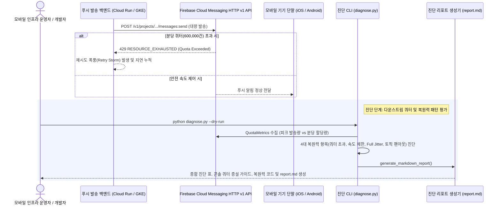

<!--
Copyright 2026 Google LLC. All Rights Reserved.
SPDX-License-Identifier: Apache-2.0

NOTICE: This code/repository is owned by Google LLC and provided under the Apache-2.0 License.
It is strictly provided as an EXAMPLE/REFERENCE ONLY and is NOT INTENDED FOR PRODUCTION USE.
All contents, designs, and code examples are subject to change, modification, or removal at any time without notice.

[고지 사항] 본 저장소 및 문서는 구글 (Google LLC) 소유이며 Apache 2.0 라이선스 하에 예시 (Sample) 용도로 제공된다.
프로덕션 환경용이 아니며, 사전 통지 없이 언제든지 수정, 변경 또는 삭제될 수 있다.
-->

# 기술 상세 설계서 (TDD): FCM 대량 푸시 쿼터 고갈 방어 및 429 쓰로틀링 복원력 진단 (As of 2026-10-17)

## 1. 시스템 아키텍처 및 런타임 상호작용 시퀀스

본 도구의 런타임 제어 및 데이터 상호작용 흐름은 아래 시퀀스 다이어그램과 같다. 대규모 모바일 푸시 발송 시 FCM HTTP v1 API의 분당 다운스트림 쿼터 초과 위험과 발송 백엔드의 속도 제한 및 지수 백오프 패턴을 분석하여 429 쓰로틀링 방어 처방을 제시한다.

---

## 2. 요구 사항 추적성 매핑 (Traceability Matrix)

| 비즈니스 요구 사항 (BRD) | 기능적 기술 요구 사항 (FR) | 비기능적 기술 요구 사항 (NFR) | 구현 파일 및 모듈 |
| :--- | :--- | :--- | :--- |
| **BR-01** (현장 장애 및 리스크 사전 탐지) | **FR-02** (핵심 운영 지표 및 설정 상태 정밀 진단) | **NFR-01** (최소 IAM 권한 준수) | `diagnose.py` (`diagnose_fcm_quota`, `audit_resilience_patterns`) |
| **BR-02** (표준화된 자동 진단 체계 구축) | **FR-01** (계층형 환경 설정 및 리소스 자동 탐지) | **NFR-02** (비대화형 환경 호환성) | `diagnose.py` (`get_default_project`, `parse_args`) |
| **BR-03** (가상 실행 기반 무중단 사전 검증) | **FR-03** (가상 실행 스모크 테스트 모드) | **NFR-03** (민감 정보 비식별화) | `diagnose.py` (`get_mock_scenario`, `--dry-run`) |
| **BR-04** (실무자 조치 가이드 및 리포트 안내) | **FR-04** (직관적 콘솔 조치 가이드 및 리소스 정리 안내) | **NFR-03** (보안 규약 준수) | `diagnose.py` (`generate_markdown_report`), `report.md` |
| **BR-05** (자원 거버넌스 라벨링 표준 준수) | **FR-04** (사내 거버넌스 4대 필수 라벨링 적용) | **NFR-04** (자원 거버넌스 준수) | `README.md`, `diagnose.py` |

---

## 3. 기능적 기술 요구 사항 (Functional Requirements)

| 요구 사항 ID | 연관 BR | 기술 요구 사항 명칭 | 구현 상세 및 검증 기준 |
| :--- | :--- | :--- | :--- |
| **FR-01** | **BR-01** | **계층형 환경 설정 및 리소스 자동 탐지** | CLI 인자(`--config, --dry-run, --json, --peak-msg-per-min, --project-id, --quota-limit-per-min`) > `.env` > `gcloud config` 활성 설정 > 대화형 번호 선택기 순으로 프로젝트 및 대상 리소스를 자동 확정한다. |
| **FR-02** | **BR-02** | **핵심 운영 지표 및 설정 상태 정밀 진단** | 대상 GCP 리소스의 메타데이터, 정책, 할당량 또는 로그 지표를 수집하여 정상(`PASS`), 주의(`WARN`), 위험(`FAIL`) 등급을 산출한다. |
| **FR-03** | **BR-03** | **가상 실행(`--dry-run`) 스모크 테스트 모드** | `--dry-run` 플래그 입력 시 외부 GCP API 호출을 우회하고 내장된 표준 시뮬레이션 데이터를 기반으로 전체 진단 리포트를 1초 내에 출력한다. |
| **FR-04** | **BR-04** | **직관적 콘솔 조치 가이드 및 리소스 정리 안내** | 진단 결과 하단에 Google Cloud 콘솔 조치 URL(Bare URL 표준)과 CLI 복구 명령어를 출력하여 즉각적인 후속 조치를 지원한다. |

---

## 4. 비기능적 기술 요구 사항 (Non-Functional Requirements)

| 요구 사항 ID | 요구 사항 명칭 | 상세 기준 |
| :--- | :--- | :--- |
| **NFR-01** | **최소 IAM 권한 준수** | 진단에 필요한 최소 권한(`roles/monitoring.viewer, roles/serviceusage.quotaAdmin, roles/serviceusage.serviceUsageViewer`)만을 요구하며, 불필요한 쓰기 권한을 강제하지 않는다. |
| **NFR-02** | **비대화형 환경 호환성 (CI/CD Ready)** | `sys.stdin.isatty()` 검증을 통해 백그라운드 태스크나 CI/CD 파이프라인 실행 시 입력 대기(Hang) 없이 안전하게 기본 후보를 채택한다. |
| **NFR-03** | **민감 정보 비식별화 및 보안 규약** | 소스 코드 및 문서 내에 실제 프로젝트 ID나 개인 식별 정보(PII)를 하드코딩하지 않으며, 모든 외부 참조 링크는 Bare URL 괄호 병기 원칙을 준수한다. |
| **NFR-04** | **자원 거버넌스 및 표준 라벨링 준수** | 생성되는 모든 GCP 자원에 4대 표준 라벨(`managed-by=google-cloud-0-to-1`, `scenario=fcm-push-quota-guard`, `env=sample`, `created-by=customer-engineer`)을 누락 없이 적용하여 자원 추적성과 비용 배분을 보장한다. |
