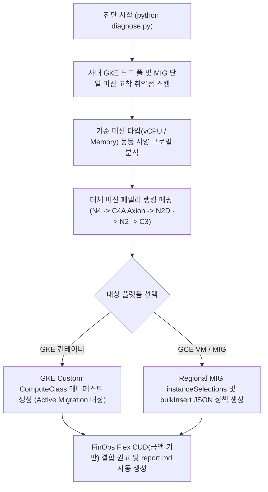

<!--
Copyright 2026 Google LLC. All Rights Reserved.
SPDX-License-Identifier: Apache-2.0

NOTICE: This code/repository is owned by Google LLC and provided under the Apache-2.0 License.
It is strictly provided as an EXAMPLE/REFERENCE ONLY and is NOT INTENDED FOR PRODUCTION USE.
All contents, designs, and code examples are subject to change, modification, or removal at any time without notice.

[고지 사항] 본 저장소 및 문서는 구글 (Google LLC) 소유이며 Apache 2.0 라이선스 하에 예시 (Sample) 용도로 제공된다.
프로덕션 환경용이 아니며, 사전 통지 없이 언제든지 수정, 변경 또는 삭제될 수 있다.
-->

> [!IMPORTANT]
> **구글 (Google LLC) 참조용 샘플 고지 사항**:
> 본 프로젝트의 모든 소스 코드와 문서는 Google LLC의 소유이며, Apache-2.0 라이선스에 따라 오직 **참조용 샘플 (Sample / Reference Only)** 목적으로만 제공된다. 프로덕션 환경에 그대로 사용할 수 없으며, 사전 통지 없이 언제든 내용이 수정, 변경 또는 삭제될 수 있다.

# 컴퓨트 엔진(Compute Engine) & GKE 인스턴스 유연성(Instance Flexibility) 및 스톡아웃 방어 설계기

업계 전반의 AI 및 대규모 컴퓨트 수요 급증으로 인한 하드웨어 용량 부족(ZONE_RESOURCE_POOL_EXHAUSTED) 상황에서, 단일 머신 타입/단일 존 고착 위험을 진단하고 GKE(Google Kubernetes Engine) 커스텀 컴퓨트 클래스(Custom ComputeClass, CCC)의 능동적 마이그레이션(Active Migration) 및 컴퓨트 엔진(Compute Engine) 리전 관리형 인스턴스 그룹(Regional MIG)의 instanceSelections 다중 머신 랭킹 정책을 자동 설계하여 무중단 복원력을 확보하는 올인원 아키텍처 진단 도구다. (As of 2026-10-17)

---

## 1. 발생 증상 및 진단 대상 체크리스트

사내 또는 고객사 환경에서 아래 증상이 발생한다면 즉시 진단 대상이다:
- [ ] 주요 리전(서울, 도쿄, 아이오와 등)에서 특정 머신 또는 GPU 타입(예: `g2-standard-8`, `a2-highgpu-8g`, `n2-standard-8`) 프로비저닝 시 `ZONE_RESOURCE_POOL_EXHAUSTED` 에러로 배포나 스케일아웃이 실패한다.
- [ ] LLM 서빙 및 인퍼런스 환경에서 NVIDIA L4, T4 또는 A100 GPU 단일 패밀리에 고착되어 스톡아웃 시 파드가 Pending 상태에 갇힌다.
- [ ] GKE 오토스케일러가 노드를 증설하지 못해 대량의 파드가 `Pending` 상태로 적체되거나, 스팟 노드 대규모 회수 시 대체 노드를 구하지 못한다.
- [ ] Compute Engine MIG(Managed Instance Groups)가 단일 인스턴스 템플릿에 고착되어 특정 존의 하드웨어 고갈 시 자동 확장에 실패한다.
- [ ] 대규모 배치/분석 작업에서 단일 머신 요청이 실패하여 전체 파이프라인이 중단되거나 지연된다.
- [ ] 자원 기반 CUD(Resource-based CUD) 약정에 묶여 최신 고성능 머신(N4, C4, C4A Axion)이나 GPU 인스턴스로 인프라를 유연하게 이전하지 못하고 있다.

---

## 2. 빠른 시작 (Quickstart)

> [!TIP]
> Cloud Shell 접속 환경 구성 및 저장소 클론(`git clone`) 방법은 루트의 [메인 README](../../README.md)를 참고한다.

### 1) 모의 데이터 가상 실행 (Dry-Run)
GCP API 호출 없이 내장된 가상 인프라 데이터로 정상 동작 여부를 즉시 검증한다:
```bash
python diagnose.py --dry-run
```

**터미널 진단 출력 미리보기:**
```text
* 다중 머신 패밀리 및 전 리전에 교차 적용되는 '금액 기반 Flex CUD(Flexible Committed Use Discounts)'를 결합하여 유연성과 비용 절감을 동시 달성할 것을 권장한다.
[6. 사내 거버넌스 4대 필수 표준 라벨링 준수]
  * GKE 노드 풀 및 Compute Engine 인스턴스 템플릿/MIG 생성 시 4대 표준 라벨 필수 적용:
    --labels=managed-by=google-cloud-0-to-1,scenario=gce-instance-flexibility-planner,env=sample,created-by=customer-engineer
================================================================================================
[안내] 복습 및 사내 공유용 진단 리포트가 생성(덮어쓰기)되었다: /usr/local/google/home/stanleychoi/Projects/google-cloud-0-to-1/samples/gce-instance-flexibility-planner/report.md
```

### 2) 실제 사내 인프라 실시간 진단
```bash
cp .env.example .env
python diagnose.py
```
> [!NOTE]
> `.env` 설정값을 비워두면 gcloud 활성 설정 및 사내 리소스를 자동으로 감지하여 진단한다.

---

## 3. 진단 및 해결 흐름



---
## 4. 조치 가이드 및 권장 설정

### 1단계: GKE 워크로드 Custom ComputeClass(CCC) 배포
산출된 `resilient-compute-class` 매니페스트를 GKE 클러스터에 적용한다. 용량 부족 시 하위 머신으로 자동 폴백되고, 최상위 머신(N4 등) 자원이 확보되면 워크로드가 무중단으로 자동 복귀(Active Migration)한다:
```bash
# GKE 클러스터 자격 증명 획득
gcloud container clusters get-credentials [CLUSTER_NAME] --region=[REGION]

# ComputeClass 매니페스트 적용 (report.md의 YAML 내용 활용)
kubectl apply -f compute-class.yaml
```
- Google Cloud 콘솔 GKE 클러스터 ( https://console.cloud.google.com/kubernetes/list )
- GKE 공식 문서 ( https://cloud.google.com/kubernetes-engine/docs )

### 2단계: Compute Engine Regional MIG instanceSelections 적용
기존의 단일 인스턴스 템플릿 MIG 대신 다중 머신 랭킹이 포함된 Regional MIG를 구성하여 특정 존 스톡아웃을 스마트하게 우회한다:
```bash
# Regional MIG 생성 및 인스턴스 선택 정책 지정
gcloud compute instance-groups managed create [MIG_NAME] \
    --region=[REGION] \
    --target-distribution-shape=BALANCED \
    --instance-template=[TEMPLATE_NAME] \
    --size=10 \
    --instance-flexibility-policy=instance-selections.json \
    --labels=managed-by=google-cloud-0-to-1,scenario=gce-instance-flexibility-planner,env=sample,created-by=customer-engineer
```
- Google Cloud 콘솔 Compute Engine VM 인스턴스 ( https://console.cloud.google.com/compute/instances )
- Compute Engine Managed Instance Groups 공식 문서 ( https://cloud.google.com/compute/docs/instance-groups )

### 3단계: 대규모 단기 배치/분석 작업에 bulkInsert API 도입
수백 대의 단기 연산 워커를 띄울 때는 단일 VM 생성을 반복하지 않고 `bulkInsert` API를 활용하여 리전 내 최적 존과 대체 머신 타입을 원자적으로 획득한다:
- Compute Engine 인스턴스 공식 문서 ( https://cloud.google.com/compute/docs/instances )

### 4단계: 상업적 유연성(Flex CUD) 포트폴리오 전환
- 특정 머신 패밀리(N2 등)에 고착된 자원 기반 CUD(Resource-based CUD)는 신규 머신(N4, C4, C4A) 전환 시 할인이 단절된다.
- 전 리전, 전 머신 패밀리에 교차 적용되는 금액 기반 Flex CUD(Flexible Committed Use Discounts)를 결합하여 인프라 유연성과 FinOps 할인을 동시 보장한다.
- 지속 사용 할인(CUD) 공식 문서 ( https://cloud.google.com/docs/cuds )

### 5단계: (선택 사항) Fluid Compute 크로스 리전 네트워킹 구성
- 가속기(GPU/TPU) 품귀로 인해 단일 리전에서 전체 연산 용량을 확보하지 못할 경우, 구글 전용 글로벌 프라이빗 백본 기반의 Cross-Region VPC 및 Dynamic Routing을 활용하여 분산 리전 간 레이턴시를 최소화하는 유동적 컴퓨팅(Fluid Compute) 네트워킹을 결합한다.
- Fluid Compute 네트워킹 공식 가이드 ( https://cloud.google.com/blog/topics/developers-practitioners/how-google-cloud-networking-supports-your-fluid-compute-choices-for-ai-workloads )

### 6단계: GCP 리소스 생성 시 4대 필수 표준 라벨링 준수
- GKE 노드 풀 및 Compute Engine 인스턴스 템플릿/MIG 생성 시 FinOps 비용 분석 및 추적을 위해 4대 표준 라벨을 필수로 주입한다:
  - `managed-by`: `google-cloud-0-to-1`
  - `scenario`: `gce-instance-flexibility-planner`
  - `env`: `sample`
  - `created-by`: `customer-engineer`
- gcloud CLI 예시: `--labels=managed-by=google-cloud-0-to-1,scenario=gce-instance-flexibility-planner,env=sample,created-by=customer-engineer`

---
## 5. 사전 준비 사항 (필요 IAM 권한)

본 도구를 실행하려면 최소 아래의 IAM 권한이 필요하다:

### (1) 필수 API 활성화
본 도구가 사내 클러스터와 인스턴스 그룹 설정을 조회하려면 아래 API가 활성화되어 있어야 한다:
```bash
gcloud services enable compute.googleapis.com container.googleapis.com
```

### (2) 진단 실행 계정 최소 IAM 권한
본 도구는 순수 읽기 전용 진단 스크립트이므로 최소한의 조회 권한만 요구한다:

| 역할 (Role) | 설명 |
| :--- | :--- |
| `roles/compute.viewer` | 컴퓨트 엔진(Compute Engine) 인스턴스 템플릿 및 MIG 설정 조회 권한 |
| `roles/container.viewer` | GKE 클러스터 및 노드 풀 구성 상태 조회 권한 |

---

## 6. 기술적 배경 및 아키텍처 원리 (Deep Dive)

### 관련 상세 설계 및 요구 사항 명세
- [비즈니스 요구 사항 명세서 (BRD)](docs/BRD.md): 비즈니스 배경, 성공 지표 및 요구 사항(BR-01~) 명세
- [기술 상세 설계서 (TDD)](docs/TDD.md): 시스템 아키텍처, 기능(FR-01~) 및 비기능(NFR-01~) 설계 명세

---

## 7. 리소스 정리 (Teardown) 안내

본 도구는 순수 읽기 전용 진단 도구이므로 별도의 클라우드 인프라 자원을 생성하지 않으며, 추가 삭제 절차가 필요하지 않다.
