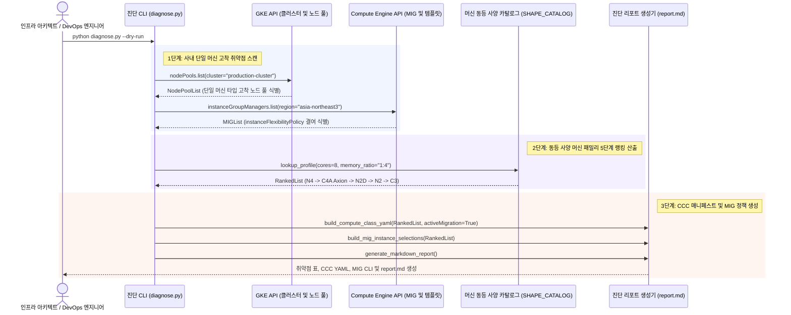

<!--
Copyright 2026 Google LLC. All Rights Reserved.
SPDX-License-Identifier: Apache-2.0

NOTICE: This code/repository is owned by Google LLC and provided under the Apache-2.0 License.
It is strictly provided as an EXAMPLE/REFERENCE ONLY and is NOT INTENDED FOR PRODUCTION USE.
All contents, designs, and code examples are subject to change, modification, or removal at any time without notice.

[고지 사항] 본 저장소 및 문서는 구글 (Google LLC) 소유이며 Apache 2.0 라이선스 하에 예시 (Sample) 용도로 제공된다.
프로덕션 환경용이 아니며, 사전 통지 없이 언제든지 수정, 변경 또는 삭제될 수 있다.
-->

# 기술 상세 설계서 (TDD): Compute Engine & GKE 인스턴스 유연성 및 스톡아웃 방어 설계기 (As of 2026-10-17)

## 1. 시스템 아키텍처 및 런타임 상호작용 시퀀스

본 도구의 런타임 제어 및 데이터 상호작용 흐름은 아래 시퀀스 다이어그램과 같다. GKE 클러스터 및 Compute Engine Regional MIG의 단일 머신 고착 취약점을 진단하고, 동등 사양 프로필 엔진을 통해 5단계 대체 머신 랭킹과 GKE Custom ComputeClass(CCC) 매니페스트 및 MIG `instanceSelections` 정책을 원클릭으로 생성한다.

---

## 2. 요구 사항 추적성 매핑 (Traceability Matrix)

| 비즈니스 요구 사항 (BRD) | 기능적 기술 요구 사항 (FR) | 비기능적 기술 요구 사항 (NFR) | 구현 파일 및 모듈 |
| :--- | :--- | :--- | :--- |
| **BR-01** (단일 머신 고착 취약점 진단) | **FR-01** (단일 머신 의존성 및 스톡아웃 취약점 스캔) | **NFR-01** (최소 IAM 권한 준수) | `diagnose.py` (`scan_vulnerabilities`, `diagnose_workloads`) |
| **BR-02** (동등 사양 머신 랭킹 산출) | **FR-02** (동등 사양 프로필 탐색 및 랭킹 엔진) | **NFR-02** (순수 파이썬 단일 실행) | `diagnose.py` (`get_machine_profile`, `SHAPE_CATALOG`) |
| **BR-03** (GKE Custom ComputeClass 자동 생성) | **FR-03** (GKE Custom ComputeClass 매니페스트 생성) | **NFR-04** (자원 거버넌스 준수) | `diagnose.py` (`generate_gke_compute_class_manifest`) |
| **BR-04** (MIG instanceSelections 정책 생성) | **FR-04** (Compute Engine Regional MIG 정책 생성) | **NFR-04** (자원 거버넌스 준수) | `diagnose.py` (`generate_mig_policy_config`) |
| **BR-05** (FinOps Flex CUD 결합 가이드) | **FR-05** (진단 리포트 자동 생성 및 덮어쓰기) | **NFR-03** (가상 실행 및 비식별화) | `diagnose.py` (`generate_report_markdown`), `report.md` |
| **BR-06** (자원 거버넌스 라벨링 표준 준수) | **FR-04, FR-05** (사내 거버넌스 4대 필수 라벨링 적용) | **NFR-04** (자원 거버넌스 준수) | `README.md`, `diagnose.py` |

---

## 3. 기능 요구 사항 (Functional Requirements)

### FR-01: 단일 머신 의존성 및 스톡아웃 취약점 스캔
- `gcloud container node-pools list` 및 `gcloud compute instance-groups managed list` 명령을 통해 사내 클러스터와 MIG의 머신 구성을 점검한다.
- `instanceFlexibilityPolicy`가 결여된 단일 템플릿 MIG 및 단일 머신 노드 풀을 식별하여 잠재적 위험 목록을 생성한다.

### FR-02: 동등 사양 프로필 탐색 및 랭킹 엔진
- 입력받은 기준 머신 타입(예: `n2-standard-8`)의 코어 수와 메모리 비율을 추출하여 `SHAPE_CATALOG`와 매칭한다.
- N4(최신 세대), C4A(Axion ARM), N2D(AMD), N2(Intel), C3(Compute-Optimized) 등 동등 성능을 내는 복수 패밀리의 성능 지수(Performance Score)와 상대 비용(Relative Cost)을 산출하여 5단계 우선순위 랭킹을 구성한다.

### FR-03: GKE Custom ComputeClass (CCC) 매니페스트 생성
- GKE 공식 `autoscaling.gke.io/v1` API 스키마에 따라 `ComputeClass` CRD YAML을 생성한다.
- 상위 우선순위 머신 자원이 복구되었을 때 워크로드를 자동으로 복귀시키는 `activeMigration.optimizeRulePriority: true` 및 `nodePoolAutoCreation.enabled: true` 속성을 내장한다.

### FR-04: Compute Engine Regional MIG 및 bulkInsert 정책 생성
- GCE Regional MIG 배포 시 활용 가능한 `instanceSelections` 정책 블록 및 `gcloud compute instance-groups managed create` 명령어를 생성한다.
- 대규모 단기 배치/분석 작업을 위해 원자적 프로비저닝을 보장하는 `bulkInsert` API JSON 규격을 산출한다.

### FR-05: 마크다운 진단 리포트 (report.md) 자동 생성 및 덮어쓰기
- 진단 결과, 취약점 분석, 머신 랭킹 표, 플랫폼별 매니페스트 YAML 및 정책 코드를 포함하는 표준 마크다운 리포트를 자동 덮어쓰기한다.

---

## 3. 비기능 요구 사항 (Non-Functional Requirements)

### NFR-01: 최소 IAM 권한 준수
- 본 도구는 읽기 전용 진단 스크립트로서 `roles/compute.viewer` 및 `roles/container.viewer` 권한만 요구하며 운영 중인 클러스터나 인스턴스를 무단 변경하지 않는다.

### NFR-02: 순수 파이썬 단일 실행 및 크로스 플랫폼 지원
- 외부 복잡한 도구 설치 없이 `python diagnose.py` 직접 실행 체계로 단일화하며 Linux, macOS, Cloud Shell 환경에서 원활하게 호환된다.

### NFR-03: 가상 실행 모드 (--dry-run) 및 비식별화
- 실제 GCP 호출 없이도 사전 시뮬레이션 데이터를 통해 1초 내에 검증 가능하며, 모의 실행 시 사내 실환경 프로젝트 ID 노출을 방지하기 위해 가명(`sample-project-id`)을 적용한다.

### NFR-04: 자원 거버넌스 및 표준 라벨링 준수
- 생성되는 모든 GCP 자원에 4대 표준 라벨(`managed-by=google-cloud-0-to-1`, `scenario=gce-instance-flexibility-planner`, `env=sample`, `created-by=customer-engineer`)을 누락 없이 적용하여 자원 추적성과 비용 배분을 보장한다.
