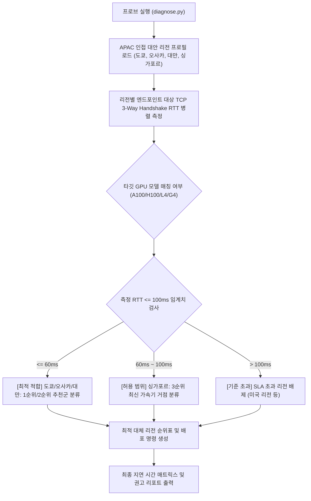

<!--
Copyright 2026 Google LLC. All Rights Reserved.
SPDX-License-Identifier: Apache-2.0

NOTICE: This code/repository is owned by Google LLC and provided under the Apache-2.0 License.
It is strictly provided as an EXAMPLE/REFERENCE ONLY and is NOT INTENDED FOR PRODUCTION USE.
All contents, designs, and code examples are subject to change, modification, or removal at any time without notice.

[고지 사항] 본 저장소 및 문서는 구글 (Google LLC) 소유이며 Apache 2.0 라이선스 하에 예시 (Sample) 용도로 제공된다.
프로덕션 환경용이 아니며, 사전 통지 없이 언제든지 수정, 변경 또는 삭제될 수 있다.
-->

> [!IMPORTANT]
> **구글 (Google LLC) 참조용 샘플 고지 사항**:
> 본 프로젝트의 모든 소스 코드와 문서는 Google LLC의 소유이며, Apache-2.0 라이선스에 따라 오직 **참조용 샘플 (Sample / Reference Only)** 목적으로만 제공된다. 프로덕션 환경에 그대로 사용할 수 없으며, 사전 통지 없이 언제든 내용이 수정, 변경 또는 삭제될 수 있다.

# 서울 워크로드 대체 컴퓨트 엔진(Compute Engine) GPU 및 인프라 리전 레이턴시/가용성 프로브 (`gce-region-latency-probe`)

서울 리전(asia-northeast3) GPU 및 고성능 인스턴스 재고 부족 시 100ms 미만 지연 시간(RTT)을 충족하는 인접 대안 리전(도쿄, 오사카, 대만, 싱가포르)의 네트워크 레이턴시와 GPU 가용성을 1분 만에 종합 측정하고 최적 배포 리전을 추천하는 도구다. (As of 2026-10-17)

---

## 1. 발생 증상 및 진단 대상 체크리스트

사내 또는 고객사 환경에서 아래 증상이 발생한다면 즉시 진단 대상이다:
- [ ] 서울 리전(`asia-northeast3`)에서 고성능 GPU(A100, H100, G4, L4) 및 최신 고성능 머신 타입(C4, N4 등) 할당 쿼터 부족 또는 온디맨드 인스턴스 생성 시 `ZONE_RESOURCE_POOL_EXHAUSTED` 에러가 빈번하게 발생한다.
- [ ] 국내 데이터 레지던시 의무 규정은 없으나, 실시간 대화형 추론이나 서빙 지연 시간을 고려하여 서울 사용자 기준 100ms 미만 왕복 지연 시간(RTT)을 반드시 충족해야 한다.
- [ ] 도쿄, 오사카, 대만, 싱가포르 등 인접 아시아 태평양(APAC) 리전 중 어떤 리전이 지연 시간이 가장 짧고 목표 GPU 및 고성능 머신 타입을 보유하고 있는지 즉각적인 비교 데이터가 부족하다.
- [ ] 미국 리전(`us-central1` 등)으로 우회 배포할 경우 발생하는 레이턴시 페널티(140ms 이상)가 서비스 품질(SLA)에 미치는 영향을 사전에 수치로 검증해야 한다.

---

## 2. 빠른 시작 (Quickstart)

### 1) 모의 데이터 가상 실행 (Dry-Run)
GCP API 호출 없이 내장된 가상 인프라 데이터로 정상 동작 여부를 즉시 검증한다:
```bash
python diagnose.py --dry-run
```

**터미널 진단 출력 미리보기:**
```text
서울 워크로드 대체 Compute Engine GPU 및 인프라 리전 레이턴시 진단 시작 (지연 기준: 100.0 ms, 타깃 GPU: 전체)
--> 가상 실행 모드 (--dry-run) 활성화: 사전 벤치마크 데이터를 분석한다.
============================================================================================================
리전                 위치                       측정 지연(ms)      기준 충족              지원 GPU
------------------------------------------------------------------------------------------------------------
asia-northeast1    일본 도쿄 (Tokyo)            34.2 ms        최적 적합 (<60ms)      A100, H100, L4, G4
asia-northeast2    일본 오사카 (Osaka)           38.6 ms        최적 적합 (<60ms)      A100, L4
asia-east1         대만 창화 (Changhua)         46.8 ms        최적 적합 (<60ms)      A100, H100, L4, G4
asia-southeast1    싱가포르 (Singapore)         76.4 ms        허용 범위 (<=100.0ms)  A100, H100, L4, G4
us-central1        미국 아이오와 (Iowa - 비교군)     148.5 ms       SLA 초과 (>100.0ms)  A100, H100, L4, G4
```

### 2) 실제 사내 인프라 실시간 진단
```bash
cp .env.example .env
python diagnose.py
```
> [!NOTE]
> `.env` 설정값을 비워두면 gcloud 활성 설정 및 사내 리소스를 자동으로 감지하여 진단한다.

---

## 3. 진단 및 해결 흐름



---
## 4. 조치 가이드 및 권장 설정

1. **일본 도쿄 (`asia-northeast1`)**: ~30-40ms RTT
   - 최저 지연 및 최다 가용량, A100/H100/G4 풍부, 1순위 최우선 추천.
2. **일본 오사카 (`asia-northeast2`)**: ~35-45ms RTT
   - 도쿄와 유사한 저지연, 도쿄 일시 품절 시 즉각적인 백업 리전.
3. **대만 창화 (`asia-east1`)**: ~40-55ms RTT
   - APAC 내 구글 대규모 인프라 거점, 안정적인 2순위 대안.
4. **싱가포르 (`asia-southeast1`)**: ~70-90ms RTT
   - 100ms 이내 진입, 차세대 가속기 및 AI 인프라 최우선 배치 거점.

---
## 5. 사전 준비 사항 (필요 IAM 권한)

본 도구를 실행하려면 최소 아래의 IAM 권한이 필요하다:

- 로컬 네트워크 소켓 레이턴시 측정에는 GCP IAM 권한이 필요하지 않다.
- 실제 컴퓨트 엔진(Compute Engine) 인스턴스 생성 및 쿼터 조회 시:
  - `roles/compute.viewer` (Compute Engine 조회)
  - `compute.regions.get`, `compute.regions.list`

---

## 6. 기술적 배경 및 아키텍처 원리 (Deep Dive)

### 관련 상세 설계 및 요구 사항 명세
- [비즈니스 요구 사항 명세서 (BRD)](docs/BRD.md): 비즈니스 배경, 성공 지표 및 요구 사항(BR-01~) 명세
- [기술 상세 설계서 (TDD)](docs/TDD.md): 시스템 아키텍처, 기능(FR-01~) 및 비기능(NFR-01~) 설계 명세

1. **일본 도쿄 (`asia-northeast1`)**: ~30-40ms RTT
   - 최저 지연 및 최다 가용량, A100/H100/G4 풍부, 1순위 최우선 추천.
2. **일본 오사카 (`asia-northeast2`)**: ~35-45ms RTT
   - 도쿄와 유사한 저지연, 도쿄 일시 품절 시 즉각적인 백업 리전.
3. **대만 창화 (`asia-east1`)**: ~40-55ms RTT
   - APAC 내 구글 대규모 인프라 거점, 안정적인 2순위 대안.
4. **싱가포르 (`asia-southeast1`)**: ~70-90ms RTT
   - 100ms 이내 진입, 차세대 가속기 및 AI 인프라 최우선 배치 거점.

---
## 7. 리소스 정리 (Teardown) 안내

본 도구는 순수 네트워크 레이턴시 측정 스크립트로 클라우드 리소스를 생성하지 않는다. 테스트로 배포한 Compute Engine GPU 및 인스턴스는 사용 완료 후 즉시 삭제한다:
```bash
gcloud compute instances delete [INSTANCE_NAME] --zone=[ZONE] --quiet
```
