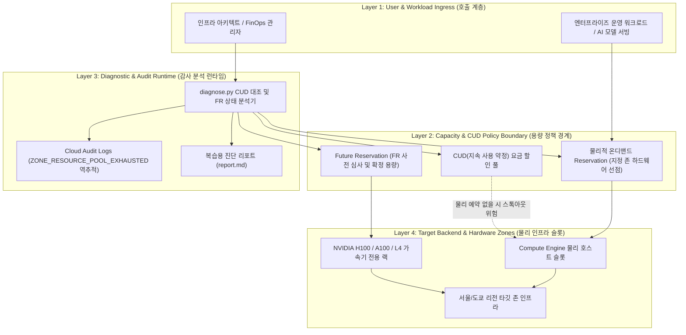

<!--
Copyright 2026 Google LLC. All Rights Reserved.
SPDX-License-Identifier: Apache-2.0

NOTICE: This code/repository is owned by Google LLC and provided under the Apache-2.0 License.
It is strictly provided as an EXAMPLE/REFERENCE ONLY and is NOT INTENDED FOR PRODUCTION USE.
All contents, designs, and code examples are subject to change, modification, or removal at any time without notice.

[고지 사항] 본 저장소 및 문서는 구글 (Google LLC) 소유이며 Apache 2.0 라이선스 하에 예시 (Sample) 용도로 제공된다.
프로덕션 환경용이 아니며, 사전 통지 없이 언제든지 수정, 변경 또는 삭제될 수 있다.
-->

> [!IMPORTANT]
> **구글 (Google LLC) 참조용 샘플 고지 사항**:
> 본 프로젝트의 모든 소스 코드와 문서는 Google LLC의 소유이며, Apache-2.0 라이선스에 따라 오직 **참조용 샘플 (Sample / Reference Only)** 목적으로만 제공된다. 프로덕션 환경에 그대로 사용할 수 없으며, 사전 통지 없이 언제든 내용이 수정, 변경 또는 삭제될 수 있다.

# 컴퓨트 엔진(Compute Engine) 하드웨어 예약(Reservation) 및 CUD 용량 보장 통합 진단기

Compute Engine 특정 리전 및 존에서 발생하는 용량 고갈(ZONE_RESOURCE_POOL_EXHAUSTED) 사태를 감사 로그로 역추적하고, 요금 할인만 적용되고 물리적 용량 확보가 없는 무방비 약정(Unreserved CUD) 위험과 GPU/특수 머신의 Future Reservation(FR) 미제출 및 승인 지연 문제를 한 번에 진단하여 하드웨어 가용성을 보장하는 통합 인프라 진단 도구다. (As of 2026-10-17)

---

## 1. 발생 증상 및 진단 대상 체크리스트

사내 또는 고객사 환경에서 아래 증상이 발생한다면 즉시 진단 대상이다:
- [ ] 주요 리전(서울, 도쿄, 아이오와 등)에서 N4, N2 또는 GPU 머신 프로비저닝 시 `ZONE_RESOURCE_POOL_EXHAUSTED` 에러로 인스턴스 생성이 중단될 때
- [ ] 1년 또는 3년 CUD(지속 사용 약정)를 체결했음에도 물리적 하드웨어 용량을 보장받지 못해 요금은 계속 나가면서 인스턴스를 띄우지 못하는 FinOps 손실이 발생할 때
- [ ] GPU(H100, A100, L4) 대규모 프로젝트를 위해 Future Reservation을 생성했으나, 콘솔에서 제출(Submit)을 누락하여 `DRAFTING` 상태로 방치되어 있을 때
- [ ] Future Reservation의 최소 리드 타임(120시간 / 5일)을 지키지 못해 구글 용량 팀 심사에서 거절되거나 서비스 론칭이 지연될 위험이 있을 때


### 1.1 도구의 본질 및 비즈니스 해결 과제 (What & Why)
- **대상 사용자 (Target)**: 컴퓨트 인프라 관리자, 클라우드 용량 기획자(Capacity Planner), FinOps 리드 및 CISO
- **해결하는 핵심 문제 (Core Pain Points)**:
  1. 대규모 할인 약정(CUD)을 체결했음에도 물리적 하드웨어 예약(Reservation)이 결합되지 않아 피크 시 `ZONE_RESOURCE_POOL_EXHAUSTED` 장애 발생
  2. 생성해 둔 예약(Reservation)이 실제 인스턴스에 매핑되지 않고 유휴 상태로 방치되어 비용만 이중 지출되는 문제
  3. 신규 대규모 워크로드 배포 전 Future Reservation(FR)을 신청해 두고 승인/제출 단계를 누락하여 오픈 당일 용량을 확보하지 못하는 사고
- **본 솔루션의 해결 방식 (Solution)**:
  - Cloud Audit Logs에서 용량 부족 실패 이력을 추적하고, CUD 약정액 대비 물리적 Reservation 확보율, 활성 예약의 실제 VM 매핑률 및 Future Reservation의 미제출(DRAFTING) 상태를 일괄 진단하여 즉시 복구 명령어를 도출한다.

### 1.2 최종 산출물 3종 세트 미리보기 (Deliverables & Visual Preview)
본 도구를 실행(`python diagnose.py`)하면 다음 3가지 구체적인 엔터프라이즈 자산이 생성된다:

| 산출물 구분 | 산출물 형태 및 명칭 | 주요 포함 내용 및 실무 활용 방안 |
| :--- | :--- | :--- |
| **① 터미널 콘솔 요약** | Visual CLI Table | CUD 대비 예약 커버리지 비율, 유휴 예약 목록, FR 제출 대기 건수 및 용량 고갈 위험 등급 |
| **② 정규 진단 보고서** | 마크다운 파일 (`report.md`) | 컴퓨트 용량 정합성 보고서, 존별 예약 매핑 현황, 미제출 Future Reservation 승인 명령어 및 공유 예약 설정 가이드 |
| **③ 후속 조치 및 배포 자산** | Actionable Asset Specs | • **Future Reservation 즉시 제출 명령어**: 드래프트 상태의 예약을 공식 활성화하는 gcloud 명령<br/>• **공유 예약(Shared Reservation) 구성 스크립트**: 복수 프로젝트 간 예약을 유연하게 공유하는 정책<br/>• **용량 부족 감사 알림 정책**: `ZONE_RESOURCE_POOL_EXHAUSTED` 발생 시 실시간 알림 파이프라인 |

---

## 2. 빠른 시작 (Quickstart)

> [!TIP]
> Cloud Shell 접속 환경 구성 및 저장소 클론(`git clone`) 방법은 루트의 [메인 README](../../README.md)를 참고한다.

### 1) 모의 데이터 가상 실행 (Dry-Run)
GCP API 호출 없이 내장된 가상 인프라 데이터로 정상 동작 여부를 즉시 검증한다:
```bash
python diagnose.py --dry-run
```

**터미널 진단 출력 미리보기:**
```text
GKE ComputeClass(CCC) 및 MIG instanceSelections 다중 머신 유연성을 동시 적용할 것을 권장한다.
[안내] 사내 거버넌스 및 자원 추적을 위한 4대 필수 표준 라벨:
  - managed-by: google-cloud-0-to-1
  - scenario: gce-reservation-guard
  - env: sample
  - created-by: customer-engineer
================================================================================================
[안내] 복습 및 사내 공유용 진단 리포트가 생성(덮어쓰기)되었다: /usr/local/google/home/stanleychoi/Projects/google-cloud-0-to-1/samples/gce-reservation-guard/report.md
```


### 2) 사내 환경 대화형 설정 (Config Wizard, 선택 사항)
사내 활성 프로젝트 및 환경 설정을 대화형으로 탐색하여 `.env`에 자동 저장한다:
```bash
python diagnose.py --config
```


### 3) 실제 사내 인프라 실시간 진단
```bash
python diagnose.py
```
> [!NOTE]
> 앞서 `python diagnose.py --config`로 환경 설정을 저장했거나 gcloud 활성 설정을 그대로 활용할 경우 별도의 `.env` 생성 없이 즉시 실행할 수 있다. (환경 변수를 텍스트 에디터로 직접 수동 편집하고자 할 때만 `cp -n .env.example .env` 실행 후 수정)

---

## 3. 솔루션 아키텍처 및 처리 흐름



---
## 4. 조치 가이드 및 권장 설정

### 1단계: 무방비 CUD에 대한 온디맨드 Reservation 선점 (4대 표준 라벨 필수)
물리적 용량이 없는 CUD에 대해 동일 존의 온디맨드 예약을 생성하여 하드웨어를 물리적으로 선점한다. 사내 거버넌스 및 자원 추적성을 위해 다음 4대 표준 라벨을 반드시 결합한다:
- `managed-by`: `google-cloud-0-to-1`
- `scenario`: `gce-reservation-guard`
- `env`: `sample` (또는 `poc`)
- `created-by`: `customer-engineer`

```bash
gcloud compute reservations create res-guaranteed-capacity \
    --zone=[ZONE] \
    --vm-count=[COUNT] \
    --machine-type=[MACHINE_TYPE] \
    --labels=managed-by=google-cloud-0-to-1,scenario=gce-reservation-guard,env=sample,created-by=customer-engineer
```

### 2단계: DRAFTING 상태 Future Reservation 즉시 제출
콘솔에서 생성만 해두고 승인 요청을 보내지 않은 Future Reservation에 대해 submit 명령을 실행한다:
```bash
gcloud compute future-reservations submit [FR_NAME] --zone=[ZONE]
```

### 3단계: 공식 문서 및 콘솔 경로
- Google Cloud Console Compute Engine Reservations ( https://console.cloud.google.com/compute/reservations )
- Compute Engine Reservations 공식 문서 ( https://cloud.google.com/compute/docs/instances/reservations-overview )
- Future Reservations 공식 문서 ( https://cloud.google.com/compute/docs/instances/future-reservations-overview )

---
## 5. 사전 준비 사항 (필요 IAM 권한)

본 도구를 실행하려면 최소 아래의 IAM 권한이 필요하다:

### (1) 필수 API 활성화
```bash
gcloud services enable compute.googleapis.com logging.googleapis.com
```

### (2) 진단 실행 계정 최소 IAM 권한

| 역할 (Role) | 설명 |
| :--- | :--- |
| `roles/compute.viewer` | CUD 약정 및 온디맨드/Future Reservation 목록 조회 권한 |
| `roles/logging.viewer` | 클라우드 로깅(Cloud Logging) 스톡아웃 감사 로그 조회 권한 |

---

## 6. 기술적 배경 및 아키텍처 원리 (Deep Dive)

### 관련 상세 설계 및 요구 사항 명세
- [비즈니스 요구 사항 명세서 (BRD)](docs/BRD.md): 비즈니스 배경, 성공 지표 및 요구 사항(BR-01~) 명세
- [기술 상세 설계서 (TDD)](docs/TDD.md): 시스템 아키텍처, 기능(FR-01~) 및 비기능(NFR-01~) 설계 명세

---

## 7. 리소스 정리 (Teardown) 안내

본 도구는 순수 읽기 전용 진단 도구이므로 별도의 클라우드 인프라 자원을 생성하지 않는다. 단, 진단 후 테스트로 생성한 온디맨드 Reservation은 검증 완료 후 즉시 삭제한다:
```bash
gcloud compute reservations delete res-guaranteed-capacity --zone=[ZONE] --quiet
```
