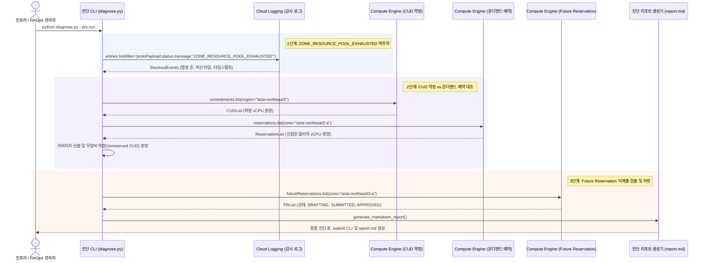

<!--
Copyright 2026 Google LLC. All Rights Reserved.
SPDX-License-Identifier: Apache-2.0

NOTICE: This code/repository is owned by Google LLC and provided under the Apache-2.0 License.
It is strictly provided as an EXAMPLE/REFERENCE ONLY and is NOT INTENDED FOR PRODUCTION USE.
All contents, designs, and code examples are subject to change, modification, or removal at any time without notice.

[고지 사항] 본 저장소 및 문서는 구글 (Google LLC) 소유이며 Apache 2.0 라이선스 하에 예시 (Sample) 용도로 제공된다.
프로덕션 환경용이 아니며, 사전 통지 없이 언제든지 수정, 변경 또는 삭제될 수 있다.
-->

# 기술 상세 설계서 (TDD): 컴퓨트 엔진(Compute Engine) 하드웨어 예약 및 CUD 용량 보장 통합 진단기

## 1. 시스템 아키텍처 및 런타임 상호작용 시퀀스

본 도구의 런타임 제어 및 데이터 상호작용 흐름은 아래 시퀀스 다이어그램과 같다. Cloud Audit Logs의 스톡아웃 이벤트를 역추적하고, CUD 약정 코어 대비 물리적 온디맨드 Reservation 확보율을 계산하며, Future Reservation(FR)의 미제출(`DRAFTING`) 상태를 검출하여 하드웨어 가용성을 보장한다.

---

## 2. 요구 사항 추적성 매핑 (Traceability Matrix)

| 비즈니스 요구 사항 (BRD) | 기능적 기술 요구 사항 (FR) | 비기능적 기술 요구 사항 (NFR) | 구현 파일 및 모듈 |
| :--- | :--- | :--- | :--- |
| **BR-01** (스톡아웃 감사 로그 역추적) | **FR-01** (스톡아웃 감사 로그 분석) | **NFR-01** (최소 IAM 권한 준수) | `diagnose.py` (`query_stockout_audit_logs`) |
| **BR-02** (CUD 대조 및 무방비 약정 진단) | **FR-02** (CUD 약정 및 온디맨드 Reservation 대조) | **NFR-01** (최소 IAM 권한 준수) | `diagnose.py` (`check_cud_reservation_coverage`) |
| **BR-03** (Future Reservation 미제출 검출) | **FR-03** (Future Reservation 상태 파싱 및 미제출 탐지) | **NFR-02** (가상 모드 지원) | `diagnose.py` (`audit_future_reservations`) |
| **BR-04** (자동 리포트 및 조치 처방) | **FR-04** (마크다운 리포트 자동 생성) | **NFR-03** (민감 정보 비식별화) | `diagnose.py` (`generate_markdown_report`), `report.md` |
| **BR-05** (표준 리소스 라벨링 적용 의무화) | **FR-02, FR-04** (사내 거버넌스 4대 필수 라벨링 적용) | **NFR-04** (표준 리소스 라벨링 준수) | `README.md`, `diagnose.py` |

---

## 3. 기능 요구 사항 (Functional Requirements)

### FR-01: 스톡아웃 감사 로그 분석
- `jsonPayload.event_subtype="compute.instances.insert"` 및 `protoPayload.status.message:"ZONE_RESOURCE_POOL_EXHAUSTED"` 필터를 통해 최근 실패 이벤트를 추출한다.

### FR-02: CUD 약정 및 온디맨드 Reservation 대조 엔진
- `gcloud compute commitments list` 및 `gcloud compute reservations list` 결과를 파싱하여 CUD vCPU 총량과 Reservation vCPU 총량을 비교하고 커버리지를 계산한다.

### FR-03: Future Reservation 상태 파싱 및 미제출 탐지
- `gcloud compute future-reservations list` 결과를 분석하여 `status == "DRAFTING"`인 항목에 대해 즉시 실행 가능한 `gcloud compute future-reservations submit` 명령어를 생성한다.

### FR-04: 마크다운 리포트 (report.md) 자동 생성
- 터미널 출력을 반영한 표준 마크다운 리포트를 자동 생성 및 덮어쓰기한다.

---

## 3. 비기능 요구 사항 (Non-Functional Requirements)

### NFR-01: 최소 IAM 권한 준수
- 본 도구는 읽기 전용 진단 스크립트로서 `roles/compute.viewer` 및 `roles/logging.viewer` 권한만 요구한다.

### NFR-02: 순수 파이썬 단일 실행 및 가상 모드 지원
- 외부 의존성 없이 `python diagnose.py --dry-run` 가상 실행을 안정적으로 지원한다.

### NFR-03: 민감 정보 비식별화 및 보안 규약
- 소스 코드 및 문서 내에 실제 프로젝트 ID나 개인 식별 정보(PII)를 하드코딩하지 않으며, 모든 외부 참조 링크는 Bare URL 괄호 병기 원칙을 준수한다.

### NFR-04: 표준 리소스 라벨링 규약 준수
- 리소스 생성 가이드 및 CLI 명령어에 4대 필수 표준 라벨(`managed-by=google-cloud-0-to-1`, `scenario=gce-reservation-guard`, `env=sample`, `created-by=customer-engineer`)을 누락 없이 포함한다.
