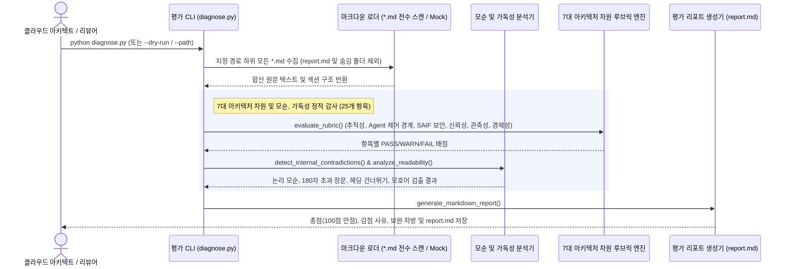

<!--
Copyright 2026 Google LLC. All Rights Reserved.
SPDX-License-Identifier: Apache-2.0

NOTICE: This code/repository is owned by Google LLC and provided under the Apache-2.0 License.
It is strictly provided as an EXAMPLE/REFERENCE ONLY and is NOT INTENDED FOR PRODUCTION USE.
All contents, designs, and code examples are subject to change, modification, or removal at any time without notice.

[고지 사항] 본 저장소 및 문서는 구글 (Google LLC) 소유이며 Apache 2.0 라이선스 하에 예시 (Sample) 용도로 제공된다.
프로덕션 환경용이 아니며, 사전 통지 없이 언제든지 수정, 변경 또는 삭제될 수 있다.
-->

> [!IMPORTANT]
> **구글 (Google LLC) 참조용 샘플 고지 사항**:
> 본 프로젝트의 모든 소스 코드와 문서는 Google LLC의 소유이며, Apache-2.0 라이선스에 따라 오직 **참조용 샘플 (Sample / Reference Only)** 목적으로만 제공된다. 프로덕션 환경에 그대로 사용할 수 없으며, 사전 통지 없이 언제든 내용이 수정, 변경 또는 삭제될 수 있다.

# 기술 상세 설계서 (TDD): Google Cloud 아키텍처 명세 실전 루브릭 평가기 (As of 2026-11-19)

## 1. 시스템 아키텍처 및 런타임 상호작용 시퀀스

본 도구의 런타임 제어 및 데이터 상호작용 흐름은 아래 시퀀스 다이어그램과 같다. 아키텍트가 평가 대상 파일 또는 디렉터리 경로(`--path`)를 지정하거나 `--dry-run` 모드를 호출하면, `diagnose.py`가 지정 경로 하위 모든 마크다운(`*.md`) 문서를 파일명 제약 없이 일괄 수집한 뒤 7대 아키텍처 차원 및 명세 내부 논리 모순, 가독성 루브릭(25개 항목)을 순차 평가하고 종합 점수 및 보완 처방 리포트(`report.md`)를 출력한다.

---

## 2. 요구 사항 추적성 매핑 (Traceability Matrix)

| 비즈니스 요구 사항 (BRD) | 기능적 기술 요구 사항 (FR) | 비기능적 기술 요구 사항 (NFR) | 구현 파일 및 모듈 |
| :--- | :--- | :--- | :--- |
| **BR-01** (요구 사항 추적성 및 내부 논리 모순 검증) | **FR-02** (요구 사항 ID 교차 참조 및 논리 모순 검출) | **NFR-01** (결정론적 로컬 실행) | `diagnose.py` (`evaluate_rubric`, `detect_internal_contradictions`) |
| **BR-02** (수치 환각 방지 및 가독성 평가) | **FR-03** (`(Proposed)` 태깅 및 장문, 모호어 분석) | **NFR-01** (결정론적 로컬 실행) | `diagnose.py` (`evaluate_rubric`, `analyze_readability`) |
| **BR-03** (Google Cloud 7대 아키텍처 차원 및 SAIF 채점) | **FR-04** (7대 차원 25개 항목 100점 루브릭 채점) | **NFR-02** (비대화형 환경 호환성) | `diagnose.py` (`evaluate_rubric`) |
| **BR-04** (Dry-run 및 지정 경로 `*.md` 전수 평가 지원) | **FR-01**, **FR-05** (`*.md` 전수 스캔 및 `--dry-run` 모드) | **NFR-03** (민감 정보 비식별화) | `diagnose.py` (`collect_markdown_files`, `auto_detect_docs`, `get_mock_bundle`) |
| **BR-05** (비식별화, Google Cloud 최신 업그레이드 및 라벨링) | **FR-04** (PII/시크릿/최신 서비스, 모델, SDK 감사 및 라벨 안내) | **NFR-04** (자원 거버넌스 및 라벨링 규약) | `diagnose.py` (`evaluate_rubric`, `detect_gcp_upgrade_recommendations`, `generate_markdown_report`) |

---

## 3. 기능적 기술 요구 사항 (Functional Requirements)

| 요구 사항 ID | 연관 BR | 기술 요구 사항 명칭 | 구현 상세 및 검증 기준 |
| :--- | :--- | :--- | :--- |
| **FR-01** | **BR-04** | **계층형 환경 설정 및 디렉터리 하위 `*.md` 전수 스캔** | 최소 4개 CLI 인자(`--config`, `--dry-run`, `-p/--project`, `--path`, 파일 및 디렉터리 혼합과 쉼표 복수 경로 지원) > `.env`(`SPEC_PATH`) > `gcloud config` 활성 프로젝트 > 현재 디렉터리 `docs/` 또는 루트 하위 모든 `*.md` 전수 수집(`report.md` 및 숨김 폴더 제외, 파일명 제약 없음) 순으로 입력을 확정한다. |
| **FR-02** | **BR-01** | **요구 사항 ID 교차 참조 및 내부 논리 모순 검출** | 전체 `*.md` 합본 내에서 정의된 요구 사항 ID(`BR-*`, `REQ-*`, `PRD-*`, `CON-*`, `FR-*`, `NFR-*`)가 파일명과 무관하게 2회 이상 교차 참조되는지 검증하고, `Read-Only` 선언 대 직접 DML 충돌, PII 마스킹 대 원문 로깅 충돌, SLA 대 동기 타임아웃 역전을 검출한다. |
| **FR-03** | **BR-02** | **수치 근거성(`(Proposed)` 태깅) 및 가독성 분석** | 지연 시간(`ms`/`s`), 가용성/정확도(`%`), 비용(`$`/`USD`), 동시성(`RPS`/`QPS`) 수치가 포함된 문장의 근거 표기 누락과 180자 초과 장문 만연체, 헤딩 계층 건너뛰기, 검증 불가 모호어를 탐지한다. |
| **FR-04** | **BR-03, BR-05** | **7대 아키텍처 차원 및 최신 GCP 버전 업그레이드 감사** | 총 25개 실전 루브릭 항목(항목당 4점 = 100점 만점: 자율성 경계, Agent 토폴로지, SAIF 보안, 신뢰성/멱등성, 관측성/Eval/WORM/4대 라벨링, 지연/토큰 경제성, ADR/모순/가독성/구형 명칭, 퇴역 AI 모델, 구형 SDK 및 레거시 인프라 업그레이드 가이드)을 채점한다. |
| **FR-05** | **BR-04** | **가상 실행(`--dry-run`) 스모크 테스트 모드** | `--dry-run` 실행 시 의도적 설계 결함이 포함된 `sample-corp` 모의 명세 표본을 평가하여 감점 검출 및 보완 처방 생성이 정상 동작함을 1초 이내에 검증한다. |

---

## 4. 비기능적 기술 요구 사항 (Non-Functional Requirements)

| 요구 사항 ID | 요구 사항 명칭 | 상세 기준 |
| :--- | :--- | :--- |
| **NFR-01** | **무의존성 결정론적 실행** | Python 3 표준 라이브러리만으로 동작하며 외부 LLM 호출이나 클라우드 과금 없이 동일한 입력에 대해 100% 일관된 루브릭 점수를 반환한다. |
| **NFR-02** | **비대화형 CI/CD 게이트 호환** | `--dry-run` 및 일반 실행 시 `not sys.stdin.isatty()` 환경에서도 입력 대기 없이 종료하며, `FAIL` 항목 존재 여부를 리포트와 콘솔에 명확히 표기한다. |
| **NFR-03** | **민감 정보 비식별화** | 내장 모의 문서 및 기본 리포트(`report.md`)에 특정 기업명, 실명, 사내 도메인, 실제 API Key를 포함하지 않고 `sample-project-id` 및 `sample-corp` 가명만 사용한다. |
| **NFR-04** | **자원 거버넌스 및 라벨링 규약** | 설계서 내 GCP 리소스 택소노미 검사 시 4대 표준 라벨(`managed-by`, `scenario`, `env`, `created-by`) 포함 여부를 필수 루브릭으로 점검한다. |
