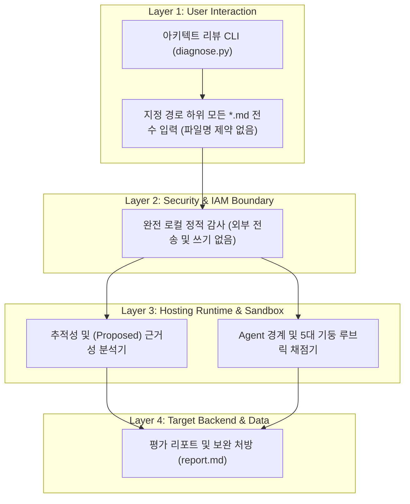

<!--
Copyright 2026 Google LLC. All Rights Reserved.
SPDX-License-Identifier: Apache-2.0

NOTICE: This code/repository is owned by Google LLC and provided under the Apache-2.0 License.
It is strictly provided as an EXAMPLE/REFERENCE ONLY and is NOT INTENDED FOR PRODUCTION USE.
All contents, designs, and code examples are subject to change, modification, or removal at any time without notice.

[고지 사항] 본 저장소 및 문서는 구글 (Google LLC) 소유이며 Apache 2.0 라이선스 하에 예시 (Sample) 용도로 제공된다.
프로덕션 환경용이 아니며, 사전 통지 없이 언제든지 수정, 변경 또는 삭제될 수 있다.
-->

> [!IMPORTANT]
> **구글 (Google LLC) 참조용 샘플 고지 사항**:
> 본 프로젝트의 모든 소스 코드와 문서는 Google LLC의 소유이며, Apache-2.0 라이선스에 따라 오직 **참조용 샘플 (Sample / Reference Only)** 목적으로만 제공된다. 프로덕션 환경에 그대로 사용할 수 없으며, 사전 통지 없이 언제든 내용이 수정, 변경 또는 삭제될 수 있다.

# Google Cloud Well-Architected Framework(WAF) 명세 린터 (`gcp-waf-linter`)

AI 에이전트 기반 Spec-Driven Development 환경에서 작성된 프로젝트의 모든 마크다운(`*.md`) 명세 문서(요구 사항, 기술 및 시스템 설계서, ADR 등 파일명 제약 없음)를 대상으로 Google Cloud Well-Architected Framework(WAF) 7대 아키텍처 차원(자율성 경계, Agent 토폴로지, SAIF 보안, 신뢰성, 관측성, 지연/토큰 경제성, ADR), 명세 내부 논리 모순 교차 검증 및 가독성/모호어까지 25개 항목 100점 만점 루브릭으로 자동 채점하는 정적 린터다. (As of 2026-11-19)

---

## 1. 발생 증상 및 진단 대상 체크리스트

사내 설계 및 아키텍처 리뷰 단계에서 아래 항목에 해당한다면 즉시 평가 대상이다:
- [ ] AI 코딩 에이전트가 생성한 설계 문서는 깔끔해 보이지만, 실제 요구 사항 ID(`BR-*`, `REQ-*`, `FR-*`, `NFR-*`) 교차 참조나 원시 자료 모순 해소가 누락되는 경우가 있다.
- [ ] 고객 원문에 없는 SLA 지연 시간, 비용, 동시성 수치를 모델이 단정적으로 기입(환각)하는지 구현 착수 전에 걸러내고 싶다.
- [ ] 읽기 전용 에이전트 권한 분리, 고위험 작업 HITL 승인 게이트, 양방향 PII 마스킹, WORM 감사 로그, 4대 표준 라벨링 등 현장 실전 항목 누락을 자동 감사하고자 한다.

---

## 2. 빠른 시작 (Quickstart)

1단계: 모의 명세 표본으로 루브릭 채점 및 리포트 확인
```bash
python diagnose.py --dry-run
```

2단계: 대화형 환경 설정 마법사로 `.env` 생성 (선택)
```bash
python diagnose.py --config
```

3단계: 로컬 명세 경로(하위 모든 `*.md`) 대상 정적 평가 실행
```bash
python diagnose.py
```

터미널 출력 미리보기:
```text
========================================================================
Google Cloud Well-Architected Framework(WAF) 명세 린터 결과
========================================================================
- 참고 프로젝트: sample-project-id
- 평가 대상: 내장 모의 명세 표본 (sample-corp)
- 종합 점수: 92 / 100점 (PASS 22건, WARN 2건, FAIL 1건)
------------------------------------------------------------------------
[완료] 상세 평가 리포트가 저장되었다: report.md
```

---

## 3. 솔루션 아키텍처 및 처리 흐름



---

## 4. 조치 가이드 및 권장 설정

평가 실행 후 생성된 [report.md](report.md)의 `FAIL` 및 `WARN` 항목을 우선 보완한다:

1. **고아 요구 사항 및 `(Proposed)` 미태깅 해소**: 명세에 정의된 `BR-*`/`REQ-*`/`FR-*`/`NFR-*` ID가 설계 및 구현 섹션에서 빠짐없이 교차 참조되도록 보완하고, 원문에 근거가 없는 추정 수치에는 `(Proposed)`를 명시한다.
2. **에이전트 제어 평면 및 4대 표준 라벨 적용**: 읽기 전용 에이전트와 상태 변경 실행 서비스를 분리하고, 설계서 내 GCP 리소스 택소노미에 4대 표준 라벨을 반영한다:
```bash
--labels=managed-by=google-cloud-0-to-1,scenario=gcp-waf-linter,env=sample,created-by=customer-engineer
```
- Google Cloud Architecture Framework ( https://cloud.google.com/architecture/framework )
- Google Cloud Security Best Practices ( https://cloud.google.com/security/best-practices )

---

## 5. 사전 준비 사항 (필요 IAM 권한)

본 도구는 로컬 마크다운 명세 문서를 Python 3 표준 라이브러리만으로 정적 분석하므로 별도의 GCP IAM 권한이나 클라우드 API 활성화를 요구하지 않는다.

| 구분 | 필요 권한 | 비고 |
| :--- | :--- | :--- |
| `GCP IAM` | 필요 없음 | 로컬 명세 `*.md` 파일 정적 감사 (선택 시 `gcloud config get-value project`만 참조) |

---

## 6. 기술적 배경 및 아키텍처 원리 (Deep Dive)

- 세부 요구 사항 및 추적성은 [docs/BRD.md](docs/BRD.md) 및 [docs/TDD.md](docs/TDD.md)를 참고한다.
- **7대 아키텍처 차원 및 모순, 가독성 루브릭(25개 항목, 100점 만점)**:
  1. **자율성 경계 및 성공 기준 (`R-01`~`R-04`)**: 요구 사항 ID 교차 참조, 읽기 전용 Agent/실행 평면 분리, HITL 승인 게이트, 정량 수치 `(Proposed)` 태깅
  2. **Agent 토폴로지, 컴퓨트 및 도구 (`R-05`~`R-07`)**: 런타임(`Agent Engine`, `Cloud Run`, `GKE`) 배치, 도구/메모리 경계, Mermaid 다이어그램
  3. **SAIF 보안, 프라이버시 및 컴플라이언스 (`R-08`~`R-11`)**: 양방향 PII 마스킹, `Model Armor` 적대적 차단, CMEK/VPC-SC, 시크릿 미노출
  4. **신뢰성, 회복 탄력성 및 상태 무결성 (`R-12`~`R-14`)**: 다중 영역 `RTO`/`RPO`, 비동기 멱등성 잠금, 타임아웃/백오프/폴백 경로
  5. **관측성, 감사 추적 및 평가 파이프라인 (`R-15`~`R-17`)**: OpenTelemetry/Eval CI/CD 게이트, WORM 불변 감사 로그, 4대 표준 라벨링
  6. **지연 시간 최적화 및 토큰 경제성 (`R-18`~`R-19`)**: 종단간 `p95`/`TTFT` 목표, 토큰 상한, 캐시 TTL, 스캔 절감
  7. **ADR, 논리 모순 교차 검증 및 가독성 (`R-20`~`R-25`)**: 트레이드오프 근거화, MVP vs Scale 분리, **명세 내부 논리 모순 교차 검출(`Read-Only` vs DML, PII 마스킹 vs Raw 로깅, SLA vs 타임아웃 역전)**, **장문 만연체, 헤딩 계층 건너뛰기 및 검증 불가 모호어(Weasel Words) 검출**, **Google Cloud 최신 서비스, 모델 및 SDK 버전 업그레이드 가이드(구형 명칭, 퇴역 AI 모델, 구형 SDK, 레거시 인프라 탐지)**

---

## 7. 리소스 정리 (Teardown) 안내

본 평가기는 클라우드 인프라를 프로비저닝하지 않으므로 별도의 클라우드 리소스 정리가 필요 없다. 로컬에서 생성된 `.env` 파일이나 임시 평가 리포트(`report.md`)만 필요에 따라 정리한다.
