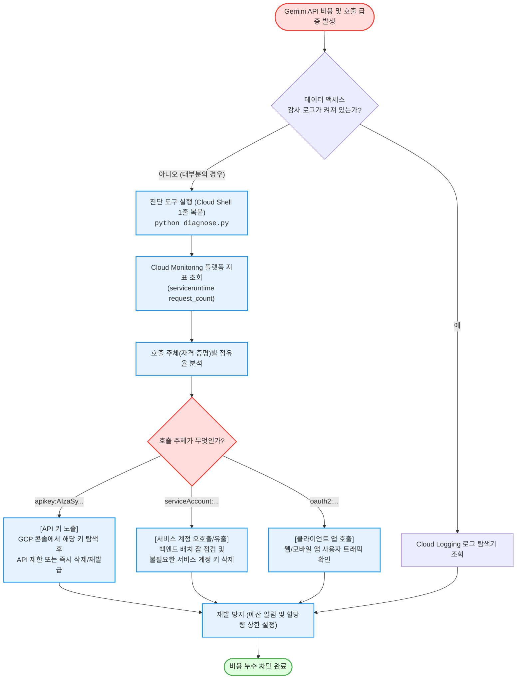

<!--
Copyright 2026 Google LLC. All Rights Reserved.
SPDX-License-Identifier: Apache-2.0

NOTICE: This code/repository is owned by Google LLC and provided under the Apache-2.0 License.
It is strictly provided as an EXAMPLE/REFERENCE ONLY and is NOT INTENDED FOR PRODUCTION USE.
All contents, designs, and code examples are subject to change, modification, or removal at any time without notice.

[고지 사항] 본 저장소 및 문서는 구글 (Google LLC) 소유이며 Apache 2.0 라이선스 하에 예시 (Sample) 용도로 제공된다.
프로덕션 환경용이 아니며, 사전 통지 없이 언제든지 수정, 변경 또는 삭제될 수 있다.
-->

> [!IMPORTANT]
> **구글 (Google LLC) 참조용 샘플 고지 사항**:
> 본 프로젝트의 모든 소스 코드와 문서는 Google LLC의 소유이며, Apache-2.0 라이선스에 따라 오직 **참조용 샘플 (Sample / Reference Only)** 목적으로만 제공된다. 프로덕션 환경에 그대로 사용할 수 없으며, 사전 통지 없이 언제든 내용이 수정, 변경 또는 삭제될 수 있다.

# 제미나이(Gemini) API 비용 급증 원인 진단 (`gemini-billing-spike`)

데이터 액세스 감사 로그(Audit Logs)가 꺼져 있어도, 클라우드 모니터링(Cloud Monitoring) 기본 지표를 통해 **어떤 인증 수단(API 키, 서비스 계정, OAuth 등)에서 Gemini 호출 비용이 급증했는지 1분 만에 규명**하는 진단 가이드다. (As of 2026-10-17)

---

## 1. 발생 증상 및 진단 대상 체크리스트

사내 또는 고객사 환경에서 아래 증상이 발생한다면 즉시 진단 대상이다:
- [ ] **비용 급증**: 이번 달 청구서나 예산 알림에서 Gemini(버텍스 AI(Vertex AI) 또는 AI Studio) 비용이 예상보다 갑자기 수 배 이상 급증했을 때
- [ ] **감사 로그 부재**: "누가 호출했는지" 확인하려 했으나, 빅쿼리(BigQuery) 감사 로그 내보내기나 데이터 액세스 감사 로그가 비활성화되어 있어 원인을 파악하기 어려울 때
- [ ] **보안 유출 의심**: 개발자가 GitHub나 클라이언트 앱에 API 키 또는 서비스 계정 키를 실수로 노출했는지 신속히 점검하고자 할 때

---

## 2. 빠른 시작 (Quickstart)

### 1) 모의 데이터 가상 실행 (Dry-Run)
GCP API 호출 없이 내장된 가상 인프라 데이터로 정상 동작 여부를 즉시 검증한다:
```bash
python diagnose.py --dry-run
```

**터미널 진단 출력 미리보기:**
```text
[진단 결과] 제미나이(Gemini) 사용량 및 비용 급증 원인 분석 리포트
   - 대상 프로젝트: sample-project-id
   - 조회 대상 기간: 최근 90일
========================================================================
총 집계된 API 호출 수: 148,250 건 (시계열 레코드: 2개)
┌──────────────────────────────────────────────────────────────────────┐
│ 1. 호출 주체(자격 증명)별 점유율 및 호출 횟수                             │
├──────────────────────────────────────────────────────────────────────┤
│  - apikey:AIzaSyB1234567890abcdefghijklmnopqr   :  135,200회 ( 91.2%) │
│  - serviceAccount:gemini-batch-sa@sample-proj.. :   13,050회 (  8.8%) │
```

### 2) 실제 사내 인프라 실시간 진단
```bash
cp .env.example .env
python diagnose.py
```
> [!NOTE]
> `.env` 설정값을 비워두면 gcloud 활성 설정 및 사내 리소스를 자동으로 감지하여 진단한다.

---

## 3. 진단 및 해결 흐름



---
## 4. 조치 가이드 및 권장 설정

출력된 자격 증명 유형에 따라 다음 단계로 이동하여 즉시 조치한다:

### 1. `apikey:AIzaSy...`가 상위 점유율을 차지한 경우
- **원인**: 누군가 소스 코드, 프론트엔드 모바일 앱, 또는 퍼블릭 깃허브에 API 키를 노출했거나 외부 테스트용 키가 무제한 호출되고 있다.
- **조치 방법**:
  1. GCP 콘솔 > API 및 서비스 > 사용자 인증 정보 ( https://console.cloud.google.com/apis/credentials )로 이동한다.
  2. 화면에 찍힌 키 앞부분(`AIzaSy...`)과 일치하는 API 키를 찾는다.
  3. **키 수정(연필 아이콘)**을 눌러 조치한다:
     - **애플리케이션 제한**: 특정 웹사이트(HTTP 리퍼러)나 특정 IP에서만 호출되도록 제한한다.
     - **API 제한**: 반드시 필요한 API(예: Vertex AI API)만 체크하고 나머지는 잠근다.
  4. 알 수 없는 키이거나 유출이 확실한 경우 즉시 **삭제(휴지통 아이콘)**한다.

### 2. `serviceAccount:...`가 상위 점유율을 차지한 경우
- **원인**: 내부 배치 애플리케이션, 클라우드 런(Cloud Run) 서비스, 또는 CI/CD 파이프라인에서 무한 재시도나 대량 호출 루프가 돌고 있다.
- **조치 방법**:
  1. GCP 콘솔 > IAM 및 관리자 > 서비스 계정 ( https://console.cloud.google.com/iam-admin/serviceaccounts )으로 이동한다.
  2. 해당 서비스 계정이 연결된 VM, Cloud Run, GKE 워크로드를 확인한다.
  3. JSON 키 파일이 발급되어 있다면 해당 키의 최근 생성일을 확인하고 불필요한 키는 사용 중지(Disable) 또는 삭제한다.

---
## 5. 사전 준비 사항 (필요 IAM 권한)

본 도구를 실행하려면 최소 아래의 IAM 권한이 필요하다:

이 도구는 **오직 읽기(조회) 작업만 수행**하며, 인프라를 변경하거나 삭제하지 않는다.  
스크립트를 실행하는 사용자 또는 서비스 계정에 아래 역할(Role) 중 하나가 필요하다:

| 역할 (Role) | 권한 ID | 용도 |
| : | : | : |
| **모니터링 뷰어 (권장)** | `roles/monitoring.viewer` | Cloud Monitoring 지표 데이터 조회 |
| **뷰어 (기본)** | `roles/viewer` | 프로젝트 리소스 및 지표 전반 조회 |

> [!NOTE]
> 사내 보안팀에 권한을 요청할 때는 **"Cloud Monitoring 지표 조회를 위한 `roles/monitoring.viewer` 권한 1개"**만 요청하면 된다.

---

## 6. 기술적 배경 및 아키텍처 원리 (Deep Dive)

### 관련 상세 설계 및 요구 사항 명세
- [비즈니스 요구 사항 명세서 (BRD)](docs/BRD.md): 비즈니스 배경, 성공 지표 및 요구 사항(BR-01~) 명세
- [기술 상세 설계서 (TDD)](docs/TDD.md): 시스템 아키텍처, 기능(FR-01~) 및 비기능(NFR-01~) 설계 명세

스크립트가 완료되면 아래와 같이 **어떤 자격 증명이 전체 호출의 몇 %를 차지했는지** 명확한 표로 출력된다:

```text
========================================================================
[진단 결과] 제미나이(Gemini) 사용량 및 비용 급증 원인 분석 리포트
   - 대상 프로젝트: sample-project-id
   - 조회 대상 기간: 최근 90일
========================================================================

총 집계된 API 호출 수: 148,250 건 (시계열 레코드: 4개)

┌──────────────────────────────────────────────────────────────────────┐
│ 1. 호출 주체(자격 증명)별 점유율 및 호출 횟수                        │
├──────────────────────────────────────────────────────────────────────┤
│  - apikey:AIzaSyB1234567890abcdefghijklmnopqr   :  135,200회 ( 91.2%) │
│  - serviceAccount:gemini-batch-sa@my-proj...    :   13,050회 (  8.8%) │
└──────────────────────────────────────────────────────────────────────┘

[2. 호출된 서비스 및 API 메서드]
  - aiplatform.googleapis.com (Vertex AI Gemini): 148,250회

[상위 호출 메서드]
  - GenerateContent: 142,100회
  - StreamGenerateContent: 6,150회
```

---
## 7. 리소스 정리 (Teardown) 안내

본 도구는 순수 Cloud Monitoring 플랫폼 지표 조회 도구이며 클라우드 상에 영구 자원을 생성하지 않으므로 별도의 자원 정리 작업이 필요하지 않다.
