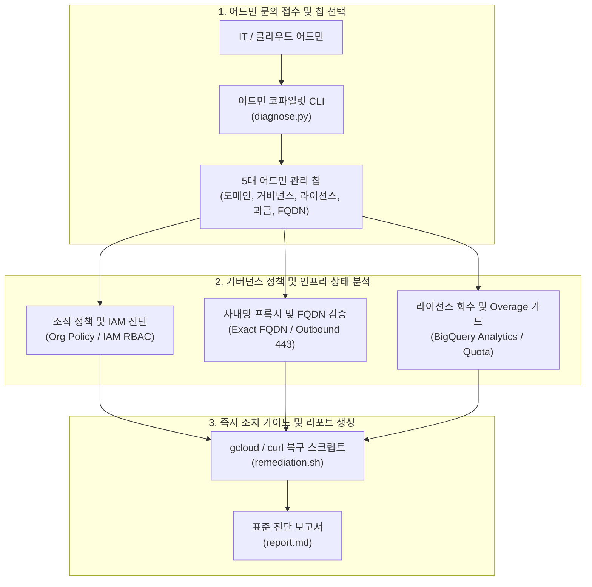

<!--
Copyright 2026 Google LLC. All Rights Reserved.
SPDX-License-Identifier: Apache-2.0

NOTICE: This code/repository is owned by Google LLC and provided under the Apache-2.0 License.
It is strictly provided as an EXAMPLE/REFERENCE ONLY and is NOT INTENDED FOR PRODUCTION USE.
All contents, designs, and code examples are subject to change, modification, or removal at any time without notice.

[고지 사항] 본 저장소 및 문서는 구글 (Google LLC) 소유이며 Apache 2.0 라이선스 하에 예시 (Sample) 용도로 제공된다.
프로덕션 환경용이 아니며, 사전 통지 없이 언제든지 수정, 변경 또는 삭제될 수 있다.
-->

# Gemini Enterprise 어드민 코파일럿 기술 상세 설계서 (TDD)

본 문서는 사내 IT 어드민 및 클라우드 인프라 팀을 지원하기 위한 제미나이 엔터프라이즈 앱(Gemini Enterprise app) 어드민 코파일럿 도구의 시스템 아키텍처, 5대 관리 칩 상세 설계, 인터페이스 규격 및 진단 로직을 정의한다.

---

## 1. 시스템 아키텍처 및 처리 흐름

본 도구는 크게 **5대 어드민 관리 칩 선택**, **사내 거버넌스 및 인프라 정책 컴파일**, **조치 가이드 및 리포트 도출**의 3단계 파이프라인으로 구성된다.

---

## 2. 요구 사항 추적성 매핑 (Traceability Matrix)

| 비즈니스 요구 사항 (BRD) | 기능적 기술 요구 사항 (FR) | 비기능적 기술 요구 사항 (NFR) | 구현 파일 및 모듈 |
| :--- | :--- | :--- | :--- |
| **BR-01** (도메인 충돌 및 온보딩 진단) | **FR-01** (도메인 충돌 진단 및 TXT 레코드 생성기) | **NFR-01** (무의존성 단일 파이썬 실행) | `diagnose.py` |
| **BR-02** (거버넌스 및 마켓플레이스 차단) | **FR-02** (마켓플레이스 차단 정책 컴파일러) | **NFR-02** (사내 최소 권한 격리) | `diagnose.py` |
| **BR-03** (라이선스 채택률 및 유휴 회수) | **FR-03** (BigQuery 활성도 분석 SQL 생성기) | **NFR-03** (결정론적 가상 실행 보장) | `diagnose.py` |
| **BR-04** (Overage 과금 방어 및 결제 통제) | **FR-04** (Billing RBAC 및 쿼터 차단 명세) | **NFR-02**, **NFR-03** | `diagnose.py` |
| **BR-05** (사내망 Exact FQDN 및 방화벽) | **FR-05** (FQDN 443 연결성 프로브 빌더) | **NFR-01**, **NFR-03** | `diagnose.py` |
| **BR-06** (추천 칩 및 원클릭 리포트) | **FR-06** (Dolphin UI 칩 규약 및 report.md 생성) | **NFR-01**, **NFR-02** | `diagnose.py`, `report.md` |

---

## 3. 기능 기술 요구 사항 명세 (Functional Requirements)

### FR-01: 도메인 충돌 진단 및 Cloud Identity 온보딩
- 사내 기본 도메인 선점 오류 발생 시 임시 서브도메인 또는 Cloud Identity Free 테넌트 배포 절차를 안내한다.
- DNS TXT 레코드 기반 도메인 소유권 검증용 문자열을 생성한다.

### FR-02: 마켓플레이스 차단 및 사내 승인 에이전트 강제 정책
- 외부 공개 에이전트 마켓플레이스 노출을 차단하는 Discovery Engine 구성 매니페스트를 합성한다.
- 사내 승인된 에이전트만 전사 갤러리(`/r/agents`)에 노출되도록 제어하는 관리자 정책을 도출한다.

### FR-03: 라이선스 채택률 분석 및 유휴 회수 쿼리
- 전사 Gemini Enterprise 배포 사용자의 활성 프롬프트 호출 로그를 집계하는 BigQuery SQL을 자동 생성한다.
- 30일 이상 미사용 임직원을 식별하여 라이선스를 자동 회수하는 gcloud 명령어를 제공한다.

### FR-04: Overage 과금 방어 및 결제 권한 통제
- 일일 풀링 쿼터 초과 시 발생하는 추가 비용(Overage)을 방어하기 위한 쿼터 캡(Cap) 설정 가이드를 제시한다.
- 임직원이 Google AI Studio에서 회사 결제 계정으로 유료 API 키를 생성하지 못하도록 Billing RBAC 권한을 제한하는 처방을 제공한다.

### FR-05: 사내망 Exact FQDN 및 방화벽 진단
- 와일드카드 도메인(`*.google.com`)이 불가한 폐쇄망 프록시 환경에서 GE 정상 구동에 필요한 15대 필수 FQDN 목록을 산출한다.
- 아웃바운드 443 포트 TCP/TLS 연결성을 사전 검증하는 테스트 명령어를 도출한다.

### FR-06: Dolphin UI 추천 칩 및 표준 리포트 생성
- Dolphin UI 네이티브 `suggested_questions` 포맷으로 다음 단계 조치 추천 칩을 출력한다.
- 실행 완료 시 진단 결과, 복구 스크립트, 콘솔 조치 가이드를 담은 `report.md`를 덮어쓴다.

---

## 4. 비기능 기술 요구 사항 명세 (Non-Functional Requirements)

### NFR-01: 무의존성 및 순수 파이썬 단일 실행 원칙
- 외부 도구 없이 `python diagnose.py` 직접 실행만으로 동작한다.

### NFR-02: 사내 보안 및 4대 필수 라벨 준수
- 모든 생성 매니페스트 및 리소스에 4대 필수 라벨(`managed-by=google-cloud-0-to-1`, `scenario=gemini-enterprise-admin-copilot`, `env=sample`, `created-by=customer-engineer`)을 강제한다.
- 실제 자격 증명이나 개인 식별 정보(PII)의 평문 노출을 전면 차단한다.

### NFR-03: 결정론적 가상 실행(--dry-run) 지원
- GCP 환경 연결 없이도 모의 데이터를 통해 5대 관리 영역의 진단 로직과 리포트 무결성을 100% 검증할 수 있도록 지원한다.
