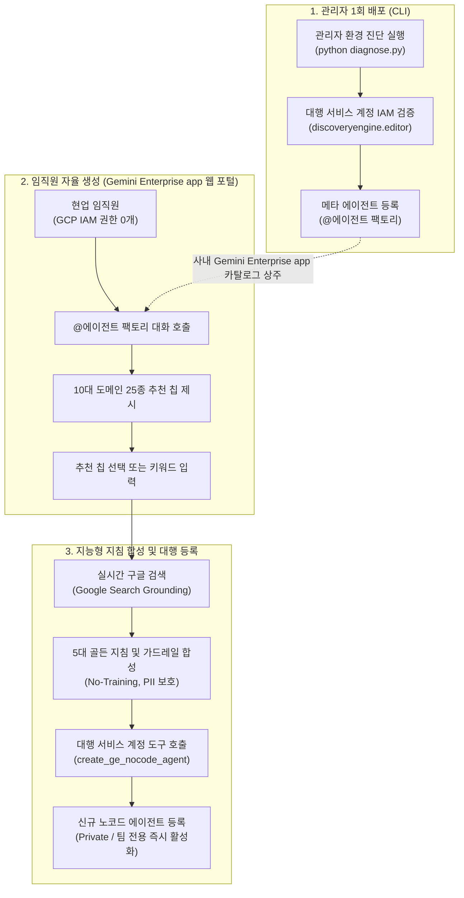

<!--
Copyright 2026 Google LLC. All Rights Reserved.
SPDX-License-Identifier: Apache-2.0

NOTICE: This code/repository is owned by Google LLC and provided under the Apache-2.0 License.
It is strictly provided as an EXAMPLE/REFERENCE ONLY and is NOT INTENDED FOR PRODUCTION USE.
All contents, designs, and code examples are subject to change, modification, or removal at any time without notice.

[고지 사항] 본 저장소 및 문서는 구글 (Google LLC) 소유이며 Apache 2.0 라이선스 하에 예시 (Sample) 용도로 제공된다.
프로덕션 환경용이 아니며, 사전 통지 없이 언제든지 수정, 변경 또는 삭제될 수 있다.
-->

> [!IMPORTANT]
> **구글 (Google LLC) 참조용 샘플 고지 사항**:
> 본 프로젝트의 모든 소스 코드와 문서는 Google LLC의 소유이며, Apache-2.0 라이선스에 따라 오직 **참조용 샘플 (Sample / Reference Only)** 목적으로만 제공된다. 프로덕션 환경에 그대로 사용할 수 없으며, 사전 통지 없이 언제든 내용이 수정, 변경 또는 삭제될 수 있다.

# Gemini Enterprise 자율형 사내 노코드 에이전트 팩토리 (gemini-enterprise-agent-factory)

제미나이 엔터프라이즈 앱(Gemini Enterprise app) 환경에서 비개발자 임직원이 복잡한 클라우드 콘솔이나 IAM 권한 없이도, 웹 채팅창에서 추천 칩 선택과 실시간 검색 그라운딩을 통해 사내 승인된 노코드(No-code) 에이전트를 자율 생성하고 전용 대행 서비스 계정으로 안전하게 등록하는 자율형 사내 에이전트 팩토리 솔루션이다. (As of 2026-10-17)

**Audience**: `#Architect`, `#Developer`, `#FinOps`, `#SecOps`  
**Concern**: `#Compliance`, `#IAM`, `#Security`  
**Service**: `#AgentPlatform`, `#GeminiAPI`  

---

## 1. 문제 증상 및 도입 배경 체크리스트

사내 엔터프라이즈 생성형 AI 환경에서 다음과 같은 병목이나 고민이 발생하고 있다면 본 솔루션 도입이 필요하다:

- [ ] **중앙 IT/인프라팀의 에이전트 제작 병목**: 현업 부서(인사, 재무, 마케팅, 고객 지원)마다 맞춤형 에이전트 제작 요청이 쏟아져 담당자가 수작업으로 지침과 도구를 세팅하느라 본연의 인프라 업무가 마비된 경우
- [ ] **비개발자 임직원의 백지 증후군(Blank Canvas Syndrome)**: 일반 직원이 에이전트를 직접 만들고 싶어도 빈 프롬프트 창에서 어떤 지침(Instructions), 가드레일, 업무 절차를 적어야 할지 몰라 포기하는 경우
- [ ] **임직원 GCP IAM 권한 부여 불가**: 일반 직원에게 에이전트 생성을 위한 구글 클라우드(Google Cloud) 콘솔 접근 권한이나 프로젝트 편집자(Editor) 권한을 부여할 수 없어 자급자족이 불가능한 경우
- [ ] **섀도우 에이전트(Shadow Agent) 및 보안 유출 공포**: 직원들이 검증되지 않은 프롬프트로 에이전트를 만들어 개인 식별 정보(PII)나 사내 기밀이 외부로 새어나갈까 봐 에이전트 생성을 원천 차단하고 있는 경우

---

## 2. 처리 아키텍처 (Activity Diagram)

본 솔루션은 관리자가 사내 Gemini Enterprise app 포털에 `@에이전트 팩토리` 메타 에이전트를 단 1회 배포하고, 전사 임직원은 IAM 권한 없이도 웹 채팅창에서 대화와 추천 칩으로 자율 에이전트를 생성 및 등록하는 2단계 파이프라인으로 동작한다.



---

## 3. 필요 IAM 역할 및 권한

메타 에이전트 배포 및 임직원 대행 등록을 위해 필요한 최소 권한(Least Privilege) 구성은 다음과 같다:

| 역할 (Role) | 부여 대상 | 용도 및 최소 권한 세부 사항 |
| :--- | :--- | :--- |
| `roles/discoveryengine.editor` | 대행 서비스 계정 (`ge-agent-factory-sa`) | Gemini Enterprise app 내 노코드 에이전트 생성, 수정 및 카탈로그 등록 대행 |
| `roles/viewer` | 관리자 실행 계정 | 사내 프로젝트 리소스 및 IAM 정책 조회 |
| 권한 불필요 (Zero IAM) | 일반 현업 임직원 | Gemini Enterprise app 웹 포털 로그인 계정 외에 GCP 콘솔 권한 일절 불필요 |

---

## 4. 원클릭 진단 및 배포 실행 가이드

### 4.1. 환경 변수 준비 (선택 사항)
본 도구는 `gcloud` 활성 설정 및 사내 리소스를 자동으로 탐지하므로 설정 파일 없이도 즉시 실행할 수 있다. 필요시 `.env.example`을 복사하여 `.env`를 생성한다:
```bash
cp .env.example .env
```

### 4.2. 가상 실행 및 스모크 테스트 (--dry-run)
실제 구글 클라우드 API 호출 없이, 메타 에이전트 매니페스트, 대행 서비스 계정 IAM 바인딩, 추천 칩 인터뷰 및 지침 합성 로직을 0.5초 만에 안전하게 검증한다:
```bash
python diagnose.py --dry-run
```

특정 추천 칩(예: 2번 인사/총무 카테고리의 1번 연차 규정 칩) 또는 커스텀 프롬프트를 지정하여 가상 실행할 수 있다:
```bash
# 2번 부서(인사/총무)의 1번 칩(연차 및 휴가 규정 안내) 지정 검증
python diagnose.py --dry-run --chip 2:1

# 사용자 직접 정의 프롬프트 기반 지침 합성 검증
python diagnose.py --dry-run --prompt "사내 특허 출원 절차 및 선행 기술 검토 에이전트"
```

### 4.3. 실제 사내 Gemini Enterprise app 배포 집행 (--publish)
사내 Gemini Enterprise app 카탈로그에 `@에이전트 팩토리`를 정식으로 등록하여 전사 임직원이 사용할 수 있도록 배포한다:
```bash
python diagnose.py --publish
```

### 4.4. 최신 Agents CLI 기반 배포 및 게시 (대안)
구글 공식 최신 **Agents CLI (`google-agents-cli`)** 도구를 활용하여 원격 Agent Runtime에 직결 배포하고 사내 Gemini Enterprise app 갤러리에 원클릭 게시할 수 있다:
```bash
# Agent Runtime 배포
agents-cli deploy --project=${PROJECT_ID} --region=us-central1

# Gemini Enterprise app 사내 갤러리 등록
agents-cli publish gemini-enterprise \
  --gemini-enterprise-app-id "projects/${PROJECT_NUMBER}/locations/global/collections/default_collection/engines/${GE_APP_ID}" \
  --display-name "Gemini Enterprise Agent Factory (사내 노코드 에이전트 팩토리)" \
  --description "비개발자 임직원용 대화형 노코드 AI 에이전트 팩토리"
```

---

## 5. 콘솔 링크 조치 가이드

- **Gemini Enterprise 웹 포털**: 사내 임직원 전용 대화형 포털 접속 및 에이전트 확인 ( https://gemini.google.com )
- **Agent Platform (GEAP) 콘솔**: 사내 등록된 에이전트 및 데이터스토어 현황 관리 ( https://console.cloud.google.com/vertex-ai/agents/ )
- **IAM 및 관리자 콘솔**: 대행 서비스 계정(`ge-agent-factory-sa`) 역할 및 바인딩 상태 확인 ( https://console.cloud.google.com/iam-admin/iam )

---

## 6. 자원 정리 안내 (Teardown)

본 솔루션 검증 후 테스트용으로 등록된 메타 에이전트나 대행 서비스 계정을 정리하고자 할 경우 아래 절차를 수행한다:

1. **대행 서비스 계정 삭제**:
   ```bash
   gcloud iam service-accounts delete ge-agent-factory-sa@${PROJECT_ID}.iam.gserviceaccount.com --quiet
   ```
2. **Gemini Enterprise app 카탈로그 에이전트 삭제**:
   - Agent Platform 콘솔 ( https://console.cloud.google.com/vertex-ai/agents/ )에 접속하여 테스트용으로 생성된 에이전트를 선택 후 삭제한다.
