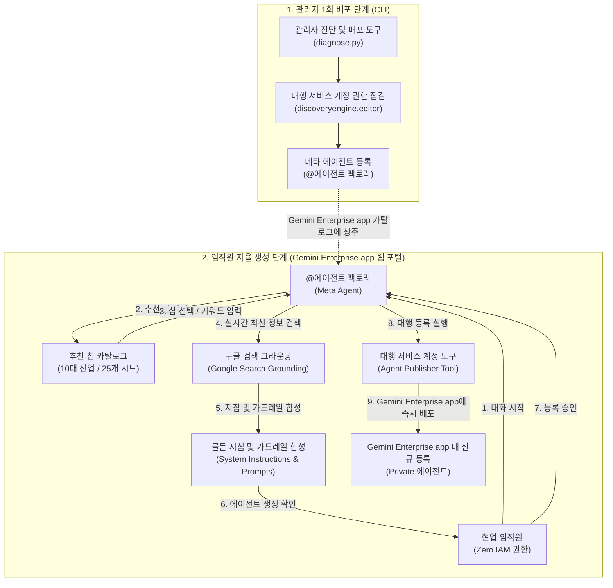

<!--
Copyright 2026 Google LLC. All Rights Reserved.
SPDX-License-Identifier: Apache-2.0

NOTICE: This code/repository is owned by Google LLC and provided under the Apache-2.0 License.
It is strictly provided as an EXAMPLE/REFERENCE ONLY and is NOT INTENDED FOR PRODUCTION USE.
All contents, designs, and code examples are subject to change, modification, or removal at any time without notice.

[고지 사항] 본 저장소 및 문서는 구글 (Google LLC) 소유이며 Apache 2.0 라이선스 하에 예시 (Sample) 용도로 제공된다.
프로덕션 환경용이 아니며, 사전 통지 없이 언제든지 수정, 변경 또는 삭제될 수 있다.
-->

# Gemini Enterprise 자율형 사내 노코드 에이전트 팩토리 기술 상세 설계서 (TDD)

본 문서는 사내 제미나이 엔터프라이즈 앱(Gemini Enterprise app) 환경에서 비개발자 임직원의 자율 에이전트 제작을 지원하는 메타 에이전트 팩토리의 시스템 아키텍처, 기술 상세 설계, 인터페이스 명세 및 검증 계획을 정의한다.

---

## 1. 시스템 아키텍처 및 처리 흐름

본 시스템은 크게 **관리자 배포 파이프라인(CLI)**과 **엔드유저 자율 생성 파이프라인(Gemini Enterprise app Web)**의 2단계 라이프사이클로 구성된다.

---

## 2. 요구 사항 추적성 매핑 (Traceability Matrix)

| 비즈니스 요구 사항 (BRD) | 기능적 기술 요구 사항 (FR) | 비기능적 기술 요구 사항 (NFR) | 구현 파일 및 모듈 |
| :--- | :--- | :--- | :--- |
| **BR-01** (메타 에이전트 배포) | **FR-01** (메타 에이전트 배포 및 진단) | **NFR-01** (무의존성 및 단일 파이썬 실행) | `diagnose.py` |
| **BR-02** (추천 칩 기반 인터뷰) | **FR-02** (경량 칩 카탈로그 및 선택기) | **NFR-02** (초경량 패키징 원칙) | `diagnose.py` 내장 카탈로그 |
| **BR-03** (실시간 검색 보강) | **FR-03** (실시간 검색 기반 지침 합성) | **NFR-03** (결정론적 가상 실행 보장) | `diagnose.py` 합성 엔진 |
| **BR-04** (무권한 대행 등록) | **FR-04** (서비스 계정 대행 등록 도구) | **NFR-01**, **NFR-02** | `diagnose.py` 배포 모듈 |
| **BR-05** (설계 거버넌스 강제) | **FR-05** (엔터프라이즈 가드레일 강제 주입) | **NFR-03** (가명 마스킹 및 보안 준수) | `diagnose.py`, `report.md` |

---

## 3. 기능 기술 요구 사항 명세 (Functional Requirements)

### FR-01: 메타 에이전트 배포 및 사전 환경 진단
- 관리자 실행 시 사내 GCP 프로젝트 ID, 리전(Location), 대상 Gemini Enterprise app 인스턴스 ID, 대행 서비스 계정의 IAM 권한을 계층형 캐스케이드(CLI > `.env` > `gcloud config`)로 자동 탐지한다.
- 대행 서비스 계정에 `roles/discoveryengine.editor` 권한이 정상 부여되어 있는지 사전 점검하고 이상 유무를 진단한다.
- `--publish` 플래그 인가 시 실제 Gemini Enterprise app 메타데이터 등록 API를 호출하여 `@에이전트 팩토리`를 등록한다.

### FR-02: 경량 추천 칩 카탈로그 및 인터뷰 엔진
- 10대 주요 비즈니스 부서(IT 인프라, 인사/총무, 재무/회계, 고객 지원, 법무/준법, 마케팅/영업, 스마트팩토리, 연구개발, 구매/조달, 정보 보안)별 대표적인 추천 칩 25종 이상을 내장한다.
- 터미널 실행(`sys.stdin.isatty()`) 시 대화형 번호 선택기(`[1] ... [2] ...`)를 렌더링하여 비개발자도 엔터 입력만으로 즉시 시나리오를 선택할 수 있도록 지원한다.
- 비대화형 환경이나 스크립트 실행 시 `--chip` 또는 `--prompt` 인자로 직접 지정할 수 있도록 지원한다.

### FR-03: 실시간 구글 검색(Google Search Grounding) 기반 지침 합성
- 선택된 칩이나 사용자 입력 프롬프트를 시드(Seed)로 하여, 실시간 구글 검색을 통해 해당 업무 영역의 최신 규정, 업계 모범 실무 절차, 필수 확인 항목을 수집한다.
- 수집된 정보를 바탕으로 제미나이(Gemini) 모델이 아래 5대 골든 프롬프트 규격으로 시스템 지침(Instructions)을 합성한다:
  1. `Role & Identity`: 업무 페르소나 및 책임 범위
  2. `Standard Workflow`: 실시간 검색으로 보강된 단계별 표준 작업 절차
  3. `Enterprise Guardrails`: 개인 식별 정보 보호 및 사실 기반 검증 수칙
  4. `Fallback Rules`: 정보 부족 또는 권한 외 요청 시 담당 부서 안내 절차
  5. `Starter Prompts`: Gemini Enterprise app 진입 시 표시될 4가지 대표 추천 질문

### FR-04: 대행 서비스 계정(Delegated Service Account) 등록 도구 정의
- 메타 에이전트가 Gemini Enterprise app 내부에서 호출할 에이전트 등록 도구(Tool Definition)의 JSON 스키마를 생성한다.
- 도구 실행 시 일반 임직원의 계정이 아닌 전용 서비스 계정(`ge-agent-factory-sa`)의 자격 증명으로 Discovery Engine / Agent API를 호출하여 대상 에이전트를 등록한다.
- 등록된 에이전트의 공개 범위를 기본적으로 `Private`(작성자 개인 및 소속 팀 전용)으로 지정하여 무분별한 전사 노출을 차단한다.

### FR-05: 엔터프라이즈 가드레일 강제 주입 및 마크다운 리포트 자동 생성
- 생성되는 모든 에이전트의 지침서에 구글 무학습(No-Training), 인적 검토 배제, 사내 기밀 정보 보호 가드레일을 시스템 수준에서 강제 삽입한다.
- 진단 및 생성 완료 시 생성된 에이전트의 전체 명세, 지침서 본문, 권장 스타터 질문, Gemini Enterprise app 접속 딥링크를 포함하는 `report.md`를 자동으로 생성 및 덮어쓴다.

---

## 4. 비기능 기술 요구 사항 명세 (Non-Functional Requirements)

### NFR-01: 무의존성 및 순수 파이썬 단일 실행 원칙
- 외부 쉘 스크립트나 무거운 웹 프레임워크(FastAPI 등)에 의존하지 않고, 순수 파이썬 단일 파일(`python diagnose.py`)로 100% 자립 실행을 보장한다.
- 크로스 플랫폼(Linux, macOS, Windows) 호환성을 보장한다.

### NFR-02: 초경량 패키징 및 단일 디렉터리 완결성
- 1,750개에 달하는 외부 정적 데이터셋 의존을 전면 배제하고, 수 KB 수준의 내장 칩 메타데이터와 실시간 검색 결합으로 전체 프로젝트 파일 크기를 수십 KB 수준으로 초경량화한다.

### NFR-03: 결정론적 가상 실행(--dry-run) 및 사내 식별 정보 마스킹
- `--dry-run` 모드 실행 시 실제 GCP API 호출 및 인터넷 검색 없이도 내장된 결정론적 모의 엔진을 통해 0.5초 이내에 정상 동작을 스모크 테스트할 수 있어야 한다.
- 가상 실행 시 사내 프로젝트 ID나 실제 환경 정보의 유출을 방지하기 위해 가명(`sample-project-id`, `sample-ge-app-id`)을 철저히 적용한다.
