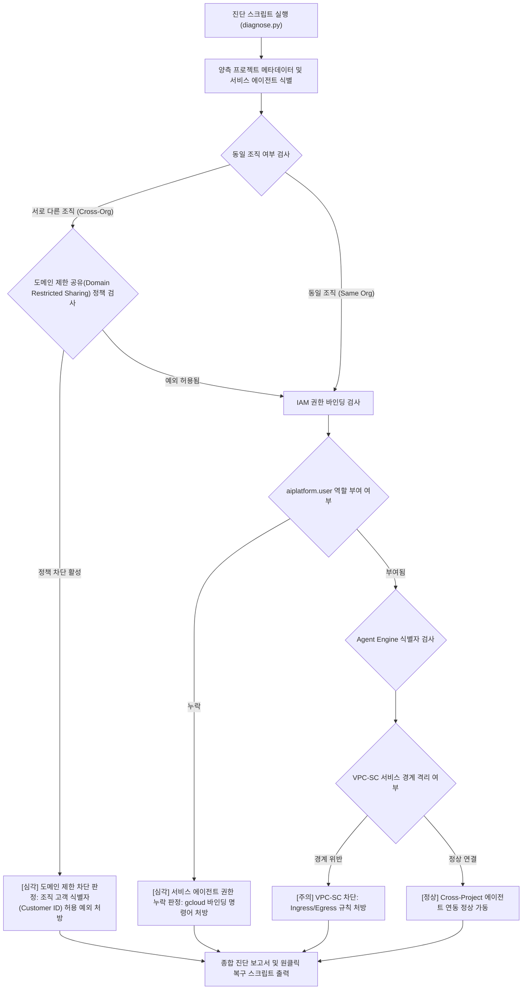

<!--
Copyright 2026 Google LLC. All Rights Reserved.
SPDX-License-Identifier: Apache-2.0

NOTICE: This code/repository is owned by Google LLC and provided under the Apache-2.0 License.
It is strictly provided as an EXAMPLE/REFERENCE ONLY and is NOT INTENDED FOR PRODUCTION USE.
All contents, designs, and code examples are subject to change, modification, or removal at any time without notice.

[고지 사항] 본 저장소 및 문서는 구글 (Google LLC) 소유이며 Apache 2.0 라이선스 하에 예시 (Sample) 용도로 제공된다.
프로덕션 환경용이 아니며, 사전 통지 없이 언제든지 수정, 변경 또는 삭제될 수 있다.
-->

> [!IMPORTANT]
> **구글 (Google LLC) 참조용 샘플 고지 사항**:
> 본 프로젝트의 모든 소스 코드와 문서는 Google LLC의 소유이며, Apache-2.0 라이선스에 따라 오직 **참조용 샘플 (Sample / Reference Only)** 목적으로만 제공된다. 프로덕션 환경에 그대로 사용할 수 없으며, 사전 통지 없이 언제든 내용이 수정, 변경 또는 삭제될 수 있다.

# 제미나이 엔터프라이즈(Gemini Enterprise) 크로스 조직 커스텀 에이전트 연동 및 조직 정책 진단기 (`gemini-enterprise-agent-resolver`)

Gemini Enterprise 웹 앱 프로젝트와 타 프로젝트 또는 타 조직의 커스텀 에이전트(Agent Engine) 연동 시 발생하는 도메인 제한 공유 조직 정책(Domain Restricted Sharing) 차단, 서비스 에이전트 IAM 권한 부재, VPC-SC 경계 위반을 1분 만에 자동 진단하고 복구 명령어를 처방하는 도구다. (As of 2026-10-17)

---

## 1. 발생 증상 및 진단 대상 체크리스트

사내 또는 고객사 환경에서 아래 증상이 발생한다면 즉시 진단 대상이다:
- [ ] 사내 엔터프라이즈 환경에서 Gemini Enterprise 웹 앱(프로젝트 A, 조직 A)과 계열사/사업부별 커스텀 에이전트(Agent Engine, 프로젝트 B, 조직 B)가 서로 다른 프로젝트에 분리되어 있어 연동 시 403 Forbidden 오류가 발생한다.
- [ ] 상대 조직의 서비스 에이전트에 권한을 부여하려 할 때, 상위 조직 정책 `constraints/iam.allowedPolicyMemberDomains`에 의해 외부 도메인 계정 바인딩이 차단된다.
- [ ] Gemini Enterprise Agent Registry에 커스텀 에이전트 등록 시 필수 서비스 에이전트(`service-[NUM]@gcp-sa-discoveryengine.iam.gserviceaccount.com`)에 `roles/aiplatform.user` 역할이 부여되지 않아 에이전트 호출이 실패한다.
- [ ] VPC Service Controls(VPC-SC) 서비스 경계가 설정된 환경에서 두 프로젝트 간 API 호출이 차단되어 에이전트 목록 검색 및 추론이 불가능하다.

---

## 2. 빠른 시작 (Quickstart)

> [!TIP]
> Cloud Shell 접속 환경 구성 및 저장소 클론(`git clone`) 방법은 루트의 [메인 README](../../README.md)를 참고한다.

### 0) 사내 환경 대화형 설정 (Config Wizard, 선택 사항)
사내 활성 프로젝트 및 환경 설정을 대화형으로 탐색하여 `.env`에 자동 저장한다:
```bash
python diagnose.py --config
```

### 1) 모의 데이터 가상 실행 (Dry-Run)
GCP API 호출 없이 내장된 가상 인프라 데이터로 정상 동작 여부를 즉시 검증한다:
```bash
python diagnose.py --dry-run
```

**터미널 진단 출력 미리보기:**
```text
Gemini Enterprise Cross-Project 에이전트 연동 진단 시작 (GE: sample-ge-project, Agent: sample-agent-project)
--> 가상 실행 모드 (--dry-run) 활성화: Cross-Org 시뮬레이션 데이터를 분석한다.
=========================================================================================================
Gemini Enterprise 앱 프로젝트: sample-ge-project <---> 커스텀 에이전트 프로젝트: sample-agent-project
=========================================================================================================
점검 항목                                상태           진단 내용
---------------------------------------------------------------------------------------------------------
Agent Engine IAM 권한 바인딩              CRITICAL     에이전트 프로젝트(sample-agent-project)에 GE 서비스 에이전트(service-104928374921@gcp-sa-discoveryengine.iam.gserviceaccount.com)의 'roles/aiplatform.user' 권한이 없음
도메인 제한 공유 조직 정책 (Domain Restricted Sharing) CRITICAL     서로 다른 조직 간 연동 환경에서 'constraints/iam.allowedPolicyMemberDomains' 정책이 활성화되어 타 조직(organizations/987654321098) 소속 계정 또는 서비스 에이전트의 IAM 바인딩이 차단됨
Agent Engine 리소스 식별자 규격              PASS         유효한 Agent Engine ID 형식 확인 완료 (8492049182740192841)
```

### 2) 실제 사내 인프라 실시간 진단
```bash
cp .env.example .env
python diagnose.py
```
> [!NOTE]
> `.env` 설정값을 비워두면 gcloud 활성 설정 및 사내 리소스를 자동으로 감지하여 진단한다.

---

## 3. 진단 및 해결 흐름



---
## 4. 조치 가이드 및 권장 설정

### 가. 사내 거버넌스 4대 필수 표준 라벨링
에이전트 인프라 및 연동 리소스 생성 시 4대 표준 라벨을 반드시 적용한다:
- `managed-by`: `google-cloud-0-to-1`
- `scenario`: `gemini-enterprise-agent-resolver`
- `env`: `sample` (또는 `poc`)
- `created-by`: `customer-engineer`

### 나. 에이전트 연동 복구 및 예외 처리 명령어

#### 1. Agent Engine 프로젝트에 GE 서비스 에이전트 권한 부여
```bash
gcloud projects add-iam-policy-binding [AGENT_PROJECT_ID] \
    --member="serviceAccount:service-[GE_PROJECT_NUM]@gcp-sa-discoveryengine.iam.gserviceaccount.com" \
    --role="roles/aiplatform.user"
```

#### 2. 도메인 제한 공유 조직 정책 예외 적용 (Cross-Org 시)
```bash
gcloud resource-manager org-policies allow constraints/iam.allowedPolicyMemberDomains [CUSTOMER_ID] \
    --project=[AGENT_PROJECT_ID]
```

### 다. 공식 문서 및 콘솔 경로
- Google Cloud Console Agent Engine ( https://console.cloud.google.com/gen-app-builder/engines )
- Google Cloud Console IAM & Admin ( https://console.cloud.google.com/iam-admin/iam )
- Google Cloud Console Organization Policies ( https://console.cloud.google.com/iam-admin/orgpolicies )
- Agent Engine 개요 ( https://cloud.google.com/vertex-ai/generative-ai/docs/agent-engine/overview )
- 도메인별 ID 제한 조직 정책 안내 ( https://cloud.google.com/resource-manager/docs/organization-policy/restricting-domains )
- Gemini Enterprise 제품 개요 ( https://docs.cloud.google.com/gemini/enterprise/docs )

---
## 5. 사전 준비 사항 (필요 IAM 권한)

본 도구를 실행하려면 최소 아래의 IAM 권한이 필요하다:

- `roles/iam.securityReviewer` (IAM 정책 조회)
- `roles/orgpolicy.policyViewer` (조직 정책 제약 조건 조회)
- `roles/aiplatform.viewer` (Agent Engine 조회)

---

## 6. 기술적 배경 및 아키텍처 원리 (Deep Dive)

### 관련 상세 설계 및 요구 사항 명세
- [비즈니스 요구 사항 명세서 (BRD)](docs/BRD.md): 비즈니스 배경, 성공 지표 및 요구 사항(BR-01~) 명세
- [기술 상세 설계서 (TDD)](docs/TDD.md): 시스템 아키텍처, 기능(FR-01~) 및 비기능(NFR-01~) 설계 명세

---

## 7. 리소스 정리 (Teardown) 안내

본 도구는 읽기 전용 진단 스크립트이므로 자체적으로 리소스를 생성하지 않는다. 테스트 목적으로 부여한 크로스 프로젝트 IAM 권한은 다음 명령어로 회수할 수 있다:
```bash
gcloud projects remove-iam-policy-binding [AGENT_PROJECT_ID] \
    --member="serviceAccount:service-[GE_PROJECT_NUM]@gcp-sa-discoveryengine.iam.gserviceaccount.com" \
    --role="roles/aiplatform.user"
```
