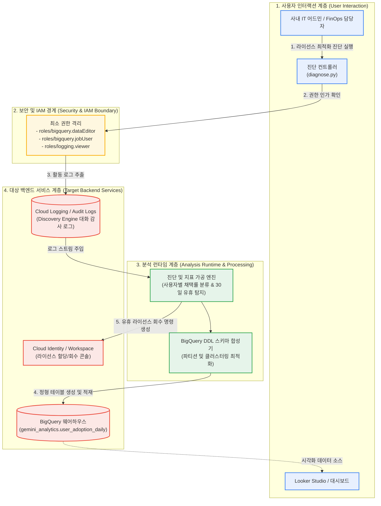

<!--
Copyright 2026 Google LLC. All Rights Reserved.
SPDX-License-Identifier: Apache-2.0

NOTICE: This code/repository is owned by Google LLC and provided under the Apache-2.0 License.
It is strictly provided as an EXAMPLE/REFERENCE ONLY and is NOT INTENDED FOR PRODUCTION USE.
All contents, designs, and code examples are subject to change, modification, or removal at any time without notice.

[고지 사항] 본 저장소 및 문서는 구글 (Google LLC) 소유이며 Apache 2.0 라이선스 하에 예시 (Sample) 용도로 제공된다.
프로덕션 환경용이 아니며, 사전 통지 없이 언제든지 수정, 변경 또는 삭제될 수 있다.
-->

> [!IMPORTANT]
> **구글 (Google LLC) 참조용 샘플 고지 사항**:
> 본 프로젝트의 모든 소스 코드와 문서는 Google LLC의 소유이며, Apache-2.0 라이선스에 따라 오직 **참조용 샘플 (Sample / Reference Only)** 목적으로만 제공된다. 프로덕션 환경에 그대로 사용할 수 없으며, 사전 통지 없이 언제든 내용이 수정, 변경 또는 삭제될 수 있다.

# 제미나이 엔터프라이즈(Gemini Enterprise) 사용자 채택률 분석 및 유휴 라이선스 회수 진단기 (`gemini-enterprise-analytics-exporter`)

전사 배포된 Gemini Enterprise 라이선스의 부서 및 사용자별 실제 활성도 지표를 추출하여 빅쿼리(BigQuery) 적재 스키마로 가공하고 미사용 유휴 라이선스 회수 대상을 1분 만에 분석하는 도구다. (As of 2026-10-17)

---

## 1. 발생 증상 및 진단 대상 체크리스트

사내 또는 고객사 환경에서 아래 증상이 발생한다면 즉시 진단 대상이다:
- [ ] 전사 또는 계열사 단위로 수천 개의 Gemini Enterprise 라이선스를 일괄 구매했으나, 실제 부서별 임직원 활용도(Active Rate)를 측정할 수 있는 통합 대시보드가 없다.
- [ ] 라이선스 할당 후 30일 이상 단 한 번도 프롬프트를 입력하지 않은 유휴 계정이 방치되어 불필요한 구독 비용이 매월 누수된다.
- [ ] 보안 및 규정 준수(Compliance) 목적으로 계정별 사용 빈도와 활동 등급(High, Moderate, Low, Dormant)을 체계적으로 분류하여 감사 리포트를 제출해야 한다.
- [ ] Cloud Identity 및 Google Workspace 관리자 콘솔에서 사용자별 지표를 일일이 수동 집계하는 데 과도한 공수가 발생하며 BigQuery 자동 파이프라인이 부재하다.


### 1.1 도구의 본질 및 비즈니스 해결 과제 (What & Why)
- **대상 사용자 (Target)**: 엔터프라이즈 IT 기획팀, C-Level 경영진, 클라우드 FinOps 리드 및 Workspace/GE 어드민
- **해결하는 핵심 문제 (Core Pain Points)**:
  1. 전사에 배포된 수백~수천 개의 Gemini Enterprise 라이선스 중 실제 누가 얼마나 자주 사용하는지 파악하지 못하는 깜깜이 운영
  2. 퇴사자나 직무 이동으로 인해 60일 이상 사용하지 않는 유휴 라이선스가 방치되어 매월 수백~수천만 원의 라이선스 비용이 낭비되는 현상
  3. 부서별/사용자별 채택률(Adoption Rate)을 정량적으로 증명하지 못해 차년도 AI 예산 확보 및 라이선스 재계약 의사 결정이 지연되는 문제
- **본 솔루션의 해결 방식 (Solution)**:
  - Cloud Logging의 감사 로그를 기반으로 사용자별 활성 일수, 세션 수, 질의 빈도를 집계하여 유휴 라이선스 회수 대상을 식별하고, 라이선스 사용 현황을 지속 추적할 수 있는 BigQuery 데이터셋 DDL 및 회수 자동화 명세를 생성한다.

### 1.2 최종 산출물 3종 세트 미리보기 (Deliverables & Visual Preview)
본 도구를 실행(`python diagnose.py`)하면 다음 3가지 구체적인 엔터프라이즈 자산이 생성된다:

| 산출물 구분 | 산출물 형태 및 명칭 | 주요 포함 내용 및 실무 활용 방안 |
| :--- | :--- | :--- |
| **① 터미널 콘솔 요약** | Visual CLI Table | 전체 라이선스 수, 활성 사용자 비율, 60일 이상 유휴 라이선스 수 및 예상 월간 회수 절감액 |
| **② 정규 진단 보고서** | 마크다운 파일 (`report.md`) | 부서별 채택률 매트릭스, 유휴 라이선스 회수 대상자 명단, BigQuery 적재 스키마 DDL 및 라이선스 재할당 가이드 |
| **③ 후속 조치 및 배포 자산** | Actionable Asset Specs | • **BigQuery 분석 데이터셋 DDL**: 감사 로그를 누적 분석하기 위한 스키마 및 뷰 정의 SQL<br/>• **유휴 라이선스 일괄 회수 CSV/명령어**: Admin 콘솔 또는 디렉터리 API를 통한 미사용 라이선스 해제 명세<br/>• **채택률 Looker Studio 대시보드 템플릿**: 경영진 보고용 실시간 부서별 활용도 시각화 쿼리 |

---

## 2. 빠른 시작 (Quickstart)

> [!TIP]
> Cloud Shell 접속 환경 구성 및 저장소 클론(`git clone`) 방법은 루트의 [메인 README](../../README.md)를 참고한다.

### 1) 모의 데이터 가상 실행 (Dry-Run)
GCP API 호출 없이 내장된 가상 인프라 데이터로 정상 동작 여부를 즉시 검증한다:
```bash
python diagnose.py --dry-run
```

**터미널 진단 출력 미리보기:**
```text
Gemini Enterprise 채택률 및 유휴 라이선스 진단 시작 (프로젝트: sample-project-id)
--> 가상 실행 모드 (--dry-run) 활성화: 사전 정의된 부서별 사용자 채택 지표를 분석한다.
=========================================================================================================
사용자 이메일                        소속 부서                  활성일(30d)     프롬프트       등급         회수 대상
---------------------------------------------------------------------------------------------------------
kim.minsoo@company.com         R&D Software           24           412        High       정상 유지
lee.jiwon@company.com          R&D Software           19           285        High       정상 유지
park.chul@company.com          R&D Software           0            0          Dormant    [회수 권고]
choi.eunji@company.com         Marketing              12           140        Moderate   정상 유지
jung.homin@company.com         Marketing              0            0          Dormant    [회수 권고]
```


### 2) 사내 환경 대화형 설정 (Config Wizard, 선택 사항)
사내 활성 프로젝트 및 환경 설정을 대화형으로 탐색하여 `.env`에 자동 저장한다:
```bash
python diagnose.py --config
```


### 3) 실제 사내 인프라 실시간 진단
```bash
python diagnose.py
```
> [!NOTE]
> 앞서 `python diagnose.py --config`로 환경 설정을 저장했거나 gcloud 활성 설정을 그대로 활용할 경우 별도의 `.env` 생성 없이 즉시 실행할 수 있다. (환경 변수를 텍스트 에디터로 직접 수동 편집하고자 할 때만 `cp -n .env.example .env` 실행 후 수정)

---

## 3. 솔루션 아키텍처 및 런타임 토폴로지

본 도구는 Gemini Enterprise 사용자 활동 로그를 추출하여 유휴 라이선스를 식별하고 BigQuery에 정형 적재하는 4계층 시스템 토폴로지를 제공한다:



---
## 4. 조치 가이드 및 권장 설정

### 1) BigQuery 적재 최적화 테이블 DDL 및 4대 필수 라벨링
사내 거버넌스 및 자원 추적성을 위해 BigQuery 데이터세트 생성 시 4대 표준 라벨(`managed-by=google-cloud-0-to-1`, `scenario=gemini-enterprise-analytics-exporter`, `env=sample`, `created-by=customer-engineer`)을 반드시 적용한다:

```bash
bq mk --dataset --location=asia-northeast3 \
    --label=managed-by:google-cloud-0-to-1 \
    --label=scenario:gemini-enterprise-analytics-exporter \
    --label=env:sample \
    --label=created-by:customer-engineer \
    [PROJECT_ID]:gemini_analytics
```

```sql
CREATE TABLE IF NOT EXISTS `gemini_analytics.user_adoption_metrics` (
  user_email STRING NOT NULL,
  department STRING,
  license_type STRING NOT NULL,
  days_active_last_30d INT64,
  total_prompts INT64,
  total_tokens INT64,
  last_active_date DATE,
  inactive_days INT64,
  activity_tier STRING,
  reclaim_candidate BOOL,
  snapshot_timestamp TIMESTAMP NOT NULL
)
PARTITION BY DATE(snapshot_timestamp)
CLUSTER BY department, activity_tier;
```

### 2) 관리 콘솔 조치 링크 및 라이선스 회수
- Google Cloud Console BigQuery ( https://console.cloud.google.com/bigquery )
- Google Workspace 관리 콘솔 라이선스 관리 ( https://admin.google.com/ac/billing/subscriptions )
- Gemini Enterprise 공식 요금 안내 ( https://cloud.google.com/gemini-enterprise/pricing )
- **회수 권고 대상 계정**:
  - 진단 결과 도출된 `[회수 권고]` 계정의 Gemini Enterprise 라이선스를 해제하고 대기 중인 신규 부서 임직원에게 재할당한다.

---
## 5. 사전 준비 사항 (필요 IAM 권한)

본 도구를 실행하려면 최소 아래의 IAM 권한이 필요하다:

- **구글 클라우드 IAM(Cloud IAM) 권한**:
  - `roles/bigquery.dataEditor` (테이블 생성 및 데이터 적재)
  - `roles/bigquery.jobUser` (쿼리 및 로드 작업 실행)
- **Google Workspace / Cloud Identity 권한**:
  - Reports API 읽기 권한 또는 라이선스 관리자 권한 (`https://www.googleapis.com/auth/admin.reports.usage.readonly`)

---

## 6. 기술적 배경 및 아키텍처 원리 (Deep Dive)

### 관련 상세 설계 및 요구 사항 명세
- [비즈니스 요구 사항 명세서 (BRD)](docs/BRD.md): 비즈니스 배경, 성공 지표 및 요구 사항(BR-01~) 명세
- [기술 상세 설계서 (TDD)](docs/TDD.md): 시스템 아키텍처, 기능(FR-01~) 및 비기능(NFR-01~) 설계 명세

---

## 7. 리소스 정리 (Teardown) 안내

본 도구는 기본적으로 읽기 전용 분석을 수행한다. 테스트 목적으로 생성한 BigQuery 데이터세트 및 테이블을 삭제하려면 다음 명령어를 실행한다:
```bash
bq rm -r -f -d [PROJECT_ID]:gemini_analytics
```
