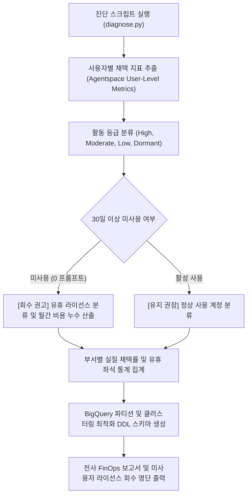

<!--
Copyright 2026 Google LLC. All Rights Reserved.
SPDX-License-Identifier: Apache-2.0

NOTICE: This code/repository is owned by Google LLC and provided under the Apache-2.0 License.
It is strictly provided as an EXAMPLE/REFERENCE ONLY and is NOT INTENDED FOR PRODUCTION USE.
All contents, designs, and code examples are subject to change, modification, or removal at any time without notice.

[고지 사항] 본 저장소 및 문서는 구글 (Google LLC) 소유이며 Apache 2.0 라이선스 하에 예시 (Sample) 용도로 제공된다.
프로덕션 환경용이 아니며, 사전 통지 없이 언제든지 수정, 변경 또는 삭제될 수 있다.
-->

> [!IMPORTANT]
> **구글 (Google LLC) 참조용 샘플 고지 사항**:
> 본 프로젝트의 모든 소스 코드와 문서는 Google LLC의 소유이며, Apache-2.0 라이선스에 따라 오직 **참조용 샘플 (Sample / Reference Only)** 목적으로만 제공된다. 프로덕션 환경에 그대로 사용할 수 없으며, 사전 통지 없이 언제든 내용이 수정, 변경 또는 삭제될 수 있다.

# 제미나이 엔터프라이즈(Gemini Enterprise) 사용자 채택률 분석 및 유휴 라이선스 회수 진단기 (`gemini-enterprise-analytics-exporter`)

전사 배포된 Gemini Enterprise 라이선스의 부서 및 사용자별 실제 활성도 지표를 추출하여 빅쿼리(BigQuery) 적재 스키마로 가공하고 미사용 유휴 라이선스 회수 대상을 1분 만에 분석하는 도구다. (As of 2026-10-17)

---

## 1. 3단계 핵심 요약 (Input -> Detect -> Fix)

| 단계 | 실행 및 동작 | 기대 산출물 및 해결 과제 |
| :--- | :--- | :--- |
| **1. 실행 (Input)** | `python diagnose.py (또는 --dry-run)` | 활성 프로젝트 및 사내 리소스 자동 감지 |
| **2. 판정 (Detect)** | 텔레메트리 실시간 분석 | 전사 Gemini Enterprise 라이선스 중 30일 이상 미사용 유휴 계정 및 부서별 채택률 분석 |
| **3. 처방 (Fix)** | 복붙용 조치 가이드 제공 | 빅쿼리 감사 테이블 적재 스키마 생성 및 미사용 라이선스 자동 회수 CLI 도출 |

---

## 2. 발생 증상 및 진단 대상 체크리스트

사내 또는 고객사 환경에서 아래 증상이 발생한다면 즉시 진단 대상이다:
- [ ] 전사 또는 계열사 단위로 수천 개의 Gemini Enterprise 라이선스를 일괄 구매했으나, 실제 부서별 임직원 활용도(Active Rate)를 측정할 수 있는 통합 대시보드가 없다.
- [ ] 라이선스 할당 후 30일 이상 단 한 번도 프롬프트를 입력하지 않은 유휴 계정이 방치되어 불필요한 구독 비용이 매월 누수된다.
- [ ] 보안 및 규정 준수(Compliance) 목적으로 계정별 사용 빈도와 활동 등급(High, Moderate, Low, Dormant)을 체계적으로 분류하여 감사 리포트를 제출해야 한다.
- [ ] Cloud Identity 및 Google Workspace 관리자 콘솔에서 사용자별 지표를 일일이 수동 집계하는 데 과도한 공수가 발생하며 BigQuery 자동 파이프라인이 부재하다.

---

## 3. 빠른 시작 (Quickstart)

### 1) 모의 데이터 가상 실행 (Dry-Run)
GCP API 호출 없이 내장된 가상 인프라 데이터로 정상 동작 여부를 즉시 검증한다:
```bash
python diagnose.py --dry-run
```

**터미널 진단 출력 미리보기:**
```text
Gemini Enterprise 채택률 및 유휴 라이선스 진단 시작 (프로젝트: sample-project-id)
--> 가상 실행 모드 (--dry-run) 활성화: 사전 정의된 부서별 사용자 채택 지표를 분석한다.
=========================================================================================================
사용자 이메일                        소속 부서                  활성일(30d)     프롬프트       등급         회수 대상
---------------------------------------------------------------------------------------------------------
kim.minsoo@company.com         R&D Software           24           412        High       정상 유지
lee.jiwon@company.com          R&D Software           19           285        High       정상 유지
park.chul@company.com          R&D Software           0            0          Dormant    [회수 권고]
choi.eunji@company.com         Marketing              12           140        Moderate   정상 유지
jung.homin@company.com         Marketing              0            0          Dormant    [회수 권고]
```

### 2) 실제 사내 인프라 실시간 진단
```bash
cp .env.example .env
python diagnose.py
```
> [!NOTE]
> `.env` 설정값을 비워두면 gcloud 활성 설정 및 사내 리소스를 자동으로 감지하여 진단한다.

---

## 4. 진단 및 해결 흐름



---
## 5. 조치 가이드 및 권장 설정

### 1) BigQuery 적재 최적화 테이블 DDL 및 4대 필수 라벨링
사내 거버넌스 및 자원 추적성을 위해 BigQuery 데이터세트 생성 시 4대 표준 라벨(`managed-by=google-cloud-0-to-1`, `scenario=gemini-enterprise-analytics-exporter`, `env=sample`, `created-by=customer-engineer`)을 반드시 적용한다:

```bash
bq mk --dataset --location=asia-northeast3 \
    --label=managed-by:google-cloud-0-to-1 \
    --label=scenario:gemini-enterprise-analytics-exporter \
    --label=env:sample \
    --label=created-by:customer-engineer \
    [PROJECT_ID]:gemini_analytics
```

```sql
CREATE TABLE IF NOT EXISTS `gemini_analytics.user_adoption_metrics` (
  user_email STRING NOT NULL,
  department STRING,
  license_type STRING NOT NULL,
  days_active_last_30d INT64,
  total_prompts INT64,
  total_tokens INT64,
  last_active_date DATE,
  inactive_days INT64,
  activity_tier STRING,
  reclaim_candidate BOOL,
  snapshot_timestamp TIMESTAMP NOT NULL
)
PARTITION BY DATE(snapshot_timestamp)
CLUSTER BY department, activity_tier;
```

### 2) 관리 콘솔 조치 링크 및 라이선스 회수
- Google Cloud Console BigQuery ( https://console.cloud.google.com/bigquery )
- Google Workspace 관리 콘솔 라이선스 관리 ( https://admin.google.com/ac/billing/subscriptions )
- Gemini Enterprise 공식 요금 안내 ( https://cloud.google.com/gemini-enterprise/pricing )
- **회수 권고 대상 계정**:
  - 진단 결과 도출된 `[회수 권고]` 계정의 Gemini Enterprise 라이선스를 해제하고 대기 중인 신규 부서 임직원에게 재할당한다.

---
## 6. 사전 준비 사항 (필요 IAM 권한)

본 도구를 실행하려면 최소 아래의 IAM 권한이 필요하다:

- **구글 클라우드 IAM(Cloud IAM) 권한**:
  - `roles/bigquery.dataEditor` (테이블 생성 및 데이터 적재)
  - `roles/bigquery.jobUser` (쿼리 및 로드 작업 실행)
- **Google Workspace / Cloud Identity 권한**:
  - Reports API 읽기 권한 또는 라이선스 관리자 권한 (`https://www.googleapis.com/auth/admin.reports.usage.readonly`)

---

## 8. 리소스 정리 (Teardown) 안내

본 도구는 기본적으로 읽기 전용 분석을 수행한다. 테스트 목적으로 생성한 BigQuery 데이터세트 및 테이블을 삭제하려면 다음 명령어를 실행한다:
```bash
bq rm -r -f -d [PROJECT_ID]:gemini_analytics
```
