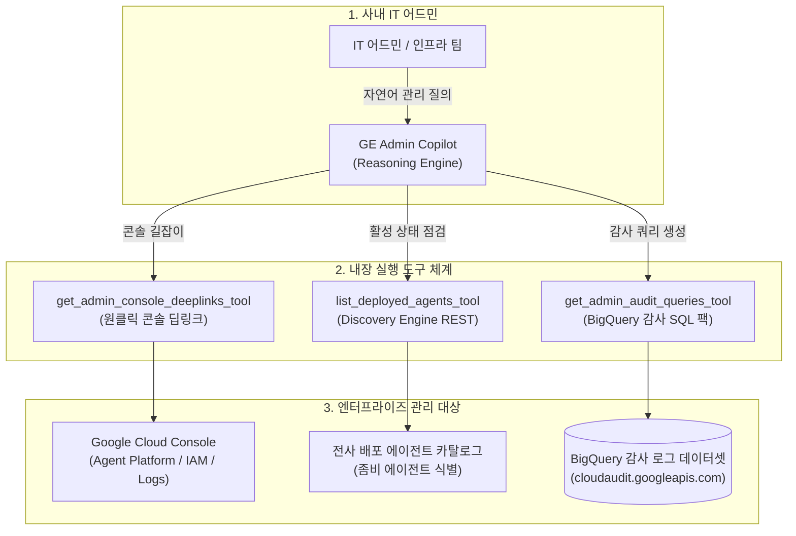

<!--
Copyright 2026 Google LLC. All Rights Reserved.
SPDX-License-Identifier: Apache-2.0

NOTICE: This code/repository is owned by Google LLC and provided under the Apache-2.0 License.
It is strictly provided as an EXAMPLE/REFERENCE ONLY and is NOT INTENDED FOR PRODUCTION USE.
All contents, designs, and code examples are subject to change, modification, or removal at any time without notice.

[고지 사항] 본 저장소 및 문서는 구글 (Google LLC) 소유이며 Apache 2.0 라이선스 하에 예시 (Sample) 용도로 제공된다.
프로덕션 환경용이 아니며, 사전 통지 없이 언제든지 수정, 변경 또는 삭제될 수 있다.
-->

> [!IMPORTANT]
> **구글 (Google LLC) 참조용 샘플 고지 사항**:
> 본 프로젝트의 모든 소스 코드와 문서는 Google LLC의 소유이며, Apache-2.0 라이선스에 따라 오직 **참조용 샘플 (Sample / Reference Only)** 목적으로만 제공된다. 프로덕션 환경에 그대로 사용할 수 없으며, 사전 통지 없이 언제든 내용이 수정, 변경 또는 삭제될 수 있다.

# Gemini Enterprise 어드민 코파일럿 (gemini-enterprise-copilot-admin)

사내 IT 어드민 및 클라우드 인프라 팀이 제미나이 엔터프라이즈 앱(Gemini Enterprise app) 운영 중 직면하는 7대 핵심 관리 과제(도메인 충돌, 외부 마켓플레이스 차단 거버넌스, 유휴 라이선스 회수, Overage 과금 방어, 사내망 FQDN 허용, 수백 개 에이전트 관리 헬 감사, 30초 BigQuery 감사 로그 싱크 및 콘솔 길잡이)를 대화형으로 신속 진단하고 자율 해결할 수 있도록 지원하는 사내 어드민 전담 코파일럿 솔루션이다. (As of 2026-10-17)

---

## 1. 발생 증상 및 진단 대상 체크리스트

사내 또는 고객사 환경에서 아래 증상이 발생한다면 즉시 진단 대상이다:
사내 엔터프라이즈 환경에서 Gemini Enterprise 도입 및 운영 중 다음과 같은 관리 이슈가 발생하고 있다면 본 솔루션 도입이 필요하다:
- [ ] **GCP 콘솔 메뉴 미아**: Workspace나 온프레미스 어드민이 GCP 콘솔의 복잡한 GE Admin 메뉴 트리를 찾지 못해 설정 변경에 어려움을 겪는 경우
- [ ] **에이전트 수백 개 난립(Agent Sprawl) 관리 헬**: 임직원들이 생성한 수백 개 에이전트 중 60일 이상 호출 0건인 좀비 에이전트나 토큰 과소비 에이전트를 파악하지 못하는 경우
- [ ] **감사 로그 BigQuery 연동 부재**: Cloud Logging에 쌓이는 데이터 액세스 로그를 BigQuery로 자동 적재하는 로그 싱크(Log Sink) 설정 방법을 모르는 경우
- [ ] **도메인 선점 오류**: 사내 도메인이 타 계정이나 기존 조직에 선점되어 테넌트 프로비저닝이 중단된 경우
- [ ] **외부 마켓플레이스 에이전트 차단 요구**: 보안 규정상 미승인 외부 에이전트 사용을 금지하고 사내 승인 에이전트만 전사 갤러리에 노출시켜야 하는 경우
- [ ] **유휴 라이선스 비용 누수**: 전사 배포된 고가 라이선스 중 30일 이상 미사용 중인 임직원 라이선스를 식별하여 회수해야 하는 경우
- [ ] **Overage 추가 과금 및 섀도우 키 우려**: 일일 풀링 쿼터 초과에 따른 과금 누수나 임직원의 AI Studio 유료 API 키 발급을 통제해야 하는 경우
- [ ] **폐쇄망 프록시 와일드카드 차단**: 사내 보안망 정책상 와일드카드 도메인 허용이 불가하여 15대 코어 FQDN의 정확한 목록이 필요한 경우

---

## 2. 빠른 시작 (Quickstart)

### 1) 모의 데이터 가상 실행 (Dry-Run)
GCP API 호출 없이 내장된 가상 인프라 데이터로 정상 동작 여부를 즉시 검증한다:
```bash
python diagnose.py --dry-run
```

**터미널 진단 출력 미리보기:**
```text
===========================================================================
  Gemini Enterprise 어드민 코파일럿 (gemini-enterprise-copilot-admin)
===========================================================================
[*] 사내 활성 Gemini Enterprise App 자동 감지: sample-ge-app-id
[*] 활성 프로젝트    : sample-project-id
[*] 배포 리전        : global
[*] 대상 GE App ID   : sample-ge-app-id
[*] 사내 대상 도메인 : example-corp.com
[*] 실행 서비스 계정 : ge-admin-sa@sample-project-id.iam.gserviceaccount.com
[*] 실행 모드        : 가상 실행 (--dry-run)

[진행] 사내 어드민 코파일럿(붕어빵 틀) 프로비저닝 파이프라인 가동...

===========================================================================
  [원클릭 배포] GE Admin Copilot 배포 파이프라인
===========================================================================
[*] 대상 프로젝트 : sample-project-id
[*] Agent Engine  : us-central1
[*] GE App ID     : sample-ge-app-id (위치: global)
[*] 필수 4대 라벨 : {'managed-by': 'google-cloud-0-to-1', 'scenario': 'gemini-enterprise-copilot-admin', 'env': 'sample', 'created-by': 'customer-engineer'}

--> [가상 실행 모드 (--dry-run)] 실제 배포 없이 프로비저닝 명세를 시뮬레이션합니다.
  [1] Agent Engine 프로비저닝 시뮬레이션: projects/sample-project-id/locations/us-central1/reasoningEngines/4756157723148550144
  [2] GE App 사내 갤러리(/r/agents) 전사 공유(ALL_USERS) 등록 명세 검증 완료

[성공] 마크다운 진단 보고서가 저장되었습니다: /path/to/samples/gemini-enterprise-copilot-admin/report.md

===========================================================================
  어드민 코파일럿 배포 및 등록 완료 (모든 점검 통과)
===========================================================================
```

### 2) 실제 사내 인프라 실시간 진단
```bash
cp .env.example .env
python diagnose.py
```
> [!NOTE]
> `.env` 설정값을 비워두면 gcloud 활성 설정 및 사내 리소스를 자동으로 감지하여 진단한다.

---

## 3. 어드민 코파일럿 아키텍처 및 관리 흐름



---

## 4. 조치 가이드 및 권장 설정

- **Gemini Enterprise 에이전트 목록 직결 콘솔**: ( https://console.cloud.google.com/gen-app-builder/engines )
- **Cloud Logging 로그 라우터 콘솔**: ( https://console.cloud.google.com/logs/router )
- **BigQuery 감사 로그 분석 콘솔**: ( https://console.cloud.google.com/bigquery )
- **Google Admin 관리 콘솔**: ( https://admin.google.com/ )
- **Google Cloud 결제(Billing) 콘솔**: ( https://console.cloud.google.com/billing )
- **Cloud DNS 및 도메인 콘솔**: ( https://console.cloud.google.com/net-services/dns/zones )

---
## 5. 사전 준비 사항 (필요 IAM 권한)

본 도구를 실행하려면 최소 아래의 IAM 권한이 필요하다:

본 도구를 실행하고 어드민 정책을 점검 및 복구하기 위해 필요한 최소 IAM 역할은 다음과 같다:

| 역할 (Role) | 권한 및 용도 |
| :--- | :--- |
| `roles/discoveryengine.admin` | Discovery Engine 마켓플레이스 및 에이전트 공유 거버넌스 설정 |
| `roles/resourcemanager.organizationAdmin` | 조직 정책(Org Policy) 및 도메인 바인딩 점검 |
| `roles/billing.admin` (또는 `viewer`) | Overage 과금 방어 및 결제 계정 사용자 RBAC 감사 |

---

## 6. 기술적 배경 및 아키텍처 원리 (Deep Dive)

### 관련 상세 설계 및 요구 사항 명세
- [비즈니스 요구 사항 명세서 (BRD)](docs/BRD.md): 비즈니스 배경, 성공 지표 및 요구 사항(BR-01~) 명세
- [기술 상세 설계서 (TDD)](docs/TDD.md): 시스템 아키텍처, 기능(FR-01~) 및 비기능(NFR-01~) 설계 명세

에이전트 인프라 및 어드민 관리 리소스(BigQuery 데이터세트, 서비스 계정, Cloud Functions 등) 생성 시 4대 표준 라벨을 반드시 적용한다:
- `managed-by`: `google-cloud-0-to-1`
- `scenario`: `gemini-enterprise-copilot-admin`
- `env`: `sample` (또는 `poc`)
- `created-by`: `customer-engineer`

---
## 7. 리소스 정리 (Teardown) 안내

본 진단 및 모의 실행 완료 후 테스트용 정책이나 임시 리소스를 정리하려면 아래 가이드를 준수한다:

```bash
# 1. 임시 DNS TXT 검증 레코드 정리 (DNS 관리 포털에서 삭제)
# 2. 테스트용 서비스 계정 정리
gcloud iam service-accounts delete "ge-admin-sa@${PROJECT_ID}.iam.gserviceaccount.com" --project="${PROJECT_ID}" --quiet
```
