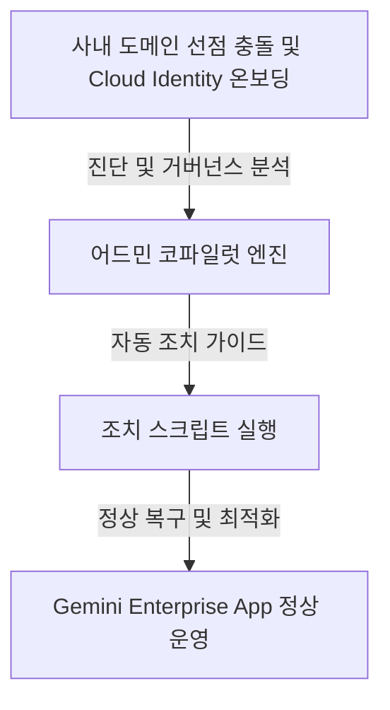

# Gemini Enterprise 어드민 코파일럿 보고서 (gemini-enterprise-copilot-admin)

- **실행 일시**: 2026-10-18 00:17:26 UTC
- **대상 프로젝트**: `sample-project-id`
- **배포 리전**: `global`
- **Gemini Enterprise App 인스턴스**: `sample-ge-app-id`
- **선택 과제**: `domain_onboarding` (사내 도메인 선점 충돌 및 Cloud Identity 온보딩)
- **카테고리**: Domain & Identity
- **진단 상태**: `PASS (Simulated)`

---

## 1. 과제 개요 및 핵심 진단 결과

- **설명**: 사내 도메인이 이미 타 계정에 선점되었을 때 Cloud Identity Free 배포 및 DNS TXT 검증
- **주요 조치 방안**: DNS TXT 레코드 소유권 확인 및 임시 테넌트 배포
- **조치 유형**: `DNS_AND_IDENTITY`



---

## 2. 거버넌스 및 정책 매니페스트 (`remediation_manifest.json`)

```json
{
  "domain": "example-corp.com",
  "verificationMethod": "DNS_TXT",
  "token": "google-site-verification=SAMPLE_TOKEN_sample",
  "status": "ACTION_REQUIRED_DNS"
}
```

---

## 3. 즉시 조치 스크립트 가이드

```bash
#!/usr/bin/env bash
# Copyright 2026 Google LLC. All Rights Reserved.
# SPDX-License-Identifier: Apache-2.0
# 도메인 충돌 해결 및 Cloud Identity Free 테넌트 온보딩 스크립트

set -euo pipefail

DOMAIN="example-corp.com"
PROJECT_ID="sample-project-id"

echo "[1/3] 사내 도메인(example-corp.com) DNS TXT 검증 레코드 생성 안내"
echo "DNS 공급자(가비아, 후이즈, Route53 등)에 아래 TXT 레코드를 추가하십시오:"
echo "호스트: @"
echo "값    : google-site-verification=SAMPLE_TOKEN_sample"

echo "[2/3] Cloud Identity Free 계정 생성 및 관리자 지정 확인"
echo "Cloud Identity 관리 콘솔: ( https://admin.google.com/ )"

echo "[3/3] Gemini Enterprise 테넌트 바인딩 확인"
echo "테넌트 활성화 상태: READY"

```

---

## 4. IAM 권한 및 어드민 진단 결과

- **실행 서비스 계정**: `ge-admin-sa@sample-project-id.iam.gserviceaccount.com`
- **필수 역할 바인딩**:
  - `roles/discoveryengine.admin`: Discovery Engine 엔터프라이즈 거버넌스 제어
  - `roles/resourcemanager.organizationAdmin`: 조직 정책(Org Policy) 및 도메인 바인딩
- **진단 상세**: 가상 실행 검증: ge-admin-sa@sample-project-id.iam.gserviceaccount.com에 roles/discoveryengine.admin, roles/resourcemanager.organizationAdmin 역할 바인딩 시뮬레이션 완료

---

## 5. 사내 거버넌스 4대 필수 표준 라벨링

에이전트 인프라 및 어드민 관리 리소스 생성 시 4대 표준 라벨을 반드시 적용한다:
- `managed-by`: `google-cloud-0-to-1`
- `scenario`: `gemini-enterprise-copilot-admin`
- `env`: `sample` (또는 `poc`)
- `created-by`: `customer-engineer`

---

## 6. 콘솔 링크 조치 가이드

- **Google Admin 관리 콘솔**: ( https://admin.google.com/ )
- **Gemini Enterprise App 관리 콘솔**: ( https://console.cloud.google.com/gen-app-builder/engines )
- **Google Cloud 결제(Billing) 콘솔**: ( https://console.cloud.google.com/billing )
- **Cloud DNS 및 도메인 콘솔**: ( https://console.cloud.google.com/net-services/dns/zones )

---

## 7. 자원 정리 안내 (Teardown)

본 진단 및 모의 실행 완료 후 테스트용 정책이나 임시 리소스를 정리하려면 아래 가이드를 준수한다:

```bash
# 1. 임시 DNS TXT 검증 레코드 정리 (DNS 관리 포털에서 삭제)
# 2. 테스트용 서비스 계정 정리
gcloud iam service-accounts delete "ge-admin-sa@sample-project-id.iam.gserviceaccount.com" --project="sample-project-id" --quiet
```
