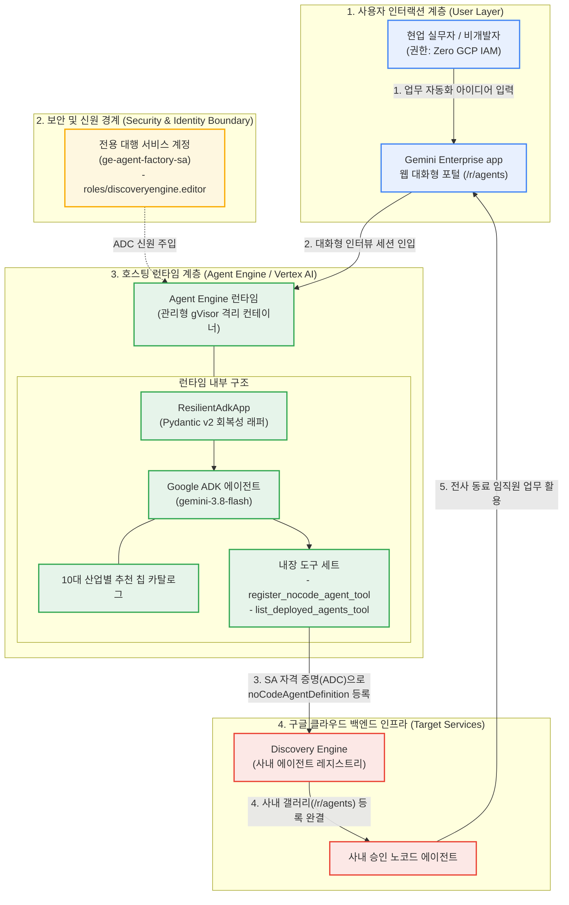

<!--
Copyright 2026 Google LLC. All Rights Reserved.
SPDX-License-Identifier: Apache-2.0

NOTICE: This code/repository is owned by Google LLC and provided under the Apache-2.0 License.
It is strictly provided as an EXAMPLE/REFERENCE ONLY and is NOT INTENDED FOR PRODUCTION USE.
All contents, designs, and code examples are subject to change, modification, or removal at any time without notice.

[고지 사항] 본 저장소 및 문서는 구글 (Google LLC) 소유이며 Apache 2.0 라이선스 하에 예시 (Sample) 용도로 제공된다.
프로덕션 환경용이 아니며, 사전 통지 없이 언제든지 수정, 변경 또는 삭제될 수 있다.
-->

> [!IMPORTANT]
> **구글 (Google LLC) 참조용 샘플 고지 사항**:
> 본 프로젝트의 모든 소스 코드와 문서는 Google LLC의 소유이며, Apache-2.0 라이선스에 따라 오직 **참조용 샘플 (Sample / Reference Only)** 목적으로만 제공된다. 프로덕션 환경에 그대로 사용할 수 없으며, 사전 통지 없이 언제든 내용이 수정, 변경 또는 삭제될 수 있다.

# Gemini Enterprise 자율형 사내 노코드 에이전트 팩토리 (gemini-enterprise-copilot-agent)

제미나이 엔터프라이즈 앱(Gemini Enterprise app) 환경에서 비개발자 임직원이 복잡한 클라우드 콘솔이나 IAM 권한 없이도, 웹 채팅창에서 14대 엔터프라이즈 카탈로그 추천 칩 선택과 실시간 검색 그라운딩을 통해 사내 승인된 노코드(No-code) 에이전트를 자율 생성하고 전용 대행 서비스 계정으로 안전하게 등록하는 자율형 사내 에이전트 팩토리 솔루션이다. (As of 2026-10-17)

---

## 1. 발생 증상 및 진단 대상 체크리스트

사내 또는 고객사 환경에서 아래 증상이 발생한다면 즉시 진단 대상이다:
사내 엔터프라이즈 생성형 AI 환경에서 다음과 같은 병목이나 고민이 발생하고 있다면 본 솔루션 도입이 필요하다:
- [ ] **중앙 IT/인프라팀의 에이전트 제작 병목**: 현업 부서(인사, 재무, 마케팅, 고객 지원)마다 맞춤형 에이전트 제작 요청이 쏟아져 담당자가 수작업으로 지침과 도구를 세팅하느라 본연의 인프라 업무가 마비된 경우
- [ ] **비개발자 임직원의 백지 증후군(Blank Canvas Syndrome)**: 일반 직원이 에이전트를 직접 만들고 싶어도 빈 프롬프트 창에서 어떤 지침(Instructions), 가드레일, 업무 절차를 적어야 할지 몰라 포기하는 경우
- [ ] **임직원 GCP IAM 권한 부여 불가**: 일반 직원에게 에이전트 생성을 위한 구글 클라우드(Google Cloud) 콘솔 접근 권한이나 프로젝트 편집자(Editor) 권한을 부여할 수 없어 자급자족이 불가능한 경우
- [ ] **섀도우 에이전트(Shadow Agent) 및 보안 유출 공포**: 직원들이 검증되지 않은 프롬프트로 에이전트를 만들어 개인 식별 정보(PII)나 사내 기밀이 외부로 새어나갈까 봐 에이전트 생성을 전면 통제하고 있는 경우

---

## 2. 빠른 시작 (Quickstart)

> [!TIP]
> Cloud Shell 접속 환경 구성 및 저장소 클론(`git clone`) 방법은 루트의 [메인 README](../../README.md)를 참고한다.

### 0) 사내 환경 대화형 설정 (Config Wizard, 선택 사항)
사내 활성 프로젝트, 리전 및 실시간 Gemini Enterprise App 목록을 감지하여 `.env`에 자동 저장한다:
```bash
python diagnose.py --config
```

### 1) 모의 데이터 가상 실행 (Dry-Run)
GCP API 호출 없이 내장된 가상 인프라 데이터로 정상 동작 여부를 즉시 검증한다:
```bash
# 기본 팩토리(붕어빵 틀) 가상 배포 시뮬레이션
python diagnose.py --dry-run

# 에이전트 칩 스펙 합성 가상 검증 (1번: 인사 총무 복리후생 매니저)
python diagnose.py --scaffold --chip 1 --dry-run

# 자유 프롬프트 기반 맞춤 에이전트 스펙 합성 가상 검증
python diagnose.py --scaffold --prompt "사내 특허 출원 가이드 에이전트" --dry-run
```

**터미널 진단 출력 미리보기:**
```text
===========================================================================
  Gemini Enterprise 노코드 에이전트 팩토리 (gemini-enterprise-copilot-agent)
===========================================================================
[*] 활성 프로젝트    : sample-project-id
[*] 대상 리전        : global
[*] 대상 GE App ID   : sample-ge-app-id
[*] 대행 서비스 계정 : ge-agent-factory-sa@sample-project-id.iam.gserviceaccount.com
[*] 실행 모드        : 가상 실행 (--dry-run)

[안내] 로컬 단일 에이전트 스펙 합성 및 인터뷰 보조 모드 가동

[단계 1/4] 대행 서비스 계정(Delegated SA) IAM 권한 진단 중...
  - 상태: PASS (Simulated) | 가상 실행 검증 완료

[단계 2/4] 메타 에이전트(@에이전트 팩토리) 매니페스트 및 도구 정의 구성 중...
  - 메타 에이전트: GE In-Chat Agent Factory (사내 노코드 에이전트 팩토리)
  - 등록 도구(Tool): create_ge_nocode_agent (대행 권한 연동)

[단계 3/4] 추천 칩 인터뷰 및 실시간 검색 그라운딩 지침 합성 중...
  - 선택된 카테고리 : 인사 및 조직 문화
  - 에이전트 타이틀 : 신규 입사자 온보딩 가이드 에이전트 (@hr-onboarding-guide)
  - 대상 사용자     : 신규 입사자, 팀 멘토, 피플팀
  - 핵심 규정 기준  : 사내 정보보호 서약 및 신규 입사자 준수 수칙
  - 5대 골든 지침 및 스타터 프롬프트 합성 완료 (No-Training & PII 보호 가드레일 강제)

[성공] 마크다운 진단 보고서가 저장되었습니다: report.md

===========================================================================
  로컬 에이전트 스펙 합성 완료
===========================================================================
```

### 2) 실제 사내 인프라 실시간 진단 및 팩토리 프로비저닝
```bash
# 팩토리 메타 에이전트 프로비저닝 및 사내 갤러리(/r/agents) 전사 등록
python diagnose.py

# 또는 외부 선언적 카탈로그를 지정하여 대화형 선택기 가동
python diagnose.py --scaffold --catalog catalog.yaml --interactive
```
> [!NOTE]
> 앞서 `python diagnose.py --config`로 환경 설정을 저장했거나 gcloud 활성 설정을 그대로 활용할 경우 별도의 `.env` 생성 없이 즉시 실행할 수 있다. (환경 변수를 텍스트 에디터로 직접 수동 편집하고자 할 때만 `cp -n .env.example .env` 실행 후 수정)

---

## 3. 솔루션 아키텍처 및 런타임 서비스 흐름



---

## 4. 조치 가이드 및 권장 설정

### 사내 갤러리 전사 활성화 및 배포 확인 가이드
- **사내 갤러리 즉시 노출**: 본 팩토리 에이전트를 통해 생성된 신규 에이전트는 엔터프라이즈 정규 규격(`adkAgentDefinition`)으로 프로비저닝되어, 별도의 수동 승인 절차 없이 **즉시 활성화(`state: ENABLED`) 및 전사 사내 갤러리(`ALL_USERS`)**에 자동 바인딩된다.
- **등록된 에이전트 목록 확인 및 관리**: 배포된 에이전트의 상태, 프롬프트, 도구 설정은 **Gemini Enterprise 에이전트 목록 콘솔 ( https://console.cloud.google.com/gemini-enterprise/locations/global/engines )**에서 확인 및 관리한다.

### 주요 콘솔 링크
- **Gemini Enterprise 웹 포털**: 사내 임직원 전용 대화형 포털 접속 및 에이전트 대화 ( https://gemini.google.com )
- **Gemini Enterprise 에이전트 목록 콘솔**: 사내 등록된 에이전트 목록 조회 및 관리 ( https://console.cloud.google.com/gemini-enterprise/locations/global/engines )
- **IAM 및 관리자 콘솔**: 대행 서비스 계정(`ge-agent-factory-sa`) 역할 및 바인딩 상태 확인 ( https://console.cloud.google.com/iam-admin/iam )

---
## 5. 사전 준비 사항 (필요 IAM 권한)

본 도구를 실행하려면 최소 아래의 IAM 권한이 필요하다:

메타 에이전트 배포 및 임직원 대행 등록을 위해 필요한 최소 권한(Least Privilege) 구성은 다음과 같다:

| 역할 (Role) | 부여 대상 | 용도 및 최소 권한 세부 사항 |
| :--- | :--- | :--- |
| `roles/discoveryengine.editor` | 대행 서비스 계정 (`ge-agent-factory-sa`) | Gemini Enterprise app 내 노코드 에이전트 생성, 수정 및 카탈로그 등록 대행 |
| `roles/viewer` | 관리자 실행 계정 | 사내 프로젝트 리소스 및 IAM 정책 조회 |
| 권한 불필요 (Zero IAM) | 일반 현업 임직원 | Gemini Enterprise app 웹 포털 로그인 계정 외에 GCP 콘솔 권한 일절 불필요 |

---

## 6. 기술적 배경 및 아키텍처 원리 (Deep Dive)

### 관련 상세 설계 및 요구 사항 명세
- [비즈니스 요구 사항 명세서 (BRD)](docs/BRD.md): 비즈니스 배경, 성공 지표 및 요구 사항(BR-01~) 명세
- [기술 상세 설계서 (TDD)](docs/TDD.md): 시스템 아키텍처, 기능(FR-01~) 및 비기능(NFR-01~) 설계 명세

에이전트 인프라 및 관리 리소스(서비스 계정, 커스텀 에이전트 등) 생성 시 4대 표준 라벨을 반드시 적용한다:
- `managed-by`: `google-cloud-0-to-1`
- `scenario`: `gemini-enterprise-copilot-agent`
- `env`: `sample` (또는 `poc`)
- `created-by`: `customer-engineer`

---
## 7. 리소스 정리 (Teardown) 안내

본 솔루션 검증 후 테스트용으로 등록된 메타 에이전트나 대행 서비스 계정을 정리하고자 할 경우 아래 절차를 수행한다:

1. **대행 서비스 계정 삭제**:
   ```bash
   gcloud iam service-accounts delete ge-agent-factory-sa@${PROJECT_ID}.iam.gserviceaccount.com --quiet
   ```
2. **Gemini Enterprise app 등록 에이전트 삭제**:
   - Gemini Enterprise 에이전트 목록 콘솔 ( https://console.cloud.google.com/gemini-enterprise/locations/global/engines )에 접속하여 대상 앱의 `Agents` 목록에서 생성된 에이전트를 선택 후 삭제한다.
