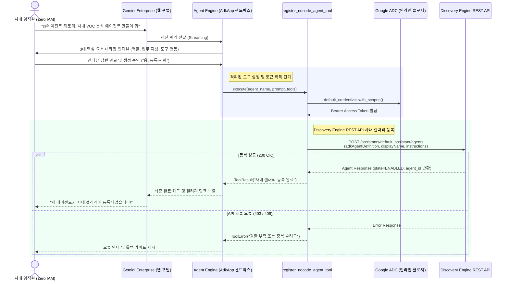

<!--
Copyright 2026 Google LLC. All Rights Reserved.
SPDX-License-Identifier: Apache-2.0

NOTICE: This code/repository is owned by Google LLC and provided under the Apache-2.0 License.
It is strictly provided as an EXAMPLE/REFERENCE ONLY and is NOT INTENDED FOR PRODUCTION USE.
All contents, designs, and code examples are subject to change, modification, or removal at any time without notice.

[고지 사항] 본 저장소 및 문서는 구글 (Google LLC) 소유이며 Apache 2.0 라이선스 하에 예시 (Sample) 용도로 제공된다.
프로덕션 환경용이 아니며, 사전 통지 없이 언제든지 수정, 변경 또는 삭제될 수 있다.
-->

# Gemini Enterprise 자율형 사내 노코드 에이전트 팩토리 기술 상세 설계서 (TDD)

본 문서는 사내 제미나이 엔터프라이즈 앱(Gemini Enterprise app) 환경에서 비개발자 임직원의 자율 에이전트 제작을 지원하는 메타 에이전트 팩토리의 시스템 아키텍처, 기술 상세 설계, 인터페이스 명세 및 검증 계획을 정의한다.

---

## 1. 시스템 아키텍처 및 런타임 상호작용 시퀀스

본 도구의 런타임 제어 및 데이터 상호작용 흐름은 아래 시퀀스 다이어그램과 같다. 클라우드 IAM 권한이 없는 사내 현업 임직원(Zero IAM)이 제미나이 엔터프라이즈 앱(Gemini Enterprise app) 대화창에서 노코드 에이전트 팩토리와 대화형 인터뷰를 진행하고 승인하면, 에이전트 엔진(Agent Engine) 런타임의 도구가 전용 대행 서비스 계정의 토큰을 획득하여 디스커버리 엔진(Discovery Engine) REST API를 통해 신규 커스텀 에이전트를 사내 갤러리에 자동 등록한다.

---

## 2. 요구 사항 추적성 매핑 (Traceability Matrix)

| 비즈니스 요구 사항 (BRD) | 기능적 기술 요구 사항 (FR) | 비기능적 기술 요구 사항 (NFR) | 구현 파일 및 모듈 |
| :--- | :--- | :--- | :--- |
| **BR-01** (메타 에이전트 배포 및 자유 프롬프팅) | **FR-01** (메타 에이전트 배포 및 자유 프롬프팅 지원) | **NFR-01** (무의존성 및 단일 파이썬 실행) | `diagnose.py` |
| **BR-02** (엔터프라이즈 에이전트 카탈로그) | **FR-02** (엔터프라이즈 에이전트 카탈로그 및 선택기) | **NFR-02** (초경량 패키징 원칙) | `catalog.yaml`, `diagnose.py` |
| **BR-03** (실시간 검색 보강) | **FR-03** (실시간 검색 기반 지침 합성) | **NFR-03** (결정론적 가상 실행 보장) | `diagnose.py` 합성 엔진 |
| **BR-04** (무권한 대행 등록) | **FR-04** (서비스 계정 대행 등록 도구) | **NFR-01**, **NFR-02** | `diagnose.py` 배포 모듈 |
| **BR-05** (설계 거버넌스 강제) | **FR-05** (엔터프라이즈 가드레일 강제 주입) | **NFR-03** (가명 마스킹 및 보안 준수) | `diagnose.py`, `report.md` |
| **BR-06** (표준 리소스 라벨링) | **FR-05** (표준 라벨링 주입 및 리포트) | **NFR-04** (4대 표준 라벨링 준수) | `diagnose.py` |
| **BR-07** (선언적 레시피 및 케밥 케이스) | **FR-06** (4단계 캐스케이드 카탈로그 로더 및 검증기) | **NFR-05** (에어갭 무중단 회복 탄력성) | `catalog.yaml`, `diagnose.py` |
| **BR-08** (에어갭 오프라인 회복 탄력성) | **FR-06** (4단계 캐스케이드 카탈로그 로더 및 검증기) | **NFR-05** (에어갭 무중단 회복 탄력성) | `diagnose.py` |
| **BR-09** (사전 슬러그/ID 전용 중복 검증) | **FR-07** (사전 슬러그/ID 전용 중복 검증 인터셉터) | **NFR-03** (결정론적 가상 실행 보장) | `diagnose.py` |

---

## 3. 기능 기술 요구 사항 명세 (Functional Requirements)

### FR-01: 메타 에이전트 배포 및 자유 프롬프팅 지원
- 관리자 실행 시 사내 GCP 프로젝트 ID, 리전(Location), 대상 Gemini Enterprise app 인스턴스 ID, 대행 서비스 계정의 IAM 권한을 계층형 캐스케이드(CLI > `.env` > `gcloud config`)로 자동 탐지한다.
- 대행 서비스 계정에 `roles/discoveryengine.editor` 권한이 정상 부여되어 있는지 사전 점검하고 이상 유무를 진단한다.
- 사용자가 카탈로그 프리셋 외에 자유 프롬프트(`--prompt` 또는 번호 `0` 선택)를 인가할 경우, 자연어 지침을 기반으로 실시간 검색 및 지침 합성을 유연하게 수행한다.
- `--publish` 플래그 인가 시 실제 Gemini Enterprise app 메타데이터 등록 API를 호출하여 `@에이전트 팩토리`를 등록한다.

### FR-02: 엔터프라이즈 에이전트 카탈로그 및 대화형 선택기
- 사내 실무(인사/조직, 복리후생, KPI 평가, 경비 전표 사전 검토, 연말정산 상담, 표준 계약서 검토, 보안/망 분리 질의, IT 헬프데스크, 시설 예약, 제안서 작성, VOC 분류, 회의록 요약, 보도자료 작성, 벤더 스크리닝, 클라우드 FinOps 등)에 특화된 엔터프라이즈 에이전트 카탈로그(`catalog.yaml`)를 제공한다.
- 터미널 실행(`sys.stdin.isatty()`) 시 대화형 번호 선택기(`[0] 자유 프롬프트 직접 입력`, `[1] ... [2] ...`)를 렌더링하여 비개발자도 엔터 입력만으로 즉시 시나리오를 선택할 수 있도록 지원한다.
- 비대화형 환경이나 스크립트 실행 시 `--chip`, `--catalog`, 또는 `--prompt` 인자로 직접 지정할 수 있도록 지원한다.
- 모든 에이전트는 Gemini Enterprise app 대화창에서 골뱅이 멘션(`@<slug>`)으로 즉시 호출할 수 있도록 핸들을 표준 매핑한다.

### FR-03: 실시간 구글 검색(Google Search Grounding) 기반 지침 합성
- 선택된 칩이나 사용자 입력 프롬프트를 시드(Seed)로 하여, 실시간 구글 검색을 통해 해당 업무 영역의 최신 규정, 업계 모범 실무 절차, 필수 확인 항목을 수집한다.
- 수집된 정보를 바탕으로 제미나이(Gemini) 모델이 아래 5대 골든 프롬프트 규격으로 시스템 지침(Instructions)을 합성한다:
  1. `Role & Identity`: 업무 페르소나 및 책임 범위
  2. `Standard Workflow`: 실시간 검색으로 보강된 단계별 표준 작업 절차
  3. `Enterprise Guardrails`: 개인 식별 정보 보호 및 사실 기반 검증 수칙
  4. `Fallback Rules`: 정보 부족 또는 권한 외 요청 시 담당 부서 안내 절차
  5. `Starter Prompts`: Gemini Enterprise app 진입 시 표시될 4가지 대표 추천 질문

### FR-04: 대행 서비스 계정(Delegated Service Account) 등록 도구 정의
- 메타 에이전트가 Gemini Enterprise app 내부에서 호출할 에이전트 등록 도구(Tool Definition)의 JSON 스키마를 생성한다.
- 도구 실행 시 일반 임직원의 계정이 아닌 전용 서비스 계정(`ge-agent-factory-sa`)의 자격 증명으로 Discovery Engine / Agent API를 호출하여 대상 에이전트를 등록한다.
- 등록된 에이전트의 공개 범위를 기본적으로 `Private`(작성자 개인 및 소속 팀 전용)으로 지정하여 무분별한 전사 노출을 차단한다.

### FR-05: 엔터프라이즈 가드레일 강제 주입 및 마크다운 리포트 자동 생성
- 생성되는 모든 에이전트의 지침서에 구글 무학습(No-Training), 인적 검토 배제, 사내 기밀 정보 보호 가드레일을 시스템 수준에서 강제 삽입한다.
- 진단 및 생성 완료 시 생성된 에이전트의 전체 명세, 지침서 본문, 권장 스타터 질문, Gemini Enterprise app 접속 딥링크를 포함하는 `report.md`를 자동으로 생성 및 덮어쓴다.

### FR-06: 4단계 캐스케이드 카탈로그 로더 및 케밥 케이스 슬러그 검증
- 외부 선언적 카탈로그 파일(`catalog.yaml`)을 파싱하여 동적으로 에이전트 목록을 적재한다.
- 4단계 캐스케이드 로딩 순서를 보장한다:
  1. CLI 인자(`--catalog <path>`)
  2. 로컬 작업 디렉터리 파일(`samples/gemini-enterprise-copilot-agent/catalog.yaml`)
  3. 사내 원격 URL(네트워크 통신 시 소켓 타임아웃 2.0초 강제)
  4. 내장 결정론적 하드코딩 폴백 시드(무인터넷 환경 대응)
- 적재된 모든 에이전트의 슬러그가 정규식 `^[a-z0-9]+(-[a-z0-9]+)*$`을 충족하는 3단계 소문자 케밥 케이스(kebab-case)인지 엄격히 검증한다.

### FR-07: 사전 슬러그/ID 전용 중복 검증 인터셉터
- 신규 에이전트 등록 요청 시 기등록된 에이전트와의 시스템 고유 슬러그(`slug`, 케밥 케이스 ID) 일치 여부를 사전에 가로채어 검증한다.
- 자연어 디스플레이 이름의 부분 매칭이나 퍼지 일치는 오탐(False Positive)을 유발하여 유사한 업무 목적의 신규 에이전트 생성을 가로막으므로 전면 배제하고, 오로지 고유 식별자인 영문 슬러그(ID)가 정확히 일치할 때만 중복으로 차단한다.
- 클라우드 대화형 런타임(GE App) 0단계 사전 검증 도구(`check_agent_duplicate_tool(slug: str)`):
  - 사용자가 특정 업무나 칩을 선택하면 1단계 인터뷰를 시작하기 전에 해당 업무의 고유 슬러그를 도출하여 Discovery Engine API로 기등록 에이전트 목록의 슬러그 태그(`[Slug: ...]`) 및 디스플레이 명칭을 스캔한다.
  - 기등록 슬러그(중복) 발견 시 1~4단계 인터뷰를 일절 진행하지 않고, 즉시 첫 턴에서 사내 갤러리(/r/agents) 링크와 함께 이미 해당 슬러그 ID로 등록되어 활성화되어 있음을 알리고 기존 에이전트 대화 또는 설정을 업데이트할 것인지 안내한다.
  - 신규 슬러그일 때만 1단계(목적 파악) 인터뷰로 진입하여 불필요한 대화 낭비를 최소화한다.

---

## 4. 비기능 기술 요구 사항 명세 (Non-Functional Requirements)

### NFR-01: 무의존성 및 순수 파이썬 단일 실행 원칙
- 외부 쉘 스크립트나 무거운 웹 프레임워크(FastAPI 등)에 의존하지 않고, 순수 파이썬 단일 파일(`python diagnose.py`)로 자립 실행이 가능해야 한다.
- 크로스 플랫폼(Linux, macOS, Windows) 호환성을 보장한다.

### NFR-02: 초경량 패키징 및 단일 디렉터리 완결성
- 1,750개에 달하는 외부 정적 데이터셋 의존을 전면 배제하고, 수 KB 수준의 내장 칩 메타데이터와 실시간 검색 결합으로 전체 프로젝트 파일 크기를 수십 KB 수준으로 초경량화한다.

### NFR-03: 결정론적 가상 실행(--dry-run) 및 사내 식별 정보 마스킹
- `--dry-run` 모드 실행 시 실제 GCP API 호출 및 인터넷 검색 없이도 내장된 결정론적 모의 엔진을 통해 메모리 상에서 신속하게 정상 동작을 스모크 테스트할 수 있어야 한다.
- 가상 실행 시 사내 프로젝트 ID나 실제 환경 정보의 유출을 방지하기 위해 가명(`sample-project-id`, `sample-ge-app-id`)을 철저히 적용한다.

### NFR-04: 사내 거버넌스 4대 필수 표준 라벨링 준수
- 사내 거버넌스, FinOps 비용 배분 및 미정리 자원 자동 추적을 위해, 생성되는 모든 에이전트 매니페스트 및 관련 클라우드 리소스에 4대 표준 라벨(`managed-by=google-cloud-0-to-1`, `scenario=gemini-enterprise-copilot-agent`, `env=sample`, `created-by=customer-engineer`)을 필수로 주입한다.
